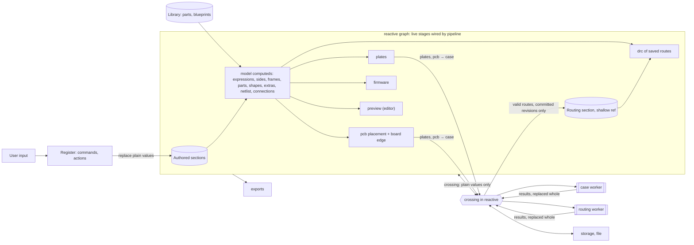
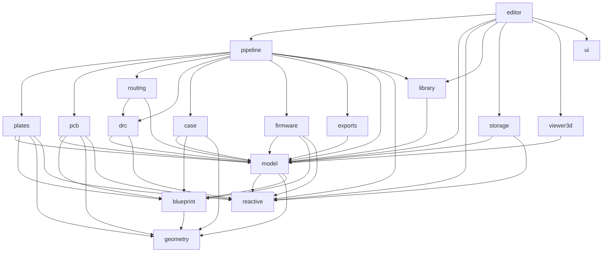
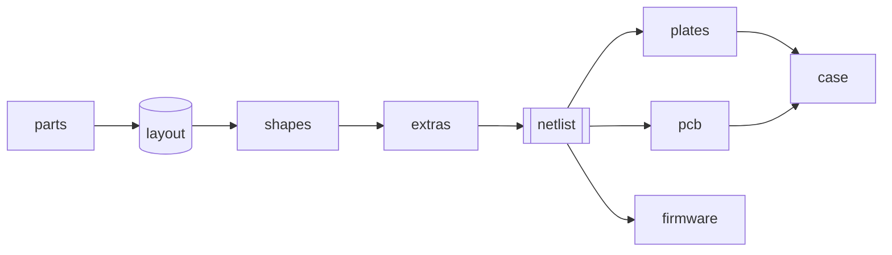
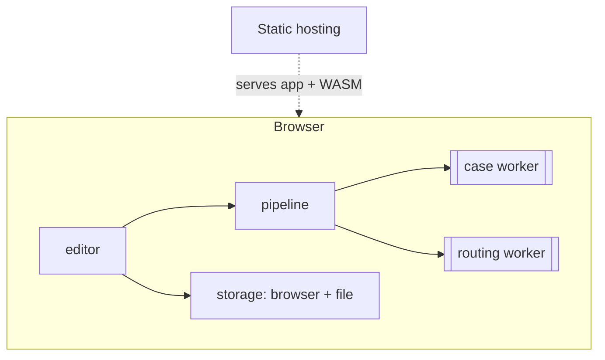

# Architecture Spine: keeb-cad, layout model and generation core

**Principles (they bind every AD):** explicit over terse · one way to do each thing · a small, coherent set of concepts.

## Glossary

Each term means exactly one thing. Code, file format and UI use these words and no synonyms.

| Term | Meaning |
| --- | --- |
| **design** | One keyboard document with exactly one electronics configuration; the only source of truth |
| **authored sections** | Every section of the design file except `routing` and `fingerprints` (AD-8); changed only by commands |
| **routing section** | One of the two saved sections of derived data: routes per board, keyed by connection. Written only by `pipeline` |
| **fingerprints section** | The other saved section of derived data: one fingerprint (input-slice hash + output hash) per build entry and per design part that applies a blueprint (AD-11). Written only by `pipeline` |
| **revision** | The content hash of the canonical serialisation of the authored sections |
| **routing hash** | The content hash of the routing section |
| **layout** | The tree of nodes that places keys and parts |
| **node** | An element of the layout: a group or a slot |
| **group** | A node with children and an arrangement; has an origin frame and no size |
| **slot** | A leaf with a frame at its centre; holds one part |
| **key** | A slot whose part has a `switch` component |
| **arrangement** | How a group places its children: `chain` or `free` |
| **frame** | A position + rotation in the plane |
| **id** | A stable identifier of a design, node, shape, vertex, construction point, entry or item in a list section; never changes, never reused |
| **reference** | A schema field of the declared reference kind that names an item by id (AD-24); never a plain string |
| **form** | `{ type: 'split'; board: 'reversible' \| 'mirrored' }` or `{ type: 'unibody' }`: the type decides whether a right side is derived; `board` (split only) is the kind of physical board (glossary `board`): one reversible PCB, or one mirrored PCB per side; it decides what the halves may differ in (AD-6) |
| **side** | One hand's set of resolved placements: `left` and `right` in split forms, `whole` in unibody |
| **side-qualified id** | `<side>/<id>`: a resolved placement of an authored element on one side (`left/thumb-far`) |
| **center** | The top-level group, required in split forms, whose frame's y-axis is the mirror axis |
| **board** | One physical PCB: one in split `reversible` and in `unibody`, one per side in split `mirrored` |
| **anchor** | What a frame is placed from: a slot (+ attach point), a group origin, a vertex, a construction point, or (lane operations only) a spot. There is no `part` anchor: placing relative to a part goes through its slot |
| **spot** | A named 3D frame a blueprint declares (`floor`, `wall-outer`, corners, `usb-side`), computed in `case`. Only that blueprint's own case lane anchors to it; elsewhere a spot travels as a placement reference in a pulled output, resolved by the consumer (AD-3, AD-18) |
| **default anchor** | The anchor used when none is set: the parent in a `free` group; the previous sibling, advanced by one step, in a `chain` |
| **attach point** | A named point on the slot's **rectangle**, the one `rectangle` output its part blueprint produces (the keycap, for a key): `center`, `edge-top/bottom/left/right`, `corner-tl/tr/bl/br` (AD-5) |
| **offset** | Local x, y, rotation (and pivot), applied in the anchor's frame; the node's only rotation |
| **pivot** | The point a rotation turns around, in the node's own frame before rotation |
| **chain** | An arrangement in which each child's default anchor is the previous sibling, advanced by one step |
| **step** | The distance from one chain child to the next, along the chain axis (AD-4) |
| **free** | An arrangement in which each child's default anchor is the parent |
| **gap** | The one uniform edge-to-edge gap between keycaps, `meta.gap` (x, y), so rows align; no group or per-child gap (AD-4) |
| **u** | A keycap-size label (`1u`, `1.5u`, …): a value of a part blueprint's `size` input, never a length (AD-5) |
| **index** | A child's position within a chain |
| **part** | What a slot holds: a library part pinned in `library-versions` (`ref('library-part')`), or a design-local part (`ref('design-part')`); both kinds use the one part schema (AD-5). `'empty'` exists only in per-side overrides (AD-6) |
| **module** | A ready-made board used as a part (nice!nano, nice!view) |
| **library** | The library's part and blueprint definitions, each with a `lib:` id and an immutable version; design-local parts share the part schema but are not in it |
| **reversible** | A flag every part carries, library or design-local; a non-reversible part on a split `reversible` board is `part-not-reversible` (AD-5, AD-6) |
| **part blueprint** | A blueprint used per slot, through the `parts` section and `slot.part`. It runs in the `parts` stage, reads only its inputs and produces a part, including exactly one `rectangle`. A slot may override only the inputs it marks per-slot (AD-5, AD-18) |
| **component** | A named footprint inside a part (`switch`, `diode`, `led`); has pins |
| **pad** | One copper pad of a pin on a board: `<side>/<slot-id>.<component>.<pin>.<copper>[.<copy>]` (Ids convention) |
| **cutout** | Geometry removed from a plate, PCB or case: an output with the role `cutout`, a target and a cutout purpose, from a part or a blueprint, or a user shape |
| **cutout purpose** | What a cutout is for (`switch`, `screw`, `mcu-window`, `display-window`, …); plates filter on it. Not a role |
| **keep-out** | A 3D volume (a shape plus a height range) that no material may enter; any stage that puts material there reports a violation. Part-owned or authored. Space a part needs cut away is a cutout, not a keep-out (AD-5) |
| **design-local part** | A part defined in the design's `parts` section, in the part schema: usually a part blueprint applied with inputs (`blueprint`), or a part blueprint the user authors in the design (`authored`, code in milestone 2); how a user makes their own key |
| **default part** | The part a slot with no part of its own uses: its nearest ancestor group's `defaultPart`, else the required `meta.defaultPart` |
| **override** | A named change to one side's placement (an `overrides` entry targeting `left/…` or `right/…`, AD-6), to the derived netlist (matrix row/column, MCU pin, LED order), or to a part parameter per target |
| **fitted** | A slot's part on one side after that side's overrides; a part removed there by `'empty'` is not fitted on that side (AD-6) |
| **parameter** | A named value with a unit; its name is its id |
| **expression** | A length or angle written with numbers, units, parameter names and `+ - * / ( )` |
| **shape** | A named **2D** geometry (AD-16): `derived` or `drawn`, possibly built on other named shapes; resolves to regions. Alterations may go on top. The one term for the outline, plates and the 2D geometry inside blueprints |
| **solid** | A named **3D** result of operations on shapes or other solids in a `case` lane; evaluated only in `case` (AD-18) |
| **derived shape** | A shape computed from the layout: the fit of a group of keys, or of parts, plus a margin; follows the layout |
| **drawn shape** | A shape built from anchored primitives and vertices (key outline, rectangle, circle, polygon, add, subtract, intersect, offset, shape reference); stays put and is checked against fit |
| **alteration** | A change the design, and only the design, puts on top of one output it pulls by role: rounded corners, cut arcs, an engraving. Downstream reads the altered result (AD-16, AD-18) |
| **fit** | A constraint region (part envelopes, margin) that a shape must contain; a key or part outside it is `fit-violated` |
| **vertex** | A polygon corner; has an id, an anchor and an offset; reusable across shapes |
| **construction point** | A helper point computed from other geometry (e.g. intersection of two lines); a possible anchor; not a part |
| **outline** | The shape designated as the board edge; pulled by the role `outline` |
| **plate** | A named definition: a shape + the cutout purposes it includes |
| **region** | A resolved shape's 2D result unit: one outer loop plus its hole loops, as exact paths (AD-16) |
| **flatten** | Turning a region's exact paths into polygons with `geometry`'s one function and `FLATTEN_TOL` (AD-16) |
| **build layer** | One physical thing a `case` lane makes: a **sheet** (a shape plus a thickness, cut flat) or a **solid** (printed or milled), with its 3D position, a process and a material (AD-18); not a keymap or copper layer |
| **build style** | Whichever build entry produces the `case-body` role; the styles (`tray`, `sandwich`, `integrated`, `plateless`) are app-owned blueprints, switchable at any time (AD-18) |
| **blueprint** | A versioned definition with declared inputs, one or more lanes, private internals and role-tagged outputs; code in a sandbox, or data; pinned in `library-versions`, live, never expanded (AD-5, AD-18). It declares no identity: what it produces is what it acts as |
| **build** | The design's one list of entries: blueprints applied once (styles, additions). Its order is presentation only (AD-18) |
| **entry** | One item of `build`: a library blueprint (by id; version pinned in `library-versions`) plus its input values |
| **lane** | The part of a blueprint that runs in one stage. Stage order: `parts → (layout) → shapes → extras → [netlist] → plates · pcb · firmware → case`. A lane reads only what is upstream of its stage and produces only its own outputs there (AD-18) |
| **role** | An open-string tag on an output (`cutout`, `mount`, `display`, `case-body`, `rectangle`, …) that consumers pull by, with an optional target (`plate`, `pcb`, `case`). A pull states how many it needs: exactly one, at least one, or any (AD-18) |
| **operation** | One step of a lane, defined in the blueprint API (`blueprint`) and implemented by the stage the lane runs in (AD-10) |
| **net** | A set of pads that must be connected; has a stable net id |
| **netlist** | Every net: matrix rows and columns, power, ground, LED chain, TRRS/UART, display bus, battery |
| **connection** | One pad pair that a net is split into; realised by a part's fixed tracks or by routing |
| **route** | The copper path for one routed connection |
| **design rules** | Net classes (width, clearance, via size), edge, hole and drill clearances, and keep-out switches (AD-20) |
| **DRC** | The design-rule check, implemented once in `drc` |
| **binding** | What one key does on one keymap layer, from the firmware-neutral vocabulary |
| **keymap layer** | One ordered entry of the keymap: an id, an editable name, and bindings keyed by side-qualified slot id. PCB layers (F.Cu, B.Cu) are always **copper layers** |
| **keymap** | Keymap layers, plus combos |
| **violation** | A reported design problem: `{ kind, severity, ids, message, fixes }` |
| **fix** | A registered entry's name plus its inputs, offered on a violation (AD-2) |
| **block** | A reusable, versioned design fragment: copied in, owned, and updated by a three-way merge (AD-9); not a blueprint. Milestone 2 |
| **command** | A named, undoable operation registered in the command register; the only way the authored sections change |
| **command register** | The one service listing every command and action: name, inputs, availability (AD-2) |
| **record** | The unit undo restores: one item with an id (a list item or tree node), or one container's ordered id list (a list section's order, a group's children) (AD-2, AD-23) |
| **committed revision** | A revision reached by a command, undo, redo, or load. Since 2026-10-30 nothing in progress reaches the design, so every revision is committed (AD-2) |
| **dependency graph** | The one graph of everything that reads something else: anchors, default anchors, shape references, construction-point inputs, parameter references, declared reads (AD-3) |
| **reactive graph** | The one graph of refs and computeds from the authored sections to the pixels (AD-10) |
| **crossing** | The one place in `reactive` through which plain values leave or enter the reactive graph (AD-11) |
| **resolved design** | `model`'s computeds over the authored sections: evaluated expressions, per-side placements, parts, shapes, netlist and connections |
| **stage** | A computation from the resolved design (and, where stated, other stage outputs) to one output. Its output depends only on its inputs, the same as a full recompute, whatever it caches or keeps incrementally inside (AD-11's cache keys rely on this). `parts`, `shapes` and `extras` are also stage names for lanes (glossary `lane`); they run inside `model`'s derivations, while `plates`, `pcb`, `firmware` and `case` are stage packages |
| **live** | A computed in the reactive graph, current at every revision |
| **background** | Computed in a Web Worker past the crossing, with progress; cancelled by a newer committed revision |
| **preview** | The editor's 2D rendering of resolved placements, shapes and stage outputs, in SVG |
| **viewport** | The one 2D view position shared by the 2D workspaces (not isolated part mode): centre (mm, y up) and zoom |
| **3D viewer** | The Case workspace's interactive rendering of bodies, in `viewer3d` |
| **body** | One named triangulated solid shown in the 3D viewer: id, kind, faces, edges. Milestone 1 has case bodies only. The 2D "key body" colour is a keycap face, not a body. The 2D board shape is the **outline**, never a body |
| **escape hatch** | Exporting a KiCad project to finish outside keeb-cad; the export no longer syncs |

## Design Paradigm

**One reactive graph, from the authored sections to the pixels.** The design (the authored sections plus the routing and fingerprints sections) is held as one plain, deep-frozen value in a `shallowRef`, replaced only by commands, `replaceDesign` and `pipeline`'s derived-section writer (AD-2). `model` derives the **resolved design** as small computeds, and the live stages and the preview are computeds over it. Slow outputs (case, routing) are background stages past **one crossing**, through which plain values leave and enter the graph. Two kinds of saved derived data depend on history, so they are kept: the routing section, re-validated against the current design rather than trusted, and the fingerprints section, which records each blueprint use's last outputs so a change in behaviour is shown, never applied silently (AD-11).



## Invariants & Rules

### AD-1: One document; authored sections plus two saved derived sections [ADOPTED]
- **Binds:** all
- **Prevents:** outputs drifting from the model; hand edits lost on regeneration; derived data quietly persisted in more places.
- **Rule:**
  - The design file holds the authored sections plus two derived sections: `routing` (AD-12) and `fingerprints` (AD-11). Nothing else derived is saved in it.
  - Every output is derived and is never edited inside keeb-cad. Changes the model can't express are made after **export** (escape hatch).
  - **Stable outputs:** the same file with the same app version gives the same outputs on every reopen. An edit changes only the outputs whose inputs it changed.

### AD-2: Authored sections change only through registered commands [ADOPTED]
- **Binds:** model, editor, every package that defines commands
- **Prevents:** ad-hoc mutation; broken undo; outputs previewed outside the design; undo floods; commands the UI or shortcuts can't see; per-command inverse code drifting from the command; fixes applied differently by each panel.
- **Rule:**
  - **Design state** lives in one ts-inject service, held in a `shallowRef`. `Design` is the whole design file's content (`DesignFile`, Data Schema): the authored sections plus the routing and fingerprints sections. **Exactly three ways write it:** registered commands; `replaceDesign` (load, file open, version switch, migration result), which reaches a committed revision and clears undo history; and `pipeline`'s derived-section writer, which changes only `routing` and `fingerprints` and adds no undo entry (AD-11, AD-12). The register rejects a command whose result changes either, with a typed `Rejection`. `replaceDesign` lives in the register concept: it takes `unknown`, migrates, parses with the design schema, deep-freezes the result with Immer's `freeze(value, true)`, then writes. A `format-too-new` file is not opened, so it never reaches `replaceDesign` (AD-8).
  - Every change to an authored section is a named command (e.g. `moveSlot`, `setGap`, `setAnchor`, `addVertex`, `setParameter`, `renameParameter`, `setBinding`, `addBuildEntry`, `setEntryInputs`), and nothing else writes to them.
  - **Command register.** It lists entries of two kinds: **commands** (undoable; write authored sections) and **actions** (not undoable; never write authored sections: Reroute, Accept output change, save, export). Menus and shortcuts see both. A command is a plain definition: name, input schema (AD-24's schema format), an availability check over the read-only design, and its apply step; actions are defined the same way. The UI reads the input schemas directly; exporting them as JSON Schema is deferred until an agent feature is planned. Its concept folder exports it; its package exports one list of its commands; the root container appends each package's list with one ts-inject `appendValue('commands', …)` per package (AD-25). Package partials never provide `commands`. The register service is built from that array and refuses duplicate names at startup; tests enforce the same and assert that every exported command is registered. Menus, undo labels and shortcuts read the register. Only registered commands run. No import-time self-registration.
  - **Writing.** A command **replaces** plain values in refs and never mutates them, through **Immer** with auto-freeze on and patches off, using one `new Immer({ autoFreeze: true })` instance, not the global default. A command's apply step receives a draft typed `Writable<Design>` and returns `void` or a `Rejection` built with `model`'s `reject(kind, ids, message)`. The register keeps a rejection outside the Immer producer (returning `undefined` to Immer) and on a rejection discards the produced value: no ref write, no undo entry. After every produced value the register runs `model`'s structural checks (acyclicity, AD-3) and rejects the same way. `run` returns `Result<void, Rejection>` and throws only on a bug. Every operation that can fail in an expected way returns a `Result<T, E>` (`replaceDesign` included); the apply step alone stays `void | Rejection`, and the register wraps it. The register's file is the only `produce` call and the only import of `immer` (with `freeze` and `castDraft`, which puts frozen records back into a draft for undo). Every design value is therefore frozen, so Vue never proxies it and a stray write throws.
  - **Inputs.** The register parses every input through the command's schema before the apply step, and the apply step sees only the parsed result: a fresh plain copy. So Immer never freezes a caller's object, and no Vue proxy enters the design.
  - **Read-only types.** `model` exports `Frozen<T>` (over Immer's `Immutable<T>`) and `Writable<T>` (over `Draft<T>`), both defined in the register's file. Outside an apply step, every design value is `Frozen<…>`: services, computeds, stages, `editor`, tests. `model` exports `Writable<T>` and `defineCommand` and `defineAction`, so any package may define commands. Writes stay confined because **only the register makes a draft** (the `immer` fence), not because the type is hidden: a draft exists only as an apply step's argument inside `run`. An entry that needs services is added through a factory that receives the container. Functions take `Frozen<…>` parameters by default (a `Frozen<T>` holding an array does not compile into a `Readonly<T>` parameter); `geometry` and `reactive`, which sit below `model`, use `readonly` arrays in their own signatures. The default is a **reviewer rule**, not a lint: code review checks that parameters are read-only. A wrong write fails at compile time; a type test proves a nested write does not compile.
  - **A drag changes the design only on drop.** While it lasts, `editor` draws the dragged nodes at their preview position, and nothing else changes: no revision, no live stage, no autosave. The drop runs **one** command (one undo entry); cancel runs nothing. Outline, plates and every other output update after the drop.
  - **Nothing in progress reaches the design.** A nudge burst moves the selection on the canvas only and runs one command when it ends (600 ms idle, any other key, any pointer action). An expression field runs its command after a typing pause (debounce) and on Enter or blur. Consecutive commands from one field in one focus session **coalesce** into one undo entry; Esc undoes that entry. There are no gestures: no begin, update or commit, and no marks.
  - **Undo.** History keeps the **before and after of each touched record** per undo entry. Touched records are found by comparing references between the before and after values (structural sharing keeps untouched records identical). Every command is one undo entry, except that a field's coalesced commands share one. Patches are derived from those records on demand. There is no per-command inverse code.
  - **Breaks.** An edit that breaks something elsewhere goes through. The break is a violation, and the violation offers its **fixes** right away, without blocking. A fix names any registered entry plus its inputs (e.g. Reroute for `unrouted`); its availability is re-checked just before it is applied. Such breaks include an alteration or other pull left with nothing to pull after a style switch (`pull-count`, AD-18) and an old input an upgrade could not map (`blueprint-input-invalid`). An upgrade that raises a nested blueprint pin (AD-5) shows the raise before it applies. A changed output fingerprint (AD-11) is shown with its difference and accepted through the **Accept output change** action.
  - A command that removes something removes everything keyed to it in the same command (deleting a slot deletes its bindings, combo memberships and overrides; deleting a vertex is rejected while a shape uses it, as is deleting a keymap layer that a binding on another keymap layer, or a combo, references), so one undo restores them all. Whether these refusals become flagged breaks is an open question.
  - A required reference can't be cleared by a cascade: deleting the `libraryVersions` entry or design part that the required `meta.defaultPart` names is refused (typed rejection) or asks for a replacement.
  - `renameParameter` rewrites every expression that uses the name, in the same command.
  - The routing and fingerprints sections are outside commands and undo (AD-11, AD-12).
  - The command log is not persisted. The design file holds state, not history.

### AD-3: Placement = one anchor + offset, over one acyclic dependency graph [ADOPTED]
- **Binds:** model, case, every stage
- **Prevents:** two placement semantics; two cycle checks; geometry that doesn't follow the layout; case operations placed by a second mechanism.
- **Rule:**
  - The tree defines ownership. Placement is independent of ownership.
  - Every node, vertex, construction point and placed lane operation has exactly **one** anchor. Unset means the default anchor. Any of them may explicitly anchor to any slot (+ attach point), group origin, vertex or construction point. There is no `part` anchor: placing relative to a part goes through its slot.
  - A **spot** is a named place a blueprint declares (`floor`, `wall-outer`, corners, `usb-side`). Spots are computed in `case`, as 3D frames, and **only that blueprint's own case-lane operations anchor to them**. An output pulled by another body carries its placement as a reference the consumer resolves (a spot name, "bottom of the body" or "outer wall", plus an offset, AD-18). An anchor input never names a spot. Layout nodes, vertices, construction points and parts never anchor to a spot, so the layout never depends on the case. Lane operations attach through this same anchor rule; there is one placement rule in the whole design.
  - **Anchors as blueprint inputs.** An `anchor` input (AD-18) is picked like every anchor here.
  - An explicit anchor **replaces** the default: placement is anchor + offset only, with no step added.
  - World frame = anchor frame → translate by offset → rotate by offset rotation about pivot. This is the single order of operations for nodes and geometry alike. A node has exactly one rotation.
  - Attach points exist on slots only; a group exposes only its origin.
  - Anchors reference by **id**, never by path.
  - The **dependency graph** is one graph and must be acyclic. `model` rejects a command that would create a cycle, with a typed rejection naming the cycle's ids, so the graph is acyclic after every command. This is structure, not a flagged break (AD-2). A loaded file with a cycle reports `anchor-cycle`; the cycle's members and their dependants are not placed. Pickers don't offer cycle-closing targets.
  - **Declared reads** (AD-11) are edges of the same graph. Inside a stage, lanes and the design's own work run in the order their reads require; a read loop is a cycle like any other: a command that would close one is rejected, and a loaded file reports it. `build`'s list order is presentation only (AD-18).

### AD-4: Exactly two arrangements; the step is a default anchor [ADOPTED]
- **Binds:** model, editor
- **Prevents:** overlapping layout mechanisms; losing per-column stagger and splay; slot widths handled differently.
- **Rule:**
  - **chain** has an axis (`x` or `y`). It always steps the positive way; the order of its children sets the direction. Child 0's default anchor is the chain's frame. Child *n*'s default anchor is child *n−1*'s **world frame** (rotation included), translated along that frame's axis by `(rect(n−1) + rect(n)) / 2 + meta.gap[axis]`, where `rect` is the extent along the axis of the slot's **rectangle** (the one `rectangle` output of its resolved part; for a key, the keycap; AD-5), in the slot's frame before its rotation. Child *n*'s offset is then applied. One key's own adjustment is its offset, which carries to later siblings.
  - Rotation carries: a child's rotation turns every later sibling's default anchor. A mid-chain turn that must not carry is expressed by giving the next sibling an explicit anchor.
  - A chain child with an explicit anchor keeps its **index**; later siblings step from wherever it ended up.
  - **free:** each child's default anchor is the parent's origin.
  - **Units:** lengths are mm (`Delta`, `Length`); `u` is not a length (AD-5). There is one gap, `meta.gap`, edge to edge between keycaps, so rows align; no gap on groups and none per chain child.
  - A slot removed on one side by an override keeps its space: that side's chain still steps by the rectangle of the slot's authored part (AD-6). A slot whose part doesn't resolve steps by its stand-in rectangle (AD-5).

### AD-5: Slots hold parts; the library and blueprints are versioned [ADOPTED]
- **Binds:** model, library, pcb, plates, case, firmware, drc
- **Prevents:** gap hard-wired to switch type; two owners of part data; cutouts defined per stage; an app update silently changing a saved design or its case.
- **Rule:**
  - The slot owns which part it holds. Per-side differences are `overrides` entries (AD-6).
  - `model` owns the **part schema**, used by library and design-local parts alike: components, pins and pin roles, 3D envelope, role-tagged outputs (cutouts with the role `cutout`, a target `plate` / `pcb` / `case` and a cutout purpose; mounts such as a trackball's cup; display models with the role `display`; the one `rectangle`), 3D keep-outs, optional fixed tracks (a pre-routed module zone), named part parameters with defaults, and one `reversible` flag. The case evaluates the solids it pulls from them. `library` owns the **library data**.
  - Library parts are immutable per version. `library-versions` pins each used library item as id + version, one version per item per design. A version is a whole number that counts up; it promises only "new and immutable". `library` keeps every released version; an update adds a version, and moving a design to it is a command.
  - **Blueprints** (AD-18), styles included, are versioned and pinned the same way: immutable per version, pinned in `library-versions` as id + version, every released version kept, and upgrading is a deliberate command.
  - **Nested blueprints** (`use`, AD-18) follow **minimal version selection**: a blueprint declares the minimum version of each blueprint it uses, and the highest minimum wins. The design's one pin per item still holds. An upgrade that raises a nested pin shows the raise before it applies (AD-2).
  - **A key is a part.** There is no separate key definition: the switch, diodes, LED and their local tracks are one part's components and fixed tracks.
  - **A key part is usually a part blueprint applied with inputs** (a design-local part `{ type: 'blueprint'; id; blueprint; inputs }`). A slot may override only the inputs the part blueprint marks **per-slot** (`slot.inputs`, e.g. `{ size: '1.5u' }`); any other is `blueprint-input-invalid`, and a different setting needs a second design part. Several part blueprints, no universal one. A position that holds a key or an encoder is one combo part blueprint: it uses both blueprints and holds both footprints and the fixed tracks between them.
  - **User-authored parts.** A user can author a part blueprint in the design (`type: 'authored'`): a footprint, drawn or converted once from a KiCad `.kicad_mod` into the part schema (the source file doesn't stay attached); pins and roles; an envelope and 3D keep-outs; role-tagged cutouts; display models; `reversible`. It uses the same schema as library part blueprints; the former hand-built `built` part folds into it. The concept is settled; the code comes in milestone 2.
  - **Two places a part is defined, one schema.** Library parts are pinned in `library-versions`; design-local parts live in the design's `parts` section, editable, with no version of their own (the design's revision covers them). This is the split blueprints use (AD-18): named library items plus the design's own. Saving to the library is one command (AD-9).
  - `meta.defaultPart` is **required**, and any group may override it with its own `defaultPart`; a slot with no part of its own uses its nearest ancestor's, else `meta.defaultPart`.
  - **Every part blueprint produces exactly one `rectangle`** (the slot pulls exactly one, AD-18), and the slot's attach points sit on it. For a key it is the keycap; for anything else the author picks it.
  - **Unresolved part:** a slot whose part reference doesn't resolve keeps its place in the chain with a **stand-in rectangle** (the default part's, or an app-defined one if that doesn't resolve either). It is drawn as a placeholder and reported (`unresolvable-reference`); later keys stay where they were. It has no components, so no pads, nets or matrix position.
  - Part parameters (e.g. screw-hole radius) can be overridden per slot or group, per target.
  - Every part, library or design-local, carries one `reversible` flag. Part-level DRC checks a design-local part's F and B copies. A non-reversible part on a split `reversible` board is `part-not-reversible` (AD-6).
  - Every stage takes cutouts, keep-outs and fixed tracks from the resolved design only.
  - **Keep-outs are 3D volumes** (a shape plus a height range). Any stage that puts material in one reports a violation (kind not yet defined, Data Schema). Space a part needs cut away (a knob opening) is a cutout, not a keep-out.
  - `overlap` on part envelopes is the one collision check (it also catches rotated, splayed and offset keys).
  - Lengths are in `mm`; angles are in `deg`. **`u` is not a length:** `1u`, `1.5u`, … are labels, values of a part blueprint's `size` input that pick the keycap (and, from 2u, the stabilizer).
  - **Milestone-1 library:** Choc v2 hotswap, SOD-123 diode, SK6812mini-e (per-key and underglow), nice!nano, SSD1306 OLED, nice!view, TRRS PJ320A, JST-PH battery connector, power switch, reset button, solder jumpers, M2 screw and standoff.

### AD-6: Form, sides and the derived right side [ADOPTED]
- **Binds:** model, every stage
- **Prevents:** split-only assumptions; stages mirroring differently; the right half having no identity.
- **Rule:**
  - The design carries `form` in `meta`: `{ type: 'split'; board: 'reversible' | 'mirrored' }` or `{ type: 'unibody' }`. The shape (split or unibody) decides whether a right side is derived; `board` (split only) decides what the halves may differ in and whether `part-not-reversible` applies. All three forms are valid in the schema from format-version 1. Milestone 1 implements split with board `reversible`; the others load and report `unsupported-form` instead of producing outputs.
  - The authored layout describes one side: `left` in split forms, `whole` in unibody. **Only `model` derives the right side**, and it emits per-side placements, with side-qualified ids, for every form. Every stage consumes them; no stage mirrors.
  - The right side is the resolved left side reflected across the y-axis of `center`'s frame. Nodes, vertices, construction points and shapes are reflected together. Attach points swap left and right.
  - **Per-side differences are `overrides` entries**, each targeting a side placement (`left/…` or `right/…`, a `SideId`) with a `part`: a part reference, or `'empty'` to remove it. `'empty'` exists only here, never on an authored `slot.part`. A slot removed on one side **keeps its space**: that side's chain still steps by the rectangle of the slot's authored part, which the other half fits, so the halves stay geometrically identical and only what's fitted differs.
  - Split, board `reversible`: one board carries every footprint of both sides (reversible footprints, solder jumpers). The halves differ only through per-side overrides, which **remove**: a whole part (`'empty'`) or **one component** of a part (`side-component`, e.g. the encoder or the switch of a combo part), so the PCB stays identical. An override never swaps a part on a reversible board (`override-not-allowed`). Geometric overrides are not allowed. A non-reversible part is `part-not-reversible`.
  - Split, board `mirrored`: one board per side. Overrides may swap or remove a part; per-side `inputs` and `offset` come with mirrored boards.
  - **Lanes and sides.** `parts`, `shapes` and `extras` lanes run once, on the authored side, and `model` derives the right side from them like everything else. `plates`, `pcb`, `firmware` and `case` lanes run **once per physical thing** they make: per half for plates, case and firmware; per board for pcb (one on a reversible board, two on a mirrored one). The lane's context says which.
  - Keymap, overrides, pads and violations use side-qualified ids.
  - There is no other asymmetry mechanism.

### AD-7: Coordinates [ADOPTED]
- **Binds:** model, every stage
- **Prevents:** flipped or mirrored outputs from mixed conventions.
- **Rule:** The model uses mm, degrees, **y up**, counter-clockwise positive, right-handed: **+z points toward the viewer of the top view** (up off the desk). Each stage converts to its target's convention at its own output boundary. The model never encodes an output's convention.

### AD-8: Design file = canonical KDL v2, versioned, sectioned, with stable ids [ADOPTED]
- **Binds:** model, library, storage, editor
- **Prevents:** noisy diffs, unreadable old files, sections stored in incompatible structures, format lock-in.
- **Rule:**
  - Designs are KDL v2 files carrying a `format-version`: a top-level node before `meta`, read (with its own schema, a whole number ≥ 1) before anything else is parsed. `model` validates them and migrates older versions forward on load. A newer version than the app knows is not opened: `format-too-new` asks the user to reload to get the newer app. A failed migration reports `migration-failed` and never overwrites the file.
  - Sections, in this order: `meta` (design id, name, form, defaultPart, gap, licence, provenance), `parameters`, `library-versions`, `parts`, `build`, `layout`, `construction`, `shapes`, `plates`, `case`, `alterations`, `overrides`, `design-rules`, `keymap`, `routing`, `fingerprints`. The schema for each lives in `model`, in one of the two storage structures (AD-23); the fields defined so far are in Data Schema.
  - `library-versions` is the design's lock on which version of each library item it uses, keyed by library id: one entry per item. A reference to a library part is `ref('library-part')`.
  - **The canonical writer lives in `model`.** It sets node and property order itself, writes lengths, angles and expressions as quoted strings (`"19mm"`, `"-15deg"`, `"wall + gap"`), and canonicalises numbers.
  - Loading and then saving an unchanged design reproduces the file byte for byte.
  - Free-text comments are not preserved.
  - **Assets** that blueprint inputs reference (SVG or image, STEP) are stored next to the design, keyed by a hash of their content, never inside the file. Sharing or exporting bundles them.
  - Every id is minted by `model` (kebab-case, unique per design, never reused), except ids starting with `lib:`, which come from the library, not from `model`.
  - The file format doesn't depend on any storage backend.

### AD-9: Remix: copy with provenance; merges in milestone 2 [ADOPTED]
- **Binds:** model, library, editor
- **Prevents:** remixes silently changing under the user; ids that can't support a later merge; a second mechanism for carrying layout changes between boards; blocks and blueprints blurred into one concept.
- **Rule:**
  - A remix source is a **block or a whole design**. A design made from another design (e.g. wireless Corney Island from wired) is a remix, not a variant.
  - **Copy design** mints a new design id and takes a new name, keeps every other id, and writes provenance into `meta`: source design id, source revision, and licence, copied from the source's `meta.licence` and unset when it had none. The copy's own `meta.licence` (the design's own licence) starts as the source's; the user may change it (a default, not enforcement). **Save to file** keeps the design id; only Copy design makes a new design.
  - Ids inside an inserted block are `<instance-id>/<block-node-id>`.
  - **Blocks are not blueprints.** A block is copied in, owned, and updated by a three-way merge; a blueprint (AD-18) is configured through its inputs and stays live. They share the library's lifecycle: versions, provenance, licence.
  - **Save to library** is one command that asks one thing: save the chosen slice as a **blueprint** (others adjust it through inputs, and it stays live) or as a **block** (others take it, change it, and pull updates by merge). The concept is settled; its code is deferred.
  - Every blueprint version carries a licence and provenance, like a design's `meta`. Anything brought in from outside (an asset, a converted footprint) keeps its source's licence.
  - **Milestone 1:** Copy design only. No library of blocks, no update pull.
  - **Milestone 2:** the design embeds an untouched base copy of the source; pulling is a three-way merge (base, new source, local) keyed by id; conflicting changes are surfaced, never auto-resolved; a pull carries layout and electronics changes alike.

### AD-10: Package dependency direction, one reactive graph, shared derivations, stage contracts [ADOPTED]
- **Binds:** all packages
- **Prevents:** stages coupling to each other; UI components or rendering libraries leaking into the core; a second entry point into reactivity; stages each evaluating geometry, expressions or nets their own way; two types for one output; blueprint operations defined twice.
- **Rule:**
  - Dependencies point only as drawn below. Stages depend only on `model`, `geometry`, `reactive` and `blueprint` (each as drawn) and never import each other. **One named exception:** `routing` imports `drc`.
  - Among workspace packages, `model` imports only `reactive`, `geometry` and `blueprint`. It receives library part and blueprint data from its caller. The build-entry command receives the blueprint from `editor`, which reads it from `library`; `model` mints the ids.
  - **One reactive graph.** The core uses Vue's reactivity API directly, with no interface of its own. `@vue/reactivity` is imported only by **`reactive`**, through one re-export file; every other package that derives, `model` and the live stages included, uses it through `reactive`. `reactive` also holds the crossing (AD-11) and the recompute trace. Only `editor` and `ui` import `vue` (components) and `@vueuse/core`. No Pinia: UI state lives in ts-inject services holding Vue refs, like design state. Worker code never imports `reactive`.
  - **Three kernel packages** sit below `model`, each holding one concept: `reactive` (the reactive graph's edges) and `geometry` (the 2D kernel, AD-16) import no workspace package; `blueprint` (the sandbox host, the blueprint API's operation and query definitions, and the data-blueprint interpreter) imports only `geometry`.
  - `blueprint`'s API is plain TypeScript over evaluated values. `model` keeps the one expression parser and passes its evaluator into the interpreter as an argument (AD-17), and owns the schema of the design's own lanes (AD-24). Only `blueprint` imports the sandbox runtime; its technology waits on the sandbox spike (Open Questions).
  - **Each stage implements its own lane's operations:** `case` its 3D operations on replicad, `pcb` zones and silkscreen, `model` placing parts (`parts`, `extras`) and shapes. The shared 2D operations come from `geometry`.
  - **`ui`** (the editor's widget layer, AD-26) imports no workspace package; only `editor` imports it. Only `ui` imports `reka-ui` and `@zag-js/hotkeys`.
  - **Shared derivations are small computeds defined in `model`, and only there:** expression evaluation, per-side placements, parts, shapes, the netlist, connections, library lookup. No stage re-derives them. There is no single `resolve` function.
  - Every derivation reads the design through **per-section selector computeds** (`computed(() => design.value.layout)`), never through `design.value` directly, so a command recomputes only what reads the sections it changed. Verification layer 7's must-not-recompute checks cover it.
  - **Every stage output type is defined in `model`** (`PlatesOutput`, `PcbPlacement`, `RouteSet`, `DrcResult`, `CaseOutput`, `FirmwareOutput`).
  - **Stage signatures:** `(resolved) → { output, violations[] }` for plates, pcb, case, firmware; a live stage's function is wrapped in a computed through `reactive` by `pipeline`, its one owner; stage packages export plain functions, never computeds. `pipeline` also holds the routing section and background results in shallow refs. `routing(resolved, placement, fixedRoutes, { connectionIds, deadline, signal })`, which returns routes for the requested ids only, and `drc(resolved, placement, routes)`. `exports(resolved, outputs)` packages what `pipeline` hands it.
  - **Named stage-to-stage flows, all via `pipeline`:** pcb placement (board edge included) → routing and drc; plates → case; pcb → case (a sandwich stacks the PCB, a plateless case holds it by its edge); every stage output → exports. No others. A live flow is one computed reading another.
  - Only `model`'s register concept imports `immer` (AD-2). `valibot` is imported by `model` and by packages that define commands; `ref`, `Id`, `Length` and `Expression` come only from `model` (AD-24).
  - Only `geometry` imports `makerjs`. Only `case` and `routing` import `clipper2-ts`. Only `routing` and `drc` import `flatbush`.
  - Only `viewer3d` imports three.js; only `editor` imports `viewer3d`. Nothing imports `editor`.
  - **Enforcement:** pnpm strict dependencies, plus dependency-cruiser rules in CI.
  - **Shared dependencies go through the pnpm catalog.** A third-party package declared by more than one workspace package is declared there once, and each package uses `catalog:`, so no two packages drift onto different copies (two ts-inject copies would break merging the package partials, AD-25).



### AD-11: Live vs background stages; revisions and cache keys [ADOPTED]
- **Binds:** model, pipeline, storage, editor, stages
- **Prevents:** a UI that blocks on slow geometry; stale outputs shown as current; cache false hits after an app update or a non-geometric edit; proxies reaching `postMessage` or files; two exits from the graph; a failed lane blanking what depends on it; an app update changing outputs silently.
- **Rule:**
  - **Live:** `model`'s derivations (the `parts`, `shapes` and `extras` lanes included), plates, pcb placement with part fixed tracks, firmware, and DRC of saved routes against the current placement, all computeds in the reactive graph. The preview is `editor` rendering of these, read directly, not a stage.
  - **The crossing.** Anything that leaves or enters the reactive graph (workers, storage, file save and load) goes through **one crossing in `reactive`**, next to the re-export, and carries plain values only. `pipeline`, `storage` and `editor` all call it.
  - **Background** (Web Workers, past the crossing): case (replicad) and routing. They report progress and partial or failed results; a newer committed revision cancels them. Background stages start at committed revisions (every revision, since nothing in progress reaches the design, AD-2); routing starts only at committed revisions (AD-12). A cancelled routing request stops like a deadline (AD-12): it returns what it placed, which is re-validated before it is kept.
  - **Cache key** = stage id + stage version + library part and blueprint versions used, nested ones included, + hash of the stage's input slice (live stages: of the resolved values they read) (+ routing hash for drc and exports; routing hash + requested connection ids for routing). A routing result cut short by a deadline or a cancel is never cached.
  - **Input slice.** Each background stage defines its own input slice in its own package: a plain type plus a selector over `model`'s computeds. `pipeline` calls the selector, sends the slice through the crossing and hashes it. **The slice hash is both the cache key's input part and the freshness tag**: a background output whose slice hash differs from the current one is shown marked stale, never as current, including on cache hits. An edit outside a stage's slice never marks it stale.
  - **Declared reads.** A lane declares what it reads: slices of the design, upstream outputs, queries. Code lists its reads; data infers them from its references. An undeclared read is an error (the lane fails). A lane's declared reads are its input slice: its cache key covers exactly them, and only they cross into the sandbox.
  - **Queries** ("the tallest part", "parts with role `mount`") are defined in `blueprint` and computed once by the stage that owns the data; every lane that declares one shares the result. The list grows with the stories that need them.
  - **Failed lanes.** A lane that throws or exceeds its step budget shows its last good output marked stale, with `lane-failed`, and pullers keep using that output until the lane runs cleanly. This holds for live lanes as for background stages.
  - **Fingerprints.** The `fingerprints` section holds one fingerprint per build entry and per design part that applies a blueprint: the hash of its declared input slice plus the hash of its outputs. A design part's slice covers its inputs plus every per-slot override that uses it, and its output hash covers all those runs. Only `pipeline` writes the section, at committed revisions, through the derived-section writer (AD-2), outside undo and outside the revision hash. A different input slice is an edit: `pipeline` writes the new pair. The same slice with different outputs is a change in behaviour (a fix in place, a raised nested pin, a kernel update): the user sees the difference and accepts it with the **Accept output change** action. Nothing changes silently.
  - Live outputs are current by construction. The routing section, routing results, the export gate and exports keep their revision and routing-hash tags (AD-12, AD-15).
  - The case solid may be cached by its cache key in memory or browser storage; it is never written to the design file.
  - `CaseOutput` carries **bodies**, each `{ id, kind, faces, edges }`, typed arrays shaped like replicad's `mesh()` and `meshEdges()` output, transferred from the case worker without copying, plus the STEP and STL bytes written in the case worker. A body is the mesh of one solid; its id is the solid's id. `model` and `case` never import three.js.
  - `pipeline` keeps the last good output of each background stage and lane, tagged with its slice hash. A background result enters the graph through the crossing as **one plain value, replaced whole in a shallow ref**; its contents (typed arrays, route sets) are never deeply reactive and never copied.

### AD-12: Routing: incremental, browser-only, saved in the routing section [ADOPTED]
- **Binds:** pcb, routing, drc, pipeline, storage
- **Prevents:** routing on the undo stack; drags destroying routes; stale routes applied blindly; two writers of the routing section.
- **Rule:**
  - Connections realised by fixed tracks (`part-tracks`, AD-14: a part's, or a blueprint's ready-made tracks such as underglow's data line) are `pcb` outputs, move live, and reach routing through pcb → routing. Routing handles only the rest.
  - Connections are per board and never join pads on two boards; a link between the halves is realised by the cable part. In split `reversible` the one board's pads are the `left/` placements' pads (with their F, B and TH copies).
  - The routing section holds, per board, routes keyed by connection id. A route is never hand-edited.
  - **A saved route is valid when** its connection still exists, both pads are at the same world positions, and `drc` passes it against the current board.
  - **Only `pipeline` writes the routing section, and only at committed revisions** (undo and redo restore the routing that was current at that revision; the next committed revision re-checks it). At each committed revision it drops invalid routes and requests routing for unrouted connections, passing valid routes as fixed obstacles. While an expression field's focus session is open (AD-2), its typing-pause commands don't trigger this: saved routes are checked for display only, and the drop and reroute run when the session ends (Enter or blur).
    - The connections whose saved routes were just dropped as invalid (e.g. those a moved part now clashes with) are routed in the same request as the moved part's connections.
  - **Fixed obstacles** cannot be crossed, moved or ripped up. Another net's fixed copper blocks at the same clearance as the engine's own copper; same-net fixed copper does not block, except that every drill keeps AD-20's drill clearances from every other drill, same net included. The engine returns copper only for the connection ids it is asked to route.
  - **Deadline:** `pipeline` sets one per request (value Deferred). The engine checks it, and the abort signal, between connections and bounds each connection's search; past it, it returns what it placed and reports the rest unrouted. It never hangs. Golden tests run with no deadline.
  - **Reroute** is an explicit user action owned by `pipeline`, registered as an action (AD-2), outside commands and undo: it drops the saved routes in a chosen scope (the whole board, or the routes around a chosen unrouted connection) and routes them again. Automatic routing never moves a valid saved route. `pipeline` does not retry the same unrouted set at the same revision and routing hash.
  - A routing result for an older committed revision is re-validated route by route against the current one before it is kept.
  - The routing section is outside commands and undo. Undo and redo may change copper while staying electrically equal.
  - Unrouted connections are `unrouted` violations, including a connection whose saved route was dropped and did not route again; the UI always shows the count.
  - Any engine sits behind this one stage interface and runs in a Web Worker in the browser. No helper program, no server, no network. The interface stays engine-neutral.
  - **Milestone-1 engine:** keeb-cad's own keyboard router in `routing`: a two-layer grid A* with rip-up and reroute of its own copper, on `clipper2-ts` and `flatbush`, in TypeScript with no Node or DOM APIs (routing verdict, 2026-10-28). tscircuit capacity-autorouter 0.0.1010 was rejected.
  - **Fallback:** whatever the engine can't route stays unrouted and is finished in KiCad after export (escape hatch). The verdict graded the engine pass with fallback, so this per-connection fallback is live in milestone 1; the whole-board SM-3 fallback is not triggered.

### AD-13: Storage behind one interface; milestone 1 is local-only [ADOPTED]
- **Binds:** editor, storage, library, pipeline
- **Prevents:** a hard dependency on any service; tabs overwriting each other; a file pairing authored state with routes from another revision; storage and the Versions list keeping different revisions; pruning a recovery point.
- **Rule:**
  - All persistence goes through the `storage` package interface: `save`, `load`, `listVersions`, `listDesigns`. The saved unit is the whole design file, written atomically: authored sections plus the routing and fingerprints sections valid for that revision.
  - `listDesigns` returns the designs in browser storage, newest first, each with design id, name, revision and last-saved time. On launch the editor reopens the first; the Start screen lists them.
  - Opening a file never overwrites browser storage: when that design id is stored at another revision, the file's revision opens as current and the stored one stays available through `listVersions`.
  - **Version retention.** `listVersions` returns every kept version of a design, newest first, each a whole design file with its reason. **Named points** are kept until the design is deleted: the revision current at each file open (`file`), each save, Save to file or Firefox download (`saved`), both sides of a version switch (`switch`), the revision before a migration (`migration`), and the source revision when the design is copied (`copy`). **Rolling:** the last 20 autosaved revisions (`autosave`). Under storage pressure only rolling versions are pruned, oldest first; autosave reports failure only when none remain.
  - Milestone 1 implements browser autosave and file Save/Open.
  - The library ships bundled with the app.
  - No network calls are needed to design or export.
  - One tab edits a design at a time; only that tab saves. Other tabs open it read-only and never write the derived sections.

### AD-14: The netlist and connections are owned by `model` [ADOPTED]
- **Binds:** model, pcb, routing, drc, firmware
- **Prevents:** a PCB wired one way and firmware scanning another; stages inventing nets; routes dropped because a key moved or was inserted.
- **Rule:**
  - `model` derives the one netlist from component pin roles and parts, and splits each net into connections. pcb, routing, drc and firmware consume them and derive none of their own.
  - Components with pins (anything in the netlist) come only from `parts` and `extras` lanes (AD-18).
  - **Declared nets.** A blueprint that places parts declares the nets between them explicitly (`led1.dout ↔ led2.din`); `model` includes them in the one netlist, like a part's fixed tracks. Nothing is inferred from roles or order. To join a net it doesn't own, a blueprint names a **pin role**, not a part or pin (`led1.din` joins the pin with role `led-data`; `vcc` and `gnd` join by role). Exactly one match is required; zero or several is `pin-role-unmatched`. A controller swap keeps the wiring.
  - **Net ids are stable:** derived from ids, never from indices or positions (e.g. column net `col:<chain-id>`, LED link `led:<slot-id>`).
  - **The split of a net into connections depends only on ids and the netlist, never on positions.** Fixed by the routing spike (`spikes/SPLIT-RULE.md`):
    - Order the net's pads (on one board, AD-12) and connect each pad to the next: n − 1 connections for n pads, none for fewer than two. No star.
    - **Order** is the netlist's authored order: a matrix net by each key's index along its chain (matrix assignment rule below), an LED net by LED chain order. Natural order of pad ids breaks ties and orders every other net.
    - Natural order compares digit runs as numbers (`d2` < `d10`) and other runs by code unit, locale-free. Digit runs equal in value but spelled differently are decided there, by code unit (`"01"` < `"1"`, so `a01b` < `a1a`).
    - **Connection id** = `<net-id>:<padA>~<padB>`, padA first in natural order. Pad ids follow the Ids convention.
    - Reversible copies are distinct pads, joined by visible connections and never assumed connected. Pins with no number or no net are obstacles, not pads. No id contains a position.
  - Each connection carries how it is realised: `part-tracks` (a part's fixed tracks, never rerouted) or `routing` (AD-12's first bullet). `model` tags it from the pin pairs that parts and blueprints declare their fixed tracks join, never from positions; `drc` checks that the placed tracks do join them. Only `routing` connections go to the engine.
  - **Matrix assignment rule:** for each key, the nearest enclosing chain running along *x* gives the column, the nearest running along *y* gives the row. Keys outside an x+y pair go into an additional row in chain order.
  - Matrix row/column, MCU pin assignment and LED chain order can be overridden; overrides are stored in the design, as further variants of the `overrides` union (Data Schema). A future optimiser must be a command that writes overrides.
  - A cross-stage invariant test asserts that the firmware matrix equals the PCB nets.

### AD-15: Exports [ADOPTED]
- **Binds:** exports, pipeline, plates, pcb, drc, case, firmware
- **Prevents:** each stage inventing its own export set; fab files from a board that fails DRC; files exported from geometry that didn't resolve.
- **Rule:** Milestone-1 exports:
  - plates: DXF, SVG, and gerber + drill (edge + holes board, same writer as the PCB)
  - case: STEP and STL
  - PCB: gerber (copper, mask, silkscreen, edge) + Excellon drill, **only when `pipeline` holds a DRC result with zero `error` violations and no unrouted connections, tagged with the same revision and routing hash as the routes being exported**; a KiCad 10 project (board file plus project and custom-rules files carrying AD-20's values, drill clearances at severity error) as the escape hatch, always available
  - firmware: a ZMK shield with the `zmk,physical-layout` node, wired split over UART and RGB underglow when the fitted parts include them, and the keymap
  - Every export except the KiCad board is **blocked while the resolved slice it reads carries a `model` violation of severity `error`**, reported as `blocked: <kind>`. Warnings never block. The KiCad board exports whatever resolved; when the board edge failed it is written with no Edge.Cuts, never a stale outline.

### AD-16: The outline is a composition of shapes, evaluated once, in `model` [ADOPTED]
- **Binds:** model, plates, pcb, case, drc, exports
- **Prevents:** the user writing construction instead of intent; an outline that doesn't follow the layout; a second outline vocabulary; outline, plates and case built by different mechanisms; plate, PCB edge, case and gerbers disagreeing on one offset or fillet; a mismatch with Ergogen's geometry; a wrong boolean or offset result passed on silently; overlapping hole loops; stages implementing booleans, offsets or flattening their own way.
- **Rule:**
  - **Shape** is the one term for 2D geometry: the outline, plates and the 2D geometry inside blueprints. 3D results are **solids** (AD-18), never shapes. Shapes, vertices and construction points are authored sections, in list structure (AD-23).
  - A shape is **derived** (the fit of a group of keys, or of parts, plus a margin; it follows the layout) or **drawn** (anchored primitives and vertices, AD-3; it stays put). Derived shapes are the main authoring path; drawn shapes are the fallback. A shape may be built on other named shapes through declared references (AD-24). **Alterations** (AD-18) may go on top. Exactly one shape is the outline.
  - **Fit** is a constraint region: part envelopes and margin. Derived shapes are computed from it; drawn shapes are checked against it. A key or part whose fit sticks out of the outline is `fit-violated`. Fit covers keys and parts placed in the layout and in `parts`, never parts placed in `extras`, which runs after `shapes` (AD-18): an `extras` part that sticks out is `fit-violated`. The default for a new design is one fitted shape per group, joined automatically.
  - Milestone-1 construction point kind: intersection of two lines. New kinds are added to the schema in `model`.
  - `model` evaluates the outline's shapes (as computeds, AD-10). No stage re-evaluates them. Each stage evaluates the 2D shapes inside its lanes with `geometry`.
  - **Downstream reads the altered result:** a reference to an output that carries an alteration reads it after the alteration (AD-18).
  - **Geometry kernel.** `geometry` holds the one implementation of boolean, offset, normalise-and-check and flatten, and the region type, as pure functions; it is the only package that imports `makerjs` and knows nothing of designs or reactivity. No other package implements its own; `model`, `plates`, `pcb` and `case` compose with it.
  - **Composition by owner.** `plates` composes every plate. `pcb` composes the board edge (the outline minus its `pcb`-target cutouts). `drc` and `exports` read the board edge from pcb placement; `case` reads plates through the plates → case flow (AD-10).
  - **Resolved shape type:** a list of **regions**, each `{ outer, holes[] }`. Every loop is a closed chain of **exact paths** (lines, arcs, circles). A circle that a boolean leaves whole stays one circle path.
    - Outer loops run counter-clockwise and holes clockwise (y up).
    - Regions are ordered by their outer loop's lowest-then-leftmost point, and every loop starts at its own lowest-then-leftmost point.
  - **Every resolved shape is normalised and checked before output**, whatever produced it (fit, primitive, polygon, boolean, offset or alteration).
    - Collinear lines are merged: lines that share an end within 1e-6 mm and run the same way within 1e-6 rad become one. The merge never drops or invents a segment.
    - Every chain must close within 1e-6 mm.
    - An offset result must also be one region per source region, with its signed area grown (positive distance) or shrunk (negative), and every flattened point within 0.05 mm of the offset distance from the source.
    - On any failure the shape is not output and `model` reports `shape-failed`, naming the shape and its operands.
  - A 2D shape `offset` is makerjs `model.outline`, run on the normalised paths of its source.
  - A failed or undefined shape is in the dependency graph (AD-3) with its dependents. Plates, the board edge and lane operations that read it produce nothing and report nothing of their own.
  - **Flatten:** `geometry` exports `flatten(region)` and the constant `FLATTEN_TOL = 0.005 mm` (maximum chord deviation). No stage passes its own tolerance.
    - Lines stay as they are.
    - Each arc becomes `max(1, ceil(|sweep| / (2·acos(1 − tol/r))))` equal chords. A full circle becomes its own loop of at least 3 chords.
    - The output keeps the region form, winding and order.
    - A stage that needs polygons flattens at its own boundary with this function.
  - **Plates:** a plate is its shape minus the part cutouts whose cutout purpose it includes, plus any user cutout shapes.
    - A cutout whose every point is more than 2 × `FLATTEN_TOL` from the plate boundary and from every other cutout becomes a hole of the region it lies in, with no boolean.
    - Every other cutout is subtracted, in cutout id order.

### AD-17: Parameters and expressions are design-wide [ADOPTED]
- **Binds:** model, editor, every authored section
- **Prevents:** per-section parameter scopes; stages evaluating expressions differently; a second expression language later.
- **Rule:**
  - The `parameters` section holds named values with units. Any length or angle property in any authored section holds a literal or an expression.
  - Grammar: numbers with units (`mm`, `deg`), parameter names, `+ - * /`, parentheses. No functions, no conditionals. One hand-written parser in `model`. This rule covers the expression grammar, not computation inside lanes: code blueprints compute in their sandbox (AD-18).
  - Units are checked; a mismatch is `unit-mismatch`. `u` is not a unit (AD-5).
  - Parameters are part of the dependency graph (AD-3).
  - **One exception:** expressions inside a data blueprint name its own inputs, not design parameters, and an input's range may name its other inputs (AD-18). The design binds those inputs with design-wide expressions.
  - Expressions are evaluated only by `model`'s evaluator: in `model`'s computeds, and in the data-blueprint interpreter, which `model` hands the evaluator (AD-10). Stages see numbers only.

### AD-18: Blueprints: live, versioned, staged, pulled by role [ADOPTED]
- **Binds:** model, blueprint, plates, pcb, firmware, case, editor, library, exports
- **Prevents:** fear of committing to a build style; a case expanded into raw operations that no longer follows the layout; case logic hard-coded in the stage; unsandboxed code running in the engine; library blueprints patching each other silently; a style switch breaking what was attached to the old style; separate concepts for keys, styles and additions; two composition mechanisms; a hidden tilt state outside the design.
- **Rule:**
  - **One concept.** Keys, build styles and case additions (wedge, underglow, magnets) are blueprints, and the design's own work uses the blueprint's schema. A blueprint has declared inputs, one or more **lanes**, private internals and **role-tagged outputs**. It is versioned and pinned in `library-versions` (AD-5), stays live, re-runs on every change and is never expanded into raw operations. It declares no identity: it produces role-tagged outputs, and what it produces is what it acts as.
  - **Two ways to use one:** per slot (a part blueprint, through the `parts` section and `slot.part`, AD-5) or once (an entry in `build`).
  - **Stages.** Lanes run in the stage order below. A lane reads only what is upstream of its stage and produces only its own outputs there.
    - `parts`: part blueprints make parts from their inputs alone, before the layout uses them.
    - `shapes`: the outline and other shapes are evaluated into regions.
    - `extras`: blueprints add parts outside slots (underglow LEDs, standoffs). The outline never fits around them (AD-16).
    - Then the netlist (AD-14), then `plates`, `pcb` and `firmware`, then `case`.
    - Routing and DRC have no lanes: routing reads ready-made tracks from `pcb`, and DRC only checks.
    - Components with pins come only from `parts` and `extras` lanes. A firmware lane produces its own config (underglow's ZMK settings), which the firmware stage pulls.
  - **Pull, never push.** A blueprint never changes a body another blueprint owns.
    - Outputs carry an open-string **role** and optionally a **target** (`plate`, `pcb`, `case`). The owner of a body pulls the roles it consumes, by role and target: the tray pulls every `cutout` targeting `case` into its bottom and every `mount` into its floor.
    - A pull states its count: **exactly one**, **at least one** or **any**. Zero or too many is `pull-count`, reported by the consumer. An output role that nothing consumes is `role-unconsumed`.
    - Export and the 3D view pull exactly one `case-body`; a slot pulls exactly one `rectangle`; the tray pulls any number of `cutout`s. Display models have the role `display`, pulled only by the 3D view.
    - **The consumer places what it pulls.** Pulled geometry carries its placement as a reference the consumer resolves ("bottom of the body", "outer wall", or a spot name, plus an offset, AD-3). A producer never reads the outputs of a body it contributes to, so no loop forms and a lane stays one function. A producer can't adapt to the consumer's numbers; the consumer reports a mismatch as a violation ("pocket deeper than the floor").
    - The `integrated` style simply produces no switch plate, so nothing ever suppresses another output.
  - **Alterations** belong to the design only. An alteration pulls exactly one output by role (rounded corners pull `switch-plate`), never a specific entry's output, so it survives a style switch; downstream stages read the altered result (AD-16). Library blueprints never alter each other. What a part needs (a power switch's hole, an OLED window) is the part's own role-tagged cutout, not an alteration.
  - **Build styles share output names** (`switch-plate`, `bottom-plate`, `case-body`) as roles. An alteration carries over a style switch when the new style produces the same role; otherwise it is a `pull-count` break with fixes (AD-2).
  - **`build`** is one list of entries, each a library blueprint applied once with its input values. The build style is whichever entry produces `case-body`; "exactly one" is checked by the consumers that pull it. The UI shows that entry first, labelled "Style": presentation, not schema. Run order isn't list order: inside a stage, lanes and the design's own work run in the order their declared reads require (AD-3, AD-11).
  - **The design's own work** (its shapes, plates, case operations and alterations) uses the same schema as library blueprints. It stays in its own sections, which are the design's own lanes, not an entry in `build`: `shapes`, `plates`, `case` (only the design's own case lane: its solids and operations) and `alterations` (every alteration the design makes, its own shapes' included; the outline is pulled as `outline`). Rounding inside the design's own shapes is an ordinary shape operation, not an alteration. Save to library cuts a slice of it (AD-9).
  - **Two forms, one interface.**
    - Blueprints written by hand (the app's own styles, library content, power users') are **code**: JS/TS run in a **sandbox** that is hermetic, deterministic and has a step budget. App-owned blueprints use the same API and the same sandbox as everyone else's.
    - The design's own work is **data**: its expressions stay at AD-17's grammar, with input metadata (label, unit, default, range that may name other inputs, options, help).
    - Both share inputs, lanes, outputs and version pinning. **No unsandboxed code** runs in any stage. Inputs are typed inside code and checked at runtime at the boundary (decision 53).
  - **Inputs.** Types: quantity (with unit), boolean, option (a declared list), text, asset (SVG or image, STEP; AD-8), part reference (pinned like any library item) and anchor (picked like every AD-3 anchor). One value per input per entry, read by every lane of the blueprint and changeable at any time. A slot overrides only inputs marked per-slot (AD-5); per-side values follow AD-6.
  - **Nesting.** Code may use another blueprint (`use(id, inputs)`), in the same lane and the same sandbox. Versions follow minimal version selection (AD-5). A removed output is a declared break with fixes.
  - **API and failures.** The blueprint API has a version, and every blueprint version records the one it was written for; an app with an older API doesn't run it (`blueprint-api-too-new`). Bugs are fixed in place, in the same operation; fingerprints make every change in behaviour visible (AD-11). A blueprint reports problems through the `blueprint` violation, with messages its author writes, naming the entry (and the slot). A failed lane follows AD-11.
  - **Upgrades.** A new blueprint version may declare how old inputs carry over (renames, defaults for new inputs, converted values). Upgrading applies that; an unmapped old input is `blueprint-input-invalid` with fixes.
  - **Build layers.** Every physical thing a `case` lane makes is a **sheet** (a shape plus a thickness, cut flat) or a **solid** (printed or milled), each with its position in 3D, a **process** and a **material**, offered as blueprint inputs with defaults. At export the process picks the file: DXF for sheets, STL or STEP for solids. Keep-outs follow AD-5.
  - Solids are evaluated only in `case`; the case worker caches per named solid. `model` owns the schema of the design's own lanes; `blueprint` owns the API; `library` owns the library blueprints.
  - **Tenting** is blueprints and parts: built-in tenting is a wedge blueprint with an angle input; accessory tenting is a stand or legs part plus a mount blueprint. There is no view-only tilt.
  - A case `offset` runs in the `case` stage on the flattened region (AD-16), with `clipper2-ts` `inflatePathsD`: `EndType.Polygon`, precision 6, arc tolerance 0.001 mm. It never calls makerjs.
  - **Corner styles:** `model` defines one corner-style enum for case offsets, and `case` maps it in one table.
    - `round` maps to `JoinType.Round`.
    - `sharp` maps to `JoinType.Miter` with a miter limit of 1000, so no corner is squared off.
    - `sharp` with a fillet radius r is the sharp offset, then opened (−r then +r, round) and closed (+r then −r, round), which rounds convex and concave corners with radius r.
  - The `tray` style blueprint builds Corney's walls (Ergogen `expand` with pointed joints and `fillet: 0.5`) as case offsets, not as 2D shape offsets.



### AD-19: Keymap is firmware-neutral [ADOPTED]
- **Binds:** model, firmware, editor
- **Prevents:** firmware-specific data in the design; QMK later needing design changes; right-half keys that can't be bound; keymap layer references breaking on reorder, duplicate or delete.
- **Rule:**
  - The `keymap` section is a list of keymap layers, each mapping side-qualified slot id → binding, plus a list of combos (set of side-qualified slot ids + layers → binding).
  - Each keymap layer has an id minted by `model` and an editable name. Keymap layer order is the list order; firmware layer numbers come from it, in the writer.
  - `layer-tap`, `momentary-layer`, `toggle-layer` and a combo's layers reference keymap layers **by id**, never by index or name. Reordering changes no binding. Duplicating mints a new keymap layer id and copies the bindings unchanged.
  - Deleting a keymap layer removes its own bindings in the same command. Deleting one that a binding on another keymap layer, or a combo, references is rejected, naming those side-qualified slots and combos (AD-2).
  - Bindings use **only** the vocabulary defined in `model`: `key`, `mod-tap`, `layer-tap`, `momentary-layer`, `toggle-layer`, `transparent`, `none`, and device actions `bluetooth`, `output-select`, `rgb`. The vocabulary grows by changing `model`. There is no raw firmware binding.
  - A device action whose hardware no fitted part provides is `binding-unsupported`, naming the slot.
  - Firmware writers translate the vocabulary. A writer is a pure addition.

### AD-20: One DRC, one set of design rules [ADOPTED]
- **Binds:** drc, routing, pipeline, pcb, exports, model
- **Prevents:** routes the router calls valid failing the export gate; checkers that disagree; keep-outs that can't be adapted per design; an engine loosening a class rule to route; co-located drills reaching fab.
- **Rule:**
  - `design-rules` is an authored section: net classes (width, clearance, via diameter and drill) assigned to nets, edge clearance, hole clearance (copper to a non-plated hole's edge), two **drill clearances**, drill edge to drill edge, same net or not: **via-to-via** (default 0.25 mm, KiCad's default) and **pad-hole** (a pad hole to any other drill, default 0.45 mm, JLCPCB's 2026-10-28 figure), and per-slot switches that disable a library keep-out (e.g. the nice!nano antenna on a wired design). Pairs inside one library footprint are checked by a `library` test, not by `drc`. The KiCad export writes these values into its project rules.
  - **Clearance policy:** engines route at the strictest net-class clearance and respect the drill clearances. `drc` checks each net class's own width and clearance and reports violations per net class. No rule is loosened to make an engine route.
  - `drc` is the only implementation of the check. Routing uses it for route validity; `pipeline` runs it as a stage for live warnings and the export gate. KiCad's DRC is a cross-check only (KiCad 10.0.7 stops some types at 199, and it did not report the spike's one case of crossing traces of different nets).
  - DRC findings are `drc` violations naming the pads, connections or shapes involved. Every clearance finding, drill clearances included, has severity `error` (blocks gerber + drill, AD-15).

### AD-21: One design, one electronics configuration [ADOPTED]
- **Binds:** model, every stage, exports, fixtures
- **Prevents:** a variant axis multiplying every stage, cache key and export.
- **Rule:**
  - A design has one netlist, one routing section and one firmware.
  - Different electronics on the same layout are separate designs related by remix (AD-9). There is no variant concept in the model, file or stages.

### AD-22: Editor views: SVG canvases, one viewport, a 3D viewer of bodies [ADOPTED]
- **Binds:** editor, viewer3d, model
- **Prevents:** workspaces choosing their own renderers; the Layout canvas and Case camera disagreeing; canvases flipping y or re-deriving geometry; Assembly needing a new viewer.
- **Rule:**
  - Every 2D canvas (Layout, Outline, PCB, Firmware, and isolated part mode in milestone 2) is inline SVG rendered by Vue templates in `editor`. Canvas items are DOM elements: focus, `aria-*`, pointer hit-testing, theme tokens as CSS custom properties (the same ones `ui`'s Tailwind `@theme` defines, AD-26), and reduced motion through CSS. Canvas marks meet 3:1 non-text contrast in both themes; handles keep the 8px canvas hit radius (DESIGN.md `spacing.canvas-hit-radius`) in screen pixels at any zoom.
  - One **viewport** (centre in model mm, y up; zoom) lives in a viewport service and is shared by the 2D workspaces. Isolated part mode has its own zoom. The model-to-screen y-flip happens once, in the viewport transform (AD-7). Text and handles are positioned through that transform but drawn in screen space, so they are never flipped or scaled.
  - Canvases draw only the resolved design and stage outputs; they compute no geometry (AD-10).
  - `viewer3d` is framework-free: it renders a list of bodies and owns the camera and its pointer and keyboard controls on its own canvas element, and honours `prefers-reduced-motion` (the Home camera move jumps). It never handles `contextmenu`; it exposes picking (screen point → body id) and a top view set from the viewport. `editor` hosts it and owns focus regions, menus and the viewport. Home/0 is the top view derived from the viewport.
  - The 3D viewer never blanks once a body exists: while `CaseOutput` is stale, the last good bodies are drawn grayed (AD-11).

### AD-23: Two storage structures: the layout is a tree, every other section is a list [ADOPTED]
- **Binds:** model, every authored section, storage
- **Prevents:** several ways to store the same kind of thing; generic machinery (references, undo, merge) special-cased per section.
- **Rule:**
  - The `layout` section is a tree (containment).
  - Every other authored section is a **list of items with ids**. `build`, `case` and `alterations` are lists too (AD-18).
  - A third storage structure needs its own decision in this spine.
  - **Records.** Each item with an id is a record, and each container's ordered id list is a record. A reorder touches only the order record; a move between groups touches two order records and the node.

### AD-24: References are a declared kind in the schema [ADOPTED]
- **Binds:** model, every authored section
- **Prevents:** a section forgetting its references; "who points at X", cascade delete, dangling checks and undo each written per section.
- **Rule:**
  - **One schema format: Valibot.** It declares both the design schema (every authored AD-8 section) and command inputs (AD-2). **Valibot schemas are the source of truth:** every type is inferred (`v.InferOutput`), never declared by hand, except the recursive layout tree's unions and `children` fields, annotated with `v.GenericSchema` (Data Schema).
  - **Shared kinds** are defined once, in `model`: `Id`, `Expression`, `ref(kind)`, `Delta`, `Length`, `Angle`, `Vec2`, `Offset`, `Gap`, `Anchor`, `Revision`, `Hash`, `AssetHash`, `Licence`, `PartId`, `BlueprintId`, `LibraryId`, `Version`, `FormatVersion`, `PartRef`, `SideId` and `Result`. A brand comes from its schema, never from a particular caller: a branded value means "checked".
  - Schemas use **no transforms**: a parsed value has the structure it was given. That means no value-changing actions (`transform`, `trim`, `toLowerCase`, …); `v.brand`, `v.metadata` and checks are allowed. A value that needs normalising is changed by the command that sets it, where it is visible and undoable. **Pass-through kinds are banned for object values:** `unknown`, `any`, `instance`, `looseObject`, and `custom` over an object return the caller's reference and break the fresh-copy parse. `v.custom` over a primitive (e.g. `` `lib:${string}` ``) is allowed only as a later step in a `v.pipe` whose first item is a primitive schema. There is no schema-kind test: layer 3's checks (caller input not frozen, no proxy in the design, over every registered command, undo, redo, `replaceDesign` and the derived-section writer) catch a pass-through wherever it sits.
  - A reference is its **own declared kind** in the schema, `ref(kind)`; never a string that happens to contain an id. Its value is the target kind's id type, with no kind and no wrapper in the value: `ref('library-part')` holds a `PartId`, `ref('library-blueprint')` a `BlueprintId`, `ref('slot')` an `Id`, and `ref('side-placement')` a `SideId`. `ref(kind)` is that id schema piped with `v.metadata({ refKind })`, read only by the generic walk (`v.getMetadata`). Code that uses a field looks the target up in its own section; there is no id index. An input value that holds a reference is a tagged object (`part`, `anchor`, `asset`), so the walk finds it from the union variant (Data Schema).
  - "Who points at X" is **one function in `model` that searches on demand** over the declared references. It walks the schema and the value together, with no per-section code, in one file. It resolves a `SideId` to its authored slot after the side prefix, so deleting the slot cascades to its overrides and an override to a missing slot is dangling. A test walks a design built from every section, so a Valibot upgrade that changes schema internals fails loudly. `Expression` is a reference-carrying kind: the walk parses it with AD-17's parser and yields `parameter` references. Cascade delete (AD-2), dangling-reference checks and the dependency graph (AD-3) use the same walk.
  - File load migrates first, then validates every authored section with the same schemas inside `replaceDesign` (AD-2).

### AD-25: Wiring and code layout [ADOPTED]
- **Binds:** all packages
- **Prevents:** hidden module state that tests can't replace; wiring done three ways; state passed around by hand; behaviour lost when data crosses to a worker or a file.
- **Rule:**
  - Services are wired with **`@snap/ts-inject`**. No module singletons (imports as the wiring), and no hand-wired factories.
  - **Pure logic is plain functions** (e.g. `placeSlot`: an anchor frame plus an evaluated offset gives a world frame). **Lookups and state** (the derived graph, history, the pipeline, the command register) **are services** wired by ts-inject. Functions with state passed around by hand are not used.
  - Data carries no methods: values are plain (AD-2), so behaviour lives in functions and services, never on the data.
  - **One partial per package.** Each package that has services exports one `PartialContainer`, `<package>Services` (e.g. `modelServices`), from its root. `main.ts` merges them in AD-10 order, then appends `commands` (AD-2). Merging partials silently keeps the last provider of a token, so **no token is provided by two package partials**: one test asserts that every partial's `getTokens()` lists, worker partials included, are pairwise disjoint and that none contains `commands`. A token is overridden only in tests (on the built root container) and in `main.ts`. A package without services exports no partial. **Each worker builds its own container** in its entry, from its package's worker partial (its cache, kernel, progress and other state are services, per the rule above); it never uses the main thread's container, and only plain data crosses (AD-11): no service, token or container.
  - Inside a package, folders are **by concept**, not by kind. Code that spans two concepts lives with the concept it produces. Stateful services stay in their concept's folder; there is no `services/` folder.
  - The packages are those drawn in AD-10; no merges. Each closes its public surface through package `exports`.

### AD-26: Editor UI layer: Reka primitives wrapped in `ui`, Tailwind on the design tokens [ADOPTED]
- **Binds:** ui, editor
- **Prevents:** hand-rolled ARIA widgets; a primitive library leaking into workspace code; two token vocabularies; shortcuts that drift from the command register; styling with ad-hoc values.
- **Rule:**
  - Every ARIA widget (menu, context menu, combobox, listbox, dialog, popover, tabs, tree, tooltip, toast, checkbox, toggle, focus trap) is a **Reka UI** primitive, never hand-built. Reka is wrapped in **`ui`**; nothing else imports it (AD-10).
  - `ui` components are **written from scratch**; shadcn-vue is reading material only (no CLI, no `cn`). `ui` holds the design tokens, thin wrappers, the hotkey layer and **generic widgets that take plain data** (a command menu takes `{ id, label, hotkey, disabledReason }[]`, not the register). Domain components (expression field, part picker, the register fed into menus and the palette) live in `editor`, by concept.
  - **Shortcuts** go through `@zag-js/hotkeys`, fed **from** the command register (AD-2): every hotkey id is a registered command; the store is never a second register. Every `kbd` hint is formatted by its formatter. zag matches letters, digits, F-keys and named keys by logical key **or** physical `KeyboardEvent.code`, so they work on non-Latin layouts; it matches symbol keys physically only with Ctrl, Alt or Meta held. So **no unmodified or Shift-only shortcut is a symbol key**. The one exception is `?`, a second, character-matched hotkey for the cheat sheet beside F1; any other symbol alias is a new decision. No shortcut is an Alt+letter chord (Firefox menu access keys). Two shortcuts never use letters that swap places between QWERTY, QWERTZ and AZERTY (Y/Z, A/Q, W/Z, M/;): zag matches a letter by typed character or physical key, so a swap pair makes one keystroke fire two shortcuts (on QWERTZ, Ctrl + the physical Z key matches both `Ctrl+Z` and `Ctrl+Y`). Alt+arrow and every Ctrl chord call `preventDefault` (Alt+Left/Right is browser Back/Forward). A test over the register enforces these with zag's `parseHotkey` and a copy of zag's symbol-key predicate, which zag does not export. **VueUse** covers low-level Vue utilities.
  - **Styling** is **Tailwind 4**. The tokens live in `ui`'s `@theme` (DESIGN.md names, Catppuccin values), so classes and the SVG canvas's `var(--…)` read one source. Spacing is Tailwind's 4px grid with DESIGN.md's named sizes as aliases. No arbitrary values (`p-[7px]`, `bg-[#…]`), checked by lint.
  - **States** (on/off, active, selected, highlighted, disabled) are styled through ARIA and data-attribute variants (`aria-pressed:`, `data-[state=active]:`, `data-[disabled]:`) on one class list. A true variant is a plain object from a prop to classes. No `cn`, no `cva`. Callers pass a `ui` component only **outer layout classes** (margin, `flex-1`, `self-*`), never what the component styles itself; this is a reviewer rule (Agents convention), not a check.
  - **Icons** are `@lucide/vue` behind one `ui` `Icon` component (size and stroke set once). Domain icons that no set has (keycap, pad, via) are hand-drawn SVGs behind the same component. State glyphs (● ▲ ✓ ▾ ⊕) stay text.
  - **Fonts**: JetBrains Mono is self-hosted (`@fontsource-variable/jetbrains-mono`, imported by `ui`'s tokens). Canvas legends must fit by its glyph widths. Chrome uses `system-ui`, with no web font.
  - **Themes** swap token values; components never use Tailwind's `dark:` variant. The OS preference (`prefers-color-scheme`) is the default. The palette commands `Theme: dark / light / system` override it, and the choice is stored in `localStorage`, never in the design. An inline script in `index.html` applies it before mount. `editor` pushes token colors into `viewer3d` on every change.
  - **Numbers** become text in one `ui` formatter:
    - `.` is always the separator, never the locale.
    - mm and deg show at most 2 decimals, without trailing zeros.
    - `≈` marks a display that rounding moved off the true value.
    - Results are always in mm.
    - Stored values keep full precision.
  - **Long lists** are not virtualized until a frame-budget check fails (Verification layer 7). The switch is Reka's virtualizers, inside `ui`'s list widgets.
  - **Workbench**: a separate Vite entry inside `packages/ui` (`workbench/`). It renders every component in every state in both themes. Nothing in the app imports it (dependency-cruiser). The browser-mode component tests mount the same state files. No Storybook.
  - The known Reka glue lives in `ui`, each with a test: Home/End taken by `ListboxFilter`; keyboard-opened context menus anchored at an element (synthetic `contextmenu`); first-item focus after a pointer open; Tab accepts the active option; `aria-disabled` and no `select` on disabled listbox items; the handler order Enter-to-accept relies on. Evidence: `ui-layer-decisions-2026-10-30.md`.

## Data Schema

The design file's fields defined so far: what layout needs (the `meta`, `library-versions`, `parts`, `layout` and `overrides` sections, and the library part fields layout reads), plus blueprint inputs and the `build` and `fingerprints` sections. **Valibot schemas are the source of truth** (AD-24): every type is inferred with `v.InferOutput`, never declared by hand, and the TypeScript below is notation for the inferred types. The one exception is the recursive layout tree, because TypeScript can't infer a type through the `children` cycle: the `Node` and `Group` unions and the `children` fields are hand-written as `InferOutput<typeof …Fields> & { children: … }`, and the recursive schemas are annotated with `v.GenericSchema<…>`, the only check. Every other field, `Slot` included, is inferred. The decision records are `_bmad-output/architecture-keeb-cad-layout-model/data-schema-draft-2026-10-31.md` (approved 2026-10-31) and `blueprints-directions-2026-11-01.md` (approved 2026-11-01).

**A story can't add or change a section's fields until this section defines them.**

```ts
// ── shared kinds (defined once in model) ────────────────────
// A quantity is a literal with a unit (`mm`, `deg`) or an expression (AD-17). `u` is not a length (decision 48).
type Delta  = Quantity<'mm'>                  // signed displacement, no check
type Length = Quantity<'mm'>                  // extent; `negative-length` when it evaluates < 0
type Angle  = Quantity<'deg'>
type Vec2   = { x: Delta; y: Delta }
type Offset = { position?: Vec2; rotation?: Angle; pivot?: Vec2 }
type Gap    = { x: Length; y: Length }        // edge to edge between keycaps (decision 49)
// A branded value exists only after its schema checked it; each schema is defined once, here (AD-24).
type Revision = Brand<string, 'Revision'>       // content hash (glossary); the hashing code parses its result with this schema
type Hash = Brand<string, 'Hash'>               // content hash of a canonical value (an input slice, outputs); parsed like Revision
type AssetHash = Brand<string, 'AssetHash'>     // content hash of an asset's bytes; the asset is stored next to the design (AD-8)
type Licence = Brand<string, 'SpdxExpression'>  // SPDX expression, e.g. 'MIT OR Apache-2.0'
type PartId      = Brand<`lib:part/${string}`, 'PartId'>             // 'lib:part/choc-v2-hotswap'; v.custom over a string (decision 32)
type BlueprintId = Brand<`lib:blueprint/${string}`, 'BlueprintId'>   // 'lib:blueprint/choc-key'
type LibraryId = PartId | BlueprintId                                // one id brand per kind of library item (decision 41)
type Version = Brand<number, 'Version'>          // whole number ≥ 1, counts up, each version immutable
type Result<T, E> = { ok: true; value: T } | { ok: false; error: E }   // every expected-failure boundary; plain union, no library

type Anchor =
  | { type: 'slot'; ref: Ref<'slot'>; attach?: AttachPoint }
  | { type: 'group'; ref: Ref<'group'> }
  | { type: 'vertex'; ref: Ref<'vertex'> }
  | { type: 'construction-point'; ref: Ref<'construction-point'> }
// No `part` anchor: placing relative to a part goes through its slot.

// Ref<kind>: the target kind's id type (Ref<'library-part'> = PartId, Ref<'library-blueprint'> = BlueprintId, others = Id); `ref(kind)` adds v.metadata({ refKind }) for the walk (decision 34).
// Id, Expression: as in AD-24. Quantity: as in AD-17. Brand: Valibot's `v.brand`. AttachPoint: as in the glossary.

// ── library (owned by `library`, immutable per version) ─────
type LibraryPart = {
  id: PartId
  version: Version
}

// ── design file ─────────────────────────────────────────────
type FormatVersion = Brand<number, 'FormatVersion'>   // whole number ≥ 1; the format-version reader parses with this schema (AD-8)

type DesignFile = {
  formatVersion: FormatVersion                    // top-level node, read before anything is parsed
  meta: Meta
  libraryVersions: LibraryVersion[]
  parts: DesignPart[]                             // typed now: the first layout story needs it (decision 51)
  build: BuildEntry[]                             // blueprints applied once (AD-18)
  layout: Group
  overrides: Override[]                           // per-side differences (decision 54)
  fingerprints: Fingerprint[]                     // saved derived data, written only by pipeline (AD-11)
}

type Form =
  | { type: 'split'; board: 'reversible' | 'mirrored' }   // board limits what the halves may differ in (AD-6)
  | { type: 'unibody' }

type Meta = {
  id: Id
  name: string
  form: Form
  defaultPart: PartRef                            // required; groups may override
  gap: Gap                                        // required; one uniform gap, so rows align; no group or per-child gap
  licence?: Licence                               // the design's own licence
  provenance?: { sourceDesign: Id; sourceRevision: Revision; licence?: Licence }   // only after Copy design; licence copied from the source's meta.licence, unset when it had none
}

type LibraryVersion = { id: LibraryId; version: Version }   // one per library item used; the record's id is the LibraryId (AD-23 holds)

// ── blueprint inputs (decision 53 closed: checked at runtime at the boundary) ──
type InputValue =
  | Quantity | boolean | string                   // quantity, boolean, option (one of the declared list), text
  | { type: 'part'; ref: PartRef }                // pinned like any library item
  | { type: 'anchor'; anchor: Anchor }            // picked like every AD-3 anchor; no spot (Deferred)
  | { type: 'asset'; hash: AssetHash }            // stored next to the design (AD-8)
// reference-carrying values are tagged, so the walk finds them from the union variant (AD-24)
type BlueprintInputs = Record<string, InputValue> // checked against the blueprint's declared inputs when it resolves; an unknown input, a bad value or a slot override of an input not marked per-slot → `blueprint-input-invalid`

// ── parts: a key is a part, usually made by a part blueprint ─
type PartRef = Ref<'library-part'> | Ref<'design-part'>     // holds PartId | Id

type DesignPart =
  | { type: 'blueprint'; id: Id; blueprint: Ref<'library-blueprint'>; inputs: BlueprintInputs }   // main path
  | { type: 'authored';  id: Id /* the part blueprint itself: recorded, typed with the milestone-2 story */ }   // user-authored part (AD-5); replaces 'built'
// `1u`, `1.5u`, … are values of a part blueprint's `size` input: labels, never a length

// ── build: blueprints applied once (AD-18) ─────────────────
type BuildEntry = { id: Id; blueprint: Ref<'library-blueprint'>; inputs: BlueprintInputs }
// the build style is whichever entry produces `case-body`; list order is presentation only

// ── layout ──────────────────────────────────────────────────
type NodeBase  = { id: Id; anchor?: Anchor; offset?: Offset }   // anchor unset = default anchor (AD-3, AD-4)
type GroupBase = NodeBase & { defaultPart?: PartRef }           // overrides meta.defaultPart
type ChainGroup = GroupBase & { arrangement: 'chain'; axis: 'x' | 'y'; children: Node[] }
type FreeGroup  = GroupBase & { arrangement: 'free';  children: Node[] }
type Group = ChainGroup | FreeGroup
type Node  = Slot | Group

type Slot = NodeBase & {
  part?: PartRef                              // unset = nearest ancestor's defaultPart, else meta.defaultPart; no 'empty' (decision 54)
  inputs?: BlueprintInputs                    // overrides only the inputs the part blueprint marks per-slot (decision 57), e.g. { size: '1.5u' }
}
// chain step along the axis = (rectA + rectB) / 2 + meta.gap[axis]
//   rect = the slot's rectangle (its part's one `rectangle` output; the keycap, for a key), in the slot's frame before its rotation
//   an unresolved part steps by its stand-in rectangle (AD-5)
// one key's own adjustment is its offset (it carries to later siblings, AD-4)

// ── overrides: per-side differences (M1 part) ───────────────
type SideId = Brand<`${'left' | 'right'}/${string}`, 'SideId'>   // a derived placement, e.g. 'right/thumb-far'
type Override =
  | { type: 'side-part'                       // per-side part change (decision 54)
      target: Ref<'side-placement'>           // holds a SideId; resolves to the authored slot after the side prefix
      part: PartRef | 'empty' }               // remove the part, or swap it (mirrored boards only; a swap on a reversible board is `override-not-allowed`)
  | { type: 'side-component'                  // removes one component of the fitted part on that side (decision 55)
      target: Ref<'side-placement'>
      component: string }                     // a component name of the part, e.g. 'encoder'
  // later, nets-and-matrix epic: matrix row/column, MCU pin and LED-order variants (decision 58)
// a removed slot keeps its space: the step uses its authored part's rectangle (decision 56)
// later (mirrored boards): inputs and offset per side

// ── fingerprints: saved derived data (AD-11) ────────────────
type Fingerprint = {
  id: Id          // the build entry's or design part's id: a key, like routing's connection ids, not a reference; pipeline drops a fingerprint whose owner is gone
  slice: Hash     // the declared input slice (a design part: its inputs plus every per-slot override that uses it)
  outputs: Hash   // all outputs of those runs
}
```

Decisions 53, 55 and 57 and the other items parked for the recipes party (attach points, unresolved part in a chain, the interpreter's package) are closed by the blueprints fold (AD-5, AD-6, AD-10, AD-18). Which story starts parts is in Open Questions.

**Recorded, not typed** (each waits for the story that needs it):
- **Library part:** pins, pads, envelope, role-tagged outputs (cutouts with a target and a cutout purpose, mounts, display models, the `rectangle`), 3D keep-outs, parameters, `reversible`, `tracks`. First PCB story (`epic-parts-and-pcb`); envelope and `rectangle` with the story that starts parts; cutouts with the plates story.
- **Authored part blueprints (`type: 'authored'`):** footprint, pins and roles, envelope, 3D keep-outs, role-tagged cutouts, display models, `reversible`. Milestone 2.
- **Blueprint declarations:** declared inputs with metadata (label, unit, default, a range that may name other inputs, options, help) and the **per-slot** mark; lanes, declared reads and pulls `{ role, target?, count: 'exactly-one' | 'at-least-one' | 'any' }`; role-tagged outputs; declared nets and pin-role joins (AD-14); the blueprint API version; the upgrade mapping (renames, defaults, converted values); licence and provenance. With the story that starts parts (Open Questions).

**Not yet defined:**
- `PinRole` (the netlist derives rows, columns and LED chains from it, AD-14) and `CutoutPurpose`.
- How a part parameter binds to geometry (e.g. a screw-hole radius changing its cutout).
- The keep-out violation's kind and owner (AD-5).
- Every other design-file section: `parameters`, `construction`, `shapes`, `plates`, `case`, `alterations`, `design-rules`, `keymap`, `routing`. (`overrides` has its M1 part typed.)

## Consistency Conventions

| Concern | Convention |
| --- | --- |
| Naming | Glossary terms only. Packages: `@keeb-cad/<name>`. KDL node names are lowercase glossary terms. Commands are verb+noun camelCase (`setGap`). |
| Ids | Kebab-case, minted by `model`. Resolved: `<side>/<id>`. Block nodes: `<instance-id>/<block-node-id>`. Pads: `<side>/<slot-id>.<component>.<pin>.<copper>[.<copy>]`, where copper is `F`, `B` or `TH` (through-hole) and `.<copy>` (2, 3, …) numbers repeats of one pin and copper in the library footprint's pad order. Reversible copies are distinct pads. Nets: derived from ids (AD-14). |
| Units in files | Quoted with an explicit unit or as an expression: `"19mm"`, `"-15deg"`, `"wall + gap"`. |
| Violations | `{ kind, severity: error \| warning, ids, message, fixes }`; `fixes` lists registered entry names plus inputs (AD-2), possibly empty. Design problems never throw. Commands that can't apply return a typed rejection. Each kind has one owner. `model`: `anchor-cycle`, `construction-undefined` (error: a construction point from parallel or coincident lines; ids name the point and its two lines; it and its dependents are not evaluated), `unresolvable-reference` (warning when a part reference names a design-local part not defined yet, the slot placing with its stand-in rectangle and no footprint; error otherwise), `shape-failed` (error: a resolved shape fails AD-16's checks; ids name the shape and its operands; it and its dependents are not output), `fit-violated` (a key or part sticks out of the outline; ids name it and the shape; severity open), `unit-mismatch`, `unsupported-form`, `part-not-reversible` (a non-reversible part on a split `reversible` board), `overlap` (part envelopes; the one collision check), `blueprint-input-invalid` (an unknown input, a value the blueprint doesn't accept, a slot override of an input not marked per-slot, or an old input an upgrade could not map; severity open), `pin-role-unmatched` (a pin-role join matched zero or several pins, AD-14), `override-not-allowed` (a part swap on a split `reversible` board, AD-6), `negative-length` (a `Length` that evaluates < 0; severity open), `binding-unsupported`, `format-too-new`, `migration-failed`. `blueprint`: `blueprint` (a message the blueprint's author writes, naming the entry and the slot), `lane-failed` (a lane threw or exceeded its step budget; its last good output is shown stale), `blueprint-api-too-new` (written for a newer blueprint API than this app's; not run), `pull-count` (a pull got zero or more than its count allows; reported by the consumer), `role-unconsumed` (warning: an output role no consumer pulls). `routing`: `unrouted`. `drc`: `drc`. A stage reports only its own kinds, plus `blueprint`'s for the lanes it runs. |
| Stable outputs | Same file + same app version → same bytes for every export. No clocks, randomness, locale or random UUIDs in outputs; tool-generated ids (KiCad UUIDs) are derived from design ids. Only routes and fingerprints are history-dependent, and they are saved. |
| Verification | Layered: (1) compile time: types, ts-inject, package `exports`, dependency-cruiser; (2) unit tests, written test-first, for functions and services (every test that touches the DOM, in `ui` and `editor` and the SVG canvas included, runs in Vitest browser mode in Chromium and Firefox; everything else on Node; no jsdom); (3) generic checks over every registered command (do → undo → identical; redo; after a run, an undo, a redo, a `replaceDesign` and a derived-section write, the design is deeply frozen and holds no proxy, and the caller's input is not frozen), file save → load round-trip, and only plain data at the crossing; (4) invariants on generated designs, the same rules the app reports as violations (the AD-14 netlist test among them); (5) headless slice scenarios, the ongoing marker; (6) end to end in a real browser, one small journey per slice, screenshot baselines approved by a person; (7) reactive and resource checks: must-not-recompute, frame budget, worker memory; (8) golden end results at milestone acceptance only. |
| Fixtures | Corney Island v0.3 wired and wireless enter as **scripts of layout commands** in tests (`fixtures/`), plus Ergogen's reference output (from `layout-model/sources/`). There is no importer and no hand-written Corney design file. Acceptance (layer 8): key centres, the outline and plates as the same shape, plate cutouts and case dimensions within ±0.05 mm of Ergogen; KiCad output opens in KiCad 10; the fab checker accepts it; ZMK output builds. LambBT and Corax56 are paper checks. |
| Build order | Work is cut into **vertical slices named by capability**. No walking skeleton, no layered order, no short skeleton. |
| Recompute debugging | A small text trace modelled on tldraw's `whyAmIRunning` (named nodes, the chain of causes, readable by agents in test output), built on Vue's hooks in `reactive`, plus "this must not recompute" yes/no checks on key paths. No recompute counts. Vue's `onTrack`/`onTrigger` fire only outside production builds and name only the immediate cause, so the cause chain is built in `reactive`. |
| Agents | Anything that can be checked is a check. What can't is shown by real production code from the first slice. AGENTS.md stays short and points at both. Rules that can't be enforced live in one file loaded by `bmad-review` (`review_guidance`) and `bmad-code-review` (`persistent_facts`) through `_bmad/custom` overrides. Agents don't edit what decides "right": oracles, invariants, golden files. |
| Editor state | UI state (selection, viewport, panels, the preview position of a drag or nudge burst) lives in small ts-inject services holding Vue refs, never in the design. **vue-router is the one owner of the open design and workspace** (`/#/design/<design-id>/<workspace>`, hash history, so any static host works). The viewport (and later the 3D camera) is stored per design id in `localStorage`, so it survives a reload. Selection stays session-only. No Pinia. Components reach every service through the one container provided at the app root. The main container is built only in `main.ts` (a worker builds its own in its entry, AD-25) and reaches components only through `app.provide` and `useService`. Components never import the container or service modules as values; type imports are fine, and lint enforces this. With that rule, a hot reload of a component keeps state, and an edit to a service or to the wiring does a clean full reload, with no stale or duplicate instances (spike, `ui-layer-decisions-2026-10-30.md`). A dev-only `devtools.ts` adds a Vue DevTools services inspector, where state is live and editable, and a commands timeline. Its setup is idempotent, and a build check proves it never ships. A state-keeping hot swap of service methods (`hotService`) waits until losing state annoys. |
| Monorepo | pnpm workspaces and TypeScript project references. Libraries in `packages/`, the editor app in `app/`. Folders by concept inside each package (AD-25). Tests sit next to their source as `*.spec.ts`; there are no `__tests__` folders. dependency-cruiser enforces AD-10 in CI. One root ESLint (vue, unicorn, vitest, playwright plugins; no Oxlint) and Prettier config covers every package. |
| Licences | `replicad-opencascadejs` is LGPL-2.1, served as an unmodified, dynamically loaded WASM; the notice ships with the app. Footprints derived from third-party libraries carry attribution. Remix provenance carries the source licence (AD-9). |

## Stack

Verified 2026-10-24 (`stack-research.md`), 2026-10-25 (gate re-check), 2026-10-26 (renderers, npm) and 2026-10-28 (clipper2-ts and makerjs, npm and GitHub); 2026-10-28 (flatbush, npm); 2026-10-30 (Vue, `@vue/reactivity`, `@snap/ts-inject`, npm); 2026-10-30 (reka-ui, @zag-js/hotkeys, @vueuse/core, tailwindcss, npm and spikes, `ui-layer-decisions-2026-10-30.md`); 2026-10-30 (immer, valibot, @valibot/to-json-schema: npm and a schema spike; @snap/ts-inject and @zag-js/hotkeys: package source read).

| Name | Version |
| --- | --- |
| TypeScript | ~6.0 |
| Vue (`editor`) / `@vue/reactivity` (`reactive` only, AD-10). Both pinned exactly in the pnpm catalog, `@vue/reactivity`'s entry a YAML alias of `vue`'s, so one number moves both: `@vue/runtime-core` pins `@vue/reactivity` exactly, so a second copy would split the graph; a test asserts one installed copy and that the alias survives pnpm's rewrites | 3.5.44 / 3.5.44 (exact) |
| @snap/ts-inject (MIT; wiring, AD-25; small project: ~19.6k weekly downloads, two main Snap committers) | ^1.2 (1.2.1 current) |
| immer (MIT; command writes, `model`'s register only, AD-2; auto-freeze on, patches off). A caret range: the lockfile stops silent upgrades, and an exact pin would also block fix releases | ^11.2.9 |
| valibot (MIT; the one schema format, AD-24). A caret range: the reference walk reads typed public schema properties, so a breaking change fails to compile and fails AD-24's walk test, pinned or not | ^1.5.0 |
| Vite | ^8.2 (8.3.5 current) |
| create-vue (TS, Router, Vitest, Playwright, ESLint; its Pinia removed) | 3.24.0 |
| vue-router | 5.4.0 |
| Vitest (Node project) / @vitest/browser-playwright + vitest-browser-vue (DOM project, Chromium and Firefox). Was ^4.1 from the create-vue starter; Vitest 5 chosen 2026-10-30 | 5.0.5 / 5.0.5 (exact, tied to Vitest) + 3.1.0 |
| @lucide/vue (icons, `ui` only, AD-26) | 1.65.0 |
| @fontsource-variable/jetbrains-mono (OFL-1.1, self-hosted, AD-26) | 5.3.0 |
| pnpm | 12.15.0 |
| dependency-cruiser | 18.7.0 |
| Prettier | 3.9.10 |
| makerjs (maintenance mode; geometry unchanged since 0.18.1, which Ergogen uses) | 0.19.2 |
| clipper2-ts (BSL-1.0; case offsets (AD-18) and the router (AD-12)). Pinned exactly: semver sorts the older stable `2.0.1` above it, and that lacks the `inflatePathsD` and `ClipperD` scaling fixes | 2.0.1-18 (exact) |
| flatbush (ISC; `routing` and `drc` spatial index) | 4.6.2 |
| replicad / replicad-opencascadejs | 1.2.0 / 1.1.0 |
| @bgotink/kdl (KDL v2) | 0.4.1 |
| @tarikjabiri/dxf | 2.9.0 |
| reka-ui (MIT; widget primitives, `ui` only, AD-26) | 2.11.0 |
| @zag-js/hotkeys (MIT; shortcuts, `ui` only, AD-26; standalone, depends only on `@zag-js/dom-query`) | 1.47.0 |
| @vueuse/core (`ui` and `editor`) | 14.4.0 |
| tailwindcss / @tailwindcss/vite (`ui` tokens in `@theme`, AD-26) | 4.3.3 / 4.3.3 |
| 2D canvas: inline SVG via Vue templates (no library) | — |
| three (3D viewer, `viewer3d` only) | 0.186.1 |
| replicad-threejs-helper (`viewer3d` only) | 1.2.0 |
| KiCad target (board format `20260206`, written literally) | 10.0.x |
| ZMK target (board names `nice_nano_v2`) | v0.3.0 |

## Structural Seed

```text
keeb-cad/
  packages/
    reactive/   # @vue/reactivity re-export, the crossing, recompute trace (no workspace imports)
    geometry/   # 2D kernel: regions, boolean, offset, normalise + check, flatten; only makerjs import
    model/      # glossary types, stage output types, KDL schema + canonical writer + migrations,
                # expression parser, derived computeds (expressions, sides, frames, parts, shapes, extras,
                # netlist, connections), declared references + who-points-at search, commands,
                # part schema, the design's own lanes' schema, keymap vocabulary
    blueprint/  # kernel: sandbox host, blueprint API (operations, queries), data-blueprint interpreter; imports only geometry
    plates/     # stage: plate composition (shape minus purpose cutouts) on geometry's kernel
    pcb/        # stage: placement + board edge + part fixed tracks + KiCad writer
    routing/    # stage: incremental routing (worker)
    drc/        # checker library + stage: design-rule check
    case/       # stage: case lane operations on replicad (worker), cache per named solid
    firmware/   # stage: ZMK writer (shield, physical layout, wired split, RGB, keymap)
    exports/    # packaging: DXF, SVG, gerber, drill, STEP, STL, KiCad, ZMK
    pipeline/   # orchestration, caching, workers, revision tagging, derived-section writer, export gate
    storage/    # storage interface + browser/file backends
    library/    # versioned library parts, footprints + attribution, versioned blueprints (styles, keys, additions)
    viewer3d/   # 3D viewer: three.js scene of bodies, camera + controls (no Vue)
    ui/         # editor widget layer: design tokens (Tailwind @theme), Reka wrappers, hotkey layer,
                # generic widgets on plain data (no workspace imports; only reka-ui/@zag-js/hotkeys importer)
  app/          # editor: Vue app (create-vue), package @keeb-cad/editor; SVG canvases
  fixtures/     # Corney Island wired + wireless as layout-command scripts, Ergogen reference output
```



## Capability → Architecture Map

| Capability (PRD) | Lives in | Governed by |
| --- | --- | --- |
| FR-1–2 layout, anchors, chain | model | AD-3, AD-4 |
| FR-3 gap, key sizes (part blueprint inputs), default and design-local parts, group and per-target overrides | model, pcb | AD-4, AD-5, Data Schema |
| FR-4 form readiness | model | AD-6 |
| FR-5 second design from a copy | separate designs | AD-21, AD-9 |
| FR-6–7 outline shapes, anchored geometry | model | AD-16, AD-3, AD-24 |
| FR-8–9 parts, cutouts, keep-outs | model (schema), library (data) | AD-5 |
| FR-10 plates | plates, exports | AD-16, AD-15 |
| FR-11 PCB, netlist, overrides | model, pcb | AD-14, AD-6 |
| FR-12 incremental routing | routing, pipeline, drc | AD-12, AD-14, AD-20 |
| FR-13 gerber + drill, KiCad escape hatch | exports, pipeline | AD-15, AD-20 |
| FR-14 tray case (build style and blueprints) | case, model, library | AD-18, AD-5, AD-17 |
| FR-15 ZMK firmware | firmware | AD-14, AD-15, AD-19 |
| FR-16 keymap | model, firmware | AD-19, AD-2 |
| FR-17 live propagation, warnings | model, pipeline, editor | AD-10, AD-11, conventions |
| FR-18 file, undo, autosave, migrations | model, storage | AD-2, AD-8, AD-13, AD-23 |
| Editor canvases and Case 3D viewer (UX spines) | editor, viewer3d | AD-22, AD-11 |
| Code wiring, layout and verification (all) | all packages | AD-25, conventions |

## Open Questions

Raised in `directions-2026-10-30.md` (Open), `code-decisions-list-2026-10-30.md` (Not decided) or `blueprints-directions-2026-11-01.md` (Still open) and not decided. None is a rule. "Spike" marks a question of fact to settle with evidence, not preference.

| Question | Touches | Revisit when |
| --- | --- | --- |
| Vue 3.5 vs 3.6 (alien-signals in `@vue/reactivity`; 3.6.0-rc.14 on 2026-10-30) | AD-10, Stack | 3.6 goes stable |
| Invalid states: suggest-only vs sometimes auto-apply fixes; keeping world position vs expression links when re-anchoring; whether AD-2's other refusals (a vertex in use, a referenced keymap layer) become flagged breaks (AD-3's cycle rejection stays a rejection, decided 2026-10-30); `unresolvable-reference` for every reference (AD-24) | AD-2, Violations | First break-and-fix story |
| Caching who-points-at as a computed for a live "used by" panel | AD-24 | A panel needs it |
| Undo record granularity (adversary B3, 2026-10-30, untracked until the 2026-10-31 audit): normalise the in-memory design (`{ order, items }` per list section, `{ root, nodes }` for the layout, `children: Id[]`) or compare nested references, which marks every ancestor of an edited node as touched and makes AD-23's "a reorder touches only the order record" false. A normalised memory shape is a second shape beside the Data Schema's file shape, so decision 31 (types inferred from schemas) has to cover it | AD-2 Undo, AD-23, Data Schema | Before undo story 14.1 |
| Reka's `useHideOthers` puts `aria-hidden` on the whole page while a combobox is open: right for the modal palette, wrong for the inline expression autocomplete; no prop found to turn it off (an upstream issue, or glue) | AD-26 | First expression-field story |
| Freeze rule for values that enter the graph from `library` and from workers (typed arrays can't be frozen) | AD-2, AD-11 | First background stage |
| Keymap binding field vs zag: both handle the same key, and ZMK codes are positional (`KeyboardEvent.code`) | AD-26, AD-19 | First keymap story |
| Left over from the 2026-10-30 sweep (the rest is decided in AD-26; radii decided as 2/4/8 px in DESIGN.md): the toast mechanism, timing and position (`[ASSUMPTION]`) | AD-26, DESIGN.md, EXPERIENCE.md | The first slice with a toast |
| Registers for everything picked from a list (blueprints, parts, exports) | AD-2, AD-25 | Second list-picker |
| Joining fitted shapes (the thumb gap: filled or not) | AD-16 | First outline story |
| Outline-from-keys primitive (not a convex hull, which loses stagger steps; probably padded part envelopes joined) | AD-16 | First outline story |
| 2D shape `offset` latency: makerjs `model.outline` takes about 70 ms on Corney's outline, more than a live frame; derived shapes (margin, automatic joining) may need offsets live. Options: own exact offset, padded cells without offset, or a worker | AD-16, AD-11 | With the outline-from-keys primitive |
| Reproducing Corney's outline from derived shapes (spike; fallback: a drawn shape) | AD-16, Fixtures | Before relying on derived shapes for acceptance |
| `fit-violated` severity | AD-16, Violations | First outline story |
| Blueprint operation list (sketch: combine, offset, extrude, tilt, round/chamfer, pattern; bosses and port cutouts as derived shapes from parts); tilt as new vocabulary | AD-18 | First tray-case story |
| 3D edges reachable only through declared spots; a stated ban on attaching to raw derived faces (implied by D10) | AD-3, AD-18 | First blueprint with an edge alteration |
| Which build styles milestone 1 ships | AD-18 | Re-slice of the epics |
| Case worker restart policy (OCCT is synchronous: cancel = terminate, ~1.2 s restart, cache lost; WASM heap never shrinks, chained booleans grow ~5 MB per rebuild) | AD-11, AD-18 | First tray-case story |
| 2D case offsets: clipper2 as arcs (bound by AD-18 since 2026-10-28) vs replicad `Drawing.offset`. Spike: clipper rebuild 485 ms, within 0.003 mm; `Drawing.offset` leaks ~4 MB per call | AD-18 | First tray-case story |
| Tent angle as a design-wide parameter (AD-17) | AD-17, AD-18 | A second blueprint needs it |
| Design rules as a fab-house preset (e.g. JLCPCB) with the numbers as overrides | AD-20 | First design-rules story |
| Alterations (on shapes) vs the case corner-style table: two rounding mechanisms | AD-16, AD-18 | First outline story with an alteration |
| Fit membership: which keys and parts each shape's fit checks (outline only, or each shape's own group) | AD-16 | First outline story |
| Style switch: whether the old style's input values are kept for switching back (alterations carry over by role, AD-18) | AD-18, AD-2 | Second style |
| Slice list and order (room's sketch: see keys → change a parameter → drag → body follows → plate DXF → tray in 3D → switch style → footprints and PCB → nets → routing → firmware → wireless copy); whether each slice is checked against Corney | Verification | Sofia's re-slice |
| Spike (Boundary): the live chain step through the sandbox. Part blueprints run live in `parts`; measure the latency of a warm sandbox call on a drag | AD-10, AD-11, AD-18 | Before the first story that runs a part blueprint |
| Which story starts parts (Sofia): where `library-versions`, the `parts` section, the required `meta.defaultPart`, the first part blueprint and the `blueprint` package arrive. Story 13.2's chain step needs every slot's rectangle, even at 1u. Also: ticket 14.7 brings every part field at once while "Recorded, not typed" spreads them over the outline, plates and PCB stories; 14.4's `overlap` needs part envelopes before any outline story; 14.5's "default part (none until epic-parts-and-pcb creates one)" contradicts the required `meta.defaultPart` | AD-5, Data Schema | Sofia plans it after the blueprints fold; story 13.2 stays blocked until then |
| Dissent (Sally): how a cup looks in the case is decided by the style that pulls it, not by the part | AD-18 | First part with a cup (trackball) |
| Dissent (Splinter): users may pick the wrong one of blueprint and block when saving to the library; a later re-save conversion would help | AD-9 | First save-to-library story |
| Dissent (Level): under minimal version selection a blueprint can run against a nested version it wasn't tested with | AD-5, AD-18 | First nested blueprint (the combo part) |
| Who may edit the reviewers' rules file; `bmad-project-context` pitfalls as the loop for repeated agent mistakes | Agents | First slice review |

## Deferred

| Decision | Why it can wait | Revisit when |
| --- | --- | --- |
| Export command input schemas as JSON Schema (`@valibot/to-json-schema`, one `overrideAction` for refs, brands, checks and `v.custom` steps, a test over every command) | No M1 reader: no agent feature is planned, and the UI reads the Valibot schemas directly | An agent feature is planned |
| Router reroute coverage: after the wired Corney move, `ULED_1:LED22.2.F~LED23.4.B` and `ULED_1:LED23.4.B~LED23.4.F` (dropped as invalid) did not route again; the reroute was tested on one key, one delta, one run, on Corney only, with a router tuned on that board | Unrouted connections stay visible (AD-12); the routing verdict graded pass with fallback | epic-routing-and-fab (pinned to epic-risk-spikes 2.13): route them, by Reroute (AD-12) or otherwise, or show why not; test more moves and a board the router was not tuned on |
| Router memory budget: the spike measured the worker JS heap only (wired 96.4 MiB), without typed arrays (about 120 MiB more, estimated) | No M1 budget is set; Corney fits | epic-routing-and-fab: measure with typed arrays and set a budget |
| Drill clearances untested in the router: the graded runs had no via-to-via or pad-hole rule (wired Corney got 45 `hole_to_hole` and 27 `holes_co_located` KiCad warnings), so completion with AD-20's drill clearances is unmeasured | The verdict's grade stands on the rules it ran | First routing story of epic-routing-and-fab: rerun the Corney scorecards with both drill clearances in the router's input |
| Bare wired Corney fails AD-20 before routing: 216 LED pads sit 0.21 mm from their own footprint cutout against the 0.30 mm edge clearance (and 4 `invalid_outline`), all `error`, so its gerbers are blocked | Routing is graded on added errors (verdict Decision 1) | epic-parts-and-pcb: change the LED footprint or add a library-declared exemption, before the first gerber story |
| Routing deadline value per request | Set by `pipeline`; Corney routes in about 13 s | epic-routing-and-fab, first routing story |
| makerjs booleans not covered by the geometry verdict (2026-10-28): arc against arc (a cut through a fillet), #377 with one shared edge or a partial overlap (might give a closed but wrong shape that `shape-failed` misses), #477 union cost on a 50-key plate, and whether plate hole loops export the same as a subtraction | Corney and LambBT pass; the verdict covers the rest | epic-shapes-and-plates, before relying on them. A failure reopens AD-16 (compare against clipper2 there) |
| **ZMK wired split vs Corney's single-wire TRRS** (`R2: DAT`): v0.3.0 supports only two-wire full-duplex UART; half-duplex is experimental. Choose: rewire for TX/RX, hardware-test half-duplex, or BLE split | Netlist comes from library pin roles either way | Before the firmware story; blocks SM-4 for the wired design |
| Gerber + drill writer: own vs `circuit-json-to-gerber`; ground pours | Hidden inside `exports` | epic-routing-and-fab, before the first gerber story |
| KiCad writer: `kicadts` vs own; KiCad schematic export | Hidden inside `exports` (it reads placement and routes); the project suffices as escape hatch | First pcb story |
| Case-offset corner mapping (AD-18: sharp with a fillet, done as open and close) against Ergogen's `expand` with pointed joints and `fillet: 0.5` | Untested; the case stage runs in the background | epic-tray-case, against Corney's case fixture within ±0.05 mm, before relying on it. A failure reopens AD-18's corner table |
| Live latency target, set on the max, not the median (Corney's outline: median 1.7–6.9 ms, max 28.4 ms under load) | Needs live stages to measure | Once live stages exist; move the evaluator off the main thread if the max misses it |
| Corney Island's own ZMK keymap (sizes the neutral vocabulary) | Not in `layout-model/sources` | Before the keymap story |
| Footprint licence (ceoloide derivation with attribution) | Data, not structure | Before footprint library work |
| Construction point kinds beyond line intersection; averaged anchors | Corney uses intersection only | During the Corney rebuild |
| Default LED-order and MCU pin assignment rules | Overrides cover Corney (AD-14) | First netlist story |
| Split `mirrored` and `unibody` implementation | Model ready (AD-6) | When a reference board is chosen (reversible Corney routes in the browser: routing verdict 2026-10-28) |
| Konva copper layer under the PCB SVG (konva 10.9.0 + vue-konva 4.0.1) | Corney is ~100 keys; SVG covers M1 (AD-22) | If PCB canvas frame time hurts during drags; selectable items stay SVG |
| Assembly view: plate and PCB bodies at real heights | Deferred past M1 (initiative Decision 2026-10-26); the 3D viewer already takes a list of bodies (AD-22) | After milestone 1 |
| MX, Choc v1, EC11, stabilisers and wide-key rules | Not needed by Corney | Milestone 2 |
| Blocks, block library, three-way merge, pull filtering | Milestone 2 (AD-9) | Milestone 2 |
| Save to library code (as a blueprint or a block, AD-9) | Concept settled; nothing in milestone 1 needs it | Milestone 2 |
| User-authored part blueprints' code, with the one-off KiCad footprint conversion (AD-5) | Concept settled | Milestone 2 |
| T1 for the data form (booleans, `when`, lookups, named values); additive, so old files stay valid | AD-17's grammar covers the design's own work so far | A real need appears |
| Shape and group references as blueprint input types; additive | No example needs them | An example needs one |
| A spot as an anchor input (the user picks one of a style's spots); additive | Producers name placement references in code (AD-18); no example needs a user-picked spot | An example needs one |
| QMK writer | Pure addition (AD-19) | After milestone 1 |
| Fast 3D preview (manifold-3d); exact-arc case walls | Background case accepted (AD-11) | If case latency or STEP quality hurts |
| Publishing, accounts, git/cloud backends | Milestone 1 is personal (AD-13) | Milestone 2 |
| Static hosting, CI/deploy pipeline, environments | No backend; any static host works | Before the first public preview |
| Offline use (caching the WASM), supported-browser matrix | Personal use; current Chromium and Firefox | Before the first public preview |
| Editor behaviour and visuals not fixed by an AD (views, drag semantics, expression field, design-local part editor) | Owned by the ux-editor spines: `epic-platform-baseline/ux-editor/EXPERIENCE.md` and `DESIGN.md` | When a UX change touches an AD's contract |
| Ergogen config import | Non-goal | After milestone 1 |
| Turborepo, TS 7 (7.0.2 stable on 2026-10-30) | Not needed yet | When speed hurts / create-vue supports them |
