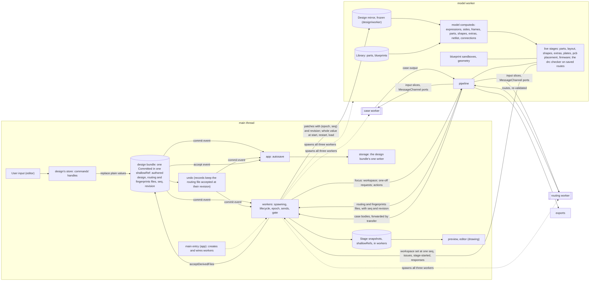
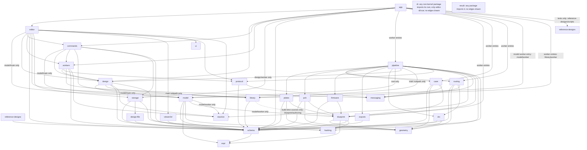
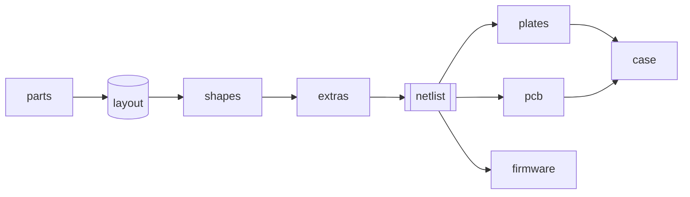
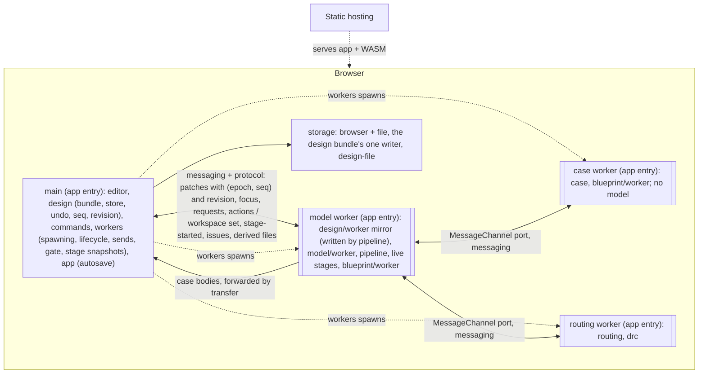

# Architecture Spine: keeb-cad, layout model and generation core

**Principles (they bind every AD):** explicit over terse · one way to do each thing · a small, coherent set of concepts.

## Glossary

Each term means exactly one thing. Code, file format and UI use these words and no synonyms.

| Term | Meaning |
| --- | --- |
| **design** | One keyboard document with exactly one electronics configuration; the only source of truth. The package `design` holds the design bundle over time: the design's state, the latest accepted derived files, how they change and their history; `model` holds its rules and `design-file` its serialisation |
| **authored sections** | The sections of the design file (AD-8); changed only by commands |
| **design bundle** | The saved unit: the design file, the routing file and the fingerprints file (each derived file tagged with the design revision it belongs to), plus the content-addressed assets; saved, versioned and shared as one (AD-1, AD-13) |
| **routing file** | One of the two saved files of derived data in the design bundle: routes per board, keyed by connection. Computed only by `pipeline`; held on main in `design`'s design bundle; saved only by main's `storage` |
| **fingerprints file** | The other saved file of derived data: one fingerprint (input-slice hash + output hash) per build entry and per design part that applies a blueprint (AD-11). Computed only by `pipeline`; held on main in `design`'s design bundle; saved only by main's `storage` |
| **storage backend** | The store, list and delete operations `storage`'s rules run over, internal to `storage` (`StorageBackend`): the browser backend implements it on IndexedDB through Dexie, the memory backend in tests (AD-13). Not the storage interface, which is `storage`'s public `save`, `load`, `listVersions` and `listDesigns` |
| **revision** | The content hash of the canonical encoding of the design value (the authored sections), computed with `hashing` by `design` on main and sent with the patches; never the hash of the KDL text, so a change to the writer or the file format alone never changes it. A migration that changes the design value changes the revision, as expected, and derived files tagged with the old revision are re-validated (AD-8, AD-12, AD-13). A content identity only, never an order |
| **routing hash** | The content hash of the routing file |
| **layout** | The tree of nodes that places keys and parts |
| **node** | An element of the layout: a group or a slot |
| **group** | A node with children and an arrangement; has an origin frame; its extent along a chain's axis is the bounding extent of its placed slots' rectangles |
| **slot** | A leaf with a frame at its centre; holds one part |
| **key** | A slot whose part has a `switch` component |
| **arrangement** | How a group places its children: `chain` or `free` |
| **frame** | A position + rotation in the plane |
| **id** | A stable identifier of a design, node, shape, vertex, construction point, entry or item in a list section; never changes, never reused |
| **reference** | A schema field of the declared reference kind that names an item by id (AD-24); never a plain string |
| **form** | `{ type: 'split'; board: 'reversible' \| 'mirrored' }` or `{ type: 'unibody' }`: the type decides whether a right side is derived; `board` (split only) is the kind of physical board (glossary `board`): one reversible PCB, or one mirrored PCB per side; it decides what the halves may differ in (AD-6) |
| **side** | One hand's set of resolved placements: `left` and `right` in split forms, `whole` in unibody |
| **side-qualified id** | `<side>/<id>`: a resolved placement of an authored element on one side (`left/thumb-far`) |
| **center** | The top-level group, required in split forms, whose frame's y-axis is the mirror axis |
| **board** | One physical PCB: one in split `reversible` and in `unibody`, one per side in split `mirrored` |
| **anchor** | What a frame is placed from: a slot (+ attach point), a group origin, a vertex, a construction point, or (lane operations only) a spot. There is no `part` anchor: placing relative to a part goes through its slot |
| **spot** | A named 3D frame a blueprint declares (`floor`, `wall-outer`, corners, `usb-side`), computed in `case`. Only that blueprint's own case lane anchors to it; elsewhere a spot travels as a placement reference in a pulled output, resolved by the consumer (AD-3, AD-18) |
| **default anchor** | The anchor used when none is set: the parent in a `free` group; the previous sibling, advanced by one step, in a `chain` |
| **attach point** | A named point on the slot's **rectangle**, the one `rectangle` output its part blueprint produces (the keycap, for a key): `center`, `edge-top/bottom/left/right`, `corner-tl/tr/bl/br` (AD-5) |
| **offset** | Local x, y, rotation (and pivot), applied in the anchor's frame; the node's only rotation |
| **pivot** | The point a rotation turns around, in the node's own frame before rotation |
| **chain** | An arrangement in which each child's default anchor is the previous sibling, advanced by one step |
| **step** | The distance from one chain child to the next, along the chain axis (AD-4) |
| **free** | An arrangement in which each child's default anchor is the parent |
| **gap** | The one uniform edge-to-edge gap between keycaps, `meta.gap` (x, y), so rows align; no group or per-child gap (AD-4) |
| **u** | A keycap-size label (`1u`, `1.5u`, …): a value of a part blueprint's `size` input, never a length (AD-5) |
| **index** | A child's position within a chain |
| **part** | What a slot holds: a library part pinned in `library-versions` (`ref('library-part')`), or a design-local part (`ref('design-part')`); both kinds use the one part schema (AD-5). `'empty'` exists only in per-side overrides (AD-6) |
| **module** | A ready-made board used as a part (nice!nano, nice!view) |
| **library** | The library's part and blueprint definitions, each with a `lib:` id and an immutable version; design-local parts share the part schema but are not in it |
| **reversible** | A flag every part carries, library or design-local; a non-reversible part on a split `reversible` board is `part-not-reversible` (AD-5, AD-6) |
| **part blueprint** | A blueprint used per slot, through the `parts` section and `slot.part`. It runs in the `parts` stage, reads only its inputs and produces a part, including exactly one `rectangle`. A slot may override only the inputs it marks per-slot (AD-5, AD-18) |
| **component** | A named footprint inside a part (`switch`, `diode`, `led`); has pins |
| **pad** | One copper pad of a pin on a board: `<side>/<slot-id>.<component>.<pin>.<copper>[.<copy>]` (Ids convention) |
| **cutout** | Geometry removed from a plate, PCB or case: an output with the role `cutout`, a target and a cutout purpose, from a part or a blueprint, or a user shape |
| **cutout purpose** | What a cutout is for (`switch`, `screw`, `mcu-window`, `display-window`, …); plates filter on it. Not a role |
| **keep-out** | A 3D volume (a shape plus a height range) that no material may enter; any stage that puts material there reports a violation. Part-owned or authored. Space a part needs cut away is a cutout, not a keep-out (AD-5) |
| **design-local part** | A part defined in the design's `parts` section, in the part schema: usually a part blueprint applied with inputs (`blueprint`), or a part blueprint the user authors in the design (`authored`, code in milestone 2); how a user makes their own key |
| **default part** | The part a slot with no part of its own uses: its nearest ancestor group's `defaultPart`, else the required `meta.defaultPart` |
| **override** | A named change to one side's placement (an `overrides` entry targeting `left/…` or `right/…`, AD-6), to the derived netlist (matrix row/column, MCU pin, LED order), or to a part parameter per target |
| **fitted** | A slot's part on one side after that side's overrides; a part removed there by `'empty'` is not fitted on that side (AD-6) |
| **parameter** | A named value with a unit; its name is its id |
| **expression** | A length or angle written with numbers, units, parameter names and `+ - * / ( )`; parsed and evaluated only by `expr` (AD-17) |
| **shape** | A named **2D** geometry (AD-16): `derived` or `drawn`, possibly built on other named shapes; resolves to regions. Alterations may go on top. The one term for the outline, plates and the 2D geometry inside blueprints |
| **solid** | A named **3D** result of operations on shapes or other solids in a `case` lane; evaluated only in `case` (AD-18) |
| **derived shape** | A shape computed from the layout: the fit of a group of keys, or of parts, plus a margin; follows the layout |
| **drawn shape** | A shape built from anchored primitives and vertices (key outline, rectangle, circle, polygon, add, subtract, intersect, offset, shape reference); stays put and is checked against fit |
| **alteration** | A change the design, and only the design, puts on top of one output it pulls by role: rounded corners, cut arcs, an engraving. Downstream reads the altered result (AD-16, AD-18) |
| **fit** | A constraint region (part envelopes, margin) that a shape must contain; a key or part outside it is `fit-violated` |
| **vertex** | A polygon corner; has an id, an anchor and an offset; reusable across shapes |
| **construction point** | A helper point computed from other geometry (e.g. intersection of two lines); a possible anchor; not a part |
| **outline** | The shape designated as the board edge; pulled by the role `outline` |
| **plate** | A named definition: a shape + the cutout purposes it includes |
| **region** | A resolved shape's 2D result unit: one outer loop plus its hole loops, as exact paths (AD-16) |
| **flatten** | Turning a region's exact paths into polygons with `geometry`'s one function and `FLATTEN_TOL` (AD-16) |
| **build layer** | One physical thing a `case` lane makes: a **sheet** (a shape plus a thickness, cut flat) or a **solid** (printed or milled), with its 3D position, a process and a material (AD-18); not a keymap or copper layer |
| **build style** | Whichever build entry produces the `case-body` role; the styles (`tray`, `sandwich`, `integrated`, `plateless`) are app-owned blueprints, switchable at any time (AD-18) |
| **blueprint** | A versioned definition with declared inputs, one or more lanes, private internals and role-tagged outputs; code in a sandbox, or data; pinned in `library-versions`, live, never expanded (AD-5, AD-18). It declares no identity: what it produces is what it acts as |
| **build** | The design's one list of entries: blueprints applied once (styles, additions). Its order is presentation only (AD-18) |
| **entry** | One item of `build`: a library blueprint (by id; version pinned in `library-versions`) plus its input values |
| **lane** | The part of a blueprint that runs in one stage. Stage order: `parts → (layout) → shapes → extras → [netlist] → plates · pcb · firmware → case`. A lane reads only what is upstream of its stage and produces only its own outputs there (AD-18) |
| **role** | An open-string tag on an output (`cutout`, `mount`, `display`, `case-body`, `rectangle`, …) that consumers pull by, with an optional target (`plate`, `pcb`, `case`). A pull states how many it needs: exactly one, at least one, or any (AD-18) |
| **operation** | One step of a lane, defined in the blueprint API (`blueprint`) and implemented by the stage the lane runs in (AD-10); not a domain operation |
| **net** | A set of pads that must be connected; has a stable net id |
| **netlist** | Every net: matrix rows and columns, power, ground, LED chain, TRRS/UART, display bus, battery |
| **connection** | One pad pair that a net is split into; realised by a part's fixed tracks or by routing |
| **route** | The copper path for one routed connection |
| **design rules** | Net classes (width, clearance, via size), edge, hole and drill clearances, and keep-out switches (AD-20) |
| **DRC** | The design-rule check, implemented once in the `drc` checker library (AD-20) |
| **binding** | What one key does on one keymap layer, from the firmware-neutral vocabulary |
| **keymap layer** | One ordered entry of the keymap: an id, an editable name, and bindings keyed by side-qualified slot id. PCB layers (F.Cu, B.Cu) are always **copper layers** |
| **keymap** | Keymap layers, plus combos |
| **violation** | A reported design problem: `{ kind, severity, ids, message, fixes }` |
| **fix** | A command id plus its inputs, offered on a violation (AD-2) |
| **block** | A reusable, versioned design fragment: copied in, owned, and updated by a three-way merge (AD-9); not a blueprint. Milestone 2 |
| **command** | An undoable entry of the design store, with a command id and a label; the only way the authored sections change |
| **command id** | The stable identifier of a command or action, namespaced by its concept folder (`layout.moveSlot`); never shown, translated or reused. Data references (violation fixes, reference-design scripts) and the design store's duplicate check use it; the UI shows the translatable **label** (AD-2) |
| **UiAction** | A registered behaviour of the editor that changes only UI state (workspace, panels, focus); a class in `editor`, registered with `registerUiAction` into `editor`'s `uiActions` multi token, with the statics `kind`, `id`, `label`, `input` and optional `hotkeys`, `available()` and `apply(input)`; never in the design store, never undoable |
| **shortcut registry** | `editor`'s one service (`ShortcutRegistry`) that collects the hotkeys the design store's commands and actions and `editor`'s UiActions declare in their static `hotkeys`, hands them to `ui`'s hotkey layer while the editor is mounted, and runs the matched handle through the invoke path; it refuses, at startup, an id two handles share and a malformed hotkey; two handles sharing a hotkey is left to review (AD-26) |
| **invoke path** | `editor`'s one way (`Invoke`) to run a command, action or UiAction from the UI (hotkey, click, gesture, menu, palette): it takes the caller's input, else the handle's input builder's, else `{}`, answers `available(handle)` for menus and the palette, and runs a command or action through the design store and a UiAction through its own availability check and apply; a command with no design open is `unavailable` (AD-26) |
| **input builder** | A `di` class in `editor`, registered for one handle with `registerInputBuilder`, that builds that entry's input from UI state (selection, focused group) when the invoke path runs it (AD-26) |
| **inspectable** | A service's entry in `editor`'s dev-only devtools inspector (the `inspectables` multi token, filled only behind the devtools `MODE` gate): its id (starts with the devtools plugin's id), label and `fields`, one per shown value: each reads its value over the service's public API and, for `editor`'s UI-state services only, may add a Valibot schema and a `set` (Editor state row) |
| **workspace** | One of the editor's five top-level views, `layout`, `outline`, `pcb`, `case` and `firmware` (`workspaceSchema`, in tab order); the open one is in the design location |
| **design location** | The open design and workspace as the URL holds them, `/#/design/<design-id>/<workspace>`; vue-router is its one owner (Editor state row) |
| **canvas** | The landmark of a workspace that draws the design (the Layout canvas, the SVG canvases), inside the editor shell |
| **stored design** | A design held in browser storage under its id, with its kept versions; `listDesigns` lists them, newest first (AD-13) |
| **launch** | The app's start: it opens the design location's design when it is stored and loads, otherwise the newest stored design, otherwise a new design, and replaces the URL to match (AD-13) |
| **design store** | The one service, in `design`, that holds the design bundle (with its seq and revision, as one `Committed` value) and is the only thing that changes it: it runs every registered command and action (from the `commands` and `actions` multi tokens, each with its command id, label, inputs and availability), undo, redo, `replaceDesign` and `acceptDerivedFiles`, and emits the commit and accept events. The package `commands` defines every entry as a `di`-registered class, the class its **handle**; `editor` invokes handles directly, and the store resolves a command id only for references that arrive as data (AD-2) |
| **domain operation** | A plain function in `model/main` over `Mutable<Design>` that changes one domain fact (`renameParameter`'s rewrite, a delete cascade, cycle rejection); a command's apply step forwards to one (AD-2). Not a lane operation (glossary `operation`) |
| **record** | The unit undo restores: one item with an id (a list item or tree node), or one container's ordered id list (a list section's order, a group's children) (AD-2, AD-23) |
| **committed revision** | A revision reached by a command, undo, redo, or load. Since 2026-10-30 nothing in progress reaches the design, so every revision is committed (AD-2) |
| **dependency graph** | The one graph of everything that reads something else: anchors, default anchors, shape references, construction-point inputs, parameter references, declared reads (AD-3) |
| **reactive graph** | The model worker's derivation graph: the refs and computeds from the design mirror to the stage outputs (`model/worker`'s derivations and the live stages `pipeline` wraps). Any package may use `reactive`; the guard against a second copy of the graph is the entry fence: only the model worker's entry imports `model/worker` (AD-10, AD-25) |
| **crossing** | The rule that every value leaving or entering a thread goes through `messaging` (typed send, one dispatcher per side, transfer lists, the design-seq gate), carrying `protocol`'s message union or a background channel's messages; plain values and transferred buffers only (AD-11). An idea owned by `messaging`, not a package |
| **seq** | The number `design` mints next to the revision, +1 per commit, undo, redo and `replaceDesign`; `workers` stamps each design message (whole design or patches) it sends to the model worker with it, and other messages carry the current seq without advancing it; every post, response and derived file echoes the seq it was computed for. Older = smaller seq in the same epoch (AD-11) |
| **epoch** | The number of one model-worker start, kept by `workers`; it changes on every start and restart. A message from another epoch is dropped (AD-11) |
| **resolved design** | `model/worker`'s computeds over the authored sections, in the model worker: evaluated expressions, per-side placements, parts, shapes, netlist and connections. Its types (`ResolvedDesign` and its parts) are in `schema` (Data Schema) |
| **stage** | A computation from the resolved design (and, where stated, other stage outputs) to one output. Its output depends only on its inputs, the same as a full recompute, whatever it caches or keeps incrementally inside (AD-11's cache keys rely on this). `parts`, `shapes` and `extras` are also stage names for lanes (glossary `lane`); they run inside `model`'s derivations, while `plates`, `pcb`, `firmware`, `case`, `routing` and `exports` are stage packages. `drc` is a checker library that `pipeline` runs live, not a stage (AD-20) |
| **model worker** | The one Web Worker that holds the design mirror, the reactive graph, the live stages and `pipeline` (AD-11) |
| **live** | Computed in the model worker after each applied command, the visible set first; posted to main whole, tagged with its seq (AD-11) |
| **visible set** | The stages of the workspace the editor shows (AD-11's workspace table); the model worker computes them first after each applied command and posts them as one message at one seq |
| **workspace set** | The posted outputs AD-11's workspace table gives one workspace, posted as one message at one seq whether that workspace is focused or not; the **Layout set** is the Layout workspace's (parts and layout). The visible set is the focused workspace's |
| **background** | Computed in the case or routing worker from an input slice `pipeline` sends, with progress; cancelled by a newer seq |
| **preview** | The editor's 2D rendering of posted stage outputs (resolved placements and shapes included), in SVG |
| **viewport** | The one 2D view position shared by the 2D workspaces (not isolated part mode): centre (mm, y up) and zoom |
| **3D viewer** | The Case workspace's interactive rendering of bodies, in `viewer3d` |
| **body** | One named triangulated solid shown in the 3D viewer: id, kind, faces, edges. Milestone 1 has case bodies only. The 2D "key body" colour is a keycap face, not a body. The 2D board shape is the **outline**, never a body |
| **escape hatch** | Exporting a KiCad project to finish outside keeb-cad; the export no longer syncs |

## Design Paradigm

**One design on the main thread, one reactive graph in a model worker.** The design (the authored sections only) is held on the main thread as one plain, deep-frozen value in a `shallowRef`, replaced only by commands and `replaceDesign` (AD-2). The main thread keeps the design bundle, the design store, the seq and undo (in `design`, with the routing file accepted at each record's revision), every command and action as a `di`-registered class whose class is its handle (`commands`), the main side of the three workers (`workers`: spawning, lifecycle, sending, receiving through the gate, the stage snapshots), the composition (`app`: the thread entries, the wiring and autosave), `storage` (the design bundle's one writer) and input and drawing (`editor`); `workers` spawns all three workers. The **model worker** keeps a deep-frozen mirror of the design (`design/worker`), updated from Immer patches tagged with (epoch, seq) and the resulting revision, and the one reactive graph: `model/worker` derives the **resolved design** as small computeds, and the live stages, wired by `pipeline`, are computeds over it. After each applied command the worker computes the **visible set** (the stages of the shown workspace) first and posts it as one message at one seq, then the hidden stages; the editor draws from posted snapshots. Blueprint sandboxes for live lanes (run by `blueprint/worker`'s lane runner) and `geometry` run in the model worker, never on the UI thread. Slow outputs (case, routing) are background stages in their own workers, fed by `pipeline` over MessageChannel ports `workers` hands it. Every value that leaves or enters a thread goes through **one crossing**: `messaging`'s typed send and design-seq gate, carrying `protocol`'s message union, plain values and transferred buffers only. Two kinds of saved derived data depend on history, so they are kept as files in the design bundle beside the design file: the routing file, re-validated against the current design rather than trusted, and the fingerprints file, which records each blueprint use's last outputs so a change in behaviour is shown, never applied silently (AD-11).



## Invariants & Rules

### AD-1: One design bundle; an authored design file plus two saved derived files [ADOPTED]
- **Binds:** all
- **Prevents:** outputs drifting from the model; hand edits lost on regeneration; derived data quietly persisted in more places.
- **Rule:**
  - The design file holds the authored sections only. The routing file (AD-12) and the fingerprints file (AD-11) are separate derived files, each tagged with the design revision it belongs to.
  - The **design bundle** is the design file, the routing file, the fingerprints file and the content-addressed assets (AD-8), saved, versioned (AD-13) and shared as one. Nothing else derived is saved in it.
  - The bundle always holds all three files. An empty derived file is a design's starting value, not a computation: `newDesign`, and a load of a bundle whose derived file is missing, unreadable or fails its schema, start the routing file with no routes and the fingerprints file with none, each tagged with that design revision. Only the design file can refuse a bundle (AD-8). From then on only `pipeline` computes new ones; load and version switch restore both saved files, undo and redo the routing file (AD-2). On main, `design` holds the **design bundle** in memory: the authored design plus the latest accepted routing and fingerprints files, inside the design store's one `Committed` value (`{ design, routing, fingerprints, seq, revision }`, AD-2), so every write replaces the whole bundle at once and a reader never sees a design with another design's derived files. `replaceDesign` takes the migrated bundle (the design, and the routing and fingerprints files when present) and sets all three in one write, filling an empty one with `design`'s `emptyDerivedFiles(revision)`; it returns which derived files it emptied, and the **load flow** (AD-13) tells the user when it emptied a saved one. The `newDesign` action hands it a design with no derived files. `workers` replaces the derived files with a `pipeline` post it received through the gate, only at main's latest seq (`design.acceptDerivedFiles(files, seq)`), which emits the store's **accept event** with the new `Committed` (no new seq or revision, so it is not a commit event); load, version switch, undo and redo restore them as above (undo and redo restore the routing file together with the design, AD-2). Commands never write derived files. Autosave reads this one bundle (AD-13).
  - Every output is derived and is never edited inside keeb-cad. Changes the model can't express are made after **export** (escape hatch).
  - **Stable outputs:** the same file with the same app version gives the same outputs on every reopen. An edit changes only the outputs whose inputs it changed.

### AD-2: Authored sections change only through registered commands [ADOPTED]
- **Binds:** design, commands, workers, model, app, editor, pipeline, schema, di
- **Prevents:** ad-hoc mutation; broken undo; outputs previewed outside the design; undo floods; commands the UI or shortcuts can't see; per-command inverse code drifting from the command; fixes applied differently by each panel; the update mechanism living in the domain; two places declaring commands and actions; an identifier that changes with a translation; a mirror with no owner; a second patch applier; `immer` outside `design`; two writers of one revision; type helpers with no legal home; Immer leaking through types; tests unable to reach commands.
- **Rule:**
  - **Design state** lives in one `di` service in `design`, the **design store** (`DesignStore`): the design bundle (AD-1), its seq and its revision as one `Committed` value (`{ design, routing, fingerprints, seq, revision }`) in one `shallowRef`. It also runs the registered commands and actions (below): `run`, `undo`, `redo`, `replaceDesign` and `acceptDerivedFiles` are its methods, each replaces the whole `Committed`, and no other class holds or assigns its `shallowRef`, so every write goes through one service. It resolves eagerly at startup, so a duplicate command id fails there. `Design` is the design file's authored sections (`DesignFile` without `formatVersion`, Data Schema), so the revision never changes with the format alone. **Exactly two ways write it:** registered commands, and `replaceDesign` (load, file open, version switch, each after `design-file`'s `migrateBundle`, and the `newDesign` action), which reaches a committed revision and clears undo history, so undo never reaches before a load or a new design. The routing and fingerprints files are not part of `Design`: they sit beside it in `Committed`, and no command writes them (AD-1). `replaceDesign` lives in `design`: load's caller hands it the migrated bundle that `migrateBundle` returns (AD-8), and it parses the design with `schema`'s design schema and each derived file with its own, deep-freezes the results with Immer's `freeze(value, true)`, then writes the design and both derived files in one write, filling a derived file that is missing, that `migrateBundle` lists as unreadable, or that fails its schema with `emptyDerivedFiles(revision)` (AD-1). It returns `Result<{ emptied: Emptied[] }, DesignInvalid>` (each emptied derived file with why: `missing`, `unreadable` or `invalid`): a design that fails its schema refuses the whole bundle, with issue paths from the design root (`['meta', 'id']`). A file `migrateBundle` refuses (`LoadError`, AD-8) never reaches `replaceDesign`.
  - **Responsibilities.** `model` owns what a change does (the rules), `design` how the design bundle changes over time (apply, record, undo and redo) and its identity (the revision and the seq), `commands` what the application can do, `workers` how main talks to the workers, `app` how it is wired, and `editor` how it looks and who asks.
  - Every change to an authored section is a command (e.g. `moveSlot`, `setGap`, `setAnchor`, `addVertex`, `setParameter`, `renameParameter`, `setBinding`, `addBuildEntry`, `setEntryInputs`), and nothing else writes to them.
  - **Commands and actions.** `design` (main) holds the mechanism: the design store (the design state and its bundle, AD-1, the registered entries, undo, the seq and its check, the revision, the commit event and the accept event), `DesignPatcher` (Immer and patches), `Writable`, the entry interfaces (`Command`, `Action`, `CommandHandle`, `ActionHandle`), `registerCommand` and `registerAction`, the `commands` and `actions` multi tokens and `replaceDesign`. The store lists entries of two kinds: **commands** (undoable; the only entries that edit authored sections) and **actions** (not undoable; never edit authored sections: Reroute, Accept output change, save, export; an action may hand a whole bundle to `replaceDesign`: New design, Open, version switch). Menus and shortcuts see both. **Every command and action is defined in the package `commands`** (AD-10), as a **class registered in `di`**, and no other package defines one. The class is the entry's **handle**: its static members are its kind (`'command'` or `'action'`), its **command id**, a translatable label and an input schema (AD-24's schema format), typed by the class-side interfaces `CommandHandle` and `ActionHandle`, which are checked wherever the class is registered into a multi token or passed to `run`. Its instance implements `Command` (an availability check over the read-only design, and an apply step over a draft) or `Action` (an availability check over `Option<Committed>`, so an action such as `newDesign` is available with no design loaded, and an apply step over the parsed input returning `AsyncResult<void, E>` from the `result` kernel, synchronous actions included), checked by `implements`, and takes the services it needs through `inject()` fields (AD-25). The command id is namespaced by the handle's concept folder (`layout.moveSlot`), stable, and never shown, translated or reused; the label is what menus, the palette and undo show. A command's apply step forwards to one `model` domain operation (through `model/main`). An action's apply calls the services it injects: Reroute and Accept output change ask `workers` to send the `action` message to `pipeline`, which owns the handler, and Export asks `pipeline` through `workers`; Save calls `storage` with `design`'s bundle; New design builds a fresh design and hands it to `replaceDesign`. One `di` module per concept folder in `commands` registers each entry only through `design`'s `registerCommand(container, Handle)` or `registerAction(container, Handle)`, which registers the class as its own singleton token and adds it to the `commands` (`MultiToken<CommandHandle>`) or `actions` (`MultiToken<ActionHandle>`) multi token (they list classes, never instances), and whose signature refuses to compile when `apply`'s input is not `v.InferOutput` of the static input schema, so an entry reached only as data is checked too; `main.ts` adds the modules (AD-25). The store injects both, refuses a duplicate command id at startup from the static ids, injects the container's `Injector` (`InjectorToken`) at construction, and resolves an entry's instance (a singleton) through it only when first needed (to read its availability or to run it): the one lazy resolution, which lets an action inject the store that runs it. `run(handle, input)` runs both kinds, by the handle's kind, and takes the input as the schema's input type (`v.InferInput`, so a caller passes plain strings where the parsed value is branded); it parses the input and checks availability before the apply step, for both kinds: a command needs a loaded design and returns `Result<void, Rejection>`; an action returns `AsyncResult<void, E | Rejection>`. A command whose apply step produces no patches returns ok without committing: no seq increment, no commit event, no undo entry. No-op means empty patches, not deep-equal, because commands replace values in refs. Not a commit, because committing an unchanged design would autosave, message the worker and add an undo entry that undoes nothing (an expression field committing on blur with no edit). `editor` imports `commands` and invokes the handles directly through its invoke path (`invoke(AddKey)`, checked by the compiler, AD-26): hotkeys, clicks, gestures, menus, the palette and undo use handles, read each handle's static label, and read availability from the invoke path (`available(handle)`). `app` runs the `newDesign` action at launch when storage holds no design. `editor` never defines an entry and never imports `pipeline`. The store resolves a command id only for a reference that arrives as data: a violation's fix posted from the worker, and the reference-design scripts (Reference designs), which are checked at runtime: `app`'s tests run them, and the store parses each input and refuses an unknown id: its `runById(command, input)` looks the id up among the registered commands and returns the `unknown-command` rejection for one it lacks (13.2). A forgotten module is silent (an empty multi token resolves to `[]`), so a missing registration is caught by that command's own end-to-end test, which invokes it through the real app: every command and action has at least one, and there is no list-versus-store unit test. `commands`' tests build a container with `design`'s store; the Corney scripts and full-app tests live in `app`; `design`'s unit tests define their own test commands. A handle's optional static `hotkeys` is read only by `editor` (AD-26). The UI reads the input schemas directly; exporting them as JSON Schema is deferred until an agent feature is planned. Only registered commands run. No import-time self-registration.
  - **Writing.** A command **replaces** plain values in refs and never mutates them, through **Immer** with auto-freeze on and patches on, inside **`DesignPatcher`**, a `di` service in `design` that holds its own `new Immer({ autoFreeze: true })` instance, never the global default; patches are switched on with Immer's `enablePatches()`, which is global (Immer has no per-instance switch). `change(design, edit)` runs an edit (`(draft: Writable<Design>) => void | Rejection`) on a draft and returns `Result<Changed, Rejection>`, where `Changed` is the produced design and its patches; `apply(design, patches)` returns the patched, frozen design. `design`'s main module and `design/worker`'s module each register it, so both threads use one configuration; `design/worker` reaches `DesignPatcher` without the store, `model/main` or `library`, so its entry fence holds (AD-25). A command's apply step receives a draft typed `Writable<Design>`, passes it to its domain operation, which takes `Mutable<Design>`, and returns `void` or a `Rejection` built with `model`'s `reject(kind, ids, message)`. `change` keeps a rejection outside the Immer producer (returning `undefined` to Immer) and on a rejection discards the produced value: no ref write, no undo entry. After every produced value the store calls `model/main`'s `checkStructure(previous, next)` directly (13.2: unknown-target; 13.3: acyclicity, AD-3), which returns `Result<void, Rejection>` and refuses only what `next` breaks that `previous` didn't (a dangling reference loaded from a file blocks no later edit), and rejects the same way; tests reach a rejection through a command that returns one, never through a seam. The store also parses every produced design with `schema`'s design schema; a failure is a bug: `run` throws `InvariantError` naming the issue paths and the command id, and nothing is committed (TypeScript has no exact types, so a spread input can carry an extra key past the compiler). A command's `run` returns `Result<void, Rejection>` and throws only on a bug. Every function that can fail in an expected way returns a `Result<T, E>` from the `result` kernel (AD-24; `replaceDesign` included); the apply step alone stays `void | Rejection`, and `change` wraps it. `DesignPatcher` is the only `produce` call and the one place that sets Immer up; `immer` (with `freeze` and `castDraft`, which puts frozen records back into a draft for undo) is imported only by `design`. Its worker subpath **`design/worker`** holds the design mirror and applies patches with `DesignPatcher.apply` (Immer's `applyPatches` and deep freeze), over the same Immer configuration; only `pipeline` and the model worker's entry import `design/worker` (AD-10, AD-25), and the main entry never reaches it. `design/worker` deep-freezes a whole design value it receives (worker start, restart, load) with the same `deepFreeze` `replaceDesign` uses, then applies patches only through `DesignPatcher.apply`, so the mirror is deep-frozen too, and there is no second patch applier. Every design value is therefore frozen, so Vue never proxies it and a stray write throws.
  - **Patches to the model worker.** Each applied command's, undo's and redo's patches are the payload to the model worker (AD-11). At each commit, undo, redo and `replaceDesign`, `design` mints the next **seq** (+1) and computes the resulting design's **revision** (the `hashing` content hash of the canonical design value), and emits them on its own **commit event**: the patches, seq and revision of each commit, undo and redo (with the routing file an undo or redo restores), and on `replaceDesign` the new `Committed` itself (the design, both derived files, seq and revision), so `workers` sends the mirror the whole bundle (AD-11) without reading the store again. `workers` (which stamps each with its epoch and sends it) and `app`'s autosave subscribe to it directly, and autosave to the accept event too (AD-1, AD-13); `design` never imports either. `design/worker` checks the mirror against the revision (`hashing`'s `hash` is provisional until the mirror-hash spike: Open Questions). `pipeline` echoes the revision on the derived files and never computes it. They carry no undo meaning; undo keeps its records (below).
  - **Inputs.** The store parses every input through the command's schema before the apply step, and the apply step sees only the parsed result of a fresh plain copy: `run` unwraps the input with `toRaw` and copies it with `structuredClone` (a value that can't be cloned is a bug and throws) before it parses. So Immer never freezes a caller's object, and no Vue proxy enters the design.
  - **Read-only types.** `design` defines `Writable<T>` (over Immer's `Draft<T>`), an apply step's draft type; domain operations take `Mutable<Design>`. Outside an apply step, every design value is `Frozen<…>`: services, computeds, stages, `editor`, tests. `Frozen<T>` (deep readonly) and `Mutable<T>` (its inverse) are plain TypeScript in `schema`, with no Immer (plain TypeScript with no schema, AD-24), so no Immer type leaks into other packages. `Writable<Design>` must be assignable to `Mutable<Design>`, checked by the compiler. `design` exports `Writable<T>` and the entry interfaces (`Command`, `Action`, `CommandHandle`, `ActionHandle`) to `commands`, which defines every entry. Writes stay confined because **only `DesignPatcher` makes a draft** (the `immer` fence), not because the type is hidden: a draft exists only as an apply step's argument inside `run`, and a domain operation receives it only from there. An entry that needs a service reaches it through `di` (AD-25), never through a module singleton. Functions take `Frozen<…>` parameters by default (a `Frozen<T>` holding an array does not compile into a `Readonly<T>` parameter); the kernels with no workspace imports (`expr`, `reactive`, `messaging`, `hashing`, `geometry`, `di`, `result`) use `readonly` arrays in their own signatures. The default is a **reviewer rule**, not a lint: code review checks that parameters are read-only. A wrong write fails at compile time; a type test proves a nested write does not compile.
  - **A drag changes the design only on drop.** While it lasts, `editor` draws the dragged nodes at their preview position, and nothing else changes: no revision, no live stage, no autosave. The drop runs **one** command (one undo entry); cancel runs nothing. Outline, plates and every other output update after the drop.
  - **Commands from snapshots.** A command computed from a stage snapshot (a drop, a nudge) carries that snapshot's seq. The store rejects it with a `stale` `Rejection` (Data Schema) when that seq is not main's latest, which is `design`'s own seq counter; `editor` shows the rejection briefly ("the layout changed, drop again"). The check and `run`'s optional `{ seq }` are coded by the first drop or nudge story (epic-drag-keys); until then only the `stale` type exists. A drop or nudge carries per-node deltas already in each node's anchor frame: `editor` converts them with the posted `frame` and `anchorAt` through `geometry`'s inverse `compose`. The editor holds a gesture's start until the snapshot at main's latest seq has arrived, and a stale rejection that still happens snaps the preview back.
  - **Nothing in progress reaches the design.** A nudge burst moves the selection on the canvas only and runs one command when it ends (600 ms idle, any other key, any pointer action). An expression field runs its command after a typing pause (debounce) and on Enter or blur. Consecutive commands from one field in one focus session **coalesce** into one undo entry; Esc undoes that entry. There are no gestures: no begin, update or commit, and no marks. `run`'s optional `{ coalesce: key }` appends a command's patches to the last entry when it carries that entry's key; any other command, undo, redo or load closes the session. The entry's label is the first command's, and multi-select typing is one command with many ids. Undo and redo on an empty stack return `unavailable`; the stack is unbounded in M1.
  - **Undo.** An undo entry holds its command's Immer forward and inverse patches (concatenated for a coalesced field session) and the routing file reference below. Undo applies the inverse patches through `DesignPatcher.apply`, redo the forward ones, and the same patches go to the model worker (AD-11). History is linear, so an entry's index paths always meet the state they came from. Every command is one undo entry, except that a field's coalesced commands share one. There is no per-command inverse code.
  - **Undo and the derived files.** Beside each undo record `design` keeps a reference to the routing file last accepted at that record's revision (a frozen value): the one current at the commit, swapped by `acceptDerivedFiles` when an accepted file belongs to the newest record's seq, so redo restores the routes already computed for that revision. Undo and redo restore that routing file together with the design, in `design`'s bundle (AD-1); `workers` sends both to the model worker (AD-12). Undo never restores the fingerprints file: it always holds the latest acceptance, so an accepted output change stays accepted.
  - **Breaks.** An edit that breaks something elsewhere goes through. The break is a violation, and the violation offers its **fixes** right away, without blocking. A fix names any registered entry by its command id plus its inputs (e.g. Reroute for `unrouted`); there is no global command-id union: the fix type in `schema` is a `v.variant` on `command`, one variant per command a fix may name, carrying that command's input schema, which its handle reuses (Data Schema `Fix`); its availability is re-checked just before it is applied. Such breaks include an alteration or other pull left with nothing to pull after a style switch (`pull-count`, AD-18) and an old input an upgrade could not map (`blueprint-input-invalid`). An upgrade that raises a nested blueprint pin (AD-5) shows the raise before it applies. A changed output fingerprint (AD-11) is shown with its difference and accepted through the **Accept output change** action.
  - A command that removes something removes everything keyed to it in the same command (deleting a slot deletes its bindings, combo memberships and overrides; deleting a vertex is rejected while a shape uses it, as is deleting a keymap layer that a binding on another keymap layer, or a combo, references), so one undo restores them all. Whether these refusals become flagged breaks is an open question. A node anchored to a deleted node, or into its subtree, falls back to its default anchor and keeps its offset; only list items keyed to the deleted ids are deleted with it.
  - A required reference can't be cleared by a cascade: deleting the design part that the required `meta.defaultPart` names is refused with `default-part-required` (13.18 adds `parts.deletePart` to carry it). Milestone 1 has no command that removes a `library-versions` pin: pins are added by the commands that use a library item and never removed by hand. The first story that removes a pin (an unpin command, or pruning unused pins) refuses removing the default part's pin with `default-part-required` too.
  - **Layout commands.** `AddGroup` and `AddSlot` take `{ parent?, index?, id?, …fields }`: an omitted parent is the root, an omitted index appends, an index above the parent's child count is refused with `index-out-of-range`, an omitted id is minted, and a given one is refused when the design already has it; the UI's add flow pre-fills a minted id the user may edit before it is committed, and ids never change afterwards. `DuplicateNode` inserts the copy after the original, gives every id in the copied subtree a numeric suffix, the lowest free `-N` from 2 after stripping an existing `-N` ending (`thumb-home` and `thumb-home-2` both copy to `thumb-home-3` when `thumb-home-2` is taken), and remaps references inside the copy. `DuplicateNode` refuses the root with `root-required` and an id the design lacks with `unknown-target`; the remap of references inside the copy is built with the first node-to-node reference (13.3's anchors). `DeleteNode` takes a list of ids, refuses the root with `root-required` and any id the design lacks with `unknown-target` (naming every missing one), deleting nothing. Editing after creation goes through 14.5's setters. 14.5's setters take node id lists: `layout.setOffset` (`null` clears a field to its default), `layout.setArrangement`, `layout.setGap`, `layout.setDefaultPart` (`null` clears a group's), `layout.setSlotInputs`. `setAnchor` keeps the offset as written, so the node moves; with no target it clears to the default anchor; keeping the world position is 15.3's re-anchor in place. `setPart` pins the newest released version when unpinned, clears slot inputs the new part doesn't mark per-slot, and with `null` clears to inherit; unused pins stay. A command that sets a blueprint input its pinned declaration doesn't allow is refused with `blueprint-input-invalid`. On a reversible board a part swap is refused with `override-not-allowed`; no command takes a right-side position.
  - `renameParameter` rewrites every expression that uses the name, in the same command, through its domain operation in `model`.
  - The routing and fingerprints files are outside commands; undo only keeps them by reference (above, AD-11, AD-12).
  - The command log is not persisted. The design bundle holds state, not history.

### AD-3: Placement = one anchor + offset, over one acyclic dependency graph [ADOPTED]
- **Binds:** model, case, every stage
- **Prevents:** two placement semantics; two cycle checks; geometry that doesn't follow the layout; case operations placed by a second mechanism.
- **Rule:**
  - The tree defines ownership. Placement is independent of ownership.
  - Every node, vertex, construction point and placed lane operation has exactly **one** anchor. Unset means the default anchor. Any of them may explicitly anchor to any slot (+ attach point), group origin, vertex or construction point. There is no `part` anchor: placing relative to a part goes through its slot.
  - A **spot** is a named place a blueprint declares (`floor`, `wall-outer`, corners, `usb-side`). Spots are computed in `case`, as 3D frames, and **only that blueprint's own case-lane operations anchor to them**. An output pulled by another body carries its placement as a reference the consumer resolves (a spot name, "bottom of the body" or "outer wall", plus an offset, AD-18). An anchor input never names a spot. Layout nodes, vertices, construction points and parts never anchor to a spot, so the layout never depends on the case. Lane operations attach through this same anchor rule; there is one placement rule in the whole design.
  - **Anchors as blueprint inputs.** An `anchor` input (AD-18) is picked like every anchor here.
  - An explicit anchor **replaces** the default: placement is anchor + offset only, with no step added.
  - World frame = anchor frame → translate by offset → rotate by offset rotation about pivot. This is the single order of operations for nodes and geometry alike. A node has exactly one rotation.
  - Attach points exist on slots only; a group exposes only its origin.
  - Anchors reference by **id**, never by path.
  - The **dependency graph** is one graph and must be acyclic. `model` rejects a command that would create a cycle, with a typed rejection naming the cycle's ids, so the graph is acyclic after every command. This is structure, not a flagged break (AD-2). A loaded file with a cycle reports `dependency-cycle`; the cycle's members and their dependants are not placed. Pickers don't offer cycle-closing targets.
  - **Declared reads** (AD-11) are edges of the same graph. They are data in the pinned blueprint version's declaration (Data Schema, Blueprint declarations), so the store on main checks read loops without running any code. Inside a stage, lanes and the design's own work run in the order their reads require; a read loop is a cycle like any other: a command that would close one is rejected, and a loaded file reports it. `build`'s list order is presentation only (AD-18).
  - The graph's edges are explicit anchors, default anchors (previous chain sibling, parent's origin) and parameter references. One `model/main` query, `wouldCycle(design, node, target)`, makes the anchor picker grey out cycle-closing targets and the command reject the same; a rejection names the cycle in order from the changed node, and a loaded `dependency-cycle` lists members only. A node anchored to an unknown id is not placed, with its dependants. An omitted `attach` is `center`; attach points lie on the slot's rectangle in its own frame, y up (`edge-top` at +h/2), and turn with the slot.

### AD-4: Exactly two arrangements; the step is a default anchor [ADOPTED]
- **Binds:** model, editor
- **Prevents:** overlapping layout mechanisms; losing per-column stagger and splay; slot widths handled differently.
- **Rule:**
  - **chain** has an axis (`x` or `y`). It always steps the positive way; the order of its children sets the direction. Child 0's default anchor is the chain's frame. Child *n*'s default anchor is child *n−1*'s **world frame** (rotation included), translated along that frame's axis by `far(n−1) + meta.gap[axis] − near(n)`, edge to edge, so the gap holds between keycaps however a group's slots sit about its origin (decided 2026-11-10, 13.2; it replaces Ergogen's centred `(rect(n−1) + rect(n)) / 2 + gap`). `near` and `far` are the low and high ends, along the axis and in the child's own frame before its rotation, of its extent: a slot's **rectangle** (the one `rectangle` output of its resolved part; for a key, the keycap; AD-5), centred on its frame, so a slot's step is `(h(n−1) + h(n)) / 2 + gap`; or a group's placed slots' rectangles taken together (recursively, in the group's frame); a group with no placed slots is a point at its origin (`near = far = 0`). Child *n*'s offset is then applied. One key's own adjustment is its offset, which carries to later siblings.
  - Rotation carries: a child's rotation turns every later sibling's default anchor. A mid-chain turn that must not carry is expressed by giving the next sibling an explicit anchor.
  - A chain child with an explicit anchor keeps its **index**; later siblings step from wherever it ended up.
  - **free:** each child's default anchor is the parent's origin.
  - **Units:** lengths are mm (`Delta`, `Length`); `u` is not a length (AD-5). There is one gap, `meta.gap`, edge to edge between keycaps, so rows align; no gap on groups and none per chain child.
  - A slot removed on one side by an override keeps its space: that side's chain still steps by the rectangle of the slot's authored part (AD-6). A slot whose part doesn't resolve steps by its stand-in rectangle (AD-5).
  - Alt-drag subtracts the move expressed in the next sibling's anchor frame, and is a no-op with no next sibling, in a `free` group, or when the next sibling has an explicit anchor. Write-back edits only a top-level additive literal (with its sign), appending a term otherwise; the literal rounds half away from zero to 0.01 mm or 0.1°, prints in shortest decimal form (never `-0` or an exponent), and is removed at zero. Re-anchor in place rounds to 0.01 mm and 0.001°, rotation in (−180, 180].

### AD-5: Slots hold parts; the library and blueprints are versioned [ADOPTED]
- **Binds:** schema, model, library, pcb, plates, case, firmware, drc
- **Prevents:** gap hard-wired to switch type; two owners of part data; cutouts defined per stage; an app update silently changing a saved design or its case.
- **Rule:**
  - The slot owns which part it holds. Per-side differences are `overrides` entries (AD-6).
  - `schema` holds the **part schema**, used by library and design-local parts alike: components, pins and pin roles, 3D envelope, role-tagged outputs (cutouts with the role `cutout`, a target `plate` / `pcb` / `case` and a cutout purpose; mounts such as a trackball's cup; display models with the role `display`; the one `rectangle`), 3D keep-outs, optional fixed tracks (a pre-routed module zone), named part parameters with defaults, and one `reversible` flag. The case evaluates the solids it pulls from them. `library` owns the **library data**.
  - Library parts are immutable per version. `library-versions` pins each used library item as id + version, one version per item per design. A version is a whole number that counts up; it promises only "new and immutable". `library` keeps every released version; an update adds a version, and moving a design to it is a command.
  - **Blueprints** (AD-18), styles included, are versioned and pinned the same way: immutable per version, pinned in `library-versions` as id + version, every released version kept, and upgrading is a deliberate command.
  - **Nested blueprints** (`use`, AD-18) follow **minimal version selection**: a blueprint declares the minimum version of each blueprint it uses, and the highest minimum wins. The design's one pin per item still holds. An upgrade that raises a nested pin shows the raise before it applies (AD-2).
  - **A key is a part.** There is no separate key definition: the switch, diodes, LED and their local tracks are one part's components and fixed tracks.
  - **A key part is usually a part blueprint applied with inputs** (a design-local part `{ type: 'blueprint'; id; blueprint; inputs }`). A slot may override only the inputs the part blueprint marks **per-slot** (`slot.inputs`, e.g. `{ size: '1.5u' }`); any other is `blueprint-input-invalid`, and a different setting needs a second design part. Several part blueprints, no universal one. A position that holds a key or an encoder is one combo part blueprint: it uses both blueprints and holds both footprints and the fixed tracks between them.
  - **User-authored parts.** A user can author a part blueprint in the design (`type: 'authored'`): a footprint, drawn or converted once from a KiCad `.kicad_mod` into the part schema (the source file doesn't stay attached); pins and roles; an envelope and 3D keep-outs; role-tagged cutouts; display models; `reversible`. It uses the same schema as library part blueprints; the former hand-built `built` part folds into it. The concept is settled; the code comes in milestone 2.
  - **Two places a part is defined, one schema.** Library parts are pinned in `library-versions`; design-local parts live in the design's `parts` section, editable, with no version of their own (the design's revision covers them). This is the split blueprints use (AD-18): named library items plus the design's own. Saving to the library is one command (AD-9).
  - `meta.defaultPart` is **required**, and any group may override it with its own `defaultPart`; a slot with no part of its own uses its nearest ancestor's, else `meta.defaultPart`.
  - **Every part blueprint produces exactly one `rectangle`** (the slot pulls exactly one, AD-18), and the slot's attach points sit on it. For a key it is the keycap; for anything else the author picks it. It is plain `{ w, h }`, centred on the slot's frame by definition (Data Schema `PartsOutput`).
  - **Unresolved part:** a slot whose part reference doesn't resolve keeps its place in the chain with a **stand-in rectangle** (the default part's, or an app-defined one, 18 × 18 mm, if that doesn't resolve either). `lib:blueprint/choc-key`'s keycap rectangle is 18 × 18 mm at `1u` and 27 × 18 mm at `1.5u`; the `NewDesign` action's `meta.gap` is 1 mm on x and y. It is drawn as a placeholder and reported (`unresolvable-reference`); later keys stay where they were. It has no components, so no pads, nets or matrix position.
  - Part parameters (e.g. screw-hole radius) can be overridden per slot or group, per target.
  - Every part, library or design-local, carries one `reversible` flag. Part-level DRC checks a design-local part's F and B copies. A non-reversible part on a split `reversible` board is `part-not-reversible` (AD-6).
  - Every stage takes cutouts, keep-outs and fixed tracks from the resolved design only.
  - **Keep-outs are 3D volumes** (a shape plus a height range). Any stage that puts material in one reports a violation (kind not yet defined, Data Schema). Space a part needs cut away (a knob opening) is a cutout, not a keep-out.
  - `overlap` on part envelopes is the one collision check (it also catches rotated, splayed and offset keys).
  - Lengths are in `mm`; angles are in `deg`. **`u` is not a length:** `1u`, `1.5u`, … are labels, values of a part blueprint's `size` input that pick the keycap (and, from 2u, the stabilizer).
  - **Milestone-1 library:** Choc v2 hotswap, SOD-123 diode, SK6812mini-e (per-key and underglow), nice!nano, SSD1306 OLED, nice!view, TRRS PJ320A, JST-PH battery connector, power switch, reset button, solder jumpers, M2 screw and standoff.
  - Before the first public preview, library versions are mutable (as AD-8's format-version). A library part without a blueprint ships its rectangle as plain data, output as a fixed run.

### AD-6: Form, sides and the derived right side [ADOPTED]
- **Binds:** model, every stage
- **Prevents:** split-only assumptions; stages mirroring differently; the right half having no identity.
- **Rule:**
  - The design carries `form` in `meta`: `{ type: 'split'; board: 'reversible' | 'mirrored' }` or `{ type: 'unibody' }`. The shape (split or unibody) decides whether a right side is derived; `board` (split only) decides what the halves may differ in and whether `part-not-reversible` applies. All three forms are valid in the schema from format-version 1. Milestone 1 implements split with board `reversible`; the others load and report `unsupported-form` instead of producing outputs.
  - The authored layout describes one side: `left` in split forms, `whole` in unibody. **Only `model` derives the right side**, and it emits per-side placements, with side-qualified ids, for every form. Every stage consumes them; no stage mirrors.
  - The right side is the resolved left side reflected across the y-axis of `center`'s frame. Nodes, vertices, construction points and shapes are reflected together. Attach points swap left and right.
  - **Per-side differences are `overrides` entries**, each targeting a side placement (`left/…` or `right/…`, a `SideId`) with a `part`: a part reference, or `'empty'` to remove it. `'empty'` exists only here, never on an authored `slot.part`. A slot removed on one side **keeps its space**: that side's chain still steps by the rectangle of the slot's authored part, which the other half fits, so the halves stay geometrically identical and only what's fitted differs.
  - Split, board `reversible`: one board carries every footprint of both sides (reversible footprints, solder jumpers). The halves differ only through per-side overrides, which **remove**: a whole part (`'empty'`) or **one component** of a part (`side-component`, e.g. the encoder or the switch of a combo part), so the PCB stays identical. An override never swaps a part on a reversible board (`override-not-allowed`). Geometric overrides are not allowed. A non-reversible part is `part-not-reversible`.
  - Split, board `mirrored`: one board per side. Overrides may swap or remove a part; per-side `inputs` and `offset` come with mirrored boards.
  - **Lanes and sides.** `parts`, `shapes` and `extras` lanes run once, on the authored side, and `model` derives the right side from them like everything else. `plates`, `pcb`, `firmware` and `case` lanes run **once per physical thing** they make: per half for plates, case and firmware; per board for pcb (one on a reversible board, two on a mirrored one). The lane's context says which.
  - Keymap, overrides, pads and violations use side-qualified ids.
  - There is no other asymmetry mechanism.

### AD-7: Coordinates [ADOPTED]
- **Binds:** model, every stage
- **Prevents:** flipped or mirrored outputs from mixed conventions.
- **Rule:** The model uses mm, degrees, **y up**, counter-clockwise positive, right-handed: **+z points toward the viewer of the top view** (up off the desk). Each stage converts to its target's convention at its own output boundary. Anything read from a file in another convention (a `.kicad_mod` footprint, an SVG asset; both y down) is converted to the model's at its own input boundary, where it is read; stored assets stay untouched (AD-8). The model never encodes an input's or an output's convention. `model` composes frames with 2D affine matrices through `geometry`'s one `compose` function; an output frame is `{ x, y, rot, mirrored }`, `rot` read from the matrix and normalised to (−180, 180], so angles compare mod 360 (13.4's Ergogen check included).

### AD-8: Design file = canonical KDL v2, versioned, sectioned, with stable ids [ADOPTED]
- **Binds:** design-file, schema, storage, design, app, library
- **Prevents:** noisy diffs, unreadable old files, sections stored in incompatible structures, format lock-in.
- **Rule:**
  - Designs are KDL v2 files carrying a `format-version`: a top-level node before `meta`, read (with its own schema, a whole number ≥ 1) before anything else is parsed. `design-file` reads them and migrates older versions forward on load; `replaceDesign` validates the design (AD-2). A newer version than the app knows is not opened: `format-too-new` asks the user to reload to get the newer app. A failed migration reports `migration-failed` and never overwrites the file.
  - **Until the first public preview, `format-version` stays 1:** a schema change bumps nothing and adds no migration step. An autosave that no longer parses is refused by `replaceDesign` as `design-invalid` (Data Schema), and the app opens a new design. Format-version 1 freezes at the first public preview; from then every schema change in the bundle bumps it and adds a migration step (below).
  - Sections, in this order: `meta` (design id, name, form, defaultPart, gap, licence, provenance), `parameters`, `library-versions`, `parts`, `build`, `layout`, `construction`, `shapes`, `plates`, `case`, `alterations`, `overrides`, `design-rules`, `keymap`. The schema for each lives in `schema`, in one of the two storage structures (AD-23); the fields defined so far are in Data Schema.
  - The routing file and the fingerprints file (AD-1) are KDL v2 files with their own schemas, in `schema`. They carry no `format-version`: the design bundle has one, the design file's. From the first public preview (above), a schema change in any file of the bundle bumps it, and `design-file`'s one migration chain migrates the whole bundle (a step may touch any of its files; the derived files keep their revision tags, so a step that changes the design value gives it a new revision, as expected, and the derived files tagged with the old one are re-validated, AD-12, AD-13); `format-too-new` and `migration-failed` apply to the bundle. Its one entry point is `design-file`'s `migrateBundle(raw)`, which `storage`'s load (used by a version switch and file open too) calls first. It returns `Result<MigratedBundle, LoadError>` (Data Schema): `format-too-new`, `migration-failed`, or `file-unreadable` (the design file is not valid KDL v2, its `format-version` node is missing or not a whole number ≥ 1, it repeats a node for a single-valued field, or the bundle has no design file; its message is built by `design-file` from the reader's located errors, with line and column where the reader gives them, and names what is missing otherwise). A derived file it cannot read, or whose migration step fails, is listed as unreadable and passed on as absent, never refused (AD-1); `migration-failed` means the design file's migration failed. It reads `format-version` and strips it: the migrated bundle's design has none, and `design-file`'s writer always writes the current version. These are load failures, not violations: nothing is loaded to report them on. `storage`'s load returns that result (asynchronously, with its own storage failures beside `LoadError`: `StorageError`, AD-13); its caller hands the migrated bundle to `design`'s `replaceDesign`, which sets the design and both derived files, each missing or invalid one filled empty with `emptyDerivedFiles` (AD-1), and chooses what to show for `LoadError | DesignInvalid`. Only `storage` imports `design-file`, so no caller chains `migrateBundle` itself. `storage` never imports `design`, `commands` or `app`.
  - `library-versions` is the design's lock on which version of each library item it uses, keyed by library id: one entry per item. A reference to a library part is `ref('library-part')`.
  - **The KDL readers and the canonical writers live in `design-file`** (main only; imports only `schema`; only `storage` imports it), one writer for each file of the bundle, all through one codec that walks the file's schema in `schema`. Each top-level field is a node: a section or other object is a node holding its fields, a primitive (`revision`) a node with one argument. Inside a node, a primitive field is a property, an object field a child node named by its key in kebab-case, and a list field a child node of that name holding one node per item; a list field marked `flatten` (the layout's `children`) writes its items straight into its parent node. A record field (`BlueprintInputs`) is a child node of that name holding one node per entry, named by its raw key and written in `compareId` order, its value a primitive's one argument or a tagged object's properties (`size "1u"`, `width type=quantity value="18mm"`). A list item's and a union variant's node name is its schema's `node` metadata (`group`, `slot`, `fingerprint`), and the reader picks a variant by that name. Variants that share a node name (`ChainGroup` and `FreeGroup`, both `group`), and the variants of a union with no `node` metadata (`form`), are told apart by their discriminator property (`arrangement`, `type`). A node its schema has no field for is passed on under its key in camelCase, so the schema's strict object refuses it; a second node for a single-valued field makes the file unreadable. Properties and child nodes follow the schema's entry order; an absent optional field is omitted. The writer builds the file as KDL nodes and writes the text with the KDL library's formatter, keeping its defaults: child nodes indented by one tab, a string quoted only where KDL v2 needs it (`id=corne`, but `"19mm"`, `"-15deg"`, `"wall + gap"`), and numbers canonicalised. A test walks every schema kind the codec supports, so a Valibot upgrade that changes schema internals fails loudly.
  - Loading and then saving an unchanged design bundle reproduces each file byte for byte.
  - Free-text comments are not preserved.
  - **Assets** that blueprint inputs reference (SVG or image, STEP) are stored in the design bundle, keyed by a hash of their content, never inside the design file.
  - Every id is minted by `model` (kebab-case, unique per design, never reused), or chosen by the caller of an add command (checked by `idSchema`, unique per design, never changed afterwards; unique means among the design's items, its nodes, design parts and build entries, not `meta.id`, which names the design itself; 13.2), except ids starting with `lib:`, which come from the library, not from `model`.
  - The file format doesn't depend on any storage backend: `design-file` imports none.

### AD-9: Remix: copy with provenance; merges in milestone 2 [ADOPTED]
- **Binds:** model, library, editor
- **Prevents:** remixes silently changing under the user; ids that can't support a later merge; a second mechanism for carrying layout changes between boards; blocks and blueprints blurred into one concept.
- **Rule:**
  - A remix source is a **block or a whole design**. A design made from another design (e.g. wireless Corney Island from wired) is a remix, not a variant.
  - **Copy design** mints a new design id and takes a new name, keeps every other id, and writes provenance into `meta`: source design id, source revision, and licence, copied from the source's `meta.licence` and unset when it had none. The copy's own `meta.licence` (the design's own licence) starts as the source's; the user may change it (a default, not enforcement). The copy carries the source's routing and fingerprints files and assets unchanged, re-validated against the copy (AD-12). Its name must not be empty, need not be unique and defaults to `<source name> copy`; its info shows the source's current name when stored, else its id, then `rev <short hash>`. **Save to file** keeps the design id; only Copy design makes a new design.
  - Ids inside an inserted block are `<instance-id>/<block-node-id>`.
  - **Blocks are not blueprints.** A block is copied in, owned, and updated by a three-way merge; a blueprint (AD-18) is configured through its inputs and stays live. They share the library's lifecycle: versions, provenance, licence.
  - **Save to library** is one command that asks one thing: save the chosen slice as a **blueprint** (others adjust it through inputs, and it stays live) or as a **block** (others take it, change it, and pull updates by merge). The concept is settled; its code is deferred.
  - Every blueprint version carries a licence and provenance, like a design's `meta`. Anything brought in from outside (an asset, a converted footprint) keeps its source's licence.
  - **Milestone 1:** Copy design only. No library of blocks, no update pull.
  - **Milestone 2:** the design embeds an untouched base copy of the source; pulling is a three-way merge (base, new source, local) keyed by id; conflicting changes are surfaced, never auto-resolved; a pull carries layout and electronics changes alike.

### AD-10: Package dependency direction, one reactive graph, shared derivations, stage contracts [ADOPTED]
- **Binds:** all packages
- **Prevents:** stages coupling to each other; UI components or rendering libraries leaking into the core; `model`'s derivations computed in two threads; stages each evaluating geometry, expressions or nets their own way; two types for one output; blueprint operations defined twice; `model` accreting every shared concern because everyone can reach it; stages depending on `model`'s behaviour for a type; a mislabelled package forcing a rule exception; one value hashing two ways across packages or threads; worker entries with no home; transport state (the epoch, pending requests) in `design`; an `editor` → `pipeline` exception; a stage importing `model` for a type, or two shapes of the resolved design; a token or other indirection hiding a misplaced package.
- **Rule:**
  - Dependencies point only as drawn below: 29 workspace packages plus `reference-designs`. The stages (`plates`, `pcb`, `firmware`, `case`, `routing`, `exports`) never import each other, `model` or `pipeline`. There is no named exception: `drc` is a checker library, not a stage (AD-20), imported by `pipeline` and `routing`.
  - **Eight kernels import no workspace package except `result`**, each one concept (`result` itself imports none, and `di` and `reactive` stay closed to kernels, so a kernel's one allowed target is `result`): the kernels `expr` (AD-17's grammar, units, parser and evaluator), `reactive` (the `@vue/reactivity` re-export and the recompute trace), `messaging` (the crossing's generic machine, AD-11), `hashing` (the canonical encoding of plain values, with sorted keys and canonical numbers, and its two hash calls, `hash` and `hashBytes`), `geometry` (the 2D kernel, AD-16) and `di` (the wiring container, AD-25; its Vue bridge `di/vue` imports only `vue`), `result` (`Result`, `Option`, `AsyncResult`, `attempt`; AD-24), and `ui` (AD-26).
  - **A forbidden edge the design needs signals a misplacement.** When the design needs an edge the graph forbids, fix the placement (move the code to the package that owns the concept, or give the concept its own package), or pass the value as an argument from its caller (one hop only: from the composition root or the direct caller into the function), before adding a token or any other indirection. Needing more than one hop means fixing the placement. A token that inverts such an edge hides the misplacement (AD-25).
  - **Any package but a kernel may import `di`'s Vue-free root:** dependency-cruiser allows it from every non-kernel package, and the graph draws no `di` edge, only this note (unlike `reactive`, whose users are drawn). Only `editor` imports `di/vue` (AD-25's fence), also not drawn. `di` holds the container mechanism only, no domain.
  - **Any package may import `result`** (`Result`, `Option`, `AsyncResult`, `attempt`; AD-24), the same way: allowed from every package, kernels included (the one workspace package a kernel may import), no edge drawn.
  - **`hashing`** is the one way a value is hashed, in every package and thread: `design` (the revision), `pipeline` (input-slice, output and routing hashes, fingerprints), `blueprint/worker` (the lane cache key) and `storage` (`AssetHash`) import it. It has two calls, split by input. **`hash(value): string`** is synchronous and hashes a canonical encoding of a frozen value (keys in a fixed order): the revision, input slices, outputs, fingerprints and lane cache keys; callers parse the result with `Revision` or `Hash` (a brand comes from its schema, AD-24, and `hashing` imports no package that defines one). Until the mirror-hash spike (Open Questions) it is a provisional whole-design hash; the spike may replace its function and its composition (whole value or cached per-record) behind the same call, and revision values may change then. **`hashBytes(bytes): Promise<string>`** is asynchronous native SHA-256 (`crypto.subtle.digest`, secure contexts only: https or localhost), for asset bytes only; its callers parse the result with `AssetHash`.
  - **`schema`** imports only `expr` and `result`. It holds types, Valibot schemas, and the helpers that define a kind or its order: `ref(kind)` and `compareId`. It is the same list as the Data Schema section: the design file's sections, the derived files, the shared kinds (AD-24), the generic type helpers (`Quantity`, `Frozen`, `Mutable`, `ReadonlyRef`), the crossing's shared kinds (`DesignPatch`, `Workspace`, `StageId`), the load and storage errors, the fix variant, the library data (`LibraryData`), the part schema, blueprint declarations and the schema of the design's own lanes, the keymap vocabulary, violation kinds, the resolved-design types, stage output types and input-slice types. There is no lint on it: its Structural Seed line is the only guard, checked in review. Stages, `drc`, `pipeline`, the selectors, `protocol`, `storage`, `viewer3d`, `exports`, `library` and `firmware` take their types from `schema`, never from `model`. Its subpath `schema/testing` holds the test builders (Test builders); only spec files and other packages' `testing` folders import it, fenced by dependency-cruiser and proven by a violation fixture in `tooling/ad10/`.
  - **`model`** holds the domain only: domain operations over `Mutable<Design>` (`renameParameter`'s rewrite, delete cascades, cycle rejection), invariants, references and who-points-at, derivations and queries. It has three entries (AD-25): the shared pure **root** (the reference walk, the dependency graph, id minting) imports only `schema`, `expr` and `geometry`; **`model/main`** (domain operations and queries, `checkInputs` and `checkStructure` among them) imports the root and is imported by `design`, `commands` and `editor`; **`model/worker`** (derivations) imports the root, `blueprint` and `reactive`, and only the model worker's entry imports it. `model/worker` takes the design as an argument, `createDerivations(design: ReadonlyRef<Frozen<Design>>, library: LibraryData, runner: LaneRunner)`, which `app`'s model-worker entry calls with `design/worker`'s mirror and the library data, so `model` never imports `design`. Only `model/worker` imports `blueprint`, so main's entry fence holds by construction. `model` receives library part and blueprint data from its caller: on main as `checkInputs`' declarations; in the worker as `createDerivations`' second argument, `LibraryData` (typed in `schema`), which the model-worker entry, the only importer of `library/worker` besides the case worker's entry, fills with the declarations of every released version and `loadScript(id, version)`. The scripts reach `blueprint/worker`'s VM pool the same way: the worker entry hands the runner `LibraryData.loadScript`, which it awaits while filling the pool in its pause (BP-9). There is no `model` → `library` edge, so `model` stays testable against any library. The build-entry command in `commands` reads the blueprint from `library` and hands it in; `model` mints the ids. **The store's input-range and upgrade-conversion checks are `model/main` queries** (`checkInputs(design, declarations, input) → Result<void, Rejection>`): whether an input is valid is a domain fact. `design`'s store calls them, as it calls `model`'s structural checks, with the pinned declarations it reads from `library`'s main subpath; `design` never imports `expr`.
  - **`design`** imports only `model` (`model/main`), `library` (its main subpath: declaration data only), `schema`, `reactive` (the `shallowRef` state) and `hashing`: the design state and the design bundle (AD-1: `acceptDerivedFiles`, `emptyDerivedFiles`), the design store, `DesignPatcher` (Immer), undo, patches, the seq and its check, the revision, `Writable`, the entry interfaces, the `commands` and `actions` multi tokens and `replaceDesign` (AD-2); its worker subpath `design/worker` holds the mirror (read-only to everyone but its writer) and its writer, over `DesignPatcher.apply`. Its commit event hands each commit's patches, seq and revision, and `replaceDesign`'s whole `Committed`, to whoever subscribes (`workers`, `app`'s autosave), and its accept event hands autosave the `Committed` after `acceptDerivedFiles` (AD-1, AD-2). It never imports `commands`, `workers`, `app`, `pipeline`, `messaging` or `protocol`.
  - **The mirror.** `pipeline` imports `design/worker` directly: it is the model worker's only receiver of `design` and `patches` messages, runs their gate, applies them through the mirror's writer, drains pending patches between stages, reads the mirror's revision for the echo and asks for the whole value on a revision mismatch (AD-11). `model/worker` reads the mirror only as the `ReadonlyRef<Frozen<Design>>` its entry passes to `createDerivations`. `design` never imports `pipeline` or `model/worker`.
  - **`design-file`** (main only) imports only `schema`: the KDL readers, a canonical writer per bundle file and `migrateBundle` (AD-8). Only `storage` imports it.
  - **`app`** is the composition package, and nothing imports it. It holds the four thread entries (`main.ts`, `model.worker.ts`, `case.worker.ts`, `routing.worker.ts`), each entry's container wiring (AD-25), and autosave, which subscribes to `design`'s commit and accept events and saves `design`'s bundle through `storage` (AD-13). `main.ts` creates and wires `workers`. It imports `editor`, `design`, `commands`, `workers`, `storage`, `schema` and `reactive` (autosave's failure state), and, for its worker entries only, `pipeline`, `model` (`model/worker`), `library` (`library/worker`), `blueprint`, `case` and `routing`, and, for its tests only, `reference-designs` through its `scripts` subpath (data only, no Node imports, so app's browser-mode tests can load it; 13.2); AD-25's fences apply to each entry's own graph. Every test that runs the real app (the Corney scripts, headless layers 3–5 over every registered command, undo, redo, and each command's end-to-end test) lives in `app`. **`reference-designs`** imports only `schema`, never `app`, `commands` or `design`: its scripts are plain data, a list of `{ command, input }` naming commands by command id, which `app`'s tests run.
  - **`commands`** (main, Vue-free) defines every command and action as a `di`-registered class that is its own handle (AD-2), with one `di` module per concept folder that registers its classes and adds them to `design`'s `commands` and `actions` multi tokens. It imports `design`, `model` (only `model/main`), `workers` (for actions), `library` (its main subpath: the blueprint data the build-entry command hands its domain operation), `storage` (Save) and `schema`. Only `editor` and `app` import it.
  - **`workers`** (main) is the main thread's side of the three workers. It spawns them and hands the model worker one MessageChannel port to each of case and routing; runs the lifecycle (crash auto-restart with a new epoch and the whole value, the Restart action, case terminate-and-respawn); sends `design`, `patches`, `focus`, `request` and `action`, stamped with its epoch and `design`'s seq; keeps the epoch and the pending requests (stale rejection, reject all on restart); receives through `messaging`'s gate (outputs, `stage-started`, `issues`, `failed`, responses, derived files, case bodies), handing accepted derived files to `design.acceptDerivedFiles`; and holds the stage snapshots and stage status. It imports `design`, `protocol`, `messaging`, `schema` and `reactive` (the snapshots' `shallowRef`s). Only `editor`, `commands` and `app` import it; `app` only creates and wires it.
  - **`editor`** (under `packages/`) is UI only: the Vue app, UI services, domain components and the SVG canvases. It invokes the handles `commands` defines, through its invoke path over `design`'s store (AD-26), and never defines one. It reads the stage snapshots and asks for `focus` and one-off requests through `workers`. It imports `model` (only `model/main`), `design`, `commands`, `workers`, `schema`, `library`, `storage`, `viewer3d`, `ui`, `protocol` and `reactive` (and `di` with its Vue bridge `di/vue`, per the `di` note above); never `pipeline` or `messaging`. Nothing imports `editor` except `app`.
  - **One reactive graph, in the model worker** (AD-11): `model/worker`'s derivations and the live stages `pipeline` wraps. The core uses Vue's reactivity API directly, with no interface of its own. `@vue/reactivity` is imported only by **`reactive`**, through one re-export file. Any package but a kernel may import `reactive`: dependency-cruiser allows it from every non-kernel package, and the drawn edges document its current users (`model` through `model/worker`, `pipeline`, `design`, `workers`, `editor`, `app`) and gains an edge when another starts using it. The guard against `model`'s derivations running in two threads is the entry fence: only the model worker's entry imports `model/worker` (AD-25). Stages export plain functions, never computeds. The main thread uses Vue reactivity only for `design`'s bundle, `workers`' stage snapshots and stage status, and editor state; it derives nothing: no stage and no blueprint code runs on main (AD-25's entry fences check it). The store's checks read the design and the pinned declarations through `model/main`'s queries (`checkInputs`, the structural checks; AD-3, AD-17). Only `editor`, `ui` and `di/vue` import `vue`; only `editor` and `ui` import `@vueuse/core`. No Pinia: UI state lives in `di` services holding Vue refs, like design state.
  - **`messaging`** holds the crossing's generic machine (AD-11) and no payload type; `protocol`, `pipeline`, `workers`, `case` and `routing` import it. **`protocol`** imports only `schema` and `messaging` and holds message kinds and codecs only: the one concrete message union between main and the model worker (payload types from `schema`) and the struct-of-arrays codecs (AD-11). Only `pipeline`, `workers` and `editor` import it. dependency-cruiser fences it, proven by a violation fixture in `tooling/ad10/`.
  - **`pipeline`** imports an explicit list: the stages, `drc`, `model` (its root only, never `model/main` or `model/worker`: the model worker's entry hands it the derivations `createDerivations` returns, typed by `schema`'s resolved-design types), `design` (only `design/worker`: the mirror and its writer), `library` (its main subpath only: declaration data; scripts reach `blueprint/worker`'s runner through `LibraryData.loadScript`, handed over by the model-worker entry), `reactive`, `protocol`, `messaging`, `blueprint`, `hashing` and `schema`. `editor` never imports `pipeline`; `app`'s model worker entry does.
  - **`storage`** imports only `schema`, `design-file` and `hashing`, and only saves what it is handed (AD-13). Only `storage` imports `dexie`, and only in its browser backend (AD-13 Storage layers). It imports no `protocol`; nothing in the model worker reaches it.
  - **`blueprint`** imports only `geometry`, `expr`, `schema`, `hashing` and `reactive`: the sandbox host, the blueprint API's operation and query definitions, the data-blueprint interpreter, and, in its worker-only subpath `blueprint/worker`, the lane runner, the per-run lane cache, the VM pool (the blueprints architecture) and `argumentHash`, the run id's hash of a lane's arguments, which the cache key uses too. Each stage passes its operation table and handle converter to the lane runner as arguments on each lane run (`runner.runLane(lane, { operations, convertHandle }, inputs)`): `model/worker` for `parts`, `shapes` and `extras`, `plates`, `pcb` and `firmware` in the model worker, `case` in the case worker. No token and no entry wiring. The case worker runs case lanes through `blueprint/worker` and never loads `model`.
  - **Blueprint authoring.** `blueprint` exposes a type-only subpath, `blueprint/authoring` (the API types and `defineBlueprint`). Blueprint sources live in a build-time root inside `library` (`library/blueprints-src/`) that may import only `blueprint/authoring`; the library build compiles them to JS plus declaration data, which is all `library`'s runtime exports ship: declaration data from its main subpath, compiled scripts only from a worker-only subpath `library/worker`, which only the model and case worker entries import. `library`'s runtime imports only `schema`. Three dependency-cruiser rules, each with a violation fixture, fence it: the sources import only `blueprint/authoring`, `library`'s runtime imports only `schema`, and only worker entries import `library/worker`.
  - `blueprint`'s API is plain TypeScript over evaluated values. `model` and the data-blueprint interpreter both evaluate expressions with `expr` (AD-17); `schema` holds the schema of the design's own lanes (AD-24). Only `blueprint` imports the sandbox runtime, **quickjs-wasi** (one VM per blueprint version; the blueprints architecture, `_bmad-output/initiative-keeb-cad-m1/architecture-blueprints/`).
  - **Each stage implements its own lane's operations:** `case` its 3D operations on replicad, `pcb` zones and silkscreen, `model` placing parts (`parts`, `extras`) and shapes. The shared 2D operations come from `geometry`.
  - **`ui`** (the editor's widget layer, AD-26) imports no workspace package but `result`, as every kernel; only `editor` imports it, through its root and its one stylesheet subpath, `ui/theme.css` (the tokens; a CSS file can't be re-exported from the root). Only `ui` imports `reka-ui`, `@zag-js/hotkeys` and `@lucide/vue`. Nothing outside `ui` imports its workbench (AD-26).
  - **Shared derivations are small computeds defined in `model/worker`, and only there:** expression evaluation, per-side placements, parts, shapes, the netlist, connections, library lookup. No stage re-derives them. There is no single `resolve` function. Their types (`ResolvedDesign` and its parts) are in `schema`; stages, `drc`, the selectors and `pipeline` read them through `schema`.
  - Every derivation reads the design mirror through **per-section selector computeds** (`computed(() => design.value.layout)`), never through `design.value` directly, so a command recomputes only what reads the sections it changed. Verification layer 7's must-not-recompute checks cover it.
  - **Every stage output type, and the `drc` checker's `DrcResult`, is defined in `schema`** (Data Schema: `PartsOutput`, `LayoutOutput`, `ShapesOutput`, `PlatesOutput`, `PcbPlacement`, `RouteSet`, `DrcResult`, `CaseOutput`, `FirmwareOutput`).
  - **Stage signatures:** `(resolved) → { output, violations[] }` for plates, pcb, case, firmware; a live stage's function is wrapped in a computed through `reactive` by `pipeline`, its one owner; stage packages export plain functions, never computeds. `pipeline` also holds the routing file and background results in shallow refs. `routing(resolved, placement, fixedRoutes, { connectionIds, deadline, signal })`, which returns routes for the requested ids only, and the checker `drc(resolved, placement, routes)`, which `pipeline` runs live and for the export gate and `routing` calls for route validity. `exports(resolved, outputs)` packages what `pipeline` hands it.
  - **Named stage-to-stage flows, all via `pipeline`:** pcb placement (board edge included) → routing and drc; plates → case; pcb → case (a sandwich stacks the PCB, a plateless case holds it by its edge); every stage output → exports. No others. A live flow is one computed reading another.
  - Only `design` imports `immer` (its `DesignPatcher`, in both threads, AD-2). `valibot` is imported by `schema`; by `commands`, whose handles declare the command input schemas; by `design`, whose store parses with them; by `model`, whose reference walk reads `v.getMetadata` (AD-24); by `design-file`, which reads `format-version` with its own schema (AD-8); by `blueprint`, which checks inputs at the boundary (AD-18); and by `library`'s build, which checks declarations. `ref`, `Id`, `Length` and `Expression` come only from `schema` (AD-24).
  - Only `geometry` imports `makerjs`. Only `storage`'s browser backend (`storage/src/browser/`) imports `dexie`: a dependency-cruiser path rule with its violation fixture in `tooling/ad10/violations/`, added by the first story that codes the browser backend. Only `case` and `routing` import `clipper2-ts`. Only `routing` and `drc` import `flatbush`.
  - Only `viewer3d` imports three.js; only `editor` imports `viewer3d`. `editor` imports `model` only through `model/main`.
  - **Enforcement:** pnpm strict dependencies, plus dependency-cruiser rules in CI: per package as drawn, and per thread entry point (AD-25).
  - **Shared dependencies go through the pnpm catalog.** A third-party package declared by more than one workspace package is declared there once, and each package uses `catalog:`, so no two packages drift onto different copies (two `@vue/reactivity` copies would split the graph, Stack).



### AD-11: Model worker: live and background stages, the crossing, ordering and cache keys [ADOPTED]
- **Binds:** messaging, protocol, schema, model, design, workers, commands, hashing, pipeline, storage, app, editor, case, routing, stages
- **Prevents:** a UI that blocks on slow geometry or on the live chain; stale outputs shown as current; a frame mixing revisions; messages applied out of order; derived files saved against another revision; commands computed from an outdated snapshot; cache false hits after an app update or a non-geometric edit; proxies or non-plain values reaching `postMessage` or files; detached buffers left in the worker; two exits from the graph; a failed lane blanking what depends on it; an app update changing outputs silently; edits queuing behind outdated stages; nested workers; hung callers; stale requests answered; transport code in the domain; stages reading `model`'s computeds; `model` loaded in the case worker; non-plain values crossing; two writers of one revision; a revision changing with the file format.
- **Rule:**
  - **Threads.** Main: the design bundle, the design store, the seq and undo (`design`), the command and action handles (`commands`), the main side of the workers (`workers`), autosave (`app`), `storage` (the design bundle's one writer, AD-13), input and drawing (`editor`). **Model worker:** the design mirror (`design/worker`), `model/worker`'s derivations, the live stages, `pipeline`, `geometry` and the blueprint sandboxes of live lanes, run by `blueprint/worker` (synchronous, never on the UI thread). **Case worker** and **routing worker:** the background stages; the case worker runs case lanes through `blueprint/worker` and never loads `model`. Each thread's entry builds its container from its own modules only (AD-25).
  - **Spawning.** `workers` spawns all three workers (the four thread entries live in `app`, AD-25, and `app`'s main entry creates and wires `workers`) and hands the model worker one MessageChannel port to each of case and routing. No worker spawns a worker. To cancel case, `pipeline` asks main to terminate and respawn the case worker; `workers` does it and hands over a new port.
  - **Ordering.** Every message main sends to the model worker (whole design or patches) carries **(epoch, seq)**, stamped on main by `workers`: the seq is the one `design` mints (+1 per commit, undo, redo and `replaceDesign`, so per design message), and every other message main sends (`focus`, requests, actions) carries the current seq without advancing it; the epoch, kept by `workers`, changes on every worker start and restart. Every post, response and derived file echoes the seq it was computed for, and every derived file the revision it belongs to. Older means a smaller seq in the same epoch; anything from another epoch is dropped. The revision is a content identity only, never an order.
  - **Live:** `model`'s derivations (the `parts`, `shapes` and `extras` lanes included), layout, plates, pcb placement with part fixed tracks, firmware, and the `drc` checker, which `pipeline` runs live on saved routes against the current placement (a checker, not a stage, AD-20), all computeds in the reactive graph in the model worker. They run after each applied command (no live stage runs during a drag, AD-2). The preview is `editor` rendering of their posted snapshots, not a stage.
  - **Visible set first.** The `focus` message names a workspace. After each applied command the worker computes that workspace's set (table below) first and posts it as **one message at one seq**, so a frame never mixes revisions, **within 100 ms of the applied command** (Sergii 2026-11-01; closes PRD §8 Q3 for the visible set). Then it computes the hidden stages, off the main thread; their violation counts show as updating until their seq's issues arrive.

    | Workspace | Visible set |
    | --- | --- |
    | Layout | parts, layout; shapes (the outline context line) join once the spine types `ShapesOutput`, before the first outline story |
    | Outline | parts, layout, shapes, plates |
    | PCB | pcb placement, the `drc` checker on saved routes (run live by `pipeline`); routing runs in the background |
    | Case | case: background, outside the 100 ms target; no live stage |
    | Firmware | parts, layout, firmware |

  - **Newer seqs.** `pipeline` checks for newer patches between stages. A newer seq lets the current stage finish; `pipeline` then applies every pending patch through `design/worker`'s mirror writer and starts the newest seq from the visible set. An older seq's remaining stages are never computed. A `focus` arriving during the hidden phase works the same way: the current stage finishes, then the newly focused set is computed and posted before the remaining hidden stages.
  - **Reads on main.** Reads of the design (who-points-at, authored values) run on main, where the design lives. Reads of posted outputs (hit-testing, snapping, readouts, violations) use the stage snapshots on main. Anything else is a **one-off request** to the model worker: a kind from a small fixed list of typed request kinds, each defined beside the stage that answers it, answered asynchronously and tagged with its seq; an answer for an older seq is dropped, and main rejects its pending caller with the typed `stale` result. A command computed from a snapshot follows AD-2's seq check.
  - **The crossing.** Every value that leaves or enters a thread goes through **`messaging`** and carries plain values and transferred buffers only, never a `Result` or an `Option` (AD-24); files (save and load) carry plain values only. `messaging` is hand-rolled, chosen after spike `spike/messaging` 0f0539a against birpc 4.2.0 and @moeru/eventa 1.0.2 (Q9 stands; no RPC library), and holds no payload type. birpc was rejected: it needed a side channel for transfer lists, its stale gate would have read private wire fields, it swallowed one-way handler errors and has a 60 s default timeout, for about 6 lines saved. **Plain** means plain objects, arrays, primitives, typed arrays and `ArrayBuffer`. It holds:
    - typed send, one dispatcher per side, transfer lists, and the port's `start()`;
    - one **design-seq gate** per receiver: `design` and `patches` pass only if their seq is greater than the latest design seq, and then advance it; every other kind passes if its seq is at least the latest; a message from another epoch is dropped. On main nothing received advances it: `workers`' own sends of `design` and `patches` set the latest design seq, which is `design`'s seq (main's latest). In the model worker `pipeline`, the only receiver of design messages, runs it;
    - a typed `stale` rejection reply to a request dropped as stale; a stale response dropped on main rejects its pending caller; main rejects every pending request on a worker restart, so no caller hangs;
    - a deep plain-value check in `send` that throws with the offending path, always in dev builds and tests; whether it runs in production is decided after measuring (Open Questions). A `ref()` crosses structured clone on Vue 3.5 (it throws on 3.6-rc), and a `shallowRef`, a class instance or a `Map` crosses silently on every version tested, so this check is the guard.
    - The design-seq gate, the stale reply and reject-on-restart are untested so far (the spike did not cover them); each needs a `messaging` test.
  - **Message unions.** `protocol` holds the **one TypeScript discriminated union** of message kinds between main and the model worker (`design`, `patches`, `focus`, `stage-started`, the workspace set, `issues`, `request`/`response`, `action` (a `pipeline`-owned registered action such as Reroute or Accept output change, which `pipeline` runs and answers by posting the derived file; main never computes a derived file), `failed`, plus the derived files, the forwarded case bodies and the case respawn below), and the struct-of-arrays codecs; it holds message kinds and codecs only. `pipeline`, `workers` and `editor` call it. The messages on the case and routing channels are defined beside the stage that answers them (in `case` and in `routing`, over `messaging`), like request kinds. Payloads: `issues { seq, violations: Violation[] }`, `stage-started { stage, seq }`, `focus { workspace }`; `workers` sends `focus` at worker start (the `Workspace` its start is given: the router's parsed one, never a second read of the URL) and on every workspace switch. `exports { seq, entries: { id, label, availability }[] }` posts the export registry's status. A `Violation` may carry a `region` polygon (model mm), which `overlap` fills.
  - **The design mirror.** `workers` sends the whole design value, with the routing and fingerprints files of `design`'s bundle, at worker start, on worker restart and on load (`replaceDesign`), and otherwise the patches of each applied command, undo and redo (AD-2), with their (epoch, seq) and the revision `design` computed. `workers` spawns the model worker only once the design store holds its first `Committed`, so its first message is that whole bundle and the mirror is never empty: load, then spawn. `pipeline` receives them, as the model worker's only receiver of design messages, and hands them to `design/worker`'s mirror writer, which it imports (AD-10); `design/worker` holds the mirror and applies them in order through `DesignPatcher.apply`, after deep-freezing each whole value it receives (AD-2), so the mirror is deep-frozen; it holds only the authored sections. Everyone else reads it read-only: `model/worker` only as the `ReadonlyRef<Frozen<Design>>` the model worker's entry passes to `createDerivations`, and `pipeline` for the revision echo. It checks the mirror against the revision it was sent, and on a mismatch `pipeline` asks for the whole value (the hash's form is open: Open Questions). Undo and redo also send the routing file they restore, with their patches; `newDesign` goes through `replaceDesign`, so its empty files travel in the whole bundle (AD-1).
  - **Lifecycle.** Before each stage the model worker posts `stage-started { stage, seq }`, `stage` a `StageId` (Data Schema): only the model worker's stages post it; the `drc` checker posts none, and routing and case report through their own progress. When more than 1000 ms have passed since main received `stage-started`, the status strip shows the running stage by its stage id and its elapsed time in whole seconds (`2 s`), until the next post clears it; the error and warning counts show the last known numbers, dimmed with `◌` while their seq is behind main's, and `0` before the first `issues`. A workspace's tab badge shows the worst state over the stages the workspace table gives it: failed > stale > rebuilding or routing > waiting for edit to finish > current. The running stage comes with a **Restart** action the user chooses. `workers` owns the Restart lifecycle. Main restarts the model worker automatically only on a crash (the worker's error event, or a message that fails to deserialize), with a new epoch and the whole design value; everything from the old epoch is dropped. After 3 consecutive crashes with no successful post between them (a stage output or an `issues` message; `stage-started` never resets the count), `workers` stops restarting, and the model worker shows failed until the user's Restart: the failed state belongs to the worker, `workers`' own `WorkerFailed = { message: string; stage?: StageId }` (stored, so unwrapped, AD-24): `stage` is set only when a stage was running at the last crash (its `stage-started` in the crashing epoch with no later post), and `message` is the error event's message, or a fixed text from `workers` for a message that failed to deserialize or an error event carrying none (a script that fails to load), which carry none. It is not protocol's `failed`, a stage's failure inside a live worker; both feed the badge; the strip shows `failed: <message>` for the worker, naming that stage when there is one, with Restart. Every model-worker stage then counts as failed, so every workspace whose set holds one (Layout, Outline, PCB, Firmware) badges failed; routing and case keep their own states. There is no automatic watchdog kill. At startup the editor draws what the design itself gives (preview, tree, authored values) and shows each stage as computing until its first post. After a workspace switch the canvas draws the set's last posted snapshot as it is; if the focused set has not arrived (every output in it at main's latest seq) within the switch grace (Consistency Conventions), the snapshot is drawn grayed and the status strip shows it as updating until the set arrives. The case worker is outside this rule (its own progress and terminate-and-respawn cancel).
  - **Stage outputs.** The worker posts each stage's **whole output** at its seq, never a diff. The output travels in **transferred typed-array buffers**, packed by an **own struct-of-arrays codec** with ids pre-sorted by the worker, one per output type, all in `protocol` (the types are in `schema`), with a round-trip test per codec. Each output carries its ids as one plain `string[]` beside its buffers, sorted in UTF-16 code-unit order by `schema`'s one `compareId` (the worker's sort and main's search both use it): row *i* of every column is `ids[i]`, and main finds an id by binary search. A column that points at another output (`LayoutOutput.part`) holds a row number into it, and the two **always travel in the same message**, hidden phase included; main stores and swaps them together. Main reads typed views straight from the buffers: no plain objects and no id index built on main. If a codec proves too costly to maintain, its fallback is the same buffers unpacked into plain objects on arrival. Each output replaces the previous one whole in a `shallowRef`; its contents are never deeply reactive and never copied. A design that produces no outputs (`unsupported-form`, AD-6) still gets zero-row outputs at each seq, so its set arrives empty.
  - **Fresh buffers.** The model worker transfers only buffers packed for that one post, never a buffer a computed, a cache, `pipeline`'s last good output or a later stage holds; the codec packs into new buffers per post. Case bodies received from the case worker are forwarded to main by transfer, and `pipeline` keeps no reference to them. A crossing test posts the same output twice and checks the worker's values are intact.
  - **Background** (case and routing workers): `pipeline` hands each its input slice over its MessageChannel port, newest seq only. They report progress and partial or failed results to `pipeline` (progress `{ done, total }`, partial `{ seq, output }`, failed `{ seq, message }`); a newer seq cancels a running stage only when its input-slice hash changed, and otherwise it runs on and its result is tagged with the latest seq. Background stages start at committed revisions (every revision, since nothing in progress reaches the design, AD-2); routing starts only at committed revisions (AD-12). A cancelled routing request stops like a deadline (AD-12): it returns what it placed, which `pipeline` re-validates before it is kept. The case worker stays separate from the model worker: OCCT runs long and synchronously, and its cancel is a terminate.
  - **Case results.** The case worker posts only to `pipeline`. `pipeline` fingerprints the output, keeps the STEP and STL bytes for export and the bodies' hashes, and forwards the mesh bodies to main by transfer; main's snapshot is the only holder of the bodies.
  - **Derived files.** `pipeline` posts the routing and fingerprints files to main, each tagged with its seq and echoing the revision it was sent. `workers` receives them through the gate and drops a derived file whose seq is not main's latest; `pipeline` re-validates at the newest seq and posts that file instead. `workers` hands each accepted file to `design.acceptDerivedFiles(files, seq)`, `design`'s bundle holds the latest accepted files, the store's accept event tells autosave (AD-1), and `storage` saves the bundle it is handed in one atomic write, never waiting for an echo; each file keeps its own revision tag (AD-13).
  - **Cache key** = stage id + stage version (for the `drc` checker `pipeline` runs live, its id and version) + library part and blueprint versions used, nested ones included, + hash of the stage's input slice (live stages: of the resolved values they read), all hashed with `hashing` (+ routing hash for the live `drc` check and exports; routing hash + requested connection ids for routing). A routing result cut short by a deadline or a cancel is never cached.
  - **Input slice.** Each background stage defines its own input slice: a plain type in `schema` plus a selector, a plain function over resolved values, in the stage's own package. `pipeline` wraps the selector in a computed, sends the slice to the stage's worker and hashes it. **The slice hash is both the cache key's input part and the freshness tag**: a background output whose slice hash differs from the current one is shown marked stale, never as current, including on cache hits. An edit outside a stage's slice never marks it stale.
  - **Declared reads.** A library blueprint's lane reads only its inputs, its pulls (upstream outputs by role) and its queries, all listed in its version's declaration; it never reads design sections directly, so whatever the design gives it arrives as an input. The design's own lanes (data) infer their reads from their references. The store checks their loops on main (AD-3). An undeclared read is an error (the lane fails in the worker). A lane's declared reads are its input slice: its cache key covers exactly them, and only they cross into the sandbox.
  - **Queries** ("the tallest part", "parts with role `mount`") are defined in `blueprint` and computed once by the stage that owns the data; every lane that declares one shares the result. The list grows with the stories that need them.
  - **Failed lanes.** A lane that throws or exceeds its step budget shows its last good output marked stale, with `lane-failed`, and pullers keep using that output until the lane runs cleanly. This holds for live lanes as for background stages.
  - **Fingerprints.** The fingerprints file holds one fingerprint per build entry and per design part that applies a blueprint: the hash of its declared input slice plus the hash of its outputs. A design part's slice covers its inputs plus every per-slot override that uses it, and its output hash covers all those runs. Numbers in an output are rounded to 6 decimals before hashing, so browsers agree. **Accept output change** accepts every pending change at once and shows how many and which ids. Only `pipeline` computes the file, at committed revisions, and posts it to main (Derived files, above); until epic-routing-and-fab 7.2 builds it, the file stays empty (epic-see-corneys-keys Decision 2026-11-02); it is outside commands and outside the revision hash. A different input slice is an edit: `pipeline` writes the new pair. The same slice with different outputs is a change in behaviour (a fix in place, a raised nested pin, a kernel update): the user sees the difference and accepts it with the **Accept output change** action. Nothing changes silently.
  - Every posted output carries its seq. The routing file, routing results, the export gate and exports keep their revision and routing-hash tags (AD-12, AD-15).
  - The case solid may be cached by its cache key in memory or browser storage; it is never written to the design bundle.
  - `CaseOutput` carries **bodies**, each `{ id, kind, faces, edges }`, typed arrays shaped like replicad's `mesh()` and `meshEdges()` output, transferred from the case worker to `pipeline` and on to main without copying, plus the STEP and STL bytes written in the case worker. A body is the mesh of one solid; its id is the solid's id. `model` and `case` never import three.js.
  - `pipeline` keeps the last good output of each background stage and lane, tagged with its slice hash, except the case bodies, whose only holder is main's snapshot (Case results). A background result enters the model worker's graph as **one plain value, replaced whole in a shallow ref**; its contents (typed arrays, route sets) are never deeply reactive and never copied.

### AD-12: Routing: incremental, browser-only, saved in the routing file [ADOPTED]
- **Binds:** pcb, routing, drc, pipeline, storage, design, workers, commands
- **Prevents:** routing on the undo stack; drags destroying routes; stale routes applied blindly; two writers of the routing file.
- **Rule:**
  - Connections realised by fixed tracks (`part-tracks`, AD-14: a part's, or a blueprint's ready-made tracks such as underglow's data line) are `pcb` outputs, move live, and reach routing through pcb → routing. Routing handles only the rest.
  - Connections are per board and never join pads on two boards; a link between the halves is realised by the cable part. In split `reversible` the one board's pads are the `left/` placements' pads (with their F, B and TH copies).
  - The routing file (AD-1) holds, per board, routes keyed by connection id, tagged with the design revision it belongs to. A route is never hand-edited.
  - **A saved route is valid when** its connection still exists, both pads are at the same world positions, and `drc` passes it against the current board.
  - **Only `pipeline` computes the routing file, and only at committed revisions**; it posts the file to main with its seq, `workers` hands it to `design`'s bundle, which holds it, and main's `storage` saves it (AD-11, AD-13). Undo and redo restore the routing file kept beside the undo record, current at that revision (AD-2); the next committed revision re-checks it. At each committed revision it drops invalid routes and requests routing for unrouted connections, passing valid routes as fixed obstacles. While an expression field's focus session is open (AD-2), its typing-pause commands don't trigger this: saved routes are checked for display only, and the drop and reroute run when the session ends (Enter or blur).
    - The connections whose saved routes were just dropped as invalid (e.g. those a moved part now clashes with) are routed in the same request as the moved part's connections.
  - **Fixed obstacles** cannot be crossed, moved or ripped up. Another net's fixed copper blocks at the same clearance as the engine's own copper; same-net fixed copper does not block, except that every drill keeps AD-20's drill clearances from every other drill, same net included. The engine returns copper only for the connection ids it is asked to route.
  - **Deadline:** `pipeline` sets one per request (value Deferred). The engine checks it, and the abort signal, between connections and bounds each connection's search; past it, it returns what it placed and reports the rest unrouted. It never hangs. Golden tests run with no deadline.
  - **Reroute** is an explicit user action owned by `pipeline`, defined in `commands` as an action whose apply asks `workers` to send the `action` message (AD-2), outside commands and undo: it drops the saved routes in a chosen scope (the whole board, or the routes around a chosen unrouted connection) and routes them again. Automatic routing never moves a valid saved route. `pipeline` does not retry the same unrouted set at the same revision and routing hash.
  - A routing result for an older committed revision is re-validated route by route against the current one before it is kept.
  - The routing file is outside commands; undo only keeps it by reference (AD-2).
  - Unrouted connections are `unrouted` violations, including a connection whose saved route was dropped and did not route again; the UI always shows the count.
  - Any engine sits behind this one stage interface and runs in a Web Worker in the browser. No helper program, no server, no network. The interface stays engine-neutral.
  - **Milestone-1 engine:** keeb-cad's own keyboard router in `routing`: a two-layer grid A* with rip-up and reroute of its own copper, on `clipper2-ts` and `flatbush`, in TypeScript with no Node or DOM APIs (routing verdict, 2026-10-28). tscircuit capacity-autorouter 0.0.1010 was rejected.
  - **Fallback:** whatever the engine can't route stays unrouted and is finished in KiCad after export (escape hatch). The verdict graded the engine pass with fallback, so this per-connection fallback is live in milestone 1; the whole-board SM-3 fallback is not triggered.

### AD-13: Storage behind one interface; milestone 1 is local-only [ADOPTED]
- **Binds:** app, design, commands, editor, storage, library, pipeline
- **Prevents:** a hard dependency on any service; tabs overwriting each other; a file pairing authored state with routes from another revision; storage and the Versions list keeping different revisions; pruning a recovery point; a rule that can lose a user's work tested only in a browser, never by mutation.
- **Rule:**
  - All persistence goes through the `storage` package interface: `save`, `load`, `listVersions`, `listDesigns`. The saved unit is the **design bundle** (AD-1), written atomically by main's `storage`, its one writer: the design file at its revision plus the latest accepted routing and fingerprints files, each keeping its own revision tag (it may be older than the design's), and the assets. `pipeline` posts both derived files at every seq, even unchanged; one whose seq is not main's latest is dropped (AD-11). `storage` only saves what it is handed. **Autosave** lives in `app`: it subscribes to `design`'s commit event (commits, undo, redo, `replaceDesign`) and its accept event (`acceptDerivedFiles`, AD-1) and saves `design`'s bundle as it is at that moment through `storage`, never waiting for the worker's echo. Autosave is a `di` service with a failure state (empty, or storage's error): it retries on the next commit or accept event and clears on success, and launch with storage unavailable opens a new, unsaved design whose failure state says why. Load re-validates routes against the design (AD-12). On disk a bundle is one zip, `<slugified name>.keeb` (a Firefox download adds `.rev<short hash>`), holding `design.kdl`, `routing.kdl`, `fingerprints.kdl` and `assets/<hash>`.
  - `listDesigns` returns the designs in browser storage, newest first, each with design id, name, revision and last-saved time. On launch the URL's design opens when it is stored and loads, otherwise the first, otherwise a new design (a failed `reset` save opens a new design instead of the first, One load flow), and the URL is replaced to match; the workspace slugs are `layout`, `outline`, `pcb`, `case` and `firmware`, an unknown or missing one being `layout`. The Start screen lists them.
  - **Storage errors.** `storage`'s own failures are a `StorageError` (Data Schema): `not-found` (load of an id not stored), `storage-unavailable` (browser storage can't be opened, or a request on it fails) and `quota-exceeded` (a refused save). Each method returns only the kinds it can raise, so `load` returns `LoadError` or `not-found` or `storage-unavailable`, `save` returns `storage-unavailable` or `quota-exceeded`, and `listVersions` and `listDesigns` return `storage-unavailable`, never the whole union. Autosave's failure state holds a save's error.
  - **Storage layers.** Below the storage interface, `storage`'s rules (version retention: pruning on a quota refusal, same-revision replacement, the `reset` point surviving, the save-counter order, `listDesigns`' order; the save that retries after pruning; and the mapping of a caught error to a `StorageError`) are pure code over the **storage backend** (`StorageBackend`, internal to `storage`), whose five operations are each one transaction returning `AsyncResult<_, CaughtError>`: `write(version, replaces)` allocates the next value of one global save counter inside its transaction (unique across tabs, which hold different designs' Web Locks), puts the version (its texts and entry) and the design's entry (name, revision, last counter, last saved), and deletes `replaces`; `versions(designId)` lists a design's version entries without texts; `designs()` lists the design entries; `read(versionId)` returns one version's texts; `delete(versionIds)` deletes them. A `VersionId` is the save counter, never reused. The browser backend's tables are `versions` (keyed by counter, indexed by design id), `designs` (keyed by design id) and `meta` (the counter). The rules choose what a write replaces (the same-revision `autosave`), the prune candidate (the saving design's oldest `autosave` that is not its newest version, deleted in its own committed transaction before the retry, since pruning means losing it), the orders and the error mapping; so no step order inside the backend can lose work, and a rule's reads before a write are safe because one tab writes a design (the Web Lock below). The counter's increment is the one rule inside the backend, checked by the backend contract on both backends. The **browser backend** (`BrowserBackend`, `storage/src/browser/`) implements it on Dexie, takes its `IDBFactory` and `IDBKeyRange` through `di` (Dexie's `indexedDB` and `IDBKeyRange` options, both needed: a query throws `MissingAPIError` without the second; the browser's by default), and hands every caught error (`{ name, message, inner? }`) to the mapping. The mapping reads `inner` when present, since Dexie surfaces one open failure as the raw DOMException from `open()`, as `OpenFailedError` from a transaction and as `DatabaseClosedError` from a table call, each with the DOMException as `inner`, and a quota refusal may arrive as an `AbortError` whose `inner` is `QuotaExceededError` (dexie.org, Dexie.QuotaExceededError). It gives `quota-exceeded` when the error or its `inner` is named `QuotaExceededError`, `storage-unavailable` otherwise, the message being the DOMException's name and text; its Node spec has a row per shape. Dexie's schema version numbers the browser backend's tables and is independent of AD-8's `format-version`, since the bundle is stored as text; Dexie's default close on `versionchange` lets another tab's upgrade proceed. The **memory backend** (`MemoryBackend`, `storage/src/testing/`) is the test double the rules' Node specs register through `di`. One **backend contract**, a shared spec in `storage/src/testing/`, runs against the memory backend on Node and the browser backend in Chromium and Firefox; a quota refusal has no browser test: the mapping's Node rows cover its error shapes and the memory backend the prune and retry, not a Chromium-only test lowering the quota with `cdp()`'s `Storage.overrideQuotaForOrigin`, because that browser run catches nothing they don't (Sergii, 2026-11-07); and storage that can't be opened is a registered `IDBFactory` whose `open` throws a real DOMException. `storage/src/browser/` runs in browser mode through `storage`'s own Vitest config, which includes only that folder; every other `storage` spec runs in an inline Node project in the root config that excludes it, as `di`'s root excludes `src/vue/**`, not in `storage`'s own config, whose projects `vitest.mutation.config.ts` drops; so Stryker mutates the rules and the memory backend (the contract must kill the double's mutants), and its `mutate` list gains negated entries for the browser backend's files and the contract helper. Rules above a backend, not inside one Dexie transaction, because a rule that can lose work must be mutation-tested; Dexie, not idb-keyval, because `setMany` can't delete, so a replacement would be two steps whose order is a work-preserving rule in code Stryker never mutates.
  - **Save takes text.** `save(entry, texts, reason)` always takes the bundle's text (`BundleTexts`) with its entry (id, name, revision: the columns `listDesigns` and `listVersions` return) and its `VersionReason`; `storage` never parses on save. Autosave writes the text with `writeBundle` first; `load` returns `LoadedBundle` (the migrated bundle and the text as read), and the load flow saves the `reset` point by handing that text back unchanged.
  - **One load flow.** Every path that opens a stored or saved bundle (launch, the Start screen's recent list, Open, version switch) calls one `di` service in `commands`: `storage`'s load, then `replaceDesign`, then it reports the outcome (derived files emptied, a `LoadError`, `DesignInvalid`) through the editor's notices. Launch runs it through the same action as the recent list; actions return no value, so no caller of an action handles a load outcome. The flow learns before `replaceDesign` whether it needs a `reset` point from `design`'s pure query `emptiedFiles(bundle)`, which runs the same per-file check `replaceDesign` does (a file `unreadable` or `invalid` needs one; `missing` needs none, nothing was saved), not from `replaceDesign`'s own `emptied`, which arrives after the open design is replaced. A load whose design file fails its schema saves no `reset` point: the flow checks it first with `design`'s pure query `checkDesign(bundle)` (the schema check `replaceDesign` runs) and returns its `DesignInvalid`, not saving a point on every failed retry, because nothing is replaced, so the stored bundle is never at risk (Sergii, 2026-11-07). When a load needs a `reset` point and saving it fails, the load stops before `replaceDesign`: the stored bundle stays untouched, the open design stays open, and the flow reports the save's `StorageError` (`storage-unavailable` or `quota-exceeded`). At launch, with no design open, it opens a new design, which autosave treats like any New design, and the notice carries the error. Coded by the first story that loads from storage.
  - Opening a file never overwrites browser storage: when that design id is stored at another revision, the file's revision opens as current and the stored one stays available through `listVersions`.
  - **Version retention.** `listVersions` returns every kept version of a design, newest first, each a summary (its `VersionId`, revision, reason and save time; every version is a whole design bundle, read by its `VersionId` by the story that first opens one). **Named points** are kept until the design is deleted: the revision current at each file open (`file`), each save, Save to file or Firefox download (`saved`), both sides of a version switch (`switch`), the revision before a migration (`migration`), the bundle exactly as read before a load emptied a saved derived file that was present but unreadable or invalid (`reset`: the load flow saves it from the bundle `storage`'s load returned as read, held in memory, so the autosave inside `replaceDesign` cannot replace it first), and the source revision when the design is copied (`copy`, kept in the copy's own list, holding the source's bundle at that revision; from milestone 2 it is the merge base, AD-9). **Rolling:** the last 20 autosaved revisions (`autosave`), one version per design revision: a later save at the same revision (the accept event's save, AD-1) replaces that revision's version and never takes a new slot. Under storage pressure only rolling versions are pruned, oldest first, inside `storage.save` for every reason: on a quota refusal it drops the saving design's oldest `autosave` version, never that design's newest version, and retries, so `quota-exceeded` means the design has no rolling version left but its newest; another design's versions are never pruned for it, not the oldest `autosave` across designs, because that could delete another design's only stored copy (Sergii, 2026-11-07); autosave and the load flow's `reset` save report failure only then. A version is identified by its save counter, so two named points at one revision never collide: replacement at the same revision applies only among `autosave` versions, so a `reset` point beside an autosave survives; order is a monotonic save counter in `storage`, never a clock.
  - Milestone 1 implements browser autosave and file Save/Open. `saved` means the current revision equals the last one written to the file. In Chromium the file handle is kept in IndexedDB per design; after a reload the first Save asks again (`queryPermission`, then `requestPermission` inside that click), a refusal fails the save and offers the picker, and Open binds later saves to the opened file.
  - The library ships bundled with the app.
  - No network calls are needed to design or export.
  - One tab edits a design at a time; only that tab saves. Other tabs open it read-only and never write any file of its bundle. A Web Lock named by the design id marks the editing tab; when the browser frees it, a read-only tab says so and edits only after the user's Take over, which reloads the stored bundle through the load flow before writing, while the demoted tab flushes its pending commit, stops autosave and drops an open expression session or nudge burst. A read-only tab never writes this design's bundle: undo, redo, Reroute, Accept output change and version switch are off; New design, Open, Copy design, export and Save to file stay.

### AD-14: The netlist and connections are owned by `model` [ADOPTED]
- **Binds:** model, pcb, routing, drc, firmware
- **Prevents:** a PCB wired one way and firmware scanning another; stages inventing nets; routes dropped because a key moved or was inserted.
- **Rule:**
  - `model` derives the one netlist from component pin roles and parts, and splits each net into connections. pcb, routing, drc and firmware consume them and derive none of their own.
  - Components with pins (anything in the netlist) come only from `parts` and `extras` lanes (AD-18).
  - **Declared nets.** A blueprint that places parts declares the nets between them explicitly (`led1.dout ↔ led2.din`); `model` includes them in the one netlist, like a part's fixed tracks. Nothing is inferred from roles or order. To join a net it doesn't own, a blueprint names a **pin role**, not a part or pin (`led1.din` joins the pin with role `led-data`; `vcc` and `gnd` join by role). Exactly one match is required; zero or several is `pin-role-unmatched`. A controller swap keeps the wiring.
  - **Net ids are stable:** derived from ids, never from indices or positions (e.g. column net `col:<chain-id>`, LED link `led:<slot-id>`).
  - **The split of a net into connections depends only on ids and the netlist, never on positions.** Fixed by the routing spike (`spikes/SPLIT-RULE.md`):
    - Order the net's pads (on one board, AD-12) and connect each pad to the next: n − 1 connections for n pads, none for fewer than two. No star.
    - **Order** is the netlist's authored order: a matrix net by each key's index along its chain (matrix assignment rule below), an LED net by LED chain order. Natural order of pad ids breaks ties and orders every other net.
    - Natural order compares digit runs as numbers (`d2` < `d10`) and other runs by code unit, locale-free. Digit runs equal in value but spelled differently are decided there, by code unit (`"01"` < `"1"`, so `a01b` < `a1a`).
    - **Connection id** = `<net-id>:<padA>~<padB>`, padA first in natural order. Pad ids follow the Ids convention.
    - Reversible copies are distinct pads, joined by visible connections and never assumed connected. Pins with no number or no net are obstacles, not pads. No id contains a position.
  - Each connection carries how it is realised: `part-tracks` (a part's fixed tracks, never rerouted) or `routing` (AD-12's first bullet). `model` tags it from the pin pairs that parts and blueprints declare their fixed tracks join, never from positions; `drc` checks that the placed tracks do join them. Only `routing` connections go to the engine.
  - **Matrix assignment rule:** for each key, the nearest enclosing chain running along *x* gives the column, the nearest running along *y* gives the row. Keys outside an x+y pair go into an additional row in chain order.
  - Matrix row/column, MCU pin assignment and LED chain order can be overridden; overrides are stored in the design, as further variants of the `overrides` union (Data Schema). A future optimiser must be a command that writes overrides.
  - A cross-stage invariant test asserts that the firmware matrix equals the PCB nets.

### AD-15: Exports [ADOPTED]
- **Binds:** exports, pipeline, plates, pcb, drc, case, firmware
- **Prevents:** each stage inventing its own export set; fab files from a board that fails DRC; files exported from geometry that didn't resolve.
- **Rule:** Milestone-1 exports:
  - plates: DXF, SVG, and gerber + drill (edge + holes board, same writer as the PCB)
  - case: STEP and STL
  - PCB: gerber (copper, mask, silkscreen, edge) + Excellon drill, **only when `pipeline` holds a DRC result with zero `error` violations and no unrouted connections, tagged with the same revision and routing hash as the routes being exported**; a KiCad 10 project (board file plus project and custom-rules files carrying AD-20's values, drill clearances at severity error) as the escape hatch, always available
  - firmware: a ZMK shield with the `zmk,physical-layout` node, wired split over UART and RGB underglow when the fitted parts include them, and the keymap
  - Every export except the KiCad board is **blocked while the resolved slice it reads carries a `model` violation of severity `error`**, reported as `blocked: <kind>`. Warnings never block. The KiCad board exports whatever resolved; when the board edge failed it is written with no Edge.Cuts, never a stale outline.
  - Export is an action that asks `pipeline` for the bytes through `workers`. Each export declares the slice it reads as a set of ids, and a `model` error blocks it when any of its ids is in that set. `pipeline` posts the registry's status with each seq (AD-11).

### AD-16: The outline is a composition of shapes, evaluated once, in `model` [ADOPTED]
- **Binds:** model, plates, pcb, case, drc, exports
- **Prevents:** the user writing construction instead of intent; an outline that doesn't follow the layout; a second outline vocabulary; outline, plates and case built by different mechanisms; plate, PCB edge, case and gerbers disagreeing on one offset or fillet; a mismatch with Ergogen's geometry; a wrong boolean or offset result passed on silently; overlapping hole loops; stages implementing booleans, offsets or flattening their own way.
- **Rule:**
  - **Shape** is the one term for 2D geometry: the outline, plates and the 2D geometry inside blueprints. 3D results are **solids** (AD-18), never shapes. Shapes, vertices and construction points are authored sections, in list structure (AD-23).
  - A shape is **derived** (the fit of a group of keys, or of parts, plus a margin; it follows the layout) or **drawn** (anchored primitives and vertices, AD-3; it stays put). Derived shapes are the main authoring path; drawn shapes are the fallback. A shape may be built on other named shapes through declared references (AD-24). **Alterations** (AD-18) may go on top. Exactly one shape is the outline.
  - **Fit** is a constraint region: part envelopes and margin. Derived shapes are computed from it; drawn shapes are checked against it. A key or part whose fit sticks out of the outline is `fit-violated`. Fit covers keys and parts placed in the layout and in `parts`, never parts placed in `extras`, which runs after `shapes` (AD-18): an `extras` part that sticks out is `fit-violated`. The default for a new design is one fitted shape per group, joined automatically.
  - Milestone-1 construction point kind: intersection of two lines. New kinds are added to the schema in `schema`.
  - `model` evaluates the outline's shapes (as computeds, AD-10). No stage re-evaluates them. Each stage evaluates the 2D shapes inside its lanes with `geometry`.
  - **Downstream reads the altered result:** a reference to an output that carries an alteration reads it after the alteration (AD-18).
  - **Geometry kernel.** `geometry` holds the one implementation of boolean, offset, normalise-and-check and flatten, and the region type, as pure functions; it is the only package that imports `makerjs` and knows nothing of designs or reactivity. No other package implements its own; `model`, `plates`, `pcb` and `case` compose with it.
  - **Composition by owner.** `plates` composes every plate. `pcb` composes the board edge (the outline minus its `pcb`-target cutouts). `drc` and `exports` read the board edge from pcb placement; `case` reads plates through the plates → case flow (AD-10).
  - **Resolved shape type:** a list of **regions**, each `{ outer, holes[] }`. Every loop is a closed chain of **exact paths** (lines, arcs, circles). A circle that a boolean leaves whole stays one circle path.
    - Outer loops run counter-clockwise and holes clockwise (y up).
    - Regions are ordered by their outer loop's lowest-then-leftmost point, and every loop starts at its own lowest-then-leftmost point.
  - **Every resolved shape is normalised and checked before output**, whatever produced it (fit, primitive, polygon, boolean, offset or alteration).
    - Collinear lines are merged: lines that share an end within 1e-6 mm and run the same way within 1e-6 rad become one. The merge never drops or invents a segment.
    - Every chain must close within 1e-6 mm.
    - An offset result must also be one region per source region, with its signed area grown (positive distance) or shrunk (negative), and every flattened point within 0.05 mm of the offset distance from the source.
    - On any failure the shape is not output and `model` reports `shape-failed`, naming the shape and its operands.
  - A 2D shape `offset` is makerjs `model.outline`, run on the normalised paths of its source.
  - A failed or undefined shape is in the dependency graph (AD-3) with its dependents. Plates, the board edge and lane operations that read it produce nothing and report nothing of their own.
  - **Flatten:** `geometry` exports `flatten(region)` and the constant `FLATTEN_TOL = 0.005 mm` (maximum chord deviation). No stage passes its own tolerance.
    - Lines stay as they are.
    - Each arc becomes `max(1, ceil(|sweep| / (2·acos(1 − tol/r))))` equal chords. A full circle becomes its own loop of at least 3 chords.
    - The output keeps the region form, winding and order.
    - A stage that needs polygons flattens at its own boundary with this function.
  - **Plates:** a plate is its shape minus the part cutouts whose cutout purpose it includes, plus any user cutout shapes.
    - A cutout whose every point is more than 2 × `FLATTEN_TOL` from the plate boundary and from every other cutout becomes a hole of the region it lies in, with no boolean.
    - Every other cutout is subtracted, in cutout id order.

### AD-17: Parameters and expressions are design-wide [ADOPTED]
- **Binds:** expr, schema, model, blueprint, editor, every authored section
- **Prevents:** per-section parameter scopes; stages evaluating expressions differently; a second expression language later.
- **Rule:**
  - The `parameters` section holds named values with units. Any length or angle property in any authored section holds a quantity: an expression string, in the file and in memory; a literal (`"19mm"`) is the smallest expression (Data Schema `Quantity`).
  - Grammar: numbers with units (`mm`, `deg`), parameter names, `+ - * /`, parentheses. No functions, no conditionals. One hand-written parser and one evaluator, `evaluate(expression, scope)`, with the units, in the kernel `expr`. `schema` imports it, so the `Expression` brand means "parses". This rule covers the expression grammar, not computation inside lanes: code blueprints compute in their sandbox (AD-18).
  - Units are checked; a mismatch is `unit-mismatch`. `u` is not a unit (AD-5).
  - Parameters are part of the dependency graph (AD-3).
  - **One exception:** expressions inside a data blueprint name its own inputs, not design parameters, and an input's range may name its other inputs (AD-18). The design binds those inputs with design-wide expressions.
  - Expressions are evaluated only by `expr`'s evaluator: `model` calls it against the design's parameters, and the data-blueprint interpreter in `blueprint` imports it and calls it against its own inputs (AD-10). Stages see numbers only.
  - Until 14.2's grammar, `expr`'s stub accepts only `-?digits(.digits)?` immediately followed by lowercase `mm` or `deg`, returning `Result<{ value, unit }, ParseError>`; 14.2 widens it additively.
  - A quantity field's schema refuses a literal of the wrong unit (a check from its `quantity(unit)` metadata); `negative-length` is reported from 14.2, when expressions are evaluated, on the fields whose schema is `lengthSchema` (metadata `quantity: 'length'`).
  - No field is unitless in milestone 1: `Unit` is `mm` or `deg`, and `u` is a label. A parameter may evaluate unitless (the grammar above says how it combines); a unitless result in a length or angle field is `unit-mismatch`.
  - A parameter is `{ name: ParameterName, value: Expression }`: a letter, then letters, digits or `_`, unique, with its unit derived from the value. Standard precedence, unary minus, whitespace between tokens; `+` and `−` need equal units, a unitless factor keeps the unit, unit × unit and unit ÷ unit are `unit-mismatch`. A command refuses an expression that fails to evaluate (wrong unit, unknown name, division by zero, negative length), including a parameter edit that would break a dependant; a loaded file reports the violation and leaves those nodes unplaced. A parameter loop is the same cycle rejection; a rename to an existing or invalid name is refused; a delete is refused while used, naming the using nodes and `meta`.

### AD-18: Blueprints: live, versioned, staged, pulled by role [ADOPTED]
- **Binds:** schema, model, blueprint, plates, pcb, firmware, case, editor, library, exports
- **Prevents:** fear of committing to a build style; a case expanded into raw operations that no longer follows the layout; case logic hard-coded in the stage; unsandboxed code running in the engine; library blueprints patching each other silently; a style switch breaking what was attached to the old style; separate concepts for keys, styles and additions; two composition mechanisms; a hidden tilt state outside the design.
- **Rule:**
  - **One concept.** Keys, build styles and case additions (wedge, underglow, magnets) are blueprints, and the design's own work uses the blueprint's schema. A blueprint has declared inputs, one or more **lanes**, private internals and **role-tagged outputs**. It is versioned and pinned in `library-versions` (AD-5), stays live, re-runs on every change and is never expanded into raw operations. It declares no identity: it produces role-tagged outputs, and what it produces is what it acts as.
  - **Two ways to use one:** per slot (a part blueprint, through the `parts` section and `slot.part`, AD-5) or once (an entry in `build`).
  - **Stages.** Lanes run in the stage order below. A lane reads only what is upstream of its stage and produces only its own outputs there.
    - `parts`: part blueprints make parts from their inputs alone, before the layout uses them.
    - `shapes`: the outline and other shapes are evaluated into regions.
    - `extras`: blueprints add parts outside slots (underglow LEDs, standoffs). The outline never fits around them (AD-16).
    - Then the netlist (AD-14), then `plates`, `pcb` and `firmware`, then `case`.
    - Routing and DRC have no lanes: routing reads ready-made tracks from `pcb`, and DRC only checks.
    - Components with pins come only from `parts` and `extras` lanes. A firmware lane produces its own config (underglow's ZMK settings), which the firmware stage pulls.
  - **Pull, never push.** A blueprint never changes a body another blueprint owns.
    - Outputs carry an open-string **role** and optionally a **target** (`plate`, `pcb`, `case`). The owner of a body pulls the roles it consumes, by role and target: the tray pulls every `cutout` targeting `case` into its bottom and every `mount` into its floor.
    - A pull states its count: **exactly one**, **at least one** or **any**. Zero or too many is `pull-count`, reported by the consumer. An output role that nothing consumes is `role-unconsumed`.
    - Export and the 3D view pull exactly one `case-body`; a slot pulls exactly one `rectangle`; the tray pulls any number of `cutout`s. Display models have the role `display`, pulled only by the 3D view.
    - **The consumer places what it pulls.** Pulled geometry carries its placement as a reference the consumer resolves ("bottom of the body", "outer wall", or a spot name, plus an offset, AD-3). A producer never reads the outputs of a body it contributes to, so no loop forms and a lane stays one function. A producer can't adapt to the consumer's numbers; the consumer reports a mismatch as a violation ("pocket deeper than the floor").
    - The `integrated` style simply produces no switch plate, so nothing ever suppresses another output.
  - **Alterations** belong to the design only. An alteration pulls exactly one output by role (rounded corners pull `switch-plate`), never a specific entry's output, so it survives a style switch; downstream stages read the altered result (AD-16). Library blueprints never alter each other. What a part needs (a power switch's hole, an OLED window) is the part's own role-tagged cutout, not an alteration.
  - **Build styles share output names** (`switch-plate`, `bottom-plate`, `case-body`) as roles. An alteration carries over a style switch when the new style produces the same role; otherwise it is a `pull-count` break with fixes (AD-2).
  - **`build`** is one list of entries, each a library blueprint applied once with its input values. The build style is whichever entry produces `case-body`; "exactly one" is checked by the consumers that pull it. The UI shows that entry first, labelled "Style": presentation, not schema. Run order isn't list order: inside a stage, lanes and the design's own work run in the order their declared reads require (AD-3, AD-11).
  - **The design's own work** (its shapes, plates, case operations and alterations) uses the same schema as library blueprints. It stays in its own sections, which are the design's own lanes, not an entry in `build`: `shapes`, `plates`, `case` (only the design's own case lane: its solids and operations) and `alterations` (every alteration the design makes, its own shapes' included; the outline is pulled as `outline`). Rounding inside the design's own shapes is an ordinary shape operation, not an alteration. Save to library cuts a slice of it (AD-9).
  - **Two forms, one interface.**
    - Blueprints written by hand (the app's own styles, library content, power users') are **code**: JS/TS run in a **sandbox** that is hermetic, deterministic and has a step budget. App-owned blueprints use the same API and the same sandbox as everyone else's.
    - The design's own work is **data**: its expressions stay at AD-17's grammar, with input metadata (label, unit, default, range that may name other inputs, options, help).
    - Both share inputs, lanes, outputs and version pinning. **No unsandboxed code** runs in any stage. Inputs are typed inside code and checked at runtime at the boundary (decision 53).
  - **Inputs.** Types: quantity (with unit), boolean, option (a declared list), text, asset (SVG or image, STEP; AD-8), part reference (pinned like any library item) and anchor (picked like every AD-3 anchor). One value per input per entry, read by every lane of the blueprint and changeable at any time. A slot overrides only inputs marked per-slot (AD-5); per-side values follow AD-6.
  - **Nesting.** Code may use another blueprint (`use(id, inputs)`), in the same lane and the same sandbox. Versions follow minimal version selection (AD-5). A removed output is a declared break with fixes.
  - **API and failures.** The blueprint API has a version, and every blueprint version records the one it was written for; an app with an older API doesn't run it (`blueprint-api-too-new`). Bugs are fixed in place, in the same operation; fingerprints make every change in behaviour visible (AD-11). A blueprint reports problems through the `blueprint` violation, with messages its author writes, naming the entry (and the slot). A failed lane follows AD-11.
  - **Upgrades.** A new blueprint version may declare how old inputs carry over (renames, defaults for new inputs, converted values). Upgrading applies that; an unmapped old input is `blueprint-input-invalid` with fixes.
  - **Build layers.** Every physical thing a `case` lane makes is a **sheet** (a shape plus a thickness, cut flat) or a **solid** (printed or milled), each with its position in 3D, a **process** and a **material**, offered as blueprint inputs with defaults. At export the process picks the file: DXF for sheets, STL or STEP for solids. Keep-outs follow AD-5.
  - Solids are evaluated only in `case`; the case worker caches per named solid. `schema` holds the schema of the design's own lanes; `blueprint` owns the API; `library` owns the library blueprints.
  - **Tenting** is blueprints and parts: built-in tenting is a wedge blueprint with an angle input; accessory tenting is a stand or legs part plus a mount blueprint. There is no view-only tilt.
  - A case `offset` runs in the `case` stage on the flattened region (AD-16), with `clipper2-ts` `inflatePathsD`: `EndType.Polygon`, precision 6, arc tolerance 0.001 mm. It never calls makerjs.
  - **Corner styles:** `schema` defines one corner-style enum for case offsets, and `case` maps it in one table.
    - `round` maps to `JoinType.Round`.
    - `sharp` maps to `JoinType.Miter` with a miter limit of 1000, so no corner is squared off.
    - `sharp` with a fillet radius r is the sharp offset, then opened (−r then +r, round) and closed (+r then −r, round), which rounds convex and concave corners with radius r.
  - The `tray` style blueprint builds Corney's walls (Ergogen `expand` with pointed joints and `fillet: 0.5`) as case offsets, not as 2D shape offsets.



### AD-19: Keymap is firmware-neutral [ADOPTED]
- **Binds:** schema, model, firmware, editor
- **Prevents:** firmware-specific data in the design; QMK later needing design changes; right-half keys that can't be bound; keymap layer references breaking on reorder, duplicate or delete.
- **Rule:**
  - The `keymap` section is a list of keymap layers, each mapping side-qualified slot id → binding, plus a list of combos (set of side-qualified slot ids + layers → binding).
  - Each keymap layer has an id minted by `model` and an editable name. Keymap layer order is the list order; firmware layer numbers come from it, in the writer.
  - `layer-tap`, `momentary-layer`, `toggle-layer` and a combo's layers reference keymap layers **by id**, never by index or name. Reordering changes no binding. Duplicating mints a new keymap layer id and copies the bindings unchanged.
  - Deleting a keymap layer removes its own bindings in the same command. Deleting one that a binding on another keymap layer, or a combo, references is rejected, naming those side-qualified slots and combos (AD-2).
  - Bindings use **only** the vocabulary defined in `schema`: `key`, `mod-tap`, `layer-tap`, `momentary-layer`, `toggle-layer`, `transparent`, `none`, and device actions `bluetooth`, `output-select`, `rgb`. The vocabulary grows by changing `schema`. There is no raw firmware binding.
  - A device action whose hardware no fitted part provides is `binding-unsupported`, naming the slot.
  - Firmware writers translate the vocabulary. A writer is a pure addition.

### AD-20: One DRC, one set of design rules [ADOPTED]
- **Binds:** drc, routing, pipeline, pcb, exports, model
- **Prevents:** routes the router calls valid failing the export gate; checkers that disagree; keep-outs that can't be adapted per design; an engine loosening a class rule to route; co-located drills reaching fab.
- **Rule:**
  - `design-rules` is an authored section: net classes (width, clearance, via diameter and drill) assigned to nets, edge clearance, hole clearance (copper to a non-plated hole's edge), two **drill clearances**, drill edge to drill edge, same net or not: **via-to-via** (default 0.25 mm, KiCad's default) and **pad-hole** (a pad hole to any other drill, default 0.45 mm, JLCPCB's 2026-10-28 figure), and per-slot switches that disable a library keep-out (e.g. the nice!nano antenna on a wired design). Pairs inside one library footprint are checked by a `library` test, not by `drc`. The KiCad export writes these values into its project rules.
  - **Clearance policy:** engines route at the strictest net-class clearance and respect the drill clearances. `drc` checks each net class's own width and clearance and reports violations per net class. No rule is loosened to make an engine route.
  - `drc` is a **checker library, not a stage**, and the only implementation of the check; it imports only `schema` and `geometry` (and `flatbush`). `routing` imports it for route validity; `pipeline` runs it live (a checker, not a stage), for warnings, and for the export gate. KiCad's DRC is a cross-check only (KiCad 10.0.7 stops some types at 199, and it did not report the spike's one case of crossing traces of different nets).
  - DRC findings are `drc` violations naming the pads, connections or shapes involved. Every clearance finding, drill clearances included, has severity `error` (blocks gerber + drill, AD-15).

### AD-21: One design, one electronics configuration [ADOPTED]
- **Binds:** model, every stage, exports, reference-designs
- **Prevents:** a variant axis multiplying every stage, cache key and export.
- **Rule:**
  - A design has one netlist, one routing file and one firmware.
  - Different electronics on the same layout are separate designs related by remix (AD-9). There is no variant concept in the model, file or stages.

### AD-22: Editor views: SVG canvases, one viewport, a 3D viewer of bodies [ADOPTED]
- **Binds:** editor, viewer3d, model
- **Prevents:** workspaces choosing their own renderers; the Layout canvas and Case camera disagreeing; canvases flipping y or re-deriving geometry; Assembly needing a new viewer.
- **Rule:**
  - Every 2D canvas (Layout, Outline, PCB, Firmware, and isolated part mode in milestone 2) is inline SVG rendered by Vue templates in `editor`. Canvas items are DOM elements: focus, `aria-*`, pointer hit-testing, theme tokens as CSS custom properties (the same ones `ui`'s Tailwind `@theme` defines, AD-26), and reduced motion through CSS. Canvas marks meet 3:1 non-text contrast in both themes (a stale snapshot's grayed marks are exempt while stale; the status strip's updating text carries the meaning); handles keep the 8px canvas hit radius (DESIGN.md `spacing.canvas-hit-radius`) in screen pixels at any zoom.
  - One **viewport** (centre in model mm, y up; zoom) lives in a viewport service and is shared by the 2D workspaces. Isolated part mode has its own zoom. The model-to-screen y-flip happens once, in the viewport transform (AD-7). Text and handles are positioned through that transform but drawn in screen space, so they are never flipped or scaled.
  - Canvases draw only the design and the posted stage snapshots (AD-11); they compute no geometry (AD-10). Placing a posted shape at a posted frame with an SVG `transform` (a part's rectangle at its slot's frame) is drawing, not geometry: `translate(x, y) rotate(rot) scale(mirrored ? -1 : 1, 1)`, in model mm inside the viewport's y-flipped group, with the posted counter-clockwise-positive `rot` as is (AD-7) and `vector-effect: non-scaling-stroke`; a test checks a key at +15° tilts counter-clockwise on screen.
  - `viewer3d` is framework-free: it renders a list of bodies and owns the camera and its pointer and keyboard controls on its own canvas element, and honours `prefers-reduced-motion` (the Home camera move jumps). It never handles `contextmenu`; it exposes picking (screen point → body id) and a top view set from the viewport. `editor` hosts it and owns focus regions, menus and the viewport. Home/0 is the top view derived from the viewport.
  - The 3D viewer never blanks once a body exists: while `CaseOutput` is stale, the last good bodies are drawn grayed (AD-11).

### AD-23: Two storage structures: the layout is a tree, every other section is a list [ADOPTED]
- **Binds:** model, every authored section, storage
- **Prevents:** several ways to store the same kind of thing; generic machinery (references, undo, merge) special-cased per section.
- **Rule:**
  - The `layout` section is a tree (containment).
  - Every other authored section is a **list of items with ids**. `build`, `case` and `alterations` are lists too (AD-18).
  - A third storage structure needs its own decision in this spine.
  - **Records.** Each list item has a key: its id, or for an override its `(type, target, component?)`, at most one each, replaced on a repeat. Undo works on patches (AD-2), not on records.

### AD-24: References are a declared kind in the schema [ADOPTED]
- **Binds:** schema, model, every authored section
- **Prevents:** a section forgetting its references; "who points at X", cascade delete, dangling checks and undo each written per section.
- **Rule:**
  - **One schema format: Valibot.** Every value parsed from outside the code (a file of the bundle, a command input, and a channel message once validated, Open Questions) has a Valibot schema. **A type whose value has a schema is inferred from it (`v.InferOutput`), never declared beside it.** Two exceptions: the recursive layout tree, whose unions and `children` fields are written by hand and checked by annotating the schema with `v.GenericSchema<…>`, and `quantity(unit)`, whose declared `v.GenericSchema<string, Quantity<U>>` return keeps the phantom unit (Data Schema). Any other type is plain TypeScript in `schema`: generic helpers (`Quantity<U>`, `Frozen<T>`, `Mutable<T>`, `ReadonlyRef<T>`) and values code builds and nothing parses (`SchemaIssue`, `Rejection`, `DesignInvalid`, `Violation`, `ItemId`). If posted violations are later checked on arrival, `Violation` gets a schema then, built on `Fix`'s schema.
  - **`Result` and `Option` come from the kernel `result`** (obsidian-journal's at 1c4e267, ported with its tests): `Ok`/`Err` and `Some`/`None` are classes with `map`, `flatMap`, `match` and the like, and `attempt` chains steps with `yield*`, stopping at the first `Err`. They are not data: **a `Result` or an `Option` never crosses a thread or enters a file.** Messages and files carry `Rejection` and other plain data, and each side wraps them locally; `messaging`'s plain-value check throws on a class instance. **`Option<T>` replaces `T | undefined` in code signatures** (a return, a getter); a type with a Valibot schema keeps plain optional fields (`?`). **A value that is stored (a computed, a ref), posted or hashed is unwrapped first** with `getOrUndefined()` or `getOr(fallback)` with a stable fallback (a constant or a primitive), because a fresh `Some`, or a fallback built per call, defeats a computed's `Object.is` cut-off. Optional parameters (`run`'s `{ seq }`) and the apply step's `void | Rejection` keep their forms.
  - **Shared kinds** are defined once, in `schema`: `Id`, `Expression`, `ref(kind)`, `Delta`, `Length`, `Angle`, `Vec2`, `Offset`, `Gap`, `Anchor`, `Revision`, `Hash`, `AssetHash`, `Licence`, `PartId`, `BlueprintId`, `LibraryId`, `Version`, `FormatVersion`, `PartRef`, `SideId`, `ItemId`, `SchemaIssue`, beside `Frozen` and `Mutable` and the order helper `compareId` (UTF-16 code-unit order, AD-11). A brand comes from its schema, never from a particular caller: a branded value means "checked".
  - Schemas use **no transforms**: a parsed value has the structure it was given. That means no value-changing actions (`transform`, `trim`, `toLowerCase`, …); `v.brand`, `v.metadata` and checks are allowed. A value that needs normalising is changed by the command that sets it, where it is visible and undoable. Pass-through kinds (`unknown`, `any`, `instance`, `looseObject`, `custom` over an object) are avoided as weak validation; `run`'s explicit copy (AD-2) keeps caller objects out of the design whatever the schema. `v.custom` over a primitive (e.g. `` `lib:${string}` ``) is allowed only as a later step in a `v.pipe` whose first item is a primitive schema. 
  - A reference is its **own declared kind** in the schema, `ref(kind)`; never a string that happens to contain an id. Its value is the target kind's id type, with no kind and no wrapper in the value: `ref('library-part')` holds a `PartId`, `ref('library-blueprint')` a `BlueprintId`, `ref('slot')` an `Id`, and `ref('side-placement')` a `SideId`. `ref(kind)` is that id schema piped with `v.metadata({ refKind })`, read only by the generic walk (`v.getMetadata`). Code that uses a field looks the target up in its own section; there is no id index. An input value that holds a reference is a tagged object (`part`, `anchor`, `asset`), so the walk finds it from the union variant (Data Schema).
  - "Who points at X" is **one function in `model`'s shared root that searches on demand** over the declared references. It walks the schema and the value together, with no per-section code, in one file. It resolves a `SideId` to its authored slot after the side prefix, so deleting the slot cascades to its overrides and an override to a missing slot is dangling. A test walks a design built from every section, so a Valibot upgrade that changes schema internals fails loudly. `Expression` is a reference-carrying kind: `expressionSchema` adds `v.metadata({ expression: true })`, which every quantity schema built on it inherits (`v.getMetadata` merges nested pipes), and the walk parses such a value with `expr`'s parser (AD-17) and yields `parameter` references. Cascade delete (AD-2), dangling-reference checks and the dependency graph (AD-3) use the same walk.
  - File load migrates first, then validates every authored section with the same schemas inside `replaceDesign` (AD-2), and each derived file with its own, emptying one that fails (AD-1).

### AD-25: Wiring and code layout [ADOPTED]
- **Binds:** all packages
- **Prevents:** hidden module state that tests can't replace; wiring done three ways; state passed around by hand; behaviour lost when data crosses to a worker or a file; main bundling derivations or the sandbox; `model`'s derivations computed in two threads; worker entries with no home; string tokens invisible to dependency-cruiser; wiring forms nobody wants to write; a token hiding a misplaced package.
- **Rule:**
  - Services are wired with the kernel package **`di`**: the container from obsidian-journal (`src/infrastructure/di`), brought in with its tests. It has typed tokens (`createToken<T>()`, `createMultiToken<T>()`), classes as their own tokens, `inject()` in service field initialisers, modules that register into a container, lifetimes, scopes, `override`, eager `autoLoad`, `dispose`, and runtime errors that name the resolution chain. Plain `di` is Vue-free and usable on every thread; its Vue bridge is the separate subpath **`di/vue`**, which only `editor` imports. No module singletons (imports as the wiring), and no hand-wired factories.
  - **Pure logic is plain functions** (e.g. `placeSlot`: an anchor frame plus an evaluated offset gives a world frame). **Lookups and state** (the derived graph, history, the pipeline, the design store) **are services** wired by `di`. Functions with state passed around by hand are not used.
  - Data carries no methods: values are plain (AD-2), so behaviour lives in functions and services, never on the data.
  - **Modules per thread.** Each package that has services exports its `di` modules from the **subpath export** of the thread they serve; a package without services exports none. `model` has three entries: its shared pure root (reference walk, dependency graph, id minting), `model/main` (domain operations and queries) and `model/worker` (derivations, a plain `createDerivations(design: ReadonlyRef<Frozen<Design>>, library: LibraryData, runner: LaneRunner)`); `design` has its main root and `design/worker` (the mirror and its writer). Types and schemas live in `schema`, importable by every thread without pulling in either side. Each thread's entry imports only its own subpaths. `editor` has one development-only subpath, `editor/devtools`, which exports the `inspectables` token, the module that fills it for `editor`'s services, and the plugin's id, the constant `keeb-cad.devtools`, not the plugin, which `mountEditor` reaches inside `editor` and `app` never uses. `app`'s main start file adds that module, and any dev-only module of `app`'s own that fills `inspectables`, through a dynamic import behind `import.meta.env.MODE === 'development'`, before `autoLoad()`, not `mountEditor` through a `Container`, because `mountEditor` runs after `autoLoad()` and holds only an `Injector`. Only that start file, those `app` modules and the build check import `editor/devtools`, a reviewer rule. The four thread entries live in `app` (`main.ts`, `model.worker.ts`, `case.worker.ts`, `routing.worker.ts`); each builds its own container from its own thread's modules (AD-10's fences apply per entry) and **awaits `autoLoad()` before it listens**. The model worker's entry calls `createDerivations` with `design/worker`'s mirror and the `LibraryData` it reads from `library/worker` (from 13.18, the first derivation; before it the entry hands `pipeline` no derivations, and `pipeline` still reaches the mirror only through `design/worker`, AD-10), hands the compiled scripts to `blueprint/worker`'s VM pool the same way, and hands the result to `pipeline`. `main.ts` adds `commands`' modules, which fill `design`'s `commands` and `actions` multi tokens (AD-2). A missing provider fails at the entry's first run with the resolution chain (the tracer), and a second registration of a single token throws `DuplicateRegistrationError`, so no test lists tokens. A token is overridden (`override`) only in tests and in `main.ts`. Each worker builds its own container in its entry (its cache, kernel, progress and other state are services, per the rule above); it never uses the main thread's container, and only plain values and transferred buffers cross (AD-11): no service, token or container.
  - **Tokens.** A class is its own token, and a multi token defined in its consumer's package and filled by a package that imports it (`design`'s `commands` and `actions`) is ordinary layering: both are imports dependency-cruiser sees, drawn in AD-10. Every other token, a `createToken` object defined apart from its provider, is listed in this table: name, type (in `schema`, or the provider package's own when the token never leaves that package), its single provider, its consumers and its thread. A new token or a second provider is a spine edit, like a new edge, and must say which misplacement it isn't hiding: a token that inverts an edge the graph forbids but the design needs hints at a misplacement, and the placement is fixed instead (AD-10). `storageBackend` hides no misplacement: the storage rules, both backends and the token all live in `storage`, and the token only lets the rules' Node specs register the memory backend in place of the browser backend (AD-13).

    | Token | Type (`schema`) | Provider | Consumers | Thread |
    | --- | --- | --- | --- | --- |
    | `storageBackend` | `StorageBackend` (`storage`'s own: internal, never crosses a thread or enters a file) | `storage` (`BrowserBackend`, in `storageModule`) | `DesignStorage` | main |

  - **Entry fences.** dependency-cruiser checks each entry point's module graph: main's never reaches `blueprint`, `pipeline`, the stage packages or the sandbox runtime (true by construction for `blueprint`, since only `model/worker` imports it); no worker's reaches `ui`, `editor`, `di/vue` or `vue`; **only the model worker's entry imports `model/worker`, and only it and `pipeline` import `design/worker`**; the case worker's never reaches `model`; only `editor` imports `di/vue`. This makes "main derives nothing" and "one reactive graph" (AD-10) failing checks.
  - Inside a package, folders are **by concept**, not by kind. Code that spans two concepts lives with the concept it produces. Stateful services stay in their concept's folder; there is no `services/` folder.
  - The packages are the 29 drawn in AD-10, plus `reference-designs`; no merges. Each closes its public surface through package `exports`.

### AD-26: Editor UI layer: Reka primitives wrapped in `ui`, Tailwind on the design tokens [ADOPTED]
- **Binds:** ui, editor
- **Prevents:** hand-rolled ARIA widgets; a primitive library leaking into workspace code; two token vocabularies; shortcuts that drift from the design store's entries; styling with ad-hoc values.
- **Rule:**
  - Every ARIA widget (menu, context menu, combobox, listbox, dialog, popover, tabs, tree, tooltip, toast, checkbox, toggle, focus trap) is a **Reka UI** primitive, never hand-built. Reka is wrapped in **`ui`**; nothing else imports it (AD-10).
  - `ui` components are **written from scratch**; shadcn-vue is reading material only (no CLI, no `cn`). `ui` holds the design tokens, thin wrappers, the hotkey layer and **generic widgets that take plain data** (a command menu takes `{ id, label, hotkey, disabledReason }[]`, not the design store). Domain components (expression field, part picker, the store's entries fed into menus and the palette) live in `editor`, by concept.
  - **Shortcuts** go through `@zag-js/hotkeys`, fed **from** `editor`'s one shortcut registry, which reads the design store's commands and actions and `editor`'s `UiAction`s: a handle declares its keys in an optional static `hotkeys` list, every hotkey is one of those, and zag's hotkey store never holds a second list. Every invocation from the UI (hotkey, click, gesture, menu, palette) goes through one `editor` invoke path, `invoke(handle, input?)`: a click or gesture passes its own input (a drop's delta, a field's text), and only when it passes none does the path build it from UI state (selection, focused group) with a per-entry input builder where needed, or pass `{}`. Its `available(handle)` is the one availability query the UI reads: a UiAction's own check, an action's, and a command's, a command being unavailable while no design is open. Chords use zag's `mod` (Cmd on macOS, Ctrl elsewhere). Every `kbd` hint is formatted by its formatter. A letter shortcut matches the letter a key types when that is a Latin letter, and the physical `KeyboardEvent.code` only when the key types a non-Latin character, so shortcuts work on Ukrainian and other non-Latin layouts, and one keystroke never fires two letter shortcuts on Dvorak, Colemak, AZERTY or QWERTZ (zag alone matches key **or** code, so on Dvorak the physical K key, which types `t`, would fire both T and K); `ui`'s hotkey layer adds that guard. A malformed hotkey string throws. **Choosing a chord** follows these rules, which are guidance for whoever picks one, not a check in code (decided 2026-11-06): no `mod+` chord the browser reserves (W, T, N, Q, L, Shift variants included); no unmodified or Shift-only symbol key, since zag matches symbol keys physically only with Ctrl, Alt or Meta held (the one exception is `?`, a second, character-matched hotkey for the cheat sheet beside F1); no Alt+letter chord (Firefox menu access keys). Alt+arrow and every Ctrl chord call `preventDefault` (Alt+Left/Right is browser Back/Forward). The entries' hotkeys are entry data, declared with each handle in `commands`. **VueUse** covers low-level Vue utilities.
  - **Styling** is **Tailwind 4**. The tokens live in `ui`'s `@theme` (DESIGN.md names, Catppuccin values), so classes and the SVG canvas's `var(--…)` read one source. Spacing is Tailwind's 4px grid with DESIGN.md's named sizes as aliases. No arbitrary values (`p-[7px]`, `bg-[#…]`), checked by lint.
  - **States** (on/off, active, selected, highlighted, disabled) are styled through ARIA and data-attribute variants (`aria-pressed:`, `data-[state=active]:`, `data-[disabled]:`) on one class list. A true variant is a plain object from a prop to classes. No `cn`, no `cva`. Callers pass a `ui` component only **outer layout classes** (margin, `flex-1`, `self-*`), never what the component styles itself; this is a reviewer rule (Agents convention), not a check.
  - **Icons** are `@lucide/vue` behind one `ui` `Icon` component (size and stroke set once). Domain icons that no set has (keycap, pad, via) are hand-drawn SVGs behind the same component. State glyphs (● ▲ ✓ ▾ ⊕) stay text.
  - **Fonts**: JetBrains Mono is self-hosted (`@fontsource-variable/jetbrains-mono`, imported by `ui`'s tokens). Canvas legends must fit by its glyph widths. Chrome uses `system-ui`, with no web font.
  - **Themes** swap token values; components never use Tailwind's `dark:` variant. The OS preference (`prefers-color-scheme`) is the default. The palette commands `Theme: dark / light / system` override it, and the choice is stored in `localStorage` (`keeb-cad.theme`), never in the design, through VueUse's `useColorMode`, wrapped once in `ui`. `editor`'s `mountEditor` applies it just before mount, not an inline script in `index.html`, because one call needs no plugin, subpath or second copy of the key; the cost, one frame of the OS background on the empty pre-mount page when the override differs from the OS, is accepted (decided 2026-11-06). `editor` pushes token colors into `viewer3d` on every change.
  - **Numbers** become text in one `ui` formatter:
    - `.` is always the separator, never the locale.
    - mm and deg show at most 2 decimals, without trailing zeros.
    - `≈` marks a display that rounding moved off the true value.
    - Halves round away from zero on the decimal value (`1.005` → `1.01`); a value that rounds to zero prints `0`, never `-0`.
    - `≈` goes before the number (`≈ 1.23`); the formatter takes `(value, unit)` and appends the unit (`19 mm`).
    - Results are always in mm.
    - Stored values keep full precision.
  - **Long lists** are not virtualized until a frame-budget check fails (Verification layer 7). The switch is Reka's virtualizers, inside `ui`'s list widgets.
  - **Workbench**: a separate Vite entry inside `packages/ui` (`workbench/`). It renders every component in every state in both themes. Nothing in the app imports it (dependency-cruiser). The browser-mode component tests mount the same state files. No Storybook.
  - The known Reka glue lives in `ui`, each with a test: Home/End taken by `ListboxFilter`; keyboard-opened context menus anchored at an element (synthetic `contextmenu`); first-item focus after a pointer open; Tab accepts the active option; `aria-disabled` and no `select` on disabled listbox items; the handler order Enter-to-accept relies on. Evidence: `ui-layer-decisions-2026-10-30.md`.

## Data Schema

The design file's fields defined so far: what layout needs (the `meta`, `library-versions`, `parts`, `layout` and `overrides` sections, and the library part fields layout reads), plus blueprint inputs, the `build` section, the fingerprints file of the design bundle, the stage output types and the resolved-design types (named, fields defined before their first story). **This section and the `schema` package are the same list** (AD-10): every type and schema in `schema` is an entry here, and an entry here is coded only in `schema`. **Valibot schemas are the source of truth** (AD-24): a type whose value has a schema is inferred with `v.InferOutput`, never declared beside it, and the TypeScript below is notation for the inferred types. The one exception is the recursive layout tree, because TypeScript can't infer a type through the `children` cycle (the `Node` and `Group` unions and the `children` fields are hand-written as `InferOutput<typeof …Fields> & { children: … }`, and the recursive schemas are annotated with `v.GenericSchema<…>`, the only check). Types with no schema (the generic helpers, and the refusal and violation types that code builds and nothing parses) are plain TypeScript (AD-24). Every schema'd field, `Slot` included, is inferred. `schema` also holds the helpers that define a kind or its order, `ref(kind)` and `compareId`, and nothing else that is a function. A schema also carries the KDL node names `design-file`'s codec reads (AD-8): `v.metadata({ node })` on each list item's and union variant's schema, a lowercase glossary term, and `v.metadata({ flatten: true })` on a list field written straight into its parent node; 23.3 (`group`, `slot`, `fingerprint`, the layout's `children`). Every object schema is a `v.strictObject`, so a field the schema doesn't define (an unknown node in a file) fails like any other: `design-invalid` for the design, an emptied derived file for a derived one (AD-1); 23.3. The decision records are `_bmad-output/architecture-keeb-cad-layout-model/data-schema-draft-2026-10-31.md` (approved 2026-10-31) and `blueprints-directions-2026-11-01.md` (approved 2026-11-01).

**A story can't add or change a section's fields until this section defines them.** A section's fields may be coded across stories: a field tagged with a story (`// 13.2`) is coded by that story and is absent from the schema until then, and a shared kind is coded by its first reader.

```ts
// ── shared kinds (defined once in schema) ───────────────────
// A quantity is always an Expression string (AD-17); a literal with a unit ('19mm', '-15deg') is the smallest expression. `u` is not a length (decision 48).
type Expression = Brand<string, 'Expression'>                    // parses with expr's parser (13.17's literal-only stub, then 14.2's grammar); expressionSchema adds v.metadata({ expression: true }) for the walk (AD-24); 13.21
type Quantity<U extends Unit> = Expression & { readonly [unit]?: U }   // hand-declared; the unit is a phantom type; quantity(unit) = expressionSchema piped with v.metadata({ unit }) and the wrong-unit literal check, declared as returning v.GenericSchema<string, Quantity<U>> (the one cast, inside quantity) so inferred fields keep their unit; 13.2
// One schema per kind, each on quantity(unit) plus v.metadata({ quantity }): lengthSchema ('length'), deltaSchema ('delta'), angleSchema ('angle').
type Delta  = Quantity<'mm'>                  // deltaSchema: signed displacement, no check
type Length = Quantity<'mm'>                  // lengthSchema: extent; `negative-length` when it evaluates < 0, found by quantity 'length'
type Angle  = Quantity<'deg'>                 // angleSchema
type Vec2   = { x: Delta; y: Delta }
type Offset = { position?: Vec2; rotation?: Angle; pivot?: Vec2 }
type Gap    = { x: Length; y: Length }        // edge to edge between keycaps (decision 49)
// Delta, Length, Angle, Vec2, Offset, Gap: 13.2 (the first quantity fields)
// A branded value exists only after its schema checked it; each schema is defined once, here (AD-24).
type Revision = Brand<string, 'Revision'>       // `hashing`'s content hash of the canonical design value (glossary), computed by `design`; its result is parsed with this schema, a string brand with no format check (a saved revision is only compared; a mismatch is re-validated, AD-12)
type Hash = Brand<string, 'Hash'>               // `hashing`'s content hash of a canonical value (an input slice, outputs); parsed like Revision
type AssetHash = Brand<string, 'AssetHash'>     // content hash of an asset's bytes; the asset is stored next to the design (AD-8)
type Licence = Brand<string, 'SpdxExpression'>  // SPDX expression, e.g. 'MIT OR Apache-2.0'
type PartId      = Brand<`lib:part/${string}`, 'PartId'>             // 'lib:part/choc-v2-hotswap'; v.custom over a string (decision 32)
type BlueprintId = Brand<`lib:blueprint/${string}`, 'BlueprintId'>   // 'lib:blueprint/choc-key'
type LibraryId = PartId | BlueprintId                                // one id brand per kind of library item (decision 41)
type Version = Brand<number, 'Version'>          // whole number ≥ 1, counts up, each version immutable
// Result<T, E> and Option<T> are not data: they come from the `result` kernel and never cross a thread or enter a file (AD-24)
type Frozen<T>      // deep readonly, plain TypeScript, no Immer (AD-2); hand-declared
type Mutable<T>     // the inverse of Frozen; domain operations take Mutable<Design>; design's Writable<Design> must be assignable to it
type ReadonlyRef<T> = { readonly value: T }   // generic, no Vue type; createDerivations takes the mirror as ReadonlyRef<Frozen<Design>>, with LibraryData and the LaneRunner beside it (AD-10): design/worker backs value with a shallowRef read through a getter, so reads are tracked and selector computeds rerun; hand-declared
// compareId(a, b): ids in UTF-16 code-unit order; the worker's sort and main's binary search both use it (AD-11)

// ── the crossing's shared kinds (AD-11): never in a file ──
type DesignPatch = { op: 'replace' | 'remove' | 'add'; path: (string | number)[]; value?: unknown }
// the commit event's, undo's and protocol's `patches` payload; hand-declared, no schema while channel validation is open (Open Questions);
// Immer's Patch and DesignPatch are assignable both ways (DesignPatcher's change produces Patch, its apply hands DesignPatch to applyPatches), and those two calls compiling is the check (only design imports immer, AD-10); 23.4 moves it here from design
const workspaceSchema = v.picklist(['layout', 'outline', 'pcb', 'case', 'firmware'])   // the URL slug and focus { workspace }; option order = tab order (keys 1-5); the router parses the URL's segment with it, a failed parse opening layout; 23.4
type Workspace = v.InferOutput<typeof workspaceSchema>
const stageIdSchema = v.picklist(['parts', 'layout', 'shapes', 'extras', 'plates', 'pcb', 'firmware'])   // closed: the model worker's stages, the ones that post stage-started and the status strip names (Restart restarts the model worker); routing and case report through their own progress (StageProgress, the case worker's), the netlist is a derivation (AD-14) and the drc checker no stage (AD-20); the cache key's stage id is its own type, defined by its first story (7.1), covering drc and exports; 23.4
type StageId = v.InferOutput<typeof stageIdSchema>

// ── refusals and violations (AD-2, Consistency Conventions) ──
type ItemId = Id | ParameterName                // what a rejection or violation names; each member is added by the story that first names one (Id: 23.2; LibraryId: 13.18; SideId: its first placement story; ParameterName: 14.2)
type SchemaIssue = { path: (string | number)[]; message: string }   // a plain copy of a Valibot issue, so callers never see Valibot's issue type: object keys and array indexes, [] for a root issue; 23.2
type Rejection =                                // a command refused; nothing changed; 23.2
  | { kind: 'input-invalid'; command: string; issues: SchemaIssue[] }     // the input failed the command's schema; command = the handle's id
  | { kind: 'unavailable'; command: string }                              // the availability check said no
  | { kind: 'unknown-command'; command: string }                          // runById named no registered command (data: a reference-design script, a posted fix); 13.2
  | { kind: 'stale'; seq: number; latest: number }                         // a command from an old snapshot (AD-2); the check: the first drop or nudge story
  | { kind: ModelRejectionKind; ids: ItemId[]; message: string }           // model's reject(kind, ids, message) and the structural-check hook
// ModelRejectionKind: a closed union; each member is added by the story that rejects with it (13.2: id-taken, an add command given an id the design already has, ids naming it; root-required, DeleteNode listing the root, ids naming it; index-out-of-range, AddGroup or AddSlot given an index above the parent's child count, ids naming the parent; and unknown-target, ids naming the missing id (also DuplicateNode or DeleteNode naming an id the design lacks): raised by the store's structural check, through the reference walk like the cycle check, for any declared reference an edit leaves pointing at a missing id or the wrong kind, and by AddGroup and AddSlot for a parent that is missing or not a group; 13.3: the cycle; 13.4: blueprint-input-invalid; 13.6: override-not-allowed; 13.18: default-part-required).
// The design store's own kinds carry no message: editor writes their text from the kind (an exhaustive ts-pattern match).
type DesignInvalid = { kind: 'design-invalid'; issues: SchemaIssue[] }   // paths from the design root (['meta', 'id']); 23.2
// replaceDesign: Result<{ emptied: Emptied[] }, DesignInvalid> (AD-1); 23.3
type DerivedFile = 'routing' | 'fingerprints'   // 23.3
type Emptied = { file: DerivedFile; reason: 'missing' | 'unreadable' | 'invalid' }   // a derived file replaceDesign filled empty; the load flow's notice and `reset` point (AD-13) apply to unreadable and invalid only; 23.3
type BundleFile = 'design' | 'routing' | 'fingerprints'   // 23.3
// Committed, the commit event and the accept event are `design`'s own types (AD-2), not Data Schema: they never enter a file or cross a thread whole (workers re-packs them into protocol's messages)
type LoadError =                                // migrateBundle(raw): Result<MigratedBundle, LoadError> (AD-8); code builds it, nothing parses it; 23.3
  | { kind: 'format-too-new'; found: number }                               // found: the file's format-version, above any this app knows; reload to get the newer app
  | { kind: 'migration-failed'; from: FormatVersion; message: string }    // the design file's step from `from` failed with `message` (a derived file's failed step makes it unreadable instead, AD-1); the file is never overwritten; nothing raises it before the first public preview (AD-8)
  | { kind: 'file-unreadable'; file: BundleFile; message: string }            // not KDL v2, no valid format-version node, a repeated node for a single-valued field, or no design file; message: the KDL reader's, with line and column; file is 'design' (a derived file that can't be read is passed on as missing, AD-1)
type StorageError =                             // storage's own failures (AD-13); code builds it, nothing parses it; editor's notices read it (16.1); 23.5
  | { kind: 'not-found'; id: Id }                // load: no design stored under that id (an error, not an Option: launch treats absence and breakage alike)
  | { kind: 'storage-unavailable'; message: string }   // the browser storage can't be opened, or a request on it fails: a SecurityError thrown by open (an opaque origin), an error on the open request (site data blocked: Chromium's UnknownError), or a request or transaction failing after open (UnknownError, AbortError); message: the DOMException's name and text. Private windows open IndexedDB in both browsers and fail sooner with quota-exceeded instead
  | { kind: 'quota-exceeded' }                   // save: the write was refused for space
// each method returns only the kinds it can raise (Extract over StorageError), never the whole union:
// load(id): AsyncResult<LoadedBundle, LoadError | not-found | storage-unavailable>;
// save(entry: { id: Id; name: string; revision: Revision }, texts: BundleTexts, reason: VersionReason): AsyncResult<void, storage-unavailable | quota-exceeded>;
// listVersions, listDesigns: AsyncResult<…, storage-unavailable>; 23.5
// Every kind is unique across the error unions one caller can receive (Rejection, LoadError, StorageError, DesignInvalid and those to come), so an exhaustive match never meets two shapes under one kind
type VersionReason = 'autosave' | 'file' | 'saved' | 'switch' | 'migration' | 'reset' | 'copy'   // why a version is kept (AD-13 Version retention); each member added by the story that saves with it (23.5: autosave, reset)
// LoadedBundle = { migrated: MigratedBundle; asRead: BundleTexts; label: { id, name, revision } (the version's, so the load flow's reset save needs no second read) } and BundleTexts (each file's text) are storage's own types, not Data Schema: they never enter a file
type Violation = {                              // a reported design problem; the edit went through (AD-2 Breaks); 23.4 codes this shape for protocol's issues, with ViolationKind and fixSchema empty, so only [] type-checks until the first story that reports a kind adds it
  kind: ViolationKind                           // the kinds in Consistency Conventions
  severity: 'error' | 'warning'
  ids: ItemId[]
  message: string
  fixes: Fix[]                                  // possibly empty
  region?: { x: number; y: number }[]          // a polygon in model mm the canvas outlines (overlap); 14.4
}
const fixSchema = v.variant('command', [ /* ...layoutFixes, ...routingFixes: each concept exports its variants */ ])   // 23.4 with no variants: valibot 1.5's v.variant('command', []) infers never and rejects every value, so Fix stays inferred from it
// a variant: v.object({ command: v.literal('routing.reroute'), input: rerouteInput }); the handle in commands reuses rerouteInput;
// added by the story whose fix names the command. Reference-design scripts are not typed by it: they are checked at runtime (AD-2).
type Fix = v.InferOutput<typeof fixSchema>

type Anchor =
  | { type: 'slot'; ref: Ref<'slot'>; attach?: AttachPoint }
  | { type: 'group'; ref: Ref<'group'> }
  | { type: 'vertex'; ref: Ref<'vertex'> }
  | { type: 'construction-point'; ref: Ref<'construction-point'> }
// No `part` anchor: placing relative to a part goes through its slot.

// Ref<kind>: the target kind's id type (Ref<'library-part'> = PartId, Ref<'library-blueprint'> = BlueprintId, others = Id); `ref(kind)` adds v.metadata({ refKind }) for the walk (decision 34).
// Id: as in AD-24; 23.2 (meta.id). Revision: 23.2. ref(kind): 13.18 (meta.defaultPart). Brand: Valibot's `v.brand`. AttachPoint: as in the glossary.

// ── library (owned by `library`, immutable per version) ─────
type LibraryPart = {
  id: PartId
  version: Version
}

// ── design file ─────────────────────────────────────────────
type FormatVersion = Brand<number, 'FormatVersion'>   // whole number ≥ 1; the format-version reader parses with this schema (AD-8)

type DesignFile = { formatVersion: FormatVersion } & Design   // formatVersion: the top-level node, read before anything is parsed; design-file's alone: migrateBundle strips it, the writer writes the current one; 23.3

type Design = {                                   // the authored sections; what the store holds and the revision hashes (AD-2)
  meta: Meta
  libraryVersions: LibraryVersion[]
  parts: DesignPart[]                             // typed now: the first layout story needs it (decision 51)
  build: BuildEntry[]                             // blueprints applied once (AD-18)
  layout: Group
  overrides: Override[]                           // per-side differences (decision 54)
}                                                 // authored sections only (AD-1)

type MigratedBundle = {                           // migrateBundle's output: current-format values, not yet parsed (replaceDesign parses them, AD-2); plain TypeScript; 23.3
  design: unknown                                 // formatVersion stripped
  routing?: unknown                               // absent when missing or unreadable (AD-1)
  fingerprints?: unknown
  unreadable: DerivedFile[]                       // derived files present but not readable as KDL, or whose migration step failed; passed as absent above (AD-1)
  migratedFrom?: FormatVersion                    // set only when a migration ran: the file's version before it ("Upgraded from format N"); never before the first public preview
}                                                 // assets: the first story that stores one

type Form =
  | { type: 'split'; board: 'reversible' | 'mirrored' }   // board limits what the halves may differ in (AD-6)
  | { type: 'unibody' }

type Meta = {
  id: Id                                          // 23.2
  name: string                                    // 23.2
  form: Form                                      // 23.2
  defaultPart: PartRef                            // required; groups may override; 13.18
  gap: Gap                                        // required; one uniform gap, so rows align; no group or per-child gap; 13.2
  licence?: Licence                               // the design's own licence; no story yet
  provenance?: { sourceDesign: Id; sourceRevision: Revision; licence?: Licence }   // only after Copy design; licence copied from the source's meta.licence, unset when it had none; 22.1
}

type LibraryVersion = { id: LibraryId; version: Version }   // one per library item used; the record's id is the LibraryId (AD-23 holds)

type ParameterName = Brand<string, 'ParameterName'>   // a letter, then letters, digits or _; never -; unique; 14.2
type Parameter = { name: ParameterName; value: Expression }   // the parameters section is Parameter[]; the unit is derived from the value; 14.2

// ── blueprint inputs (decision 53 closed: checked at runtime at the boundary) ──
type InputValue =
  | boolean | string                              // boolean, option (one of the declared list), text
  | { type: 'quantity'; value: Quantity<Unit> }   // tagged: an Expression carries parameter references (AD-24); plain expressionSchema, its unit and literal
                                                  // checked by checkInputs against the pinned DeclaredInput.unit (blueprint-input-invalid); not below 0 = range.min, never negative-length
  | { type: 'part'; ref: PartRef }                // pinned like any library item
  | { type: 'anchor'; anchor: Anchor }            // picked like every AD-3 anchor; no spot (Deferred)
  | { type: 'asset'; hash: AssetHash }            // stored next to the design (AD-8)
// reference-carrying values are tagged, so the walk finds them from the union variant (AD-24)
type BlueprintInputs = Record<string, InputValue> // checked against the blueprint's declared inputs when it resolves; an unknown input, a bad value or a slot override of an input not marked per-slot → `blueprint-input-invalid`

// LibraryData: createDerivations' second argument (AD-10), exported by library/worker and read by the model and case worker entries.
// Plain TypeScript with no Valibot schema: never parsed, never crosses a thread or enters a file. Coded by 13.21 (its first producer).
type LibraryData = {
  declarations: Readonly<Record<BlueprintId, Readonly<Record<Version, BlueprintDeclaration>>>>   // every released version, eager; the same data library's main subpath exports
  loadScript: (id: BlueprintId, version: Version) => AsyncResult<string, ScriptLoadFailed>   // the compiled script, one chunk per version, fetched when a design pins it;
                                                  // called only for an (id, version) declarations holds (an unknown one is unresolvable-reference);
                                                  // library/worker wraps its dynamic import with AsyncResult.fromPromise; the runner maps Err to its unavailable lane result
                                                  // while any lane is unavailable, pipeline re-enters the pause on a backoff (about 1 s doubling, capped at 30 s); an edit retries at once
}
type ScriptLoadFailed = { kind: 'script-load-failed'; message: string }   // 13.21
// One chunk per version needs Vite's worker.format 'es' (the default 'iife' inlines every version into the worker file): the app's
// production Vite config sets it, as app's Vitest config already does, by the first story that spawns a worker in the production app.
// The glob reads the library build's compiled scripts with query '?raw', never the TS sources; the per-version chunk is checked on a build output.

// ── blueprint declarations: library data (owned by `library`, immutable per version) ──
// Written once in TS beside the blueprint's code as an exported defineBlueprint({...});
// the library build evaluates it, checks it with this schema and ships it as data next to the
// compiled JS. Main reads only the data; the sandbox runs only the code.
type BlueprintDeclaration = {
  id: BlueprintId
  version: Version
  apiVersion: number                              // whole number; newer than the app's → blueprint-api-too-new (AD-18)
  licence: { spdx: string; author: string; source?: string }   // as AD-9 records for library items
  inputs: Record<string, DeclaredInput>
  lanes: Partial<Record<LaneStage, LaneDeclaration>>
  upgrade?: UpgradeMapping                        // from the previous version only
  uses: { id: BlueprintId; minVersion: Version }[] // nested blueprints (use()); MVS on main writes the result into library-versions; the worker runs only pins
  nets?: unknown                                  // nets and pin-role joins: typed with PinRole (AD-14); parses as v.optional(v.unknown()), opaque until then (13.21)
}
type LaneStage = 'parts' | 'shapes' | 'extras' | 'plates' | 'pcb' | 'firmware' | 'case'   // a stage named here and in StageId is spelled the same; 'case' lanes run in the case worker and have no StageId
type DeclaredInput = {
  default: InputValue
  label: string
  help?: string
  perSlot?: true                                  // a slot may override it (AD-5)
} & (                                             // a v.variant on kind, coded by 13.21 (the first to validate declarations); a builder per branch
  | { kind: 'quantity'; unit: Unit; range?: { min?: Expression; max?: Expression } }   // no unitless input in M1; range: AD-17 expressions over this blueprint's own inputs, evaluated by expr's evaluator
  | { kind: 'option'; options: string[] }
  | { kind: 'boolean' | 'text' | 'part' | 'anchor' | 'asset' }
)
type LaneDeclaration = {
  pulls: { role: Role; target?: Target; count: 'exactly-one' | 'at-least-one' | 'any' }[]
  queries: QueryName[]                            // defined in `blueprint` (AD-11)
  outputs: { name: string; role: Role; target?: Target; kind: OutputKind; purpose?: CutoutPurpose; count: 'one' | 'any' }[]   // name unique within the lane; any may be empty; purpose parses as v.optional(v.unknown()), opaque until CutoutPurpose is defined (13.21)
}
type UpgradeMapping = {
  from: Version                                   // the previous version; an upgrade across versions chains the mappings in one command
  renames?: Record<string, string>
  defaults?: Record<string, InputValue>           // new inputs
  convert?: Record<string, Expression>            // AD-17 expressions over the old inputs; applied by the store on main
}
type Role = string                                // open string (AD-18): 'rectangle', 'cutout', 'mount', 'outline', 'case-body', …
type Target = 'plate' | 'pcb' | 'case'
type Unit = 'mm' | 'deg'                          // AD-17's units; owned by expr, re-exported by schema
type ParseError = { kind: 'expression-parse-failed'; input: string }   // owned by expr, re-exported by schema; the editor writes its text from the kind
type OutputKind = 'shape' | 'solid' | 'footprint' | 'part-placement' | 'config' | 'envelope'   // closed list; grows with the stories
// envelope: a 2D region plus a height range (bottom, top in mm above the plate); live, read by fit and overlap (AD-5, AD-16)
type QueryName = string                           // one of the queries defined in `blueprint`; closed list, grows with the stories
// Checks: on main, without running code: input values (blueprint-input-invalid), read loops across
// blueprints from producer roles, pulls and queries (AD-3), role-unconsumed. At library build: a part
// blueprint declares exactly one 'rectangle' output (AD-5). In the worker: a run's returned roles must
// match its lane's outputs, else lane-failed naming the role. Each chained upgrade step is checked
// against that version's declared inputs; an input it cannot produce is blueprint-input-invalid.

// ── parts: a key is a part, usually made by a part blueprint ─
type PartRef = Ref<'library-part'> | Ref<'design-part'>     // holds PartId | Id

type DesignPart =
  | { type: 'blueprint'; id: Id; blueprint: Ref<'library-blueprint'>; inputs: BlueprintInputs }   // main path
  | { type: 'authored';  id: Id /* the part blueprint itself: recorded, typed with the milestone-2 story */ }   // user-authored part (AD-5); replaces 'built'
// `1u`, `1.5u`, … are values of a part blueprint's `size` input: labels, never a length

// ── build: blueprints applied once (AD-18) ─────────────────
type BuildEntry = { id: Id; blueprint: Ref<'library-blueprint'>; inputs: BlueprintInputs }
// the build style is whichever entry produces `case-body`; list order is presentation only

// ── layout ──────────────────────────────────────────────────
type NodeBase  = { id: Id; anchor?: Anchor; offset?: Offset }   // anchor unset = default anchor (AD-3, AD-4)
type GroupBase = NodeBase & { defaultPart?: PartRef }           // overrides meta.defaultPart
type ChainGroup = GroupBase & { arrangement: 'chain'; axis: 'x' | 'y'; children: Node[] }
type FreeGroup  = GroupBase & { arrangement: 'free';  children: Node[] }
type Group = ChainGroup | FreeGroup
type Node  = Slot | Group

type Slot = NodeBase & {
  part?: PartRef                              // unset = nearest ancestor's defaultPart, else meta.defaultPart; no 'empty' (decision 54)
  inputs?: BlueprintInputs                    // overrides only the inputs the part blueprint marks per-slot (decision 57), e.g. { size: '1.5u' }
}
// chain step along the axis = far(A) + meta.gap[axis] − near(B), edge to edge (AD-4); for two slots (hA + hB) / 2 + gap
//   rect = the slot's rectangle (its part's one `rectangle` output; the keycap, for a key), in the slot's frame before its rotation
//   an unresolved part steps by its stand-in rectangle (AD-5)
// one key's own adjustment is its offset (it carries to later siblings, AD-4)

// ── overrides: per-side differences (M1 part) ───────────────
type SideId = Brand<`${'left' | 'right'}/${string}`, 'SideId'>   // a derived placement, e.g. 'right/thumb-far'
type Override =
  | { type: 'side-part'                       // per-side part change (decision 54)
      target: Ref<'side-placement'>           // holds a SideId; resolves to the authored slot after the side prefix
      part: PartRef | 'empty' }               // remove the part, or swap it (mirrored boards only; a swap on a reversible board is `override-not-allowed`)
  | { type: 'side-component'                  // removes one component of the fitted part on that side (decision 55)
      target: Ref<'side-placement'>
      component: string }                     // a component name of the part, e.g. 'encoder'
  // later, nets-and-matrix epic: matrix row/column, MCU pin and LED-order variants (decision 58)
// a removed slot keeps its space: the step uses its authored part's rectangle (decision 56)
// later (mirrored boards): inputs and offset per side

// ── design bundle: saved, versioned and shared as one (AD-1, AD-13) ──
// the design file (DesignFile) + the routing file + the fingerprints file + content-addressed assets (AD-8)
// each derived file is its own KDL file with its own schema; computed only by pipeline, saved only by main's storage
type RoutingFile = {
  revision: Revision   // the design revision it belongs to
  // routes per board, keyed by connection id: not yet defined; until then the file holds only its revision
}
type FingerprintsFile = {
  revision: Revision   // the design revision it belongs to
  fingerprints: Fingerprint[]
}

// ── fingerprints: saved derived data (AD-11) ────────────────
type Fingerprint = {
  id: Id          // the build entry's or design part's id: a key, like routing's connection ids, not a reference; pipeline drops a fingerprint whose owner is gone
  slice: Hash     // the declared input slice (a design part: its inputs plus every per-slot override that uses it)
  outputs: Hash   // all outputs of those runs
}

// ── posted stage outputs (AD-11): typed in schema; each one's struct-of-arrays codec is in protocol ──
// each output also carries ids: string[], sorted by the worker; row i of every column is ids[i]
type PartsOutput = {                // one row per resolved part run, sorted by compareId in the worker; rows[i] belongs to ids[i]
  ids: string[]                     // '<part id>@<hash of its resolved inputs>' (BP-5's argument hash), the app-defined stand-in run 'stand-in'
  rows: { w: number; h: number }[]  // the `rectangle`, mm, centred on the slot's frame by definition (AD-4, AD-5)
}
// ResolvedParts: what the parts derivation holds; createDerivations returns { parts: ReadonlyRef<ResolvedParts>; pins: ReadonlyRef<{ id: BlueprintId; version: Version }[]> }, pins its own computed over library-versions, so reading them for the pause runs no lane. Plain TypeScript: never crosses a thread or enters a file.
type ResolvedParts = {
  output: PartsOutput
  slots: Record<Id, { run: string; fit: 'fitted' | 'stand-in' }>
  violations: Violation[]
}
type LayoutOutput = {               // shaped like PartsOutput; rows[i] belongs to ids[i]
  ids: string[]                     // one per side placement, slots and groups, side-qualified `<side>/<id>` (Consistency Conventions), sorted by compareId in the worker
  rows: {
  kind: 'slot' | 'group'
  frame: { x: number; y: number; rot: number; mirrored: boolean }   // world frame, mm and deg; mirrored on right-side rows (AD-6)
  anchorAt: { x: number; y: number }   // origin of the anchor frame before the offset (AD-3): a chain child's stepped point, a free child's parent origin,
                                       // an explicit slot anchor's attach point; the root group's own frame
  part: number                      // slots: the run its space steps by, as its row in the PartsOutput posted with it (model writes the row index into its parts output's ids); groups: -1
  fit: 'fitted' | 'empty' | 'stand-in'   // slots: empty = removed by an override, keeps its space (AD-6); stand-in = its part doesn't resolve (AD-5); groups: fitted, ignored
  placed: boolean                   // false: in or below an anchor cycle or an unresolvable anchor (AD-3, Violations); frame and anchorAt are NaN
  }[]
}
// slot -> part run: one computed in model's parts concept (own part, else the nearest group's defaultPart, else meta.defaultPart; 'else' means unset), plus per-slot inputs,
// read by the parts lane and placement. fit = stand-in, with part pointing at the stand-in run (the next level's rectangle, else the app-defined one), when the set
// reference doesn't resolve (unresolvable-reference) or resolves with no run output (blueprint-api-too-new, a first run failing with no last good output, unavailable).
// An 'empty' override wins: fit = empty, still stepping by that rectangle.
type ShapesOutput    // fields: defined before its first story (the Layout set's outline context line, AD-11)
type PlatesOutput    // fields: defined before its first story
type PcbPlacement    // fields: defined before its first story; carries the board edge (AD-16)
type RouteSet        // fields: defined before its first story
type DrcResult       // fields: defined before its first story
type FirmwareOutput  // fields: defined before its first story
type CaseOutput      // bodies, each { id, kind, faces, edges }: typed arrays shaped like replicad's mesh() and meshEdges(),
                     // a body's id is its solid's id; plus the STEP and STL bytes (AD-11); field types defined before its first story
// the extras, netlist and connections outputs are typed here before the first story that posts them

// ── resolved design (AD-10): produced by model/worker; stages, drc, selectors and pipeline read it through schema ──
type ResolvedDesign  // and its parts: placements, parts, shapes, netlist, connections; fields: defined before its first story

// ── input slices of background stages (AD-11): one plain type per stage, each typed here before its first story ──
type StageProgress = { done: number; total: number }   // 7.1
type StagePartial<O> = { seq: number; output: O }      // 7.1
type StageFailed = { seq: number; message: string }     // 7.1
```

Decisions 53, 55 and 57 and the other items parked for the recipes party (attach points, unresolved part in a chain, the interpreter's package) are closed by the blueprints fold (AD-5, AD-6, AD-10, AD-18). Parts start in epic-see-corneys-keys: 13.16, 13.17, 13.21, 13.18, before 13.2.

**Recorded, not typed** (each waits for the story that needs it):
- **Library part:** pins, pads, envelope, role-tagged outputs (cutouts with a target and a cutout purpose, mounts, display models, the `rectangle`), 3D keep-outs, parameters, `reversible`, `tracks`. First PCB story (`epic-parts-and-pcb`); `rectangle` typed (`PartsOutput`), produced from 13.18; the envelope typed here before 14.4 (`overlap`, its first reader); cutouts with the plates story.
- **Authored part blueprints (`type: 'authored'`):** footprint, pins and roles, envelope, 3D keep-outs, role-tagged cutouts, display models, `reversible`. Milestone 2.
- **Blueprint declarations:** typed above (`BlueprintDeclaration`), except their nets and pin-role joins, typed with `PinRole` (AD-14).

**Not yet defined:**
- `PinRole` (the netlist derives rows, columns and LED chains from it, AD-14) and `CutoutPurpose`.
- How a part parameter binds to geometry (e.g. a screw-hole radius changing its cutout).
- The keep-out violation's kind and owner (AD-5).
- Every other design-file section: `parameters`, `construction`, `shapes`, `plates`, `case`, `alterations`, `design-rules`, `keymap`. (`overrides` has its M1 part typed.)
- The routing file's routes.

## Consistency Conventions

| Concern | Convention |
| --- | --- |
| Naming | Glossary terms only. Packages: `@keeb-cad/<name>`. KDL node names are lowercase glossary terms. Command and action classes are verb+noun PascalCase (`SetGap`, `NewDesign`); a command id is `<concept folder>.<verb+noun camelCase>` (`layout.moveSlot`). |
| Ids | Kebab-case, minted by `model`. Resolved: `<side>/<id>`. Block nodes: `<instance-id>/<block-node-id>`. Pads: `<side>/<slot-id>.<component>.<pin>.<copper>[.<copy>]`, where copper is `F`, `B` or `TH` (through-hole) and `.<copy>` (2, 3, …) numbers repeats of one pin and copper in the library footprint's pad order. Reversible copies are distinct pads. Nets: derived from ids (AD-14). |
| Units in files | Quoted with an explicit unit or as an expression: `"19mm"`, `"-15deg"`, `"wall + gap"`. |
| Violations | `{ kind, severity: error \| warning, ids, message, fixes }` (`Violation`, Data Schema); `fixes` lists command ids plus inputs (AD-2), possibly empty. Design problems never throw. Commands that can't apply return a `Rejection` (Data Schema). Kinds are typed in `schema`; each kind has one reporting owner. `model`: `dependency-cycle` (error: anchors or parameters in a loop; ids name the members in cycle order; they and their dependants are not placed), `construction-undefined` (error: a construction point from parallel or coincident lines; ids name the point and its two lines; it and its dependents are not evaluated), `unresolvable-reference` (a reference that can't be found. A part reference: the slot places with its stand-in rectangle and no footprint, a warning for a design-local part, an error for a library or blueprint reference; a part that is found but produced no output reports only its blueprint violation. An anchor whose target id doesn't resolve, which only a file can hold since deleting the target clears the anchor: error, ids name the anchored node; it and its dependants are not placed, as for `dependency-cycle`), `shape-failed` (error: a resolved shape fails AD-16's checks; ids name the shape and its operands; it and its dependents are not output), `fit-violated` (a key or part sticks out of the outline; ids name it and the shape; severity open), `unit-mismatch` (error), `unsupported-form` (error; ids name the design), `part-not-reversible` (a non-reversible part on a split `reversible` board), `overlap` (part envelopes, in M1 the part's rectangle; the one collision check: an intersection deeper than 0.001 mm is an error reporting the separating depth, closer than a 0.5 mm clearance, touching included, a warning reporting the gap; within a side and across the centre, `empty` slots skipped), `blueprint-input-invalid` (an unknown input, a value the blueprint doesn't accept, a slot override of an input not marked per-slot, or an old input an upgrade could not map; severity open), `pin-role-unmatched` (a pin-role join matched zero or several pins, AD-14), `override-not-allowed` (error: a part swap on a split `reversible` board, AD-6; ids name the target), `negative-length` (error: a `Length` that evaluates < 0), `binding-unsupported`. Each kind's message is built by one `model` function from its kind and ids, which tests call to assert whole violations. (`design-file`'s `format-too-new`, `migration-failed` and `file-unreadable` are load failures, `LoadError` in Data Schema, not violations.) `blueprint`: `blueprint` (a message the blueprint's author writes, naming the entry and the slot), `lane-failed` (a lane threw or exceeded its step budget; its last good output is shown stale), `blueprint-api-too-new` (written for a newer blueprint API than this app's; not run), `pull-count` (a pull got zero or more than its count allows; reported by the consumer), `role-unconsumed` (warning: an output role no consumer pulls). `routing`: `unrouted`. `drc`: `drc`. A stage reports only its own kinds, plus `blueprint`'s for the lanes it runs. |
| Switch grace | About 200 ms after a workspace switch before an older snapshot is drawn grayed (AD-11). A tunable presentation value, not an invariant. |
| Stable outputs | Same file + same app version → same bytes for every export. No clocks, randomness, locale or random UUIDs in outputs; tool-generated ids (KiCad UUIDs) are derived from design ids. Only routes and fingerprints are history-dependent, and they are saved in the design bundle. |
| Verification | Layered: (1) compile time: types, package `exports`, dependency-cruiser (a `di` wiring fault fails at the entry's first run, naming the resolution chain, AD-25); (2) unit tests, written test-first, for functions and services (every test that touches the DOM, in `ui` and `editor` and the SVG canvas included, runs in Vitest browser mode in Chromium and Firefox; everything else on Node; no jsdom; Vitest runs in shuffled order; the pure files of the priority packages (`pcb`, `plates`, `case`, `exports`, `design-file`, `storage`) are mutation-tested with Stryker on Node, gated in PR CI at a break threshold of 90; their code that needs a browser or I/O (`storage`'s browser backend, AD-13 Storage layers) stays out of Stryker, and it and any test Stryker cannot reach, in browser mode or an integration test, are checked by a toggled bug that must turn the test red); (3) generic checks over every registered command (do → undo → identical; redo; after a run, an undo, a redo and a `replaceDesign`, the design and the model worker's mirror are deeply frozen and hold no proxy; `run`'s explicit input copy, AD-2, keeps caller objects out), design bundle save → load round-trip, only plain values and transferred buffers at the crossing (`messaging`'s plain-value check), and a post of the same output twice leaving the worker's values intact (AD-11); (4) invariants on generated designs, the same rules the app reports as violations (the AD-14 netlist test among them); (5) headless slice scenarios, the ongoing marker, including on the reference designs: every switch cutout centre in the plates output equals its footprint centre in the PCB placement; (6) end to end in a real browser, one small journey per slice and at least one test per command and action (it also catches a missing registration, AD-2), screenshot baselines approved by a person; (7) reactive and resource checks: must-not-recompute, frame budget, worker memory; (8) golden end results at milestone acceptance only. |
| Reference designs | Corney Island v0.3 wired and wireless enter as **scripts of layout commands** (`reference-designs/`: plain `{ command, input }` data naming commands by command id, run by `app`'s tests), plus Ergogen's reference output (from `layout-model/sources/`). There is no importer and no hand-written Corney design file. Acceptance (layer 8): key centres, the outline and plates as the same shape, plate cutouts and case dimensions within ±0.05 mm of Ergogen; KiCad output opens in KiCad 10; the fab checker accepts it; ZMK output builds. These outside-reader checks (KiCad 10, the fab checker, the ZMK build) also run as a CI job on every PR that touches a stage package. LambBT and Corax56 are paper checks. |
| Test builders | Each schema concept ships a **test builder** in the same PR that adds the concept: a hand-written function returning a valid value with defaults (`aMeta()`, `aDesign({ layout })`), in the `testing` subpath of the package that owns the concept's schema (`schema/testing` first), imported only by spec files and other packages' `testing` folders, so a package's own test helpers can build on them. A builder's file takes its schema file's name (`testing/meta.ts` holds `aMeta`), so a concept's later builders share its file. A variant schema gets a builder per branch and one common builder taking only the discriminator, which returns that branch's builder output (`aSplitForm`, `aUnibodyForm`, `aForm('split')`). A test overrides only the fields it reads, so a new required field changes one default, not every spec. A builder's tests show that its default output parses through its schema, and that each field it takes comes back when passed: one `it.each` row per field, asserting the passed value, never one computed the way the builder builds it. A scalar builder (`anId('a-b')`) shows that it returns its default, returns its argument, and refuses a value its schema refuses. Data a test is about stays written out in the test (the design-file codec's KDL, the layout a check must catch). Hand-written defaults, not values generated from the Valibot schemas, because a generated value can reach a state no command produces and nobody chose it. The owning package's subpath, not `reference-designs`, because the builder then changes in the same place as its schema; reference designs stay whole keyboards built by commands. Frozen files for each format version (migration tests) are a separate concern, added by the story that first bumps the format version. |
| Build order | Work is cut into **vertical slices named by capability**. No walking skeleton, no layered order, no short skeleton. **Tech debt** goes into the epic whose next story would fail its verify, or add more of the same debt, without it; any other debt goes to `deferred-work.md`, which that epic's Refactor sweep closes or prunes of stale cards. A decision only a person can make is not debt: it goes to Sergii as a question. No separate tech-debt epic, because order is what matters and such an epic would lose every contest for a place in it. |
| Recompute debugging | A small text trace modelled on tldraw's `whyAmIRunning` (named nodes, the chain of causes, readable by agents in test output), built on Vue's hooks in `reactive`, plus "this must not recompute" yes/no checks on key paths. No recompute counts. Vue's `onTrack`/`onTrigger` fire only outside production builds and name only the immediate cause, so the cause chain is built in `reactive`. |
| Agents | Anything that can be checked is a check. What can't is shown by real production code from the first slice. AGENTS.md stays short and points at both. Rules that can't be enforced live in one file loaded by `bmad-review` (`review_guidance`) and `bmad-code-review` (`persistent_facts`) through `_bmad/custom` overrides. Agents don't edit what decides "right": oracles, invariants, golden files. |
| Editor state | UI state (selection, viewport, panels, the preview position of a drag or nudge burst) lives in small `di` services holding Vue refs, never in the design. **vue-router is the one owner of the open design and workspace** (`/#/design/<design-id>/<workspace>`, hash history, so any static host works). The viewport (and later the 3D camera) is stored per design id in `localStorage`, so it survives a reload. Selection stays session-only. No Pinia. Components reach every service through the one container provided at the app root. The main container is built only in `app`, in the start file its `main.ts` re-exports (a worker builds its own in the start file its `app` entry re-exports, AD-25) and reaches components only through `di/vue` (`app.provide` and `useService`). A component never calls `useService` itself: it uses `editor`'s composables, `.ts` files over `useService`, tested on their own. A composable returns what one use needs, values, computeds or functions (`useOpenDesign()`, `useInvoke()`), never a service instance; a service may have several; none takes a token argument; each lives in its concept's folder; and no `editor` file re-exports `useService` or `di/vue`. No composable returns a function that calls the store's `run`, `replaceDesign`, `acceptDerivedFiles`, `undo` or `redo`, so a composable runs an entry only through the invoke path (`useAddKey()` may return `() => invoke(AddKey)`); a reviewer rule, since lint can't see it. A component imports neither `di` nor `di/vue` as a value (type imports are fine), checked by typescript-eslint's `no-restricted-imports` on `.vue` files, so a composable is the only way to a service. That ban is the whole rule: other imports are not restricted by it, and a component names an entry by importing its handle from `commands` (AD-2). With that rule, a hot reload of a component keeps state, and an edit to a service or to the wiring does a clean full reload, with no stale or duplicate instances (spike, `ui-layer-decisions-2026-10-30.md`). A dev-only devtools plugin in `editor` (`@vue/devtools-api`'s `setupDevToolsPlugin`, shown in the overlay `vite-plugin-vue-devtools` serves) adds a services inspector, where state is live and editable (`addInspector` with `getInspectorTree`, `getInspectorState` and `editInspectorState`), and a commands timeline (`addTimelineLayer`). The inspector lists the entries of `editor`'s `inspectables` multi token, `{ id, label, fields }`, which the `editor/devtools` module, and any dev-only `app` module, added by `app`'s start file behind the same `MODE` gate (AD-25), registers over each shown service's public API, so none ships. A field is `{ get }`, or `{ get, schema, set }` when it can be edited; each value is declared once, not as a `state()` and a separate `edit(key, value)`, because a separate pair can drift apart and makes every service repeat the same key and value checks. The plugin answers every edit: an unknown key, or a value the field's schema refuses, changes nothing. Every inspectable's id starts with the plugin's id; only `editor`'s UI-state services have a field with `set`, and the design store's fields are read-only (an edit there would be a third writer, AD-2). The timeline has two layers: invocations, from an event `Invoke` emits per call (handle id and label, input, result), and commits, from the design store's commit event, so undo and redo show too. The kit records a plugin's timeline only while its Record toggle is on, resets that toggle to off at every setup and drops events meanwhile, so the plugin adds no event for the current `Committed` on setup, not one that would always be dropped; the launch commit shows in the inspector as its `seq` and `revision`. `mountEditor` loads it through a dynamic import under `import.meta.env.MODE === 'development'`, which a production build replaces with `false`, so no chunk ships, and which Vitest's `test` mode leaves off, so component specs never load it. Its setup is idempotent (the DevTools kit runs a plugin's setup on the active app and again when it replays registered plugins), and a build check proves nothing behind either gate ships: `app/dist` holds no trace of the plugin's id, which every inspectable's id carries. A state-keeping hot swap of service methods (`hotService`) waits until losing state annoys. |
| Monorepo | pnpm workspaces and TypeScript project references. Libraries in `packages/` (the editor included, `packages/editor`), the composition package `app` in `app/`. Folders by concept inside each package (AD-25). Tests sit next to their source as `*.spec.ts`; there are no `__tests__` folders. dependency-cruiser enforces AD-10 in CI. One root ESLint (vue, unicorn, vitest, playwright, better-tailwindcss plugins; no Oxlint) and Prettier config covers every package. |
| Type libs | Each package's `tsconfig.lib.json` names the TypeScript `lib`s for the threads its code runs on, and no more. `ES2023` by default. `DOM` only where code runs on the main thread and reads the page (for example `editor`, `app`). `WebWorker` where a package runs in a worker or calls a web API both threads have (for example `design`: `design/worker` runs in the model worker and the store calls `structuredClone`; `commands`, which type-checks `design`'s store source). `ESNext.Disposable` where code calls `di`'s dispose. Never `DOM` and `WebWorker` in one program. A web API both threads have is typed by `WebWorker`, not a hand-written `declare global`, because the lib's declaration is the platform's own; not by `DOM`, because `DOM` lets `document` type-check in worker code. Rejected: one tsconfig per entry, because each package compiles its entries as one program today. |
| Licences | `replicad-opencascadejs` is LGPL-2.1, served as an unmodified, dynamically loaded WASM; the notice ships with the app. Footprints derived from third-party libraries carry attribution. Remix provenance carries the source licence (AD-9). |

## Stack

Verified 2026-10-24 (`stack-research.md`), 2026-10-25 (gate re-check), 2026-10-26 (renderers, npm) and 2026-10-28 (clipper2-ts and makerjs, npm and GitHub); 2026-10-28 (flatbush, npm); 2026-10-30 (Vue, `@vue/reactivity`, npm); 2026-10-30 (reka-ui, @zag-js/hotkeys, @vueuse/core, tailwindcss, npm and spikes, `ui-layer-decisions-2026-10-30.md`); 2026-10-30 (immer, valibot, @valibot/to-json-schema: npm and a schema spike; @zag-js/hotkeys: package source read); 2026-11-02 (flatbush 4.7.0, npm, `reviews/review-verification-split-2026-11-02.md`); 2026-11-07 (@vue/devtools-api and vite-plugin-vue-devtools 8.2.1, npm; the inspector and timeline hooks from the 8.2.1 type declarations and the 2026-10-30 spike; a scratch Vite 8.3.5 build emitted no chunk for a dynamic import under `import.meta.env.DEV`, `reviews/review-reality-check-23-20-2026-11-07.md`).

| Name | Version |
| --- | --- |
| TypeScript (the language of every package) | ~6.0 |
| Vue (the editor's UI framework; `editor`) / `@vue/reactivity` (`reactive` only, AD-10). Both pinned exactly in the pnpm catalog, `@vue/reactivity`'s entry a YAML alias of `vue`'s, so one number moves both: `@vue/runtime-core` pins `@vue/reactivity` exactly, so a second copy would split the graph; a test asserts one installed copy and that the alias survives pnpm's rewrites | 3.5.44 / 3.5.44 (exact) |
| di (own kernel package: obsidian-journal's container with its tests; wiring, AD-25) | — |
| result (own kernel package: obsidian-journal's Result, Option, AsyncResult and attempt with their tests; AD-24) | — |
| immer (MIT; command writes, `design` only: its `DesignPatcher`, on main and in `design/worker`, AD-2; auto-freeze on, patches on as the model worker's payload). A caret range: the lockfile stops silent upgrades, and an exact pin would also block fix releases | ^11.2.9 |
| valibot (MIT; the one schema format, AD-24). A caret range: the reference walk reads typed public schema properties, so a breaking change fails to compile and fails AD-24's walk test, pinned or not | ^1.5.0 |
| nanoid (MIT; `model`'s id minting, AD-8: a custom lowercase-alphanumeric alphabet, so ids are kebab-case) | ^6.0.2 |
| @noble/hashes (MIT, no dependencies, audited; `hashing` only: `hash` is the SHA-256 of the canonical encoding, synchronous). Provisional until the mirror-hash spike (Open Questions) | ^2.4.0 |
| nanoevents (MIT, no dependencies; `design`'s commit event, behind its `TypedEmitter`/`Subscribable` pair, AD-2) | ^10.0.0 |
| Vite (dev server and production build) | ^8.2 (8.3.5 current) |
| create-vue (the starter the app was scaffolded from: TS, Router, Vitest, Playwright, ESLint; its Pinia removed) | 3.24.0 |
| vue-router (holds the open design and workspace in the URL) | 5.4.0 |
| Vitest (the test runner: Node project) / @vitest/browser-playwright + vitest-browser-vue (DOM project, Chromium and Firefox). Was ^4.1 from the create-vue starter; Vitest 5 chosen 2026-10-30 | 5.0.5 / 5.0.5 (exact, tied to Vitest) + 3.1.0 |
| @lucide/vue (icons, `ui` only, AD-26) | 1.65.0 |
| @fontsource-variable/jetbrains-mono (the UI's monospace font; OFL-1.1, self-hosted, AD-26) | 5.3.0 |
| pnpm (package manager and workspaces) | 12.15.0 |
| dependency-cruiser (enforces the package import graph, AD-10) | 18.7.0 |
| Prettier (code formatting) | 3.9.10 |
| makerjs (2D boolean, offset and flatten; `geometry` only; maintenance mode; geometry unchanged since 0.18.1, which Ergogen uses) | 0.19.2 |
| clipper2-ts (BSL-1.0; case offsets (AD-18) and the router (AD-12)). Pinned exactly: semver sorts the older stable `2.0.1` above it, and that lacks the `inflatePathsD` and `ClipperD` scaling fixes | 2.0.1-18 (exact) |
| flatbush (ISC; `routing` and `drc` spatial index; 4.7.0 released 2026-10-30, not breaking, adds `collides()`) | 4.7.0 |
| replicad / replicad-opencascadejs (the case's 3D solids) | 1.2.0 / 1.1.0 |
| quickjs-wasi (MIT; QuickJS-NG in WASM; the blueprint sandbox, `blueprint` only, AD-10). Pinned exactly: 25 releases and 3 majors in its first 8 months | 3.6.3 (exact) |
| @bgotink/kdl (parses and formats KDL v2 text; `design-file` only) | 0.4.1 |
| dexie (Apache-2.0, no dependencies; `storage`'s browser backend only, AD-13: one transaction per backend operation, schema versions for later stores). Verified 2026-11-07 on npm: 4.4.7, released 2026-10-19, a 4.4.x release every one to two months. A caret range, as immer's: the lockfile stops silent upgrades, and the backend contract runs against it in both browsers | ^4.4.7 |
| @tarikjabiri/dxf (writes DXF exports) | 2.9.0 |
| reka-ui (MIT; widget primitives, `ui` only, AD-26) | 2.11.0 |
| @zag-js/hotkeys (MIT; shortcuts, `ui` only, AD-26; standalone, depends only on `@zag-js/dom-query`) | 1.47.0 |
| @vueuse/core (Vue composition utilities; `ui` and `editor`) | 14.4.0 |
| vite-plugin-vue-devtools (MIT; the Vue DevTools overlay, `app`'s Vite config, dev server only) | 8.2.1 |
| @vue/devtools-api (MIT; `editor`'s dev-only services inspector and commands timeline, through `setupDevToolsPlugin`; 9.x is a release candidate) | 8.2.1 |
| tailwindcss / @tailwindcss/vite (`ui` tokens in `@theme`, AD-26) | 4.3.3 / 4.3.3 |
| eslint-plugin-better-tailwindcss (MIT; the no-arbitrary-values lint, AD-26: its `no-restricted-classes` with a value-only pattern, not eslint-plugin-tailwindcss's `no-arbitrary-value`, whose fixed regex misses `hover:p-[7px]` and `p-(--x)`) | 4.10.0 |
| 2D canvas: inline SVG via Vue templates (no library) | — |
| three (3D viewer, `viewer3d` only) | 0.186.1 |
| replicad-threejs-helper (`viewer3d` only) | 1.2.0 |
| KiCad target (board format `20260206`, written literally) | 10.0.x |
| ZMK target (board names `nice_nano_v2`) | v0.3.0 |

## Structural Seed

```text
keeb-cad/
  packages/
    expr/        # kernel: AD-17's grammar, units (mm, deg), hand-written parser, evaluate(expression, scope)
                 # imports: result (its parser's Result)
    reactive/    # kernel: @vue/reactivity re-export (only importer), recompute trace; imports: none (may import result)
    messaging/   # kernel: the crossing's generic machine: typed send, one dispatcher per side, transfer lists,
                 # port start(), design-seq gate per receiver, stale rejection, deep plain-value check; no payload types
                 # imports: none (may import result)
    hashing/     # kernel: canonical encoding of plain values (sorted keys, canonical numbers), `hash` (sync, values) and `hashBytes` (async SHA-256, asset bytes)
                 # imports: none (may import result)
    geometry/    # kernel: regions, boolean, offset, normalise + check, flatten; only makerjs importer; imports: none (may import result)
    di/          # kernel: the wiring container (obsidian-journal's, with its tests): createToken, createMultiToken,
                 # classes as tokens, inject(), modules, lifetimes, scopes, override, autoLoad, dispose, resolution-chain
                 # errors; di/vue: the Vue bridge, imported only by editor; container mechanism only (no domain);
                 # any package but a kernel may import the Vue-free root (no edges drawn); imports: none (may import result)
    result/      # kernel: obsidian-journal's Result (Ok, Err), Option (Some, None), AsyncResult and attempt, with its
                 # tests; classes, never data: none crosses a thread or enters a file; any package may import it
                 # (no edges drawn); imports: none (no fromValibot: design's parse returns Results)
    ui/          # editor widget layer: design tokens (Tailwind @theme), Reka wrappers, hotkey layer and its matching
                 # rules, generic widgets on plain data; only reka-ui/@zag-js/hotkeys importer; imports: none (may import result)
    schema/      # types, Valibot schemas and the helpers that define a kind or its order (ref(kind), compareId)
                 # testing: one test builder per concept, a builder per branch plus a common one per variant (anId, aRevision,
                 # aHash, aFormatVersion, aFingerprint, aSplitForm/aUnibodyForm/aForm, aFreeGroup/aChainGroup/aGroup,
                 # aSlot, aLayout, aMeta, aDesign, aRoutingFile, aFingerprintsFile; 13.21: anExpression; 13.2: aLength, aDelta, anAngle);
                 # tests and testing folders only
                 # (= the Data Schema section): shared kinds, generic type helpers (Quantity, Frozen, Mutable,
                 # ReadonlyRef), the fix variant, LibraryData, design file sections, derived files, part schema, blueprint
                 # declarations, the design's own lanes' schema, keymap vocabulary, violation kinds, resolved-design
                 # types, stage output types, input-slice types; imports: expr, result
    blueprint/   # sandbox host, blueprint API (operations, queries), data-blueprint interpreter;
                 # blueprint/authoring (type-only); blueprint/worker: lane runner, lane cache, VM pool
                 # only quickjs-wasi importer; imports: geometry, expr, schema, hashing, reactive
    drc/         # checker library (not a stage): design-rule check; imports: schema, geometry
    model/       # domain only. root (shared, pure): reference walk + who-points-at, dependency graph, id minting;
                 # imports: schema, expr, geometry. model/main: domain operations over Mutable<Design>, invariants,
                 # reject, queries (checkInputs among them); imports: root. model/worker: derivations,
                 # createDerivations(design: ReadonlyRef<Frozen<Design>>, library: LibraryData, runner: LaneRunner) (expressions, sides, frames, parts, shapes,
                 # extras, netlist, connections, library lookup); imports: root, blueprint, reactive
    design/      # main: the design bundle over time: one Committed value (design, latest accepted routing and
                 # fingerprints files, seq, revision) in one shallowRef (acceptDerivedFiles, emptyDerivedFiles), design store,
                 # DesignPatcher (only Immer importer), undo (restores the routing file with the design), patches, seq (minted
                 # here) and its check, revision, Writable, the entry interfaces (Command, Action, CommandHandle, ActionHandle),
                 # the commands and actions multi tokens, replaceDesign, commit and accept events; design/worker: the design mirror and its writer, DesignPatcher
                 # imports: model (model/main only), library (main subpath only), schema, reactive, hashing
    design-file/ # main only: KDL readers, a canonical writer per bundle file, migrateBundle; imports: schema
    plates/      # stage: plate composition (shape minus purpose cutouts); imports: schema, geometry, blueprint
    pcb/         # stage: placement + board edge + part fixed tracks + KiCad writer; imports: schema, geometry, blueprint
    firmware/    # stage: ZMK writer (shield, physical layout, wired split, RGB, keymap); imports: schema, blueprint
    case/        # stage (case worker): case lane operations on replicad, cache per named solid, its input-slice
                 # selector and channel messages; imports: schema, geometry, blueprint, messaging
    routing/     # stage (routing worker): incremental routing, its input-slice selector and channel messages
                 # imports: schema, geometry, drc, messaging
    exports/     # stage: packaging DXF, SVG, gerber, drill, STEP, STL, KiCad, ZMK; imports: schema
    library/     # versioned library parts, footprints + attribution, versioned blueprints (styles, keys, additions);
                 # blueprints-src imports only blueprint/authoring; library/worker: LibraryData (declarations, loadScript over per-version script chunks); imports: schema
    protocol/    # message kinds and codecs only: the one main <-> model worker message union, struct-of-arrays codecs
                 # imports: schema, messaging
    pipeline/    # model worker: live stage wiring, caching, case + routing workers over ports from main, seq tagging,
                 # routing + fingerprints files (posted to main), export gate, action handler, drc checker run live,
                 # the one receiver of design messages (gate, patch drain, resync through design/worker's writer)
                 # imports: plates, pcb, routing, case, firmware, exports, drc, model (root only), design (design/worker
                 # only), library (main subpath only), reactive, protocol, messaging, blueprint, hashing, schema
    storage/     # main: storage interface, its rules over the storage backend, the browser backend (Dexie), file Save/Open; the design bundle's one writer, saves what it is
                 # handed; imports: schema, design-file, hashing
    viewer3d/    # 3D viewer: three.js scene of bodies, camera + controls (no Vue); imports: schema
    commands/    # main, Vue-free: every command and action as a di-registered class, the class its handle (static kind,
                 # command id, label, input schema; instance availability and apply), one di module per concept folder
                 # registering its classes into design's commands and actions multi tokens; imports: design, model (model/main only), workers, library,
                 # storage, schema; imported by editor and app
    workers/     # main: the main side of the three workers: spawning, ports, lifecycle (crash restart with a new epoch,
                 # Restart, case terminate + respawn), sends (design, patches, focus, request, action) stamped with the
                 # epoch and design's seq, pending requests (stale rejection, reject on restart), receiving through the
                 # gate, derived files to design.acceptDerivedFiles, stage snapshots and stage status
                 # imports: design, protocol, messaging, schema, reactive; imported by editor, commands and app
    editor/      # UI only: Vue app, UI services, domain components, SVG canvases; invokes commands' handles through
                 # design's store, defines none; reads stage snapshots and asks for focus and requests through
                 # workers; imports: model (model/main only), design, commands, workers, schema, library, storage,
                 # viewer3d, ui, protocol, reactive (and di/vue, its only importer); imported only by app;
                 # editor/devtools: dev-only inspectables token, module and plugin id, imported only behind the MODE gate in app
  app/           # composition, package @keeb-cad/app: the four thread entries (main.ts, model.worker.ts,
                 # case.worker.ts, routing.worker.ts) and their di wiring (each awaits autoLoad() before it listens),
                 # creating and wiring workers, autosave (design's commit and accept events -> storage), the newDesign action at launch on empty storage; every test that runs the
                 # real app lives here
                 # imports: editor, design, commands, workers, storage, schema; worker entries: pipeline,
                 # model (model/worker), library (library/worker), blueprint, case, routing; imported by nothing
  reference-designs/ # Corney Island wired + wireless as plain-data { command, input } scripts, Ergogen reference output
                     # imports: schema (never app, commands or design); names commands by command id
```



## Capability → Architecture Map

| Capability (PRD) | Lives in | Governed by |
| --- | --- | --- |
| FR-1–2 layout, anchors, chain | model | AD-3, AD-4 |
| FR-3 gap, key sizes (part blueprint inputs), default and design-local parts, group and per-target overrides | model, pcb | AD-4, AD-5, Data Schema |
| FR-4 form readiness | model | AD-6 |
| FR-5 second design from a copy | separate designs | AD-21, AD-9 |
| FR-6–7 outline shapes, anchored geometry | model | AD-16, AD-3, AD-24 |
| FR-8–9 parts, cutouts, keep-outs | schema (part schema), model, library (data) | AD-5 |
| FR-10 plates | plates, exports | AD-16, AD-15 |
| FR-11 PCB, netlist, overrides | model, pcb | AD-14, AD-6 |
| FR-12 incremental routing | routing, pipeline, drc | AD-12, AD-14, AD-20 |
| FR-13 gerber + drill, KiCad escape hatch | exports, pipeline | AD-15, AD-20 |
| FR-14 tray case (build style and blueprints) | case, blueprint, library | AD-18, AD-5, AD-17 |
| FR-15 ZMK firmware | firmware | AD-14, AD-15, AD-19 |
| FR-16 keymap | schema, model, firmware | AD-19, AD-2 |
| FR-17 live propagation, warnings | model and pipeline (model worker), workers, editor | AD-10, AD-11, conventions |
| FR-18 file, undo, autosave, migrations | design, commands, app, design-file, storage | AD-2, AD-8, AD-13, AD-23 |
| Editor canvases and Case 3D viewer (UX spines) | editor, viewer3d | AD-22, AD-11 |
| Code wiring, layout and verification (all) | all packages | AD-25, conventions |

## Open Questions

Raised in `directions-2026-10-30.md` (Open), `code-decisions-list-2026-10-30.md` (Not decided) or `blueprints-directions-2026-11-01.md` (Still open) and not decided. None is a rule. "Spike" marks a question of fact to settle with evidence, not preference.

| Question | Touches | Revisit when |
| --- | --- | --- |
| Vue 3.5 vs 3.6 (alien-signals in `@vue/reactivity`; 3.6.0-rc.14 on 2026-10-30) | AD-10, Stack | 3.6 goes stable |
| Open in a read-only tab of a design id another tab holds the Web Lock on: Open writes a `file` point and sets the current revision, and AD-13 keeps Open available in read-only tabs | AD-13 | The story that codes the Web Lock and Take over |
| Invalid states: suggest-only vs sometimes auto-apply fixes; whether AD-2's other refusals (a vertex in use, a referenced keymap layer) become flagged breaks (AD-3's cycle rejection stays a rejection, decided 2026-10-30); `unresolvable-reference` for the references beyond parts and anchors (AD-24) | AD-2, Violations | First break-and-fix story |
| Caching who-points-at as a computed for a live "used by" panel | AD-24 | A panel needs it |
| Reka's `useHideOthers` puts `aria-hidden` on the whole page while a combobox is open: right for the modal palette, wrong for the inline expression autocomplete; no prop found to turn it off (an upstream issue, or glue) | AD-26 | First expression-field story |
| Freeze rule for values that enter the graph from `library` and from workers (typed arrays can't be frozen) | AD-2, AD-11 | First background stage |
| Keymap binding field vs zag: both handle the same key, and ZMK codes are positional (`KeyboardEvent.code`) | AD-26, AD-19 | First keymap story |
| Left over from the 2026-10-30 sweep (the rest is decided in AD-26; radii decided as 2/4/8 px in DESIGN.md): the toast mechanism, timing and position (`[ASSUMPTION]`) | AD-26, DESIGN.md, EXPERIENCE.md | The first slice with a toast |
| Registers for everything picked from a list (blueprints, parts, exports) | AD-2, AD-25 | Second list-picker |
| Joining fitted shapes (the thumb gap: filled or not) | AD-16 | First outline story |
| Outline-from-keys primitive (not a convex hull, which loses stagger steps; probably padded part envelopes joined) | AD-16 | First outline story |
| 2D shape `offset` latency: makerjs `model.outline` takes about 70 ms on Corney's outline, most of the visible set's 100 ms (AD-11); derived shapes (margin, automatic joining) may need offsets live. Options: own exact offset, padded cells without offset | AD-16, AD-11 | With the outline-from-keys primitive |
| Reproducing Corney's outline from derived shapes (spike; fallback: a drawn shape) | AD-16, Reference designs | Before relying on derived shapes for acceptance |
| `fit-violated` severity | AD-16, Violations | First outline story |
| Blueprint operation list (sketch: combine, offset, extrude, tilt, round/chamfer, pattern; bosses and port cutouts as derived shapes from parts); tilt as new vocabulary | AD-18 | First tray-case story |
| 3D edges reachable only through declared spots; a stated ban on attaching to raw derived faces (implied by D10) | AD-3, AD-18 | First blueprint with an edge alteration |
| Which build styles milestone 1 ships | AD-18 | Re-slice of the epics |
| Case worker restart policy (OCCT is synchronous: cancel = terminate, ~1.2 s restart, cache lost; WASM heap never shrinks, chained booleans grow ~5 MB per rebuild) | AD-11, AD-18 | First tray-case story |
| 2D case offsets: clipper2 as arcs (bound by AD-18 since 2026-10-28) vs replicad `Drawing.offset`. Spike: clipper rebuild 485 ms, within 0.003 mm; `Drawing.offset` leaks ~4 MB per call | AD-18 | First tray-case story |
| Tent angle as a design-wide parameter (AD-17) | AD-17, AD-18 | A second blueprint needs it |
| Design rules as a fab-house preset (e.g. JLCPCB) with the numbers as overrides | AD-20 | First design-rules story |
| Alterations (on shapes) vs the case corner-style table: two rounding mechanisms | AD-16, AD-18 | First outline story with an alteration |
| Fit membership: which keys and parts each shape's fit checks (outline only, or each shape's own group) | AD-16 | First outline story |
| Style switch: whether the old style's input values are kept for switching back (alterations carry over by role, AD-18) | AD-18, AD-2 | Second style |
| Slice list and order (room's sketch: see keys → change a parameter → drag → body follows → plate DXF → tray in 3D → switch style → footprints and PCB → nets → routing → firmware → wireless copy); whether each slice is checked against Corney | Verification | Sofia's re-slice |
| Dissent (Sally): how a cup looks in the case is decided by the style that pulls it, not by the part | AD-18 | First part with a cup (trackball) |
| Dissent (Splinter): users may pick the wrong one of blueprint and block when saving to the library; a later re-save conversion would help | AD-9 | First save-to-library story |
| Dissent (Level): under minimal version selection a blueprint can run against a nested version it wasn't tested with | AD-5, AD-18 | First nested blueprint (the combo part) |
| Spike: re-run the stage-transport spike (`archive/spike-stage-transport`) on AC power, and measure the clone cost of the outputs' `string[]` ids in Firefox; its verdict ran on battery, so no absolute transport time is used as a budget until then | AD-11 | Before any transport time is used as a budget |
| Spike: the design-mirror hash (the revision `design` computes with `hashing`'s `hash` and `design/worker` checks, AD-2; it decides the function and composition behind `hash`, provisional until then, AD-10; option (c) can remove only the check, never the revision, which the derived files need). In the AC re-run, on Corney and 10x, main-thread time per command for (a) a whole-design hash, (b) per-record hashes cached by reference (a WeakMap on frozen records; rehash only changed records and their parents), (c) no production check (the hash check in dev builds and tests only; production relies on the whole-value resync at start, restart and load); also Immer patch size and worker apply time on deletes and reorders (positional, non-minimal array patches). Decide after the numbers | AD-2, AD-10, AD-11 | The transport spike's AC re-run, and before the first public preview (a later swap of `hash` flags every saved fingerprint as an output change) |
| `messaging`'s deep plain-value check in production builds (always on in dev builds and tests) | AD-11 | After measuring its cost per send |
| Who may edit the reviewers' rules file; `bmad-project-context` pitfalls as the loop for repeated agent mistakes | Agents | First slice review |
| Setters writing the draft directly vs forwarding to a `model` operation; the cycle check living in `model` and in the store | AD-2, AD-3 | First command story |
| Who evaluates design parameters in the design's own case lane | AD-17, AD-18 | First tray-case story |
| Run-id hash vs lane-cache key | AD-11, AD-18 | First blueprint lane story |
| Request/response payload types vs their handlers (`protocol` vs beside the answering stage) | AD-11 | First request kind |
| `exports` → `geometry` for flatten | AD-10, AD-15 | First export story |
| Validating channel messages and derived files on load | AD-11, AD-13 | First background stage |
| KiCad writer in `pcb` (Structural Seed) vs `exports` (Deferred row) | AD-10, AD-15 | First pcb story |
| The cache key's stage id type (the model worker's `StageId`s plus routing, case, the `drc` checker and exports) | AD-11 | 7.1 |

## Deferred

| Decision | Why it can wait | Revisit when |
| --- | --- | --- |
| Export command input schemas as JSON Schema (`@valibot/to-json-schema`, one `overrideAction` for refs, brands, checks and `v.custom` steps, a test over every command) | No M1 reader: no agent feature is planned, and the UI reads the Valibot schemas directly | An agent feature is planned |
| Router reroute coverage: after the wired Corney move, `ULED_1:LED22.2.F~LED23.4.B` and `ULED_1:LED23.4.B~LED23.4.F` (dropped as invalid) did not route again; the reroute was tested on one key, one delta, one run, on Corney only, with a router tuned on that board | Unrouted connections stay visible (AD-12); the routing verdict graded pass with fallback | epic-routing-and-fab (pinned to epic-risk-spikes 2.13): route them, by Reroute (AD-12) or otherwise, or show why not; test more moves and a board the router was not tuned on |
| Router memory budget: the spike measured the worker JS heap only (wired 96.4 MiB), without typed arrays (about 120 MiB more, estimated) | No M1 budget is set; Corney fits | epic-routing-and-fab: measure with typed arrays and set a budget |
| Drill clearances untested in the router: the graded runs had no via-to-via or pad-hole rule (wired Corney got 45 `hole_to_hole` and 27 `holes_co_located` KiCad warnings), so completion with AD-20's drill clearances is unmeasured | The verdict's grade stands on the rules it ran | First routing story of epic-routing-and-fab: rerun the Corney scorecards with both drill clearances in the router's input |
| Bare wired Corney fails AD-20 before routing: 216 LED pads sit 0.21 mm from their own footprint cutout against the 0.30 mm edge clearance (and 4 `invalid_outline`), all `error`, so its gerbers are blocked | Routing is graded on added errors (verdict Decision 1) | epic-parts-and-pcb: change the LED footprint or add a library-declared exemption, before the first gerber story |
| Routing deadline value per request | Set by `pipeline`; Corney routes in about 13 s | epic-routing-and-fab, first routing story |
| makerjs booleans not covered by the geometry verdict (2026-10-28): arc against arc (a cut through a fillet), #377 with one shared edge or a partial overlap (might give a closed but wrong shape that `shape-failed` misses), #477 union cost on a 50-key plate, and whether plate hole loops export the same as a subtraction | Corney and LambBT pass; the verdict covers the rest | epic-shapes-and-plates, before relying on them. A failure reopens AD-16 (compare against clipper2 there) |
| **ZMK wired split vs Corney's single-wire TRRS** (`R2: DAT`): v0.3.0 supports only two-wire full-duplex UART; half-duplex is experimental. Choose: rewire for TX/RX, hardware-test half-duplex, or BLE split | Netlist comes from library pin roles either way | Before the firmware story; blocks SM-4 for the wired design |
| Gerber + drill writer: own vs `circuit-json-to-gerber`; ground pours | Hidden inside `exports` | epic-routing-and-fab, before the first gerber story |
| KiCad writer: `kicadts` vs own; KiCad schematic export | Hidden inside `exports` (it reads placement and routes); the project suffices as escape hatch | First pcb story |
| Case-offset corner mapping (AD-18: sharp with a fillet, done as open and close) against Ergogen's `expand` with pointed joints and `fillet: 0.5` | Untested; the case stage runs in the background | epic-tray-case, against Corney's reference case within ±0.05 mm, before relying on it. A failure reopens AD-18's corner table |
| Checking the visible set's 100 ms target (AD-11) on the max, not the median (Corney's outline: median 1.7–6.9 ms, max 28.4 ms under load) | Needs live stages to measure | Once live stages exist |
| Corney Island's own ZMK keymap (sizes the neutral vocabulary) | Not in `layout-model/sources` | Before the keymap story |
| Footprint licence (ceoloide derivation with attribution) | Data, not structure | Before footprint library work |
| Construction point kinds beyond line intersection; averaged anchors | Corney uses intersection only | During the Corney rebuild |
| Default LED-order and MCU pin assignment rules | Overrides cover Corney (AD-14) | First netlist story |
| Split `mirrored` and `unibody` implementation | Model ready (AD-6) | When a reference board is chosen (reversible Corney routes in the browser: routing verdict 2026-10-28) |
| Konva copper layer under the PCB SVG (konva 10.9.0 + vue-konva 4.0.1) | Corney is ~100 keys; SVG covers M1 (AD-22) | If PCB canvas frame time hurts during drags; selectable items stay SVG |
| Assembly view: plate and PCB bodies at real heights | Deferred past M1 (initiative Decision 2026-10-26); the 3D viewer already takes a list of bodies (AD-22) | After milestone 1 |
| MX, Choc v1, EC11, stabilisers and wide-key rules | Not needed by Corney | Milestone 2 |
| Blocks, block library, three-way merge, pull filtering | Milestone 2 (AD-9) | Milestone 2 |
| Save to library code (as a blueprint or a block, AD-9) | Concept settled; nothing in milestone 1 needs it | Milestone 2 |
| User-authored part blueprints' code, with the one-off KiCad footprint conversion (AD-5) | Concept settled | Milestone 2 |
| T1 for the data form (booleans, `when`, lookups, named values); additive, so old files stay valid | AD-17's grammar covers the design's own work so far | A real need appears |
| Shape and group references as blueprint input types; additive | No example needs them | An example needs one |
| A spot as an anchor input (the user picks one of a style's spots); additive | Producers name placement references in code (AD-18); no example needs a user-picked spot | An example needs one |
| QMK writer | Pure addition (AD-19) | After milestone 1 |
| Fast 3D preview (manifold-3d); exact-arc case walls | Background case accepted (AD-11) | If case latency or STEP quality hurts |
| Publishing, accounts, git/cloud backends | Milestone 1 is personal (AD-13) | Milestone 2 |
| Test rules for the network boundary; access (accounts) joins the priority packages | No network or accounts in milestone 1 | With publishing and accounts |
| A hosted library (scripts published after the app ships): local copies of every pinned version so a design opens with no network (AD-13), fetch failures | `LibraryData.loadScript` already hides where a script comes from; M1's library ships bundled (AD-13) | Hosting is first planned |
| A unitless quantity field (`scalarSchema`, `quantity: 'scalar'`) | No M1 field is unitless; `u` is a label | The first blueprint input or field that needs a unitless number |
| Static hosting, CI/deploy pipeline, environments; deploy skew (a redeploy under an open tab makes every script chunk it hasn't fetched yet 404: keep old chunks, or prompt a reload) | No backend; any static host works | Before the first public preview |
| Freezing format-version 1 (AD-8): from then every schema change bumps it and adds a migration step; `hash`'s function is final before it | Saved designs are dev data until then | The first public preview |
| Offline use (caching the WASM), supported-browser matrix | Personal use; current Chromium and Firefox | Before the first public preview |
| Editor behaviour and visuals not fixed by an AD (views, drag semantics, expression field, design-local part editor) | Owned by the ux-editor spines: `epic-platform-baseline/ux-editor/EXPERIENCE.md` and `DESIGN.md` | When a UX change touches an AD's contract |
| Ergogen config import | Non-goal | After milestone 1 |
| Turborepo, TS 7 (7.0.2 stable on 2026-10-30) | Not needed yet | When speed hurts / create-vue supports them |
