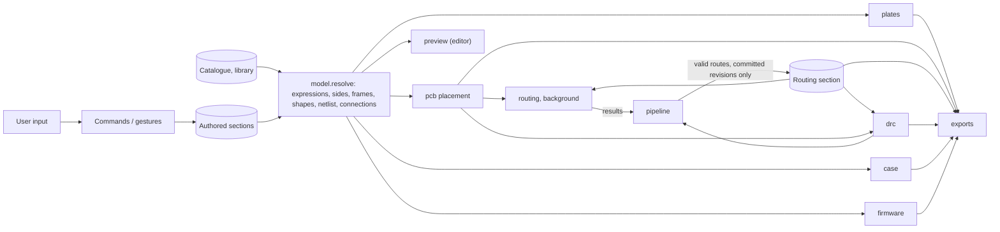
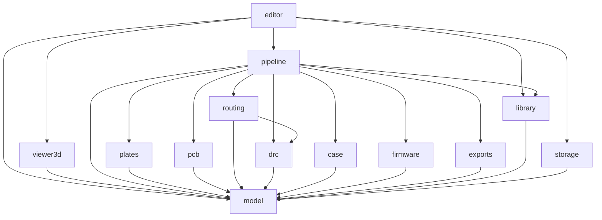
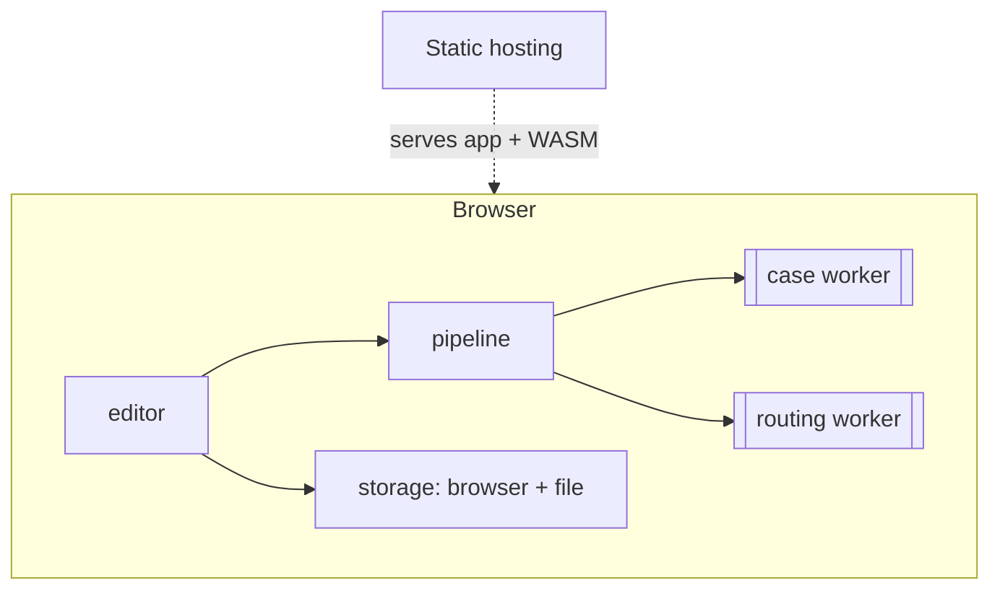

# Architecture Spine: keeb-cad, layout model and generation core

> ⚠️ **Proposed directions pending (2026-10-30).** `directions-2026-10-30.md` records approach directions that change the paradigm and AD-3, AD-5, AD-10, AD-16 and AD-18. Until `bmad-architecture` folds them in, read the affected ADs together with that record and don't build the physical body (shapes, plates, case) from AD-16/AD-18 as written.

**Principles (they bind every AD):** explicit over terse · one way to do each thing · a small, coherent set of concepts.

## Glossary

Each term means exactly one thing. Code, file format and UI use these words and no synonyms.

| Term | Meaning |
| --- | --- |
| **design** | One keyboard document with exactly one electronics configuration; the only source of truth |
| **authored sections** | Every section of the design file except `routing` (AD-8); changed only by commands |
| **routing section** | The one saved section of derived data: routes per board, keyed by connection. Written only by `pipeline` |
| **revision** | The content hash of the canonical serialisation of the authored sections |
| **routing hash** | The content hash of the routing section |
| **layout** | The tree of nodes that places keys and parts |
| **node** | An element of the layout: a group or a slot |
| **group** | A node with children and an arrangement; has an origin frame and no size |
| **slot** | A leaf with a size (`w`×`h`, default `1u`×`1u`) and a frame at its centre; holds one part |
| **key** | A slot whose part is the key cell |
| **arrangement** | How a group places its children: `chain` or `free` |
| **frame** | A position + rotation in the plane |
| **id** | A stable identifier of a design, node, shape, vertex, construction point or case operation; never changes, never reused |
| **form** | `split-reversible`, `split-mirrored` or `unibody` |
| **side** | One hand's set of resolved placements: `left` and `right` in split forms, `whole` in unibody |
| **side-qualified id** | `<side>/<id>`: a resolved placement of an authored element on one side (`left/thumb-far`) |
| **center** | The top-level group, required in split forms, whose frame's y-axis is the mirror axis |
| **board** | One physical PCB: one in `split-reversible` and `unibody`, one per side in `split-mirrored` |
| **anchor** | What a frame is placed from: a slot (+ attach point), a group origin, a vertex or a construction point |
| **default anchor** | The anchor used when none is set: the parent in a `free` group; the previous sibling, advanced by one step, in a `chain` |
| **attach point** | A named point on a slot's rectangle (`center`, `edge-top/bottom/left/right`, `corner-tl/tr/bl/br`) |
| **offset** | Local x, y, rotation (and pivot), applied in the anchor's frame; the node's only rotation |
| **pivot** | The point a rotation turns around, in the node's own frame before rotation |
| **chain** | An arrangement in which each child's default anchor is the previous sibling, advanced by one step |
| **step** | The distance from one chain child to the next, along the chain direction (AD-4) |
| **free** | An arrangement in which each child's default anchor is the parent |
| **gap** | Extra distance along the chain direction before a child |
| **index** | A child's position within a chain |
| **part** | What a slot holds: a catalogue entry, the key cell, or `empty` |
| **module** | A ready-made board used as a part (nice!nano, nice!view) |
| **catalogue** | The available part definitions, each with an id and an immutable version |
| **component** | A named footprint inside a part or key cell (`switch`, `diode`, `led`); has pins |
| **pad** | One copper pad of a pin on a board: `<side>/<slot-id>.<component>.<pin>.<copper>[.<copy>]` (Ids convention) |
| **cutout** | Geometry removed from a plate, PCB or case: part-owned (catalogue, with a role and target) or a user shape |
| **cutout role** | A cutout's purpose (`switch`, `screw`, `mcu-window`, `display-window`, …); plates select roles |
| **keep-out** | An area routing must avoid; part-owned (catalogue) or authored |
| **key cell** | A key template stored in the design: components + their local tracks; groups reference one |
| **pitch** | Centre-to-centre key distance, `pitch-x` / `pitch-y`; independent of switch type |
| **population** | Which slots are fitted, per side |
| **override** | A named change to population, to the derived right side (`split-mirrored`), to the derived netlist (matrix row/column, MCU pin, LED order), or to a part parameter per target |
| **parameter** | A named value with a unit; its name is its id |
| **expression** | A length or angle written with numbers, units, parameter names and `+ - * / ( )` |
| **shape** | A named 2D geometry built from geometry operations: key outline, rectangle, circle, polygon, add, subtract, intersect, offset (corner style, fillet), shape reference |
| **vertex** | A polygon corner; has an id, an anchor and an offset; reusable across shapes |
| **construction point** | A helper point computed from other geometry (e.g. intersection of two lines); a possible anchor; not a part |
| **outline** | The shape designated as the board edge |
| **plate** | A named definition: a shape + the cutout roles it includes |
| **region** | A resolved shape piece: one outer loop plus its hole loops, as exact paths (AD-16) |
| **flatten** | Turning a region's exact paths into polygons with `model`'s one function and `FLATTEN_TOL` (AD-16) |
| **case operation** | A node in the case's 3D operation graph (extrude, offset, boolean, z-position; extensible) |
| **template** | A payload of parameters + case operations, inserted once |
| **net** | A set of pads that must be connected; has a stable net id |
| **netlist** | Every net: matrix rows and columns, power, ground, LED chain, TRRS/UART, display bus, battery |
| **connection** | One pad pair that a net is split into; realised by a key cell, a part, or routing |
| **route** | The copper path for one routed connection |
| **design rules** | Net classes (width, clearance, via size), edge, hole and drill clearances, and keep-out switches (AD-20) |
| **DRC** | The design-rule check, implemented once in `drc` |
| **binding** | What one key does on one keymap layer, from the firmware-neutral vocabulary |
| **keymap layer** | One ordered entry of the keymap: an id, an editable name, and bindings keyed by side-qualified slot id. PCB layers (F.Cu, B.Cu) are always **copper layers** |
| **keymap** | Keymap layers, plus combos |
| **violation** | A reported design problem: `{ kind, severity, ids, message }` |
| **block** | A reusable, versioned design fragment (milestone 2) |
| **command** | A named, undoable operation; the only way the authored sections change |
| **gesture** | A continuous interaction (a drag): begin, update(s), then commit or cancel |
| **committed revision** | A revision reached by a command, a gesture commit or cancel, undo, redo, or load |
| **dependency graph** | The one graph of everything that reads something else: anchors, default anchors, shape references, construction-point inputs, parameter references |
| **resolved design** | The design with expressions evaluated and every per-side placement, shape, netlist and connection computed |
| **stage** | A pure function from the resolved design (and, where stated, other stage outputs) to one output |
| **live** | Recomputed synchronously, including during a gesture |
| **background** | Computed in a Web Worker, with progress; cancelled by a newer committed revision |
| **preview** | The editor's 2D rendering of resolved placements, shapes and stage outputs, in SVG |
| **viewport** | The one 2D view position shared by the 2D workspaces (not isolated cell mode): centre (mm, y up) and zoom |
| **3D viewer** | The Case workspace's interactive rendering of bodies, in `viewer3d` |
| **body** | One named triangulated solid shown in the 3D viewer: id, kind, faces, edges. Milestone 1 has case bodies only. The 2D "key body" colour is a keycap face, not a body |
| **escape hatch** | Exporting a KiCad project to finish outside keeb-cad; the export no longer syncs |

## Design Paradigm

**Single source of truth, with derived views.** The authored sections are the design. `model` resolves them once into a **resolved design**, and every output is a pure, cached function of it. The one piece of saved derived data is the routing section: it depends on history, so it is kept, and it is re-validated against the current design rather than trusted. Interaction happens in an imperative shell (`editor`) that changes authored sections **only** through commands.



## Invariants & Rules

### AD-1: One document; authored sections plus one saved routing section [ADOPTED]
- **Binds:** all
- **Prevents:** outputs drifting from the model; hand edits lost on regeneration; derived data quietly persisted in more places.
- **Rule:**
  - The design file holds the authored sections plus the routing section. Nothing else derived is saved in it.
  - Every output is derived and is never edited inside keeb-cad. Changes the model can't express are made after **export** (escape hatch).
  - **Stable outputs:** the same file with the same app version gives the same outputs on every reopen. An edit changes only the outputs whose inputs it changed.

### AD-2: Authored sections change only through named commands and gestures [ADOPTED]
- **Binds:** model, editor
- **Prevents:** ad-hoc mutation; broken undo; drag previews computed outside the design; undo floods.
- **Rule:**
  - Every change to an authored section is a named command in `model` (e.g. `moveSlot`, `setGap`, `setAnchor`, `addVertex`, `setParameter`, `renameParameter`, `setBinding`, `insertTemplate`, `setFitted`), and nothing else writes to them.
  - A drag is a **gesture**: `begin`, `update`…, then `commit` or `cancel`. Each `update` produces a revision that the live stages consume. A committed gesture is **one** undo entry.
  - A command that removes something removes everything keyed to it in the same command (deleting a slot deletes its bindings, combo memberships, population entries and overrides; deleting a vertex is rejected while a shape uses it, as is deleting a keymap layer that a binding on another keymap layer, or a combo, references), so one undo restores them all.
  - `renameParameter` rewrites every expression that uses the name, in the same command.
  - The routing section is outside commands and undo (AD-12).
  - The command log is not persisted. The design file holds state, not history.

### AD-3: Placement = one anchor + offset, over one acyclic dependency graph [ADOPTED]
> ⚠️ Extended by `directions-2026-10-30.md` D10: anchors may also name spots that case recipes declare.
- **Binds:** model, every stage
- **Prevents:** two placement semantics; two cycle checks; geometry that doesn't follow the layout.
- **Rule:**
  - The tree defines ownership. Placement is independent of ownership.
  - Every node, vertex and construction point has exactly **one** anchor. Unset means the default anchor. Any of them may explicitly anchor to any slot (+ attach point), group origin, vertex or construction point.
  - An explicit anchor **replaces** the default: placement is anchor + offset only, with no step added.
  - World frame = anchor frame → translate by offset → rotate by offset rotation about pivot. This is the single order of operations for nodes and geometry alike. A node has exactly one rotation.
  - Attach points exist on slots only; a group exposes only its origin.
  - Anchors reference by **id**, never by path.
  - The **dependency graph** is one graph and must be acyclic. `model` rejects a command that would create a cycle; a loaded file with a cycle reports `anchor-cycle`.

### AD-4: Exactly two arrangements; the step is a default anchor [ADOPTED]
- **Binds:** model, editor
- **Prevents:** overlapping layout mechanisms; losing per-column stagger and splay; slot widths handled differently.
- **Rule:**
  - **chain** has a direction (`+x` or `+y`). Child 0's default anchor is the chain's frame. Child *n*'s default anchor is child *n−1*'s **world frame** (rotation included), translated along the direction axis of that frame by `(size(n−1) + size(n)) / 2 + gap(n)`, where `size` is the slot's extent along the direction in `u`. Child *n*'s offset is then applied.
  - Rotation carries: a child's rotation turns every later sibling's default anchor. A mid-chain turn that must not carry is expressed by giving the next sibling an explicit anchor.
  - A chain child with an explicit anchor keeps its **index**; later siblings step from wherever it ended up.
  - **free:** each child's default anchor is the parent's origin.
  - **Units:** `u` means `pitch-x` on x-axis properties and `pitch-y` on y-axis properties. Every length property in the schema is tagged `x`, `y` or `none`; `u` on a `none` property is `unit-mismatch`.
  - Empty slots keep their index and still advance the chain.

### AD-5: Slots hold parts; the catalogue is versioned; pitch is independent of switch type [ADOPTED]
> ⚠️ Extended by `directions-2026-10-30.md` D8: recipes are versioned and pinned like catalogue parts.
- **Binds:** model, library, pcb, plates, case, firmware, drc
- **Prevents:** spacing hard-wired to switch type; two owners of part data; cutouts defined per stage; an app update silently changing a saved design.
- **Rule:**
  - The slot owns which part it holds. Population owns only whether it is fitted, per side.
  - `model` owns the **catalogue schema**: components, pins and pin roles, minimum pitch, 3D envelope, cutouts (role + target `plate` / `pcb` / `case`), keep-outs, optional fixed tracks (a pre-routed module zone), named part parameters with defaults. `library` owns the **catalogue data**.
  - Catalogue entries are immutable per version. `catalogue-refs` pins each used part as id + version. `library` keeps every released version; an update adds a version, and moving a design to it is a command.
  - Groups reference a key cell; a slot uses its nearest ancestor's. A slot whose key-cell reference doesn't resolve has no components, so no pads, nets or matrix position. Part parameters (e.g. screw-hole radius) can be overridden per slot or group, per target.
  - Every stage takes cutouts, keep-outs and fixed tracks from the resolved design only.
  - Pitch below a switch's minimum is `pitch-below-min`, never silently adjusted.
  - Lengths carry an explicit unit: `u` or `mm`. Angles are in `deg`.
  - **Milestone-1 catalogue:** Choc v2 hotswap, SOD-123 diode, SK6812mini-e (per-key and underglow), nice!nano, SSD1306 OLED, nice!view, TRRS PJ320A, JST-PH battery connector, power switch, reset button, solder jumpers, M2 screw and standoff.

### AD-6: Form, sides and the derived right side [ADOPTED]
- **Binds:** model, every stage
- **Prevents:** split-only assumptions; stages mirroring differently; the right half having no identity.
- **Rule:**
  - The design carries `form`. All three forms are valid in the schema from format-version 1. Milestone 1 implements `split-reversible`; the others load and report `unsupported-form` instead of producing outputs.
  - The authored layout describes one side: `left` in split forms, `whole` in unibody. **Only `model.resolve` derives the right side**, and it emits per-side placements, with side-qualified ids, for every form. Every stage consumes them; no stage mirrors.
  - The right side is the resolved left side reflected across the y-axis of `center`'s frame. Nodes, vertices, construction points and shapes are reflected together. Attach points swap left and right.
  - `split-reversible`: one board carries every footprint of both sides (reversible footprints, solder jumpers). Sides differ only in population. Geometric overrides are not allowed.
  - `split-mirrored`: one board per side. Overrides (swap part / remove / offset) target `right/` ids.
  - Keymap, population, pads and violations use side-qualified ids.
  - There is no other asymmetry mechanism.

### AD-7: Coordinates [ADOPTED]
- **Binds:** model, every stage
- **Prevents:** flipped or mirrored outputs from mixed conventions.
- **Rule:** The model uses mm, degrees, **y up**, counter-clockwise positive. Each stage converts to its target's convention at its own output boundary. The model never encodes an output's convention.

### AD-8: Design file = canonical KDL v2, versioned, sectioned, with stable ids [ADOPTED]
- **Binds:** model, library, storage, editor
- **Prevents:** noisy diffs, unreadable old files, sections stored in incompatible shapes, format lock-in.
- **Rule:**
  - Designs are KDL v2 files carrying a `format-version`. `model` validates them and migrates older versions forward on load. A newer version than the app knows opens read-only with `format-too-new`. A failed migration reports `migration-failed` and never overwrites the file.
  - Sections, in this order: `meta` (design id, name, form, pitch, provenance), `parameters`, `catalogue-refs`, `key-cells`, `layout`, `construction`, `shapes`, `plates`, `case`, `population`, `overrides`, `design-rules`, `keymap`, `routing`. The schema for each lives in `model`.
  - **The canonical writer lives in `model`.** It sets node and property order itself, writes lengths, angles and expressions as quoted strings (`"19mm"`, `"-15deg"`, `"wall + gap"`), and canonicalises numbers.
  - Loading and then saving an unchanged design reproduces the file byte for byte.
  - Free-text comments are not preserved. Annotations use a `note` property.
  - Every id is minted by `model` (kebab-case, unique per design, never reused).
  - The file format doesn't depend on any storage backend.

### AD-9: Remix: copy with provenance; merges in milestone 2 [ADOPTED]
- **Binds:** model, library, editor
- **Prevents:** remixes silently changing under the user; ids that can't support a later merge; a second mechanism for carrying layout changes between boards.
- **Rule:**
  - A remix source is a **block or a whole design**. A design made from another design (e.g. wireless Corney Island from wired) is a remix, not a variant.
  - **Copy design** mints a new design id and takes a new name, keeps every other id, and writes provenance into `meta`: source design id, source revision, licence. **Save to file** keeps the design id; only Copy design makes a new design.
  - Ids inside an inserted block are `<instance-id>/<block-node-id>`.
  - **Milestone 1:** Copy design only. No library of blocks, no update pull.
  - **Milestone 2:** the design embeds an untouched base copy of the source; pulling is a three-way merge (base, new source, local) keyed by id; conflicting changes are surfaced, never auto-resolved; a pull carries layout and electronics changes alike.

### AD-10: Package dependency direction, shared derivations, stage contracts [ADOPTED]
> ⚠️ Contradicted by `directions-2026-10-30.md` D1: one reactive world on Vue's reactivity engine, including the core. The wording is to be amended openly.
- **Binds:** all packages
- **Prevents:** stages coupling to each other; UI framework or rendering libraries leaking into the core; stages each evaluating geometry, expressions or nets their own way; two shapes for one output.
- **Rule:**
  - Dependencies point only as drawn below. Stages depend on `model` only and never import each other. **One named exception:** `routing` imports `drc`.
  - `model` imports no other workspace package. `resolve(authored, catalogue)` receives catalogue data from its caller. `insertTemplate(payload)` receives the template from `editor`, which reads it from `library`; `model` mints the ids and suffixes clashing parameter names.
  - **Shared derivations live in `model.resolve`, and only there:** expression evaluation, per-side placements, shapes, the netlist, connections, catalogue lookup.
  - **Every stage output type is defined in `model`** (`PlatesOutput`, `PcbPlacement`, `RouteSet`, `DrcResult`, `CaseOutput`, `FirmwareOutput`).
  - **Stage signatures:** `(resolved) → { output, violations[] }` for plates, pcb, case, firmware. `routing(resolved, placement, fixedRoutes, { connectionIds, deadline, signal })`, which returns routes for the requested ids only, and `drc(resolved, placement, routes)`. `exports(resolved, outputs)` packages what `pipeline` hands it.
  - **Named stage-to-stage flows, all via `pipeline`:** pcb placement → routing and drc; every stage output → exports. No others.
  - Only `model` imports `makerjs`. Only `case` and `routing` import `clipper2-ts`. Only `routing` and `drc` import `flatbush`.
  - Only `editor` imports Vue. Only `viewer3d` imports three.js; only `editor` imports `viewer3d`. Nothing imports `editor`.
  - **Enforcement:** pnpm strict dependencies, plus dependency-cruiser rules in CI.



### AD-11: Live vs background stages; revisions and cache keys [ADOPTED]
- **Binds:** pipeline, editor, stages
- **Prevents:** a UI that blocks on slow geometry; stale outputs shown as current; cache false hits after an app update or a non-geometric edit.
- **Rule:**
  - **Live:** resolve, plates, pcb placement with key-cell and part tracks, firmware, and DRC of saved routes against the current placement. The preview is `editor` rendering of these, not a stage.
  - **Background** (Web Workers): case (replicad) and routing. They report progress and partial or failed results; a newer committed revision cancels them. Background stages start only at committed revisions, or after a gesture has been idle for a debounce interval; routing starts only at committed revisions (AD-12). A cancelled routing request stops like a deadline (AD-12): it returns what it placed, which is re-validated before it is kept.
  - **Cache key** = stage id + stage version + catalogue versions used + hash of the resolved slice the stage reads (+ routing hash for drc and exports; routing hash + requested connection ids for routing). A routing result cut short by a deadline or a cancel is never cached.
  - Every output is tagged with the revision it was computed from (+ routing hash where it reads routes). An output whose tag differs from the current one is shown marked stale, never as current, including on cache hits.
  - The case solid may be cached by its cache key in memory or browser storage; it is never written to the design file.
  - `CaseOutput` carries **bodies**, each `{ id, kind, faces, edges }`, typed arrays shaped like replicad's `mesh()` and `meshEdges()` output, transferred from the case worker without copying, plus the STEP and STL bytes written in the case worker. A body's id is the id of the case operation whose result it is. `model` and `case` never import three.js.
  - `pipeline` keeps the last good output of each stage, tagged with its revision; the editor holds references to them, never copies, and never makes them reactive.

### AD-12: Routing: incremental, browser-only, saved in the routing section [ADOPTED]
- **Binds:** pcb, routing, drc, pipeline, storage
- **Prevents:** routing on the undo stack; drags destroying routes; stale routes applied blindly; two writers of the routing section.
- **Rule:**
  - Connections realised by a key cell or a part's fixed tracks are pcb placement and move live. Routing handles only the rest.
  - Connections are per board and never join pads on two boards; a link between the halves is realised by the cable part. In `split-reversible` the one board's pads are the `left/` placements' pads (with their F, B and TH copies).
  - The routing section holds, per board, routes keyed by connection id. A route is never hand-edited.
  - **A saved route is valid when** its connection still exists, both pads are at the same world positions, and `drc` passes it against the current board.
  - **Only `pipeline` writes the routing section, and only at committed revisions.** At each committed revision it drops invalid routes and requests routing for unrouted connections, passing valid routes as fixed obstacles. During a gesture, saved routes are checked for display only.
    - The connections whose saved routes were just dropped as invalid (e.g. those a moved part now clashes with) are routed in the same request as the moved part's connections.
  - **Fixed obstacles** cannot be crossed, moved or ripped up. Another net's fixed copper blocks at the same clearance as the engine's own copper; same-net fixed copper does not block, except that every drill keeps AD-20's drill clearances from every other drill, same net included. The engine returns copper only for the connection ids it is asked to route.
  - **Deadline:** `pipeline` sets one per request (value Deferred). The engine checks it, and the abort signal, between connections and bounds each connection's search; past it, it returns what it placed and reports the rest unrouted. It never hangs. Golden tests run with no deadline.
  - **Reroute** is an explicit user action owned by `pipeline`, outside commands and undo: it drops the saved routes in a chosen scope (the whole board, or the routes around a chosen unrouted connection) and routes them again. Automatic routing never moves a valid saved route. `pipeline` does not retry the same unrouted set at the same revision and routing hash.
  - A routing result for an older committed revision is re-validated route by route against the current one before it is kept.
  - The routing section is outside commands and undo. Undo and redo may change copper while staying electrically equal.
  - Unrouted connections are `unrouted` violations, including a connection whose saved route was dropped and did not route again; the UI always shows the count.
  - Any engine sits behind this one stage interface and runs in a Web Worker in the browser. No helper program, no server, no network. The interface stays engine-neutral.
  - **Milestone-1 engine:** keeb-cad's own keyboard router in `routing`: a two-layer grid A* with rip-up and reroute of its own copper, on `clipper2-ts` and `flatbush`, in TypeScript with no Node or DOM APIs (routing verdict, 2026-10-28). tscircuit capacity-autorouter 0.0.1010 was rejected.
  - **Fallback:** whatever the engine can't route stays unrouted and is finished in KiCad after export (escape hatch). The verdict graded the engine pass with fallback, so this per-connection fallback is live in milestone 1; the whole-board SM-3 fallback is not triggered.

### AD-13: Storage behind one interface; milestone 1 is local-only [ADOPTED]
- **Binds:** editor, storage, library, pipeline
- **Prevents:** a hard dependency on any service; tabs overwriting each other; a file pairing authored state with routes from another revision; storage and the Versions list keeping different revisions; pruning a recovery point.
- **Rule:**
  - All persistence goes through the `storage` package interface: `save`, `load`, `listVersions`, `listDesigns`. The saved unit is the whole design file, written atomically: authored sections plus the routing section valid for that revision.
  - `listDesigns` returns the designs in browser storage, newest first, each with design id, name, revision and last-saved time. On launch the editor reopens the first; the Start screen lists them.
  - Opening a file never overwrites browser storage: when that design id is stored at another revision, the file's revision opens as current and the stored one stays available through `listVersions`.
  - **Version retention.** `listVersions` returns every kept version of a design, newest first, each a whole design file with its reason. **Named points** are kept until the design is deleted: the revision current at each file open (`file`), each save, Save to file or Firefox download (`saved`), both sides of a version switch (`switch`), the revision before a migration (`migration`), and the source revision when the design is copied (`copy`). **Rolling:** the last 20 autosaved revisions (`autosave`). Under storage pressure only rolling versions are pruned, oldest first; autosave reports failure only when none remain.
  - Milestone 1 implements browser autosave and file Save/Open.
  - The catalogue ships bundled with the app.
  - No network calls are needed to design or export.
  - One tab edits a design at a time; only that tab saves. Other tabs open it read-only and never write the routing section.

### AD-14: The netlist and connections are owned by `model` [ADOPTED]
- **Binds:** model, pcb, routing, drc, firmware
- **Prevents:** a PCB wired one way and firmware scanning another; stages inventing nets; routes dropped because a key moved or was inserted.
- **Rule:**
  - `model.resolve` produces the one netlist from component pin roles, the key cell and parts, and splits each net into connections. pcb, routing, drc and firmware consume them and derive none of their own.
  - **Net ids are stable:** derived from ids, never from indices or positions (e.g. column net `col:<chain-id>`, LED link `led:<slot-id>`).
  - **The split of a net into connections depends only on ids and the netlist, never on positions.** Fixed by the routing spike (`spikes/SPLIT-RULE.md`):
    - Order the net's pads (on one board, AD-12) and connect each pad to the next: n − 1 connections for n pads, none for fewer than two. No star.
    - **Order** is the netlist's authored order: a matrix net by each key's index along its chain (matrix assignment rule below), an LED net by LED chain order. Natural order of pad ids breaks ties and orders every other net.
    - Natural order compares digit runs as numbers (`d2` < `d10`) and other runs by code unit, locale-free. Digit runs equal in value but spelled differently are decided there, by code unit (`"01"` < `"1"`, so `a01b` < `a1a`).
    - **Connection id** = `<net-id>:<padA>~<padB>`, padA first in natural order. Pad ids follow the Ids convention.
    - Reversible copies are distinct pads, joined by visible connections and never assumed connected. Pins with no number or no net are obstacles, not pads. No id contains a position.
  - Each connection carries how it is realised: `fixed-tracks` (a part's fixed tracks), `key-cell` or `routing` (AD-12's first bullet). `model` tags it from the pin pairs that the key cell and catalogue parts declare their tracks join, never from positions; `drc` checks that the placed tracks do join them. Only `routing` connections go to the engine.
  - **Matrix assignment rule:** for each key, the nearest enclosing chain running along *x* gives the column, the nearest running along *y* gives the row. Keys outside an x+y pair go into an additional row in chain order.
  - Matrix row/column, MCU pin assignment and LED chain order can be overridden; overrides are stored in the design. A future optimiser must be a command that writes overrides.
  - A cross-stage golden test asserts that the firmware matrix equals the PCB nets.

### AD-15: Exports [ADOPTED]
- **Binds:** exports, pipeline, plates, pcb, drc, case, firmware
- **Prevents:** each stage inventing its own export set; fab files from a board that fails DRC; files exported from geometry that didn't resolve.
- **Rule:** Milestone-1 exports:
  - plates: DXF, SVG, and gerber + drill (edge + holes board, same writer as the PCB)
  - case: STEP and STL
  - PCB: gerber (copper, mask, silkscreen, edge) + Excellon drill, **only when `pipeline` holds a DRC result with zero `error` violations and no unrouted connections, tagged with the same revision and routing hash as the routes being exported**; a KiCad 10 project (board file plus project and custom-rules files carrying AD-20's values, drill clearances at severity error) as the escape hatch, always available
  - firmware: a ZMK shield with the `zmk,physical-layout` node, wired split over UART and RGB underglow when the population fits them, and the keymap
  - Every export except the KiCad board is **blocked while the resolved slice it reads carries a `model` violation of severity `error`**, reported as `blocked: <kind>`. Warnings never block. The KiCad board exports whatever resolved; when the board edge failed it is written with no Edge.Cuts, never a stale outline.

### AD-16: Shapes are authored and evaluated once, in `model` [ADOPTED]
> ⚠️ Contradicted by `directions-2026-10-30.md` D4: the body is a composition of derived and drawn pieces; anchored vertices become the fallback, not the main path.
- **Binds:** model, plates, pcb, case, drc, exports
- **Prevents:** plate, PCB edge, case and gerbers disagreeing on one offset or fillet; a mismatch with Ergogen's geometry; a wrong boolean or offset result passed on silently; overlapping hole loops; stages flattening or composing plates their own way.
- **Rule:**
  - Shapes, vertices and construction points are authored sections. Every primitive and vertex is anchored (AD-3). Shapes reference shapes by id. Exactly one shape is the outline.
  - Milestone-1 construction point kind: intersection of two lines. New kinds are added to the schema in `model`.
  - `model.resolve` is the **single shape evaluator**, and the only package that imports `makerjs`. No stage re-evaluates a shape.
  - It also composes every plate and the board edge (the outline minus its `pcb`-target cutouts). `plates`, `pcb`, `drc` and `exports` read these composed regions and run no booleans of their own.
  - **Resolved shape type:** a list of **regions**, each `{ outer, holes[] }`. Every loop is a closed chain of **exact paths** (lines, arcs, circles). A circle that a boolean leaves whole stays one circle path.
    - Outer loops run counter-clockwise and holes clockwise (y up).
    - Regions are ordered by their outer loop's lowest-then-leftmost point, and every loop starts at its own lowest-then-leftmost point.
  - **Every resolved shape is normalised and checked before output**, whatever produced it (primitive, polygon, boolean or offset).
    - Collinear lines are merged: lines that share an end within 1e-6 mm and run the same way within 1e-6 rad become one. The merge never drops or invents a segment.
    - Every chain must close within 1e-6 mm.
    - An offset result must also be one region per source region, with its signed area grown (positive distance) or shrunk (negative), and every flattened point within 0.05 mm of the offset distance from the source.
    - On any failure the shape is not output and `model` reports `shape-failed`, naming the shape and its operands.
  - A shape `offset` is makerjs `model.outline`, run on the normalised paths of its source.
  - A failed or undefined shape is in the dependency graph (AD-3) with its dependents. Plates, the board edge and case operations that read it produce nothing and report nothing of their own.
  - **Flatten:** `model` exports `flatten(region)` and the constant `FLATTEN_TOL = 0.005 mm` (maximum chord deviation). No stage passes its own tolerance.
    - Lines stay as they are.
    - Each arc becomes `max(1, ceil(|sweep| / (2·acos(1 − tol/r))))` equal chords. A full circle becomes its own loop of at least 3 chords.
    - The output keeps the region form, winding and order.
    - A stage that needs polygons flattens at its own boundary with this function.
  - **Plates:** a plate is its shape minus the part cutouts whose role it includes, plus any user cutout shapes.
    - A cutout whose every point is more than 2 × `FLATTEN_TOL` from the plate boundary and from every other cutout becomes a hole of the region it lies in, with no boolean.
    - Every other cutout is subtracted, in cutout id order.

### AD-17: Parameters and expressions are design-wide [ADOPTED]
- **Binds:** model, editor, every authored section
- **Prevents:** per-section parameter scopes; stages evaluating expressions differently; a second expression language later.
- **Rule:**
  - The `parameters` section holds named values with units. Any length or angle property in any authored section holds a literal or an expression.
  - Grammar: numbers with units (`mm`, `u`, `deg`), parameter names, `+ - * /`, parentheses. No functions, no conditionals. One hand-written parser in `model`.
  - Units are checked; a mismatch is `unit-mismatch`. `u` resolves only on axis-tagged properties (AD-4).
  - Parameters are part of the dependency graph (AD-3).
  - Expressions are evaluated only in `model.resolve`. Stages see numbers only.

### AD-18: Case = an authored 3D operation graph [ADOPTED]
> ⚠️ Contradicted by `directions-2026-10-30.md` D5–D9, D11: the style is a live setting, recipes are live data run by one interpreter, and your operations sit on top of derived layers. No template is inserted once.
- **Binds:** model, case, editor, library
- **Prevents:** two storage shapes for templates; case logic hard-coded in the stage; a case limited to straight extrusion.
- **Rule:**
  - The `case` section is a graph of case operations with ids. Operations reference shapes by id, parameters by name, and part cutouts with target `case` (AD-5).
  - A template is inserted **once** (`insertTemplate`): it adds parameters plus editable case operations whose values are expressions over them. Milestone 1 ships one template, `tray`, in `library`.
  - The `case` stage is an interpreter of the operation graph. Adding an operation type means a schema in `model` plus an interpreter in `case`; nothing else changes.
  - Milestone-1 operation types: extrude, offset, boolean (add, subtract, intersect), z-position.
  - A case `offset` runs in the `case` stage on the flattened region (AD-16), with `clipper2-ts` `inflatePathsD`: `EndType.Polygon`, precision 6, arc tolerance 0.001 mm. It never calls makerjs.
  - **Corner styles:** `model` defines one corner-style enum for case offsets, and `case` maps it in one table.
    - `round` maps to `JoinType.Round`.
    - `sharp` maps to `JoinType.Miter` with a miter limit of 1000, so no corner is squared off.
    - `sharp` with a fillet radius r is the sharp offset, then opened (−r then +r, round) and closed (+r then −r, round), which rounds convex and concave corners with radius r.
  - The `tray` template authors Corney's walls (Ergogen `expand` with pointed joints and `fillet: 0.5`) as case offsets, not as shape offsets.

### AD-19: Keymap is firmware-neutral [ADOPTED]
- **Binds:** model, firmware, editor
- **Prevents:** firmware-specific data in the design; QMK later needing design changes; right-half keys that can't be bound; keymap layer references breaking on reorder, duplicate or delete.
- **Rule:**
  - The `keymap` section is a list of keymap layers, each mapping side-qualified slot id → binding, plus a list of combos (set of side-qualified slot ids + layers → binding).
  - Each keymap layer has an id minted by `model` and an editable name. Keymap layer order is the list order; firmware layer numbers come from it, in the writer.
  - `layer-tap`, `momentary-layer`, `toggle-layer` and a combo's layers reference keymap layers **by id**, never by index or name. Reordering changes no binding. Duplicating mints a new keymap layer id and copies the bindings unchanged.
  - Deleting a keymap layer removes its own bindings in the same command. Deleting one that a binding on another keymap layer, or a combo, references is rejected, naming those side-qualified slots and combos (AD-2).
  - Bindings use **only** the vocabulary defined in `model`: `key`, `mod-tap`, `layer-tap`, `momentary-layer`, `toggle-layer`, `transparent`, `none`, and device actions `bluetooth`, `output-select`, `rgb`. The vocabulary grows by changing `model`. There is no raw firmware binding.
  - A device action whose hardware the population doesn't fit is `binding-unsupported`, naming the slot.
  - Firmware writers translate the vocabulary. A writer is a pure addition.

### AD-20: One DRC, one set of design rules [ADOPTED]
- **Binds:** drc, routing, pipeline, pcb, exports, model
- **Prevents:** routes the router calls valid failing the export gate; checkers that disagree; keep-outs that can't be adapted per design; an engine loosening a class rule to route; co-located drills reaching fab.
- **Rule:**
  - `design-rules` is an authored section: net classes (width, clearance, via diameter and drill) assigned to nets, edge clearance, hole clearance (copper to a non-plated hole's edge), two **drill clearances**, drill edge to drill edge, same net or not: **via-to-via** (default 0.25 mm, KiCad's default) and **pad-hole** (a pad hole to any other drill, default 0.45 mm, JLCPCB's 2026-10-28 figure), and per-slot switches that disable a catalogue keep-out (e.g. the nice!nano antenna on a wired design). Pairs inside one catalogue footprint are checked by a `library` test, not by `drc`. The KiCad export writes these values into its project rules.
  - **Clearance policy:** engines route at the strictest net-class clearance and respect the drill clearances. `drc` checks each net class's own width and clearance and reports violations per net class. No rule is loosened to make an engine route.
  - `drc` is the only implementation of the check. Routing uses it for route validity; `pipeline` runs it as a stage for live warnings and the export gate. KiCad's DRC is a cross-check only (KiCad 10.0.7 stops some types at 199, and it did not report the spike's one case of crossing traces of different nets).
  - DRC findings are `drc` violations naming the pads, connections or shapes involved. Every clearance finding, drill clearances included, has severity `error` (blocks gerber + drill, AD-15).

### AD-21: One design, one electronics configuration [ADOPTED]
- **Binds:** model, every stage, exports, fixtures
- **Prevents:** a variant axis multiplying every stage, cache key and export.
- **Rule:**
  - A design has one population per side, one netlist, one routing section and one firmware.
  - Different electronics on the same layout are separate designs related by remix (AD-9). There is no variant concept in the model, file or stages.

### AD-22: Editor views: SVG canvases, one viewport, a 3D viewer of bodies [ADOPTED]
- **Binds:** editor, viewer3d, model
- **Prevents:** workspaces choosing their own renderers; the Layout canvas and Case camera disagreeing; canvases flipping y or re-deriving geometry; Assembly needing a new viewer.
- **Rule:**
  - Every 2D canvas (Layout, Shapes, PCB, Firmware, isolated cell mode) is inline SVG rendered by Vue templates in `editor`. Canvas items are DOM elements: focus, `aria-*`, pointer hit-testing, theme tokens as CSS custom properties, and reduced motion through CSS. Canvas marks meet 3:1 non-text contrast in both themes; handles keep the 8px canvas hit radius (DESIGN.md `spacing.canvas-hit-radius`) in screen pixels at any zoom.
  - One **viewport** (centre in model mm, y up; zoom) lives in Pinia and is shared by the 2D workspaces. Isolated cell mode has its own zoom. The model-to-screen y-flip happens once, in the viewport transform (AD-7). Text and handles are positioned through that transform but drawn in screen space, so they are never flipped or scaled.
  - Canvases draw only the resolved design and stage outputs; they compute no geometry (AD-10).
  - `viewer3d` is framework-free: it renders a list of bodies and owns the camera and its pointer and keyboard controls on its own canvas element, and honours `prefers-reduced-motion` (the Home camera move jumps). It never handles `contextmenu`; it exposes picking (screen point → body id) and a top view set from the viewport. `editor` hosts it and owns focus regions, menus and the viewport. Home/0 is the top view derived from the viewport.
  - The 3D viewer never blanks once a body exists: while `CaseOutput` is stale, the last good bodies are drawn grayed (AD-11).

## Consistency Conventions

| Concern | Convention |
| --- | --- |
| Naming | Glossary terms only. Packages: `@keeb-cad/<name>`. KDL node names are lowercase glossary terms. Commands are verb+noun camelCase (`setGap`). |
| Ids | Kebab-case, minted by `model`. Resolved: `<side>/<id>`. Block nodes: `<instance-id>/<block-node-id>`. Pads: `<side>/<slot-id>.<component>.<pin>.<copper>[.<copy>]`, where copper is `F`, `B` or `TH` (through-hole) and `.<copy>` (2, 3, …) numbers repeats of one pin and copper in the catalogue footprint's pad order. Reversible copies are distinct pads. Nets: derived from ids (AD-14). |
| Units in files | Quoted with an explicit unit or as an expression: `"19mm"`, `"1u"`, `"-15deg"`, `"wall + gap"`. |
| Violations | `{ kind, severity: error \| warning, ids, message }`. Design problems never throw. Commands that can't apply return a typed rejection. Each kind has one owner. `model`: `anchor-cycle`, `construction-undefined` (error: a construction point from parallel or coincident lines; ids name the point and its two lines; it and its dependents are not evaluated), `unresolvable-reference` (warning when a key-cell reference names a cell not defined yet, the slot placing with no footprint; error otherwise), `shape-failed` (error: a resolved shape fails AD-16's checks; ids name the shape and its operands; it and its dependents are not output), `unit-mismatch`, `unsupported-form`, `pitch-below-min`, `overlap`, `binding-unsupported`, `format-too-new`, `migration-failed`. `routing`: `unrouted`. `drc`: `drc`. A stage reports only its own kinds. |
| Stable outputs | Same file + same app version → same bytes for every export. No clocks, randomness, locale or random UUIDs in outputs; tool-generated ids (KiCad UUIDs) are derived from design ids. Only routes are history-dependent, and they are saved. |
| Testing | Golden fixtures: Corney Island v0.3 wired and wireless, as two designs (`fixtures/`, from `layout-model/sources/`). Internal: key positions within 0.01 mm of Ergogen. Acceptance: key centres, outline vertices, plate cutouts and case dimensions within ±0.05 mm. Every stage has golden-file tests. KiCad output opens in KiCad 10; ZMK output builds. A cross-stage netlist test enforces AD-14. LambBT and Corax56 are paper checks. |
| Editor state | UI state (selection, viewport, panels, gesture in progress) lives in Pinia, never in the design. The design store exposes `dispatch(command)`, the gesture API and read access only. |
| Monorepo | pnpm workspaces and TypeScript project references. Libraries in `packages/`, the editor app in `app/`. dependency-cruiser enforces AD-10 in CI. One root ESLint/Oxlint and Prettier config covers every package. |
| Licences | `replicad-opencascadejs` is LGPL-2.1, served as an unmodified, dynamically loaded WASM; the notice ships with the app. Footprints derived from third-party libraries carry attribution. Remix provenance carries the source licence (AD-9). |

## Stack

Verified 2026-10-24 (`stack-research.md`), 2026-10-25 (gate re-check), 2026-10-26 (renderers, npm) and 2026-10-28 (clipper2-ts and makerjs, npm and GitHub); 2026-10-28 (flatbush, npm).

| Name | Version |
| --- | --- |
| TypeScript | ~6.0 |
| Vue | 3.5.44 |
| Vite | ^8.2 (8.3.5 current) |
| create-vue (TS, Router, Pinia, Vitest, Playwright, ESLint/Oxlint) | 3.24.0 |
| Pinia | ^4.0 (4.1.0 current) |
| vue-router | 5.4.0 |
| Vitest | ^4.1 (as the starter ships) |
| pnpm | 12.15.0 |
| dependency-cruiser | 18.7.0 |
| Prettier | 3.9.10 |
| makerjs (maintenance mode; geometry unchanged since 0.18.1, which Ergogen uses) | 0.19.2 |
| clipper2-ts (BSL-1.0; case offsets (AD-18) and the router (AD-12)). Pinned exactly: semver sorts the older stable `2.0.1` above it, and that lacks the `inflatePathsD` and `ClipperD` scaling fixes | 2.0.1-18 (exact) |
| flatbush (ISC; `routing` and `drc` spatial index) | 4.6.2 |
| replicad / replicad-opencascadejs | 1.2.0 / 1.1.0 |
| @bgotink/kdl (KDL v2) | 0.4.1 |
| @tarikjabiri/dxf | 2.9.0 |
| 2D canvas: inline SVG via Vue templates (no library) | — |
| three (3D viewer, `viewer3d` only) | 0.186.1 |
| replicad-threejs-helper (`viewer3d` only) | 1.2.0 |
| KiCad target (board format `20260206`, written literally) | 10.0.x |
| ZMK target (board names `nice_nano_v2`) | v0.3.0 |

## Structural Seed

```text
keeb-cad/
  packages/
    model/      # glossary types, stage output types, KDL schema + canonical writer + migrations,
                # expression parser, resolve (expressions, sides, frames, shapes via makerjs,
                # netlist, connections), commands, catalogue schema, keymap vocabulary,
                # case-operation schemas, flatten
    plates/     # stage: plate geometry
    pcb/        # stage: placement + key-cell and part tracks + KiCad writer
    routing/    # stage: incremental routing (worker)
    drc/        # checker library + stage: design-rule check
    case/       # stage: case-operation interpreter on replicad (worker)
    firmware/   # stage: ZMK writer (shield, physical layout, wired split, RGB, keymap)
    exports/    # packaging: DXF, SVG, gerber, drill, STEP, STL, KiCad, ZMK
    pipeline/   # orchestration, caching, workers, revision tagging, routing-section writer, export gate
    storage/    # storage interface + browser/file backends
    library/    # versioned catalogue data, footprints + attribution, case templates
    viewer3d/   # 3D viewer: three.js scene of bodies, camera + controls (no Vue)
  app/          # editor: Vue app (create-vue), package @keeb-cad/editor; SVG canvases
  fixtures/     # Corney Island wired + wireless designs, Ergogen reference output
```



## Capability → Architecture Map

| Capability (PRD) | Lives in | Governed by |
| --- | --- | --- |
| FR-1–2 layout, anchors, chain | model | AD-3, AD-4 |
| FR-3 pitch, slot size, key cell, group and per-target overrides | model, pcb | AD-4, AD-5 |
| FR-4 form readiness | model | AD-6 |
| FR-5 second design from a copy | separate designs | AD-21, AD-9 |
| FR-6–7 shapes, anchored geometry | model | AD-16, AD-3 |
| FR-8–9 parts, cutouts, keep-outs | model (schema), library (data) | AD-5 |
| FR-10 plates | plates, exports | AD-16, AD-15 |
| FR-11 PCB, netlist, overrides | model, pcb | AD-14, AD-6 |
| FR-12 incremental routing | routing, pipeline, drc | AD-12, AD-14, AD-20 |
| FR-13 gerber + drill, KiCad escape hatch | exports, pipeline | AD-15, AD-20 |
| FR-14 tray case | case, model, library | AD-18, AD-17 |
| FR-15 ZMK firmware | firmware | AD-14, AD-15, AD-19 |
| FR-16 keymap | model, firmware | AD-19, AD-2 |
| FR-17 live propagation, warnings | pipeline, editor | AD-11, conventions |
| FR-18 file, undo, autosave, migrations | model, storage | AD-2, AD-8, AD-13 |
| Editor canvases and Case 3D viewer (UX spines) | editor, viewer3d | AD-22, AD-11 |

## Deferred

| Decision | Why it can wait | Revisit when |
| --- | --- | --- |
| Router reroute coverage: after the wired Corney move, `ULED_1:LED22.2.F~LED23.4.B` and `ULED_1:LED23.4.B~LED23.4.F` (dropped as invalid) did not route again; the reroute was tested on one key, one delta, one run, on Corney only, with a router tuned on that board | Unrouted connections stay visible (AD-12); the routing verdict graded pass with fallback | epic-routing-and-fab (pinned to epic-risk-spikes 2.13): route them, by Reroute (AD-12) or otherwise, or show why not; test more moves and a board the router was not tuned on |
| Router memory budget: the spike measured the worker JS heap only (wired 96.4 MiB), without typed arrays (about 120 MiB more, estimated) | No M1 budget is set; Corney fits | epic-routing-and-fab: measure with typed arrays and set a budget |
| Drill clearances untested in the router: the graded runs had no via-to-via or pad-hole rule (wired Corney got 45 `hole_to_hole` and 27 `holes_co_located` KiCad warnings), so completion with AD-20's drill clearances is unmeasured | The verdict's grade stands on the rules it ran | First routing story of epic-routing-and-fab: rerun the Corney scorecards with both drill clearances in the router's input |
| Bare wired Corney fails AD-20 before routing: 216 LED pads sit 0.21 mm from their own footprint cutout against the 0.30 mm edge clearance (and 4 `invalid_outline`), all `error`, so its gerbers are blocked | Routing is graded on added errors (verdict Decision 1) | epic-parts-and-pcb: change the LED footprint or add a catalogue-declared exemption, before the first gerber story |
| Routing deadline value per request | Set by `pipeline`; Corney routes in about 13 s | epic-routing-and-fab, first routing story |
| makerjs booleans not covered by the geometry verdict (2026-10-28): arc against arc (a cut through a fillet), #377 with one shared edge or a partial overlap (might give a closed but wrong shape that `shape-boolean-failed` misses), #477 union cost on a 50-key plate, and whether plate hole loops export the same as a subtraction | Corney and LambBT pass; the verdict covers the rest | epic-shapes-and-plates, before relying on them. A failure reopens AD-16 (compare against clipper2 there) |
| Shape `offset` latency: makerjs `model.outline` takes about 70 ms on Corney's outline, more than a live frame | No M1 shape uses an offset: Corney's walls are case offsets in `tray` (AD-18), and LambBT has none | When a design's outline uses an offset and live editing hurts: own exact offset or a worker |
| **ZMK wired split vs Corney's single-wire TRRS** (`R2: DAT`): v0.3.0 supports only two-wire full-duplex UART; half-duplex is experimental. Choose: rewire for TX/RX, hardware-test half-duplex, or BLE split | Netlist comes from catalogue pin roles either way | Before the firmware story; blocks SM-4 for the wired design |
| Gerber + drill writer: own vs `circuit-json-to-gerber`; ground pours | Hidden inside `exports` | epic-routing-and-fab, before the first gerber story |
| KiCad writer: `kicadts` vs own; KiCad schematic export | Hidden inside `exports` (it reads placement and routes); the project suffices as escape hatch | First pcb story |
| Case-offset corner mapping (AD-18: sharp with a fillet, done as open and close) against Ergogen's `expand` with pointed joints and `fillet: 0.5` | Untested; the case stage runs in the background | epic-tray-case, against Corney's case fixture within ±0.05 mm, before relying on it. A failure reopens AD-18's corner table |
| Live latency target, set on the max, not the median (Corney's outline: median 1.7–6.9 ms, max 28.4 ms under load) | Needs live stages to measure | Once live stages exist; move the evaluator off the main thread if the max misses it |
| Corney Island's own ZMK keymap (sizes the neutral vocabulary) | Not in `layout-model/sources` | Before the keymap story |
| Footprint licence (ceoloide derivation with attribution) | Data, not structure | Before footprint library work |
| Construction point kinds beyond line intersection; averaged anchors | Corney uses intersection only | During the Corney rebuild |
| Default LED-order and MCU pin assignment rules | Overrides cover Corney (AD-14) | First netlist story |
| `split-mirrored` and `unibody` implementation | Model ready (AD-6) | When a reference board is chosen (reversible Corney routes in the browser: routing verdict 2026-10-28) |
| Konva copper layer under the PCB SVG (konva 10.9.0 + vue-konva 4.0.1) | Corney is ~100 keys; SVG covers M1 (AD-22) | If PCB canvas frame time hurts during gestures; selectable items stay SVG |
| Assembly view: plate and PCB bodies at real heights | Deferred past M1 (initiative Decision 2026-10-26); the 3D viewer already takes a list of bodies (AD-22) | After milestone 1 |
| MX, Choc v1, EC11, stabilisers and wide-key rules | Not needed by Corney | Milestone 2 |
| Blocks, block library, three-way merge, pull filtering | Milestone 2 (AD-9) | Milestone 2 |
| QMK writer | Pure addition (AD-19) | After milestone 1 |
| Fast 3D preview (manifold-3d); exact-arc case walls | Background case accepted (AD-11) | If case latency or STEP quality hurts |
| Publishing, accounts, git/cloud backends | Milestone 1 is personal (AD-13) | Milestone 2 |
| Static hosting, CI/deploy pipeline, environments | No backend; any static host works | Before the first public preview |
| Offline use (caching the WASM), supported-browser matrix | Personal use; current Chromium and Firefox | Before the first public preview |
| Editor behaviour and visuals not fixed by an AD (views, drag semantics, expression field, key-cell editor) | Owned by the ux-editor spines: `epic-platform-baseline/ux-editor/EXPERIENCE.md` and `DESIGN.md` | When a UX change touches an AD's contract |
| Ergogen config import | Non-goal | After milestone 1 |
| Turborepo, Vitest 5, TS 7, Vue 3.6 | Not needed yet | When speed hurts / create-vue supports them |
