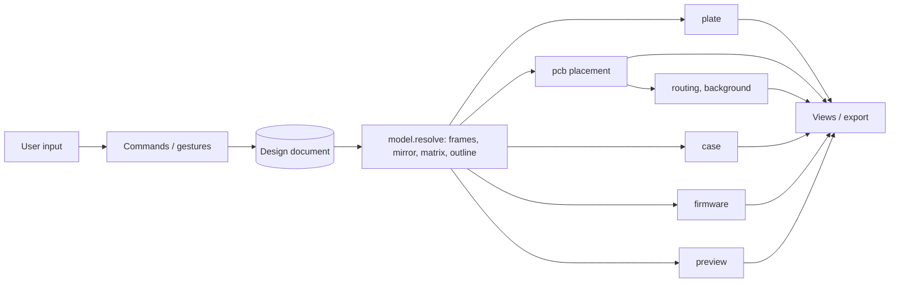
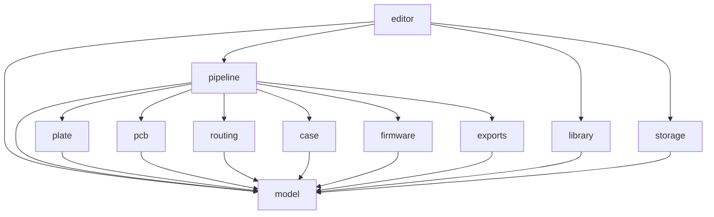
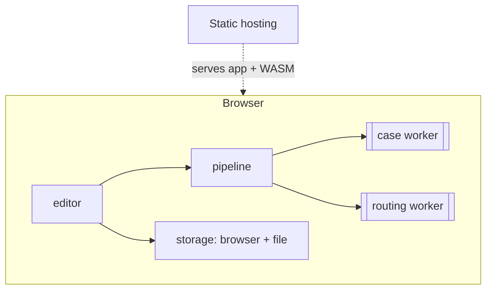

# Architecture Spine: keeb-cad, layout model and generation core

**Principles (they bind every AD):** explicit over terse · one way to do each thing · a small, coherent set of concepts.

## Glossary

Each term means exactly one thing. Code, file format and UI use these words and no synonyms.

| Term | Meaning |
| --- | --- |
| **design** | One keyboard document; the only source of truth |
| **revision** | The content hash of a design's canonical file |
| **node** | Any element of the design tree (group, sequence, slot) |
| **id** | A node's stable identifier; never changes after creation, survives renames and moves |
| **side** | A top-level group for one hand (`left`, `right`) |
| **side mode** | `reversible` (one geometry for both sides) or `mirrored` (derived copy + overrides) |
| **anchor** | The reference node + attach point whose **full frame** (position + rotation) a node's offset is applied in |
| **attach point** | A named point on a node's footprint rectangle (`center`, `edge-top/bottom/left/right`, `corner-tl/tr/bl/br`) |
| **offset** | A node's local x, y, rotation (and pivot), applied in its anchor's frame |
| **pivot** | The point a rotation turns around, given in the node's own frame before rotation. Used for nothing else. |
| **sequence** | An arrangement: each child is placed after the previous one by a **step** |
| **step** | Pitch along the sequence direction, plus gap, then the child's own offset, all in the previous child's frame |
| **free** | An arrangement whose children are placed independently, each by its own anchor and offset |
| **gap** | Extra distance along the sequence direction before a child |
| **index** | A child's position within a sequence |
| **slot** | A leaf with a size (`w`×`h`, default `1u`×`1u`) that holds one part |
| **part** | What a slot holds: a catalogue entry (switch cell, encoder, MCU module, battery, power switch, reset, screw) or `empty` |
| **catalogue** | The set of available part definitions (footprint, minimum pitch, pins, 3D envelope) |
| **switch cell** | A user-defined key template stored in the design: switch type + diode + LED placement + optional stabiliser + per-key tracks |
| **pitch** | Centre-to-centre key distance, `pitch-x` / `pitch-y`; a design setting, independent of switch type |
| **override** | A named change applied to the derived side (swap part, remove, offset, or populate) |
| **matrix** | The electrical model: each switch's row, column, diode direction, net names, and MCU pin roles |
| **board outline** | The derived polygon(s) that bound a side; shared by plate, pcb and case |
| **block** | A reusable, versioned design fragment from the library |
| **command** | A named, undoable operation; the only way a design changes |
| **gesture** | A continuous interaction (a drag) expressed as begin, update(s), and then commit or cancel |
| **resolved design** | The design with every node's world frame, the mirrored side, matrix and board outline computed |
| **stage** | A pure function from the resolved design to one output |
| **derived output** | Anything a stage produces: plate, PCB, case, firmware, preview, exports |

## Design Paradigm

**Single source of truth, with derived views.** The design document is the only state. `model` resolves it once into a **resolved design**. Every output is a pure, cached function of that. Interaction happens in an imperative shell (`editor`) that changes the design **only** through commands.



## Invariants & Rules

### AD-1: One document, derived outputs [ADOPTED]
- **Binds:** all
- **Prevents:** outputs drifting from the model; hand edits lost on regeneration.
- **Rule:** The design document is the only persisted design state. Every output is derived from it and is never edited inside keeb-cad. Changes that the model can't express are made after **export**, and the exported copy no longer syncs.

### AD-2: Changes only through named commands and gestures [ADOPTED]
- **Binds:** model, editor, library updates
- **Prevents:** ad-hoc mutation; broken undo; drag previews computed outside the design; undo floods.
- **Rule:**
  - Every change is a named command in `model` (e.g. `moveSlot`, `setGap`, `insertBlock`, `applyOverride`, `applyBlockUpdate`), and nothing else writes to the design.
  - A drag is a **gesture**: `begin`, `update`…, then `commit` or `cancel`. Each `update` produces a new revision that the live stages consume.
  - A committed gesture is **one** undo entry.
  - Background stages start only on commit, or after the drag has been idle for a debounce interval.
  - The command log is not persisted. The design file holds state, not history.

### AD-3: Placement = anchor frame + offset [ADOPTED]
- **Binds:** model, every stage
- **Prevents:** two placement semantics (Ergogen-style `affect`, cascade, cumulative magic).
- **Rule:**
  - The tree defines ownership.
  - A node's world frame is: anchor frame → translate by offset → rotate by offset rotation about pivot. This is the single order of operations.
  - Anchors always use the full frame; there is no position-only mode. To keep a node level, set a cancelling rotation.
  - Only children of a `free` group, top-level groups, and inserted blocks may set an anchor. The default anchor is the parent.
  - The anchor graph is acyclic. The model rejects cycles.
  - Anchors reference nodes by **id**, never by path.

### AD-4: Exactly two arrangements [ADOPTED]
- **Binds:** model, editor
- **Prevents:** overlapping layout mechanisms; losing per-column stagger and splay (Corney, LambBT).
- **Rule:**
  - **sequence** has a direction (`+x` or `+y` of its own frame).
  - **The step rule:** child *n*'s frame is child *n−1*'s frame, moved one pitch plus `gap` along the direction, then transformed by child *n*'s offset (x, y, rotation about pivot). This expresses accumulated stagger and splay explicitly.
  - **free:** each child is placed by its own anchor and offset.
  - **Units:** `u` on the x axis means `pitch-x`, and `u` on the y axis means `pitch-y`.
  - **Dragging:** dragging a sequence child changes that child's step, and the children after it follow. Alt-drag also compensates the next step, so the children after that stay put.
  - Empty slots keep their index and still advance the sequence.

### AD-5: Slots hold catalogue parts; pitch is independent of switch type [ADOPTED]
- **Binds:** model, library, pcb, plate, case, firmware
- **Prevents:** spacing hard-wired to switch type (Corney Island uses Choc at 19mm); keys and add-ons modelled differently; two owners of part data.
- **Rule:**
  - Every leaf is a slot holding one part.
  - `model` owns the **catalogue schema**: footprint reference, minimum pitch, pins and roles, 3D envelope. `library` owns the **catalogue data**. Switch cells are stored in the design.
  - Switch type defines the minimum pitch. Pitch (`pitch-x`, `pitch-y`) is a separate design setting. Pitch below the minimum is a violation, never silently adjusted.
  - Lengths carry an explicit unit: `u` or `mm`. Angles are in `deg`.
  - **Milestone-1 catalogue:** MX, Choc v1 and Choc v2 switches; stabilisers for wide keys (2u, 6.25u, 7u); one wired and one wireless (nice!nano-class) MCU module; battery connector; power switch; reset button; EC11 encoder; M2 screw.
  - **Wide keys:** slot width ≥ 2u requires a stabiliser. The switch cell places it, and plate, pcb and case all honour its cutouts.

### AD-6: Side mode and mirror derivation [ADOPTED]
- **Binds:** model, every stage
- **Prevents:** stages mirroring differently; override targets drifting; ad-hoc asymmetry.
- **Rule:**
  - **Only `model.resolve` mirrors, and every stage consumes the result.**
  - `reversible`: one geometry is used for both sides. Only `populate` overrides are allowed (which part is fitted on which side).
  - `mirrored`: the right side is derived from the **resolved** left side by reflecting across the y-axis of the frame of the design's top-level group with id `center`. Derived ids are `mirror:<left-id>`. Attach points swap left and right (`corner-bl` ↔ `corner-br`, `edge-left` ↔ `edge-right`). Overrides (swap part / remove / offset / populate) target `mirror:` ids.
  - There is no other asymmetry mechanism.

### AD-7: Coordinates [ADOPTED]
- **Binds:** model, every stage
- **Prevents:** flipped or mirrored outputs from mixed conventions.
- **Rule:** The model uses mm, degrees, **y up**, counter-clockwise positive. Each stage converts to its target's convention at its own output boundary (KiCad and SVG flip y). The model never encodes an output's convention.

### AD-8: Design file = canonical KDL v2, versioned, with stable ids and provenance [ADOPTED]
- **Binds:** model, library, storage, editor
- **Prevents:** noisy diffs, failed block merges, unreadable old files, format lock-in.
- **Rule:**
  - Designs and blocks are KDL v2 files carrying a `format-version`. `model` validates them and migrates older versions forward on load.
  - **The canonical writer lives in `model`.** It sets the node and property order itself (it doesn't rely on the parser's formatter), writes lengths and angles as quoted strings (`"19mm"`, `"-15deg"`), and canonicalises numbers.
  - Loading and then saving an unchanged design reproduces the file byte for byte.
  - Free-text comments are not preserved. Annotations use a `note` property.
  - Every node has a stable `id`, minted by `model` (kebab-case, unique per design, never reused). Every inserted block records its source block id, version and licence.
  - The file format doesn't depend on any storage backend.

### AD-9: Blocks are copied, with pullable updates [ADOPTED]
- **Binds:** model, library, editor
- **Prevents:** remixes silently changing under the user; updates overwriting local edits.
- **Rule:**
  - Inserting a block copies it into the design and anchors its root.
  - Node ids inside an inserted block are `<instance-id>/<block-node-id>`, and stay stable across block versions.
  - The design embeds an untouched **base copy** of each inserted block version, so every design file is self-contained for merging, whatever library it meets.
  - Pulling an update is a three-way merge (embedded base, new version, local edits) keyed by id. After a successful merge, the base copy is replaced by the new version. Conflicting changes to the same property are surfaced to the user, never auto-resolved.

### AD-10: Package dependency direction and shared derivations [ADOPTED]
- **Binds:** all packages
- **Prevents:** stages coupling to each other; UI framework leaking into the core; each session inventing its own resolved shape.
- **Rule:**
  - Dependencies point only as drawn below. Stages depend on `model` only, and never import each other.
  - **Stage signature:** `(resolved: ResolvedDesign) → { output, violations[] }`. `ResolvedDesign` is defined in `model`.
  - **Shared derivations live in `model.resolve`, and only there:** world frames, the mirrored side, the matrix, the board outline, and catalogue lookup.
  - **The one stage-to-stage flow:** `pipeline` passes pcb placement output to routing. Routing still imports only `model`.
  - Only `editor` imports Vue. Nothing imports `editor`.
  - **Enforcement:** pnpm strict dependencies, plus dependency-cruiser rules in CI.



### AD-11: Live vs background stages; revisions and cache keys [ADOPTED]
- **Binds:** pipeline, editor, stages
- **Prevents:** a UI that blocks on slow geometry; stale outputs shown as current; cache misses across anchors.
- **Rule:**
  - **Live** (synchronous, so they update while dragging): resolve, plate, firmware, pcb **placement**, and the 2D preview.
  - **Background** (Web Workers): case (replicad) and routing. They report progress and partial or failed results, and a newer revision cancels them.
  - **Deliberate narrowing of the forged idea:** the case updates in the background, not live (accepted 2026-10-24).
  - A **revision** is the content hash of the canonical file. A stage's cache key covers the subtree it reads, plus its anchor closure, plus the global settings it reads.
  - Every output is tagged with its revision, and the UI never shows an older revision's output as current.

### AD-12: Routing is one background stage, browser-only [ADOPTED]
- **Binds:** pcb, routing, pipeline
- **Prevents:** routing logic scattered across stages; hand-edited traces.
- **Rule:**
  - Routing takes pcb placement output plus switch-cell tracks, and returns tracks plus a list of unrouted nets.
  - Its result is derived and never hand-edited.
  - The UI always shows the unrouted count.
  - Any engine sits behind this one stage interface.
  - The engine runs in a Web Worker inside the browser. No helper program, no server.
  - **Fallback:** whatever the engine can't route is reported as unrouted and finished in KiCad after export (AD-1 escape hatch).

### AD-13: Storage behind one interface; milestone 1 is local-only [ADOPTED]
- **Binds:** editor, storage, library
- **Prevents:** a hard dependency on any service; premature server, account or publishing work; tabs overwriting each other.
- **Rule:**
  - All persistence goes through the `storage` package interface: `save`, `load`, `listVersions`.
  - Milestone 1 implements browser autosave and file Save/Open.
  - The block library ships bundled with the app.
  - No network calls are needed to design, remix or export.
  - One tab edits a design at a time; other tabs open it read-only.

### AD-14: The matrix is owned by `model` [ADOPTED]
- **Binds:** model, pcb, routing, firmware
- **Prevents:** a PCB wired one way and firmware scanning another.
- **Rule:**
  - `model.resolve` produces the one matrix: row/column per switch slot, diode direction, net names, key order, and MCU pin roles.
  - pcb, routing and firmware consume it, and none of them derives its own.
  - **Assignment rule:** for each switch slot, the nearest enclosing sequence running along *x* (in its own frame) gives the column index, and the nearest running along *y* gives the row index. Column-staggered and row-staggered boards both follow this rule without configuration.
  - Slots that aren't inside an x+y pair (thumbs, free parts) go into an additional row in sequence order.
  - Any slot's row/column can be overridden. Overrides are stored in the design. A future matrix optimiser must be a command that writes overrides.
  - A cross-stage golden test asserts that the firmware matrix equals the PCB nets.

### AD-15: Exports [ADOPTED]
- **Binds:** exports, plate, pcb, case, firmware
- **Prevents:** each stage inventing its own export set.
- **Rule:** Milestone-1 exports:
  - plate: DXF and SVG
  - case: STEP and STL
  - PCB: a KiCad 10 project (board plus schematic)
  - firmware: a ZMK shield (including the `zmk,physical-layout` node) and a QMK `keyboard.json`

  Exports are deterministic. Gerbers are produced from the KiCad project outside keeb-cad.

## Consistency Conventions

| Concern | Convention |
| --- | --- |
| Naming | Glossary terms only. Packages: `@keeb-cad/<name>`. KDL node names are lowercase glossary terms. Commands are verb+noun camelCase (`setGap`). |
| Ids | Kebab-case, minted by `model`. Block nodes: `<instance-id>/<block-node-id>`. Mirrored nodes: `mirror:<left-id>`. |
| Units in files | Quoted with an explicit unit: `"19mm"`, `"1u"`, `"-15deg"`. |
| Errors and violations | Stages return `{ output, violations[] }`. Violations (`pitch-below-min`, `overlap`, `unrouted`, `unresolvable-anchor`, `merge-conflict`) carry node ids. Design problems never throw. Commands that can't apply return a typed rejection. |
| Determinism | Same revision gives the same bytes for every export. No clocks, randomness, locale or UUIDs in outputs. Tool-generated ids (KiCad UUIDs) are derived from node ids. |
| Testing | The golden fixtures are Corney Island, LambBT and Corax56 (`fixtures/`, from `layout-model/sources/`). `resolve` must match their Ergogen key positions within 0.01mm. Every stage has golden-file tests. KiCad output must open in KiCad 10. A cross-stage matrix test enforces AD-14. |
| Editor state | UI state (selection, viewport, panels, gesture in progress) lives in Pinia and never in the design. The design store exposes `dispatch(command)`, the gesture API, and read access only. |
| Monorepo | pnpm workspaces and TypeScript project references. dependency-cruiser enforces AD-10 in CI. |
| Licences | `replicad-opencascadejs` is LGPL-2.1, served as an unmodified, dynamically loaded WASM; the notice ships with the app. Blocks carry their own licence (AD-8). |

## Stack

Verified 2026-10-24 (`stack-research.md`, reviewer re-check).

| Name | Version |
| --- | --- |
| TypeScript | ~6.0 |
| Vue | 3.5.44 |
| Vite | ^8.2 (8.3.5 current) |
| create-vue (TS, Router, Pinia, Vitest, Playwright, ESLint/Oxlint) | 3.24.0 |
| Pinia | ^4.0 (4.1.0 current) |
| vue-router | 5.4.0 |
| Vitest | ^4.1 (as the starter ships; 5.x upgrade deferred) |
| pnpm | 12.15.0 |
| dependency-cruiser | 18.7.0 |
| replicad / replicad-opencascadejs | 1.2.0 / 1.1.0 |
| @bgotink/kdl (KDL v2) | 0.4.1 |
| @tarikjabiri/dxf | 2.9.0 |
| clipper2-ts | 2.0.1-18 (pinned exactly) |
| KiCad target (board format 20260206) | 10.0.x |
| ZMK target | v0.3.0 |
| QMK target (`keyboard.json`) | 0.34.x |

## Structural Seed

```text
keeb-cad/
  packages/
    model/      # glossary types, KDL schema + canonical writer + migrations, resolve (frames, mirror, matrix, outline), commands, merge, catalogue schema
    plate/      # stage: plate geometry
    pcb/        # stage: placement + KiCad writer
    routing/    # stage: routing (worker)
    case/       # stage: replicad case (worker)
    firmware/   # stage: ZMK shield + physical layout, QMK keyboard.json
    exports/    # stage: file packaging (DXF, SVG, STEP, STL, KiCad, firmware)
    pipeline/   # orchestration, caching, workers, revision tagging
    storage/    # storage interface + browser/file backends
    library/    # bundled blocks (.kdl) + catalogue data + licences
    editor/     # Vue app (create-vue)
  fixtures/     # golden boards (Corney Island, LambBT, Corax56)
```



## Deferred

| Decision | Why it can wait | Revisit when |
| --- | --- | --- |
| Routing engine choice (must be browser-runnable) | Hidden behind AD-12 | Spike on a real board, scheduled first; it also tests pre-routed MCU zones |
| KiCad writer: `kicadts` (0.0.x) vs own writer | Hidden inside `pcb` | First pcb story; decide by whether KiCad 10 opens the output |
| Fast 3D preview (manifold-3d) | Background case accepted (AD-11) | If case latency hurts in use |
| Publishing, shared library, accounts, git/cloud backends | Milestone 1 is personal (AD-13) | Milestone 2 |
| Static hosting provider, CI/deploy pipeline, environments | No backend; any static host works | Before the first public preview |
| Offline use (caching the ~7 MB WASM), supported-browser matrix | Personal use first; target current Chromium and Firefox | Before the first public preview |
| Gerbers inside keeb-cad | Produced from the KiCad project (AD-15) | Milestone 2 |
| Averaged anchors | No milestone-1 board needs them in the key tree | When screw or aux placement needs them |
| Ergogen config import | Follow-on | After check 2 passes |
| Row-staggered board golden fixture | Model supports row stagger (AD-4, AD-14), but milestone 1 doesn't validate it | Before claiming row-board support |
| Drag-handle UX and switch-cell editor UI | Editor-level design | UX pass before editor stories |
| `mirrored` side mode against a real board (Heatwave) | Milestone boards are reversible | Before the first mirrored design |
| Turborepo, Vitest 5, TS 7, Vue 3.6 | Not needed yet / tooling not ready | When speed hurts / create-vue supports them |
| Study the community "Shield Wizard" | Prior art | First firmware story |
