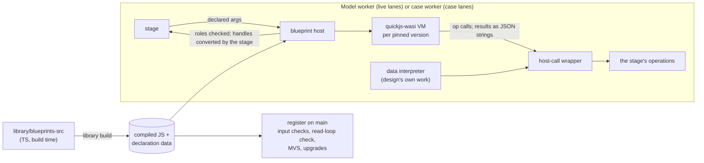

# Architecture Spine — blueprints

## Design Paradigm

**Sandboxed plain functions over host calls.** A pinned blueprint version is compiled once into a factory inside its own sandbox VM. Each lane run calls the factory for a fresh instance and runs one lane function: it receives its declared inputs, pulls and queries as arguments, calls its stage's operations, which run synchronously on the same thread, and returns its declared, role-tagged outputs. Nothing survives between runs. Live lanes run in the model worker, case lanes in the case worker (initiative spine AD-11). Main never runs blueprint code; it reads only declarations, as data.

## Inherited Invariants

| Inherited | From parent | Binds here |
| --- | --- | --- |
| AD-18 | initiative spine | One blueprint concept; lanes per stage; pull, never push; code in a hermetic, deterministic sandbox with a step budget; the data form for the design's own work; nesting by `use()` in the same lane and sandbox |
| AD-11 | initiative spine | Live lanes run in the model worker after each applied command, never per drag frame; the visible set within 100 ms; a library blueprint's lane reads only inputs, pulls and queries; failed lanes show their last good output stale with `lane-failed`; stage cache keys and fingerprints |
| AD-10 | initiative spine | `blueprint` imports only `geometry`, `expr`, `schema` and `hashing`; only `blueprint` imports quickjs-wasi; the data interpreter imports `expr`'s evaluator directly; the `blueprint/authoring` build-time path and its fences; the lane runner, lane cache and VM pool in `blueprint/worker` |
| AD-25 | initiative spine | Per-thread `di` modules and entry fences: main never reaches `blueprint`, a stage or the runtime |
| AD-5 | initiative spine | Versions immutable and pinned; minimal version selection for nested pins; every part blueprint has exactly one `rectangle` |
| AD-3, AD-17, AD-24, AD-2 | initiative spine | One acyclic graph with declared reads as edges, checked on main; expressions only through `expr`'s evaluator; references a declared kind; commands the only writers |
| Data Schema: `BlueprintDeclaration` | initiative spine | The declaration's shape (`uses` and the `envelope` output kind included) and its checks |

## Invariants & Rules

### BP-1 — Calls: operations run as they are called

- **Binds:** blueprint, model, plates, pcb, firmware, case, library
- **Prevents:** two evaluation styles; a dataflow language grown to avoid measuring; asynchronous host calls inside a lane.
- **Rule:**
  - Blueprint code calls its stage's operations; each runs on the host when called, synchronously, on the lane's thread, and returns a result the code may use and measure. Geometry stays on the host; the sandbox holds integer handles.
  - Every host call goes through **one host-call wrapper** in `blueprint`. Results cross into the guest as **one JSON string**, never built through the engine's object API; the data interpreter (BP-10), which runs on the host, calls the operations directly.
  - Nothing a lane needs is asynchronous: assets and other declared values are resolved before the run.

### BP-2 — Engine: quickjs-wasi [ADOPTED]

- **Binds:** blueprint
- **Prevents:** one trap taking down every blueprint.
- **Rule:** The runtime is quickjs-wasi, pinned exactly (initiative spine, Stack); only `blueprint` imports it. Detecting a pending job uses its internal `qjs_is_job_pending` export; a contract test covers it and runs on every version bump. The app carries QuickJS-NG's and wasi-libc's licence notices.

### BP-3 — Determinism: a fresh instance in an allow-listed, frozen scope

- **Binds:** blueprint
- **Prevents:** state surviving between runs; output depending on call history; guest code running while the host reads a failure; host details leaking in.
- **Rule:**
  - Each pinned version is compiled once into a **factory**, kept apart from the boundary code; every run calls it for a fresh instance.
  - The global scope is an **allow-list**: the ECMAScript built-ins minus `Date`, `Math.random`, `WeakRef` and `FinalizationRegistry`, plus the frozen blueprint API. Everything else is deleted, then intrinsics and globals are frozen and the global object made non-extensible; blueprints run in strict mode. A test walks every reachable global against the list.
  - Every VM has `maxStackSize` 256 KiB and a fixed WASI clock and random source.
  - The boundary wraps each lane call and each `use()` in `try/catch`, converts a throw with `String()` inside the run's budget and returns `{ failed: <message cut at 500 characters> }` as JSON. The host never reads a guest error object; it throws only message strings into the guest.
  - A returned value JSON can't carry exactly (`NaN`, `±Infinity`, `undefined`, a function) is a typed failure. The result decode is strict: an empty or unparsable result is a failure. No promise job outlives a run.

### BP-4 — Budgets

- **Binds:** blueprint, pipeline, editor
- **Prevents:** runaway code or allocation stalling a worker; a slow blueprint nobody can point at; a nondeterministic limit.
- **Rule:**
  - **Steps:** 100 interrupt-handler calls per run (about one per 5,000 simple loop iterations; the minimal key uses 1), pinned by a test. The step budget bounds bytecode only. The count may differ by one with call history; that is an accepted limit.
  - **Memory:** every VM has a `memoryLimit` of 64 MiB, pinned by a test. Out of memory is a typed failure. A VM whose memory has grown past 48 MiB is replaced in the next pause. The lane cache is LRU with 500 entries. The app's blueprint API version is 1; 13.17 records the two Deferred items (out of memory from earlier garbage, 2D/3D handle tags) without code.
  - **Host work:** no budget. The worker records each lane run's time for attribution only: the status strip's running stage names the blueprint, the Inspector shows a lane's last run time. Times never decide an output.

### BP-5 — Each lane run is a cached unit

- **Binds:** blueprint, pipeline
- **Prevents:** a stage rerunning every lane for one slot's change; caching a failure that depends on timing.
- **Rule:**
  - The **lane runner** lives in `blueprint/worker`; it owns the per-run lane cache, which is memory-only and never persisted. The case worker loads it without `model`.
  - A lane run's cache key is the stage and its version, the blueprint version, the transitive closure of its pinned `uses` and the hash of exactly the arguments it receives, each in its resolved canonical form: quantities, options and text by value; a part ref by the referenced part's content hash (blueprint version plus inputs); an asset by its content hash; a pull by the pulled output's content hash, `count: any` pulls ordered by producer id; an anchor by its resolved frame. Identical runs share one entry. A stage receives only lane outputs, never runs blueprint code, and keeps its own AD-11 cache key.
  - A **deterministic** failure (a throw, the step budget, out of memory, a non-JSON-exact value, an undeclared or missing role, a pending job) is cached like a success: it reruns only when the key changes. Its last good output shows stale with `lane-failed`, carrying the stable message.
  - A lane whose VM is gone (dropped mid-stage after a trap or a pending job) is skipped, marked `unavailable` and **never cached**; it reruns in the next pause. Only the run that trapped is cached.

### BP-6 — Nesting

- **Binds:** blueprint, library, model
- **Prevents:** a nested blueprint seeing its caller's state; nested versions decided at run time; a caller's reads changing with a nested upgrade.
- **Rule:** A declaration lists its `uses` (`{ id, minVersion }`). Adding or upgrading a blueprint runs minimal version selection on main over the `uses` graph and writes the pins into `library-versions`; the worker runs only pinned versions. `use(id, inputs)` calls the nested factory for a fresh instance in the caller's VM, lane and handle table; a `use()` of an id not in `uses` fails the run. A nested blueprint receives only the inputs its caller passes; an omitted input takes its declared default; a bad one fails the run with the cause "nested input", naming the blueprint and the input. It has no pulls or queries of its own. `use()` returns the nested lane's checked `{ outputs, problems }`; nested problems join the caller's, naming the nested blueprint. The library build rejects a `uses` cycle, a `uses` target that declares pulls or queries, and a visible `use()` of an id not in `uses`.

### BP-7 — Authoring: TS compiled at library build

- **Binds:** library, blueprint, schema
- **Prevents:** a compiler in the app; a declaration that disagrees with its code; main reaching `blueprint` through `library`.
- **Rule:**
  - Milestone 1 blueprints are TS sources in `library/blueprints-src/`, which import only `blueprint/authoring` (initiative spine AD-10). Each is one `export default defineBlueprint({ id, version, inputs, uses, lanes: { <stage>: { pulls, queries, outputs, run(args, op) } } })`; the declaration types `args` and `op`.
  - The library build type-checks it, validates the declaration with the schema in `schema`, and splits it into a self-contained script (bundled, no imports, evaluating to `{ lanes: { <stage>: run } }`) and the declaration as JSON; a round-trip test checks the script's lane names against the declaration's. Declaration data ships from `library`'s main subpath; scripts only from `library/worker`, which only the model and case worker entries import. Main never carries blueprint code, even as text.
  - The declaration's schema lives in `schema`; the host receives declarations already validated, as plain data. The query list and the API version live in `blueprint` and are checked in the worker.

### BP-8 — The lane contract

- **Binds:** blueprint, every stage that runs lanes, library
- **Prevents:** undeclared reads; lanes reaching another stage's operations; two ways outputs return to a stage.
- **Rule:**
  - A module exports `lanes = { <stage>(args, op) }`. `args = { inputs, pulls, queries }` holds exactly what the declaration lists: inputs as plain values (quantities as numbers in mm or deg; options and text as strings; part refs, anchors and assets as opaque handles), pulls as handles keyed by role (an array per its count), query results as plain values. An anchor input can't feed a `parts` lane (it runs before the layout); the library build rejects one. `op` exposes only that stage's operations.
  - A lane returns `{ outputs: { <name>: handle | plain | array }, problems: [{ message, severity }] }`. A part's `rectangle` output is plain `{ w, h }`, centred on the slot's frame (initiative spine AD-5). The host checks each output against its declared name and `count` (`one` or `any`, which may be empty); `problems` become `blueprint` violations naming the entry and slot. The stage converts each handle into its output type in `schema`; the run's handles are then freed.

### BP-9 — VM lifecycle

- **Binds:** blueprint, model, plates, pcb, firmware, case, library
- **Prevents:** VM creation inside a synchronous stage; VMs that outlive their pins; leaked handles.
- **Rule:**
  - One VM per pinned blueprint version, holding its factory and the factories of the transitive closure of its pinned `uses`; a pin change that alters a nested version means a new VM.
  - A pool in `blueprint/worker`, one per worker, filled by the lane runner: in the model worker in its pause between applying patches and running stages; in the case worker before case lanes, rebuilt after a respawn. Each stage passes its operation table and handle converter to the runner as arguments on each lane run (`runner.runLane(lane, { operations, convertHandle }, inputs)`): `model/worker` for `parts`, `shapes` and `extras`, `plates`, `pcb` and `firmware` in the model worker, `case` in the case worker. No tokens and no entry wiring; the runner keeps the pool, the lane cache and the VM lifecycle. The compiled scripts reach the pool as an argument from the worker entry, which reads them from `library/worker` (initiative spine AD-10).
  - One handle table per lane run, owned by the host and shared by nested `use()` calls, freed at the run's end, including quickjs-wasi's internal handle copies.
  - A VM is disposed when its version is no longer pinned in the current design.

### BP-10 — The data form uses the same operations

- **Binds:** blueprint, expr
- **Prevents:** a second implementation of operations for the design's own work.
- **Rule:** The data-blueprint interpreter (in `blueprint`, evaluating with `expr`'s evaluator against its own inputs) walks the design's own work and calls the same stage operations through the same host-call wrapper. It needs no sandbox, runs on the lane's thread and is cached per lane run. Its syntax is decided with the first outline story.

## Consistency Conventions

| Concern | Convention |
| --- | --- |
| Failure kinds | `lane-failed` names the entry, the slot and its cause (a throw with its message, the step budget, out of memory, a non-JSON-exact value with its path, a pending job, an undeclared or missing role); `unavailable` is transient and uncached; `blueprint-input-invalid` comes from main; `blueprint-api-too-new` and an unknown query from the worker (initiative spine, Violations) |
| Host API | Every operation is defined once in `blueprint` (signature and JSON result shape) and implemented by the stage that owns the lane (AD-18) |
| Verification | Per host: a stateful blueprint gives the same output for the same input; a runaway stops at the step budget; an allocation loop fails out of memory, typed; unbounded recursion fails typed; the global allow-list test; a throwing getter never runs on the host; a nested blueprint can't see its caller; the pending-job contract test. At library build: every declaration validates and every part blueprint declares one `rectangle` |

## Deferred

| Item | Why it can wait | Revisit |
| --- | --- | --- |
| A host-work counter in the host-call wrapper (charge 1 + the vertex count of the handles passed; past a budget the call throws and the lane fails) | Milestone 1 blueprints are the app's own; attribution shows a slow one; adding it changes only the wrapper | Third-party blueprints |
| The blueprint operation list | Owned by the first tray-case story (initiative spine, Open Questions) | First tray-case story |
| Nets and pin-role joins in the declaration | Typed with `PinRole` in the netlist work (AD-14) | First PCB story |
| The data form's syntax | Decided with the outline primitives | First outline story |
| In-app TS compilation | No user-authored blueprints in milestone 1 | Milestone 2 authored blueprints |
| Out-of-memory results that depend on garbage left by earlier runs; data-form failure kinds and keys; tagging handles as 2D or 3D; when case lanes rerun (review-adversary-rerun-2026-11-01.md) | Each first matters in a later story | Story 17 (out of memory, handle tags); the first outline story (data form); the first tray-case story (case reruns) |
| Absolute timings and memory probes in a browser worker on AC | The spikes ran on battery and the memory probes in Node; rankings hold | Story 17, before a number becomes a budget |

## Working material

Drawn before the calls and model-worker decisions; out of date, kept as history: `blueprint-sketches-2026-11-01.md`, `blueprint-interactions-2026-11-01.html`, `blueprint-walkthrough-2026-11-01.html`.
